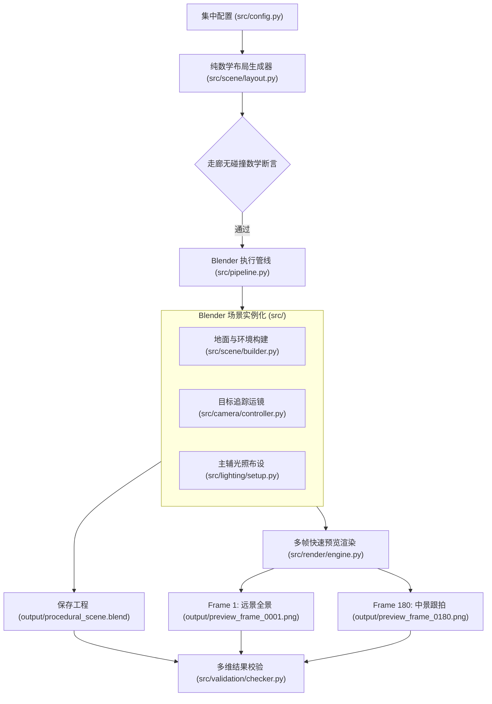
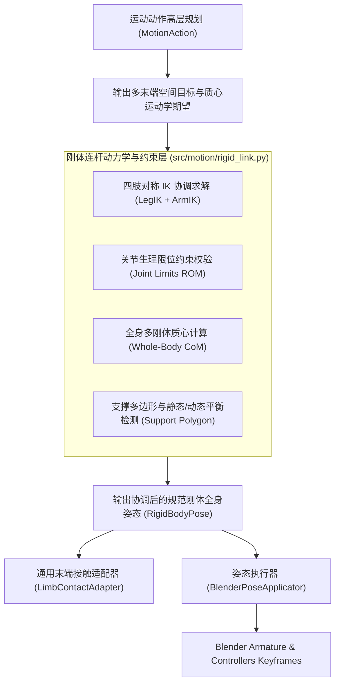

# ARCHITECTURE: 系统架构与模块设计蓝图

> [!NOTE]
> 当前阶段已完成【任务 3：程序化三维场景、灯光与摄像机基础系统】。已建立世界坐标约定、程序化地面/环境元素、角色走廊净空算法、双光源照明与摄像机追踪关键帧系统。

---

## 1. 统一世界坐标约定 (World Coordinate Conventions)

为了确保各子系统（地面、环境障碍、未来角色、骨骼、动画状态机与摄像机追踪）能够严丝合缝地协同工作，全项目确立并执行以下不可冲突的物理世界坐标规范：

* **坐标轴定义**：
  * **$Z$ 轴向上**（+Z 指向天空，-Z 指向地心）。
  * **$X$ 轴向右**（+X 指向东方/画面右侧）。
  * **$Y$ 轴向前**（+Y 指向北方/深度纵深前进方向）。
* **地面基准参考面**：
  * **地面顶表面严格处于 $Z = 0.0\text{ m}$**。
  * 地面厚度向下延伸至负 Z 区域（例如厚度为 $0.2\text{ m}$ 的地台，其中心处于 $Z = -0.1\text{ m}$，底面在 $Z = -0.2\text{ m}$，顶面精准处于 $Z = 0.0\text{ m}$）。
  * 角色站立时脚底与地面接触面严格基准为 $Z = 0.0\text{ m}$。
* **物理度量单位**：
  * 全系统统一采用**米 (Meters)** 为基础长度单位。
* **角色预留走廊与运动空间约定**：
  * **初始站立区 (Stand Area)**：$(0.0, -8.0, 0.0)$，半径 $1.5\text{ m}$。
  * **行走主走廊 (Walking Segment)**：从 $(0.0, -8.0, 0.0)$ 沿 $+Y$ 直线前行至 $(0.0, 0.0, 0.0)$。
  * **减速与转身区 (Turn Area)**：中心在 $(0.0, 0.0, 0.0)$，半径 $2.0\text{ m}$。
  * **离场轨迹 (Exit Segment)**：从 $(0.0, 0.0, 0.0)$ 转向并迈步至 $(3.5, 7.0, 0.0)$。
  * **安全净空缓冲带宽 (Corridor Clearance)**：沿走廊全长保持 $\ge 2.4\text{ m}$ 净空半径，程序化布局生成器严格禁止任何环境障碍物侵入该区域。

---

## 2. 系统总体架构与数据流



---

## 3. 落地模块划分与职责

```text
ProceduralAnimation/
├── src/
│   ├── config.py             # 统一配置（FPS 24, 360帧, 1280x720, 走廊路径, 光照, 种子等）
│   ├── pipeline.py           # 端到端无头执行管线总调度
│   ├── scene/
│   │   ├── layout.py         # 纯 Python 确定性几何布局算法与点线距离走廊净空检查
│   │   └── builder.py        # Blender 场景、地台 (Z=0)、建筑体块与柱状障碍物实例化
│   ├── camera/
│   │   └── controller.py     # 摄像机 50mm 镜头、Track-To 观察目标与 360 帧关键帧运镜插值
│   ├── lighting/
│   │   └── setup.py          # 主光 (2500W暖光)、辅光 (800W冷光) 与世界环境天光
│   ├── character/            # 角色生成接口占位 (任务 4+)
│   ├── rig/                  # 骨骼控制接口占位 (任务 4+)
│   ├── motion/               # 连续动作状态机接口占位 (任务 5+)
│   ├── render/
│   │   └── engine.py         # Workbench 视口渲染引擎封装与多帧预览图输出
│   └── validation/
│       └── checker.py        # 空间约束 (Z=0)、净空断言、相机位移与分辨率多维校验
├── tests/
│   ├── test_task3_spatial.py # 空间种子确定性与走廊净空单测套件
│   ├── verify_task3_blend.py # 重新载入 .blend 场景对象多维校验器
│   └── ...
├── output/                   # 运行产物输出目录 (受 .gitignore 保护)
├── run_pipeline.py           # 宿主/Blender 双模执行脚本
└── run_pipeline.ps1          # PowerShell 一键触发脚本
```

---

## 4. 物理约束辅助的刚体连杆人体运动控制架构设计 (Task 6E 设计草案)

> [!NOTE]
> 本章节基于 Task 6E 针对现有源码的严格审计结果制定。系统坚持纯 Python 原生无外部重量级物理引擎依赖原则，采用**物理约束辅助的程序化动画（Physics-Constraint-Assisted Procedural Animation）**技术路线，不开发肌肉、肌腱或微观柔体物理仿真。

### 4.1 现有源码深度审计结论

1. **现有 19 根骨骼的几何与约束现状**（依据 [`src/rig/builder.py:25-50`](file:///c:/Users/64701/OneDrive/Desktop/ProceduralAnimation/src/rig/builder.py#L25-L50)）：
   * **骨骼层级**：单根 `root`（世界定位） $\rightarrow$ `pelvis`（局部游离，允许 $XYZ$ 移动与旋转） $\rightarrow$ 轴向串联 `spine` (0.48m) $\rightarrow$ `neck` (0.05m) $\rightarrow$ `head` (0.22m)；双侧分支挂载 `shoulder.L/R` (0.18m) $\rightarrow$ `upper_arm.L/R` (0.30m) $\rightarrow$ `forearm.L/R` (0.26m) $\rightarrow$ `hand.L/R` (0.10m)；骨盆双侧分支挂载 `thigh.L/R` (0.42m) $\rightarrow$ `shin.L/R` (0.40m) $\rightarrow$ `foot.L/R` (~0.154m)。
   * **局部轴约定**：所有骨骼纵向主轴（Head $\rightarrow$ Tail）固定为 Bone $+Y$；局部 $X$ 轴与世界 $+X$（右侧）对齐。局部 $X$ 轴旋转代表**矢状面俯仰/屈伸 (Pitch / Flexion-Extension)**；局部 $Y$ 轴旋转代表**纵轴扭转 (Twist / Rotation)**；局部 $Z$ 轴旋转代表**冠状面内收/外展 (Roll / Abduction-Adduction)**。
   * **自由度与限制现状**：所有骨骼均配置为 `XYZ Euler`。**当前 Armature 完全没有配置任何 `LIMIT_ROTATION` 约束**，缺失关节解剖学生理活动范围（ROM: Range of Motion）限制，关节安全目前仅靠上层生成逻辑的数学范围隐式保证。

2. **姿态控制独立性与固定曲线依赖现状**：
   * **独立控制能力**：[`src/rig/pose.py`](file:///c:/Users/64701/OneDrive/Desktop/ProceduralAnimation/src/rig/pose.py) 提供了 `set_bone_rotation()` 与 `set_bone_location()`，底层支持对任意骨骼的三维欧拉角与位移进行独立设置。
   * **现有动作的固定经验曲线现状**：在 Task 5A~6D 的所有动作实现中（`start_stop_walk.py`、`run_cycle.py`、`sprint_start.py`、`sprint_brake.py`），上半身姿态生成完全依赖硬编码的三角函数经验调制（例如骨盆下蹲起伏、前倾角度、双臂反向正弦摆动），头部与颈部仅以固定比例反向抵消脊柱旋转；`shoulder` 与 `hand` 骨骼在所有现有动作中从未被主动驱动（始终保持 0°）。

3. **左右手足末端目标支持情况**：
   * **双脚 (Foot_L / Foot_R)**：**完全支持**。在 [`src/rig/ik.py`](file:///c:/Users/64701/OneDrive/Desktop/ProceduralAnimation/src/rig/ik.py) 与 [`src/rig/foot_contact.py`](file:///c:/Users/64701/OneDrive/Desktop/ProceduralAnimation/src/rig/foot_contact.py) 中拥有独立的 `FootIK.L/R` 控制器及 `KneePole.L/R` 极向目标，支持独立的世界空间坐标与欧拉角设定、接触锁定、漂移测量与达程限幅。
   * **双手 (Hand_L / Hand_R)**：**完全不支持**。场景中不存在手部 IK 目标与极向目标物体，骨架中无手臂 IK 约束，无法在世界空间指定手部位置与旋转目标，目前仅能通过 FK 显式设置肩部与肘部欧拉角间接定位。

4. **现有机制可复用度**：
   * `src/rig/pose.py`（变换应用与查询）、`src/rig/ik.py`（极向约束算法、达程与防穿地检测）、`src/rig/foot_contact.py`（世界空间零漂移锁定与解锁）、`src/motion/framework.py`（`MotionState`、`MotionAction`、`MotionPlanner` 调度流水线）均具有高度通用性，可 100% 复用。
   * 双臂需对称扩展双骨骼 IK 链（`ArmIK` + `ElbowPole` + 手腕旋转复制），并将单侧足部锁定扩展为四肢通用接触锁定。

5. **物理力学模型现状**：
   * **完全缺失**：系统中**不存在**身体质量（Mass）、多连杆加权质心（Center of Mass, CoM）、转动惯量（Inertia Tensor）、摩擦锥（Friction Cone）及接触冲量/地反力（Impulse / GRF）模型。当前平滑加减速与姿态缓冲完全为运动学曲线规划。

---

### 4.2 现状能力三态分类矩阵

| 模块能力项 | 状态 | 源码依据 | 说明 |
| :--- | :--- | :--- | :--- |
| 19 根骨骼层级与刚性分段装配 | **已实现** | `src/rig/builder.py:25-50` | 5 躯干 + 8 双臂 + 6 双腿，层级清晰稳定 |
| 13 个网格部件与骨骼的一对一刚体绑定 | **已实现** | `src/rig/builder.py:58-72` | 刚性父级连接，保持 rest_world_matrix |
| 任意单骨骼局部三维姿态独立控制 | **已实现** | `src/rig/pose.py:34-68` | `set_bone_rotation` / `set_bone_location` |
| 双腿两骨骼 IK 求解器与膝关节极向引导 | **已实现** | `src/rig/ik.py:110-210` | `shin` $\rightarrow$ `thigh`, `KneePole` 引导 |
| 双脚独立世界坐标/旋转设定与达程保护 | **已实现** | `src/rig/ik.py:300-360` | `set_foot_ik_target`, 限幅 `[0.16, 0.82]m` |
| 双足世界空间零滑动锁定与漂移核验 | **已实现** | `src/rig/foot_contact.py` | 漂移 $< 0.04\text{ mm}$，支持动态解锁与重定父级 |
| 统一动作状态机与流水线调度器 | **已实现** | `src/motion/framework.py` | `MotionPlanner` / `MotionAction` / `MotionState` |
| 环境接触表面法线查询接口 | **仅有接口** | `src/motion/framework.py:290` | `EnvironmentQuery` 目前恒定返回 `(0, 0, 1)` |
| 四肢多接触点数据承载容器 | **仅有接口** | `src/motion/framework.py:166` | `ContactPointState` 声明支持手部，但无底层支撑 |
| 双臂两骨骼 IK 求解器与肘关节极向引导 | **未实现** | 缺失 `src/rig/arm_ik.py` | 尚无 `HandIK.L/R` 与 `ElbowPole.L/R` |
| 双手独立世界坐标与旋转目标控制 | **未实现** | 缺失对应控制器与约束 | 无法直接指定手部世界抓握/支撑目标 |
| 各关节生理活动范围限制 (Joint Limits / ROM) | **未实现** | 缺失关节限位数据与约束 | 存在极端姿态下关节反折穿帮隐患 |
| 连杆分段质量、转动惯量与质心 (CoM) 模型 | **未实现** | 缺失物理属性模块 | 无物理质心计算，无支撑平衡判据 (ZMP) |
| 接触面摩擦锥与简化物理冲量响应模型 | **未实现** | 缺失接触力学解算 | 完全依靠几何硬性锁定与运动学曲线驱动 |

---

### 4.3 物理约束辅助刚体连杆控制层定位与最小架构扩展

在现有分层架构中，新增**刚体连杆动力学与约束层 (Rigid-Link Dynamics & Constraint Layer)**，定位为高层动作决策（`MotionAction`）与底层骨骼姿态执行（`BlenderPoseApplicator`）之间的**物理几何约束中介层**：



#### 必须新增或扩展的最少模块划分：
1. **新增 `src/rig/arm_ik.py`**：
   * 对称复刻 `src/rig/ik.py`，建立双臂两骨骼 IK（`upper_arm` + `forearm` $\rightarrow$ `HandIK`，肘部极向目标 `ElbowPole`），提供 `set_hand_ik_target()` 与手部世界朝向控制，并内置臂长达程检测（上臂 0.30m + 前臂 0.26m = 0.56m 最大达程）。
   * 增加 IK/FK 无缝切换权重（`influence`），确保不破坏现有动作的纯 FK 摆臂。
2. **新增 `src/motion/rigid_link.py`**：
   * 人体刚体连杆数据结构与轻量级动力学校验纯 Python 库：
     - 定义人体 13 分段经验质量比率（Dempster 标准解剖数据）与局部几何质心。
     - 定义各关节生理屈伸/展收/扭转范围（`JointLimit`）。
     - 提供 `compute_whole_body_com(arm)` 实时根据当前姿态前向运动学计算全身物理质心世界坐标。
     - 提供 `clamp_joint_rotations(arm)` 关节超限安全防护。
3. **扩展 `src/rig/foot_contact.py`**：
   * 将现有的足部世界空间锁定机制泛化，增加对 `hand_L` / `hand_R` 的世界空间锁定与解锁支持，支持未来攀爬、撑越与伏地动作。
4. **扩展 `src/motion/framework.py`**：
   * `MotionState` 扩展暴露全身物理质心坐标 `com_world` 与速度；`ContactConstraintAdapter` 接入双手末端控制。

---

### 4.4 核心数据接口草案

```python
from dataclasses import dataclass, field
from typing import Dict, Optional, Tuple
from mathutils import Vector

@dataclass(frozen=True)
class RigidSegmentSpec:
    """单个刚体连杆的几何与惯性规范（纯数据，零外部依赖）。"""
    name: str                           # 连杆名称（如 "Torso", "UpperLeg_L"）
    bone_name: str                      # 对应绑定的骨骼名称（如 "spine", "thigh.L"）
    mass_ratio: float                   # 占全身质量的经验比率（Dempster 系数，总和为 1.0）
    length: float                       # 连杆几何长度 (m)
    local_com_offset: Tuple[float, float, float]  # 连杆质心相对于 Bone Head 的局部坐标 (m)
    box_dimensions: Tuple[float, float, float]    # 占位几何外轮廓尺寸 (dx, dy, dz) (m)

@dataclass(frozen=True)
class JointLimitSpec:
    """单个关节局部三维欧拉角生理活动范围限制（Degrees）。"""
    bone_name: str
    pitch_range_deg: Tuple[float, float]  # 矢状面屈伸范围 (Min, Max) [Bone Local X]
    twist_range_deg: Tuple[float, float]  # 纵轴内外旋范围 (Min, Max) [Bone Local Y]
    roll_range_deg: Tuple[float, float]   # 冠状面内收外展范围 (Min, Max) [Bone Local Z]

@dataclass(frozen=True)
class EndEffectorTarget:
    """独立末端执行器（手/足）的空间运动目标。"""
    limb: str                                     # "foot_L", "foot_R", "hand_L", "hand_R"
    target_world_xyz: Tuple[float, float, float]  # 期望世界坐标 (m)
    target_rotation_deg: Optional[Tuple[float, float, float]] = None  # 期望目标朝向 (deg)
    pole_world_hint: Optional[Tuple[float, float, float]] = None      # 关节极向引导坐标
    is_locked_contact: bool = False               # 是否需要严格世界空间零漂移锁定
    surface_normal: Tuple[float, float, float] = (0.0, 0.0, 1.0)      # 接触面法线

@dataclass
class WholeBodyPoseSpec:
    """刚体连杆控制层输出的全局姿态规划规范。"""
    frame: int
    pelvis_world_location: Tuple[float, float, float]
    pelvis_world_rotation_deg: Tuple[float, float, float]
    end_effectors: Dict[str, EndEffectorTarget] = field(default_factory=dict)
    joint_rotations_deg: Dict[str, Tuple[float, float, float]] = field(default_factory=dict)
    expected_com_world: Optional[Tuple[float, float, float]] = None
```

---

### 4.5 Task 6F 最小实现范围、测试标准与兼容策略

1. **最小实现范围 (Minimal Implementation Scope)**：
   * 实现 `src/rig/arm_ik.py`：构建双臂两骨骼 IK 链（`upper_arm` $\rightarrow$ `forearm`），创建 `HandIK.L/R`、`ElbowPole.L/R`，实现 `set_hand_ik_target` 与 `setup_arm_ik`，具备达程限幅与肘关节向后外侧极向控制。
   * 实现 `src/motion/rigid_link.py`：录入 13 个连杆的质量分布表与关节生理活动限位；实现前向运动学全身质心 `compute_whole_body_com` 与关节角度越界截断函数 `clamp_joint_rotations`。
   * 编写独立自动化测试套件 `tests/verify_task6f_rigid_link.py`。
2. **测试标准 (Acceptance Criteria)**：
   * **双手独立目标精度**：在可达范围内，手部目标位置误差 $\le 0.001\text{ m}$，朝向对齐误差 $\le 0.1^\circ$。
   * **极向与关节屈伸方向**：双肘关节极向始终偏向身体后外侧，无肘部翻转或内向反折。
   * **质心合理性**：标准静止对称站姿下，全身加权物理质心水平偏移 $|X| \le 0.001\text{ m}$，垂直高度处于 $[0.88, 0.94]\text{ m}$（符合成年人体质心高度占身高约 55%~57% 的解剖学规律）。
   * **关节限位有效性**：人为输入超限大角度时，`clamp_joint_rotations` 准确限幅至安全阈值内，0 异常抛出。
3. **向后兼容策略 (Backward Compatibility Strategy)**：
   * **零侵入原则**：现有 19 根骨架层次结构完全保留，不改动已有骨骼父子关系。
   * **现有动作零回归破坏**：手臂 IK 增加约束影响权重控制（`influence = 0.0` 默认禁用）；现有 Task 5A~6D 的所有动作（Walk, Run, Sprint Start, Sprint Brake）运行行为 100% 保持不变，所有现有回归测试套件继续全绿通过。

---

### 4.6 核心技术风险与应对方案

1. **手臂 IK/FK 姿态争用冲突 (IK/FK Blending Conflict)**：
   * *风险*：若手臂 IK 常驻激活，现有基于 FK 欧拉角的摆臂动画将被 IK 约束覆盖并导致姿态异常。
   * *应对*：在 `arm_ik.py` 中为 `ArmIK` 和手腕 `CopyRotation` 约束增加显式 `influence` 开关；在纯行走/跑步动作中设置 `influence = 0.0`，在需要手部精准抓握或支撑触碰（如撑越、攀爬）的动作中设置 `influence = 1.0`。
2. **肘部极向奇异点与关节翻转 (Elbow Pole Flipping)**：
   * *风险*：手臂活动范围为全向大范围球形空间，当手腕接近胸前或身体中轴时，极向向量容易出现共线奇异点导致手臂突发翻转。
   * *应对*：极向目标位置不绑定固定世界轴，而是基于肩部位置、手部位置与人体矢状面的正交外积向量进行动态前向投射，确保解算器平滑。
3. **质心与接触支撑不自洽导致逆解失败**：
   * *风险*：若上层规划强行指定质心位置而脱离了四肢接触支撑几何边界，可能造成 IK 无法达成或重心失稳倒地。
   * *应对*：质心在阶段 1 定位为**只读观测与平衡验证指标**，不作为强硬位置约束强行求解，辅助动作规划层进行姿态微调。
