# ARCHITECTURE: 全程序化 3D 动画系统架构与工程规范蓝图

> **最新架构审计版本**：v4.0 (Environment Gate 01 真实 Mesh 环境查询、步态连续性闭环与全量独立架构审计完成)  
> **审计基准 Git SHA**：`7a3e244825cd87bf3d787c530318055dc94a3e1f`  
> **核心原则**：磁盘源码与真实可运行调用链是唯一事实标准。严禁将“设计目标”或“仅存在于测试/独立脚本中的调用”描述为已经完成集成的生产架构。严格区分当前真实架构、阶段性测试架构与未来规划能力。

---

## 1. 核心架构设计思想与关键原则 (Core Architectural Principles)

全系统在运动生成与控制上必须严格遵循以下十项基本原则：

1. **MotionAction 是连续运动目标的生成者**：`MotionAction` 负责根据时间参数、步态调度或动作意图，解析计算根节点位移、质心起伏、四肢末端期望轨迹及接触意图。它不直接操作底层约束 Empty 或骨骼欧拉角。
2. **WholeBodyController 是统一姿态协调器**：`WholeBodyController`（WBC）负责统一协调并分配全身姿态，集中调度双腿 IK、双臂 IK/FK、骨盆偏移与脊柱姿态。**WBC 绝不负责步态调度、步幅规划或时间轴演化**。
3. **现有 IK/FK 是实际骨架求解执行机构**：Blender 的两骨 IK 约束与旋转复制（Copy Rotation）是骨架运动解算的真实底层执行机构，WBC 通过驱动控制器 Empty 物体与骨骼局部属性驱动求解器。
4. **JointModel 负责 ROM 检查，严禁截断后虚报成功**：`JointModel` 负责解剖生理活动范围（ROM）校验。若采用 ROM 投影截断（Clamp Mode），**必须重新求解或检查四肢末端目标误差；若 ROM 截断导致四肢末端脱离规划目标超过公差，必须真实返回 `ROM_CONFLICT` 错误且标记 `success = False`，绝对不得截断后虚假汇报成功**。
5. **ContactModel 负责接触状态与几何检查，不直接取代脚部锁定执行器**：`ContactModel` 负责四肢接触几何检测（法向间隙、穿透深度、切向滑移）、接触生命周期状态机与支撑状态分类，它不直接操作 `FootIK` Empty 物体。
6. **FootContactAdapter (foot_contact.py) 负责执行实际世界空间接触锁定**：真实的零漂移足部锁定由 `src/rig/foot_contact.py` 通过解除 `FootIK` 父级并在世界坐标系下原位固定来执行，这是足部地面零漂移的唯一底层保障。
7. **BodyKinematics、CoM、BodyInertia 当前是纯只读评估模块**：`rigid_link.py`（CoM）、`body_kinematics.py`（速度/加速度）、`body_inertia.py`（惯性张量/角动量）目前均为事后只读遥测模块，**严禁宣称它们已参与力矩驱动或动力学闭环控制**。
8. **MotionState 负责保存已执行姿态对应的真实状态**：`MotionState` 是不可变的帧状态快照，用于持久化当前帧实际评估得到的位姿、真实线速度/角速度、接触字典与物理遥测指标，供后续动作或时间步读取。
9. **状态回传不等同于主动反馈控制，更不等于真实动力学仿真**：将物理遥测数据写入 `MotionState.params` 仅为只读数据持久化，在缺少受力计算与主动误差修正回路前，系统本质上仍是开环运动学驱动。
10. **环境网格查询作为单一几何几何感知源**：自 Environment Gate 01 起，真实几何环境感知统一收敛至 [`src/scene/blender_mesh_query_adapter.py`](file:///c:/Users/64701/OneDrive/Desktop/ProceduralAnimation/src/scene/blender_mesh_query_adapter.py)，严禁在真实地形运动中退回到硬编码解析地面。

---

## 2. 统一物理与世界坐标约定 (Physical & World Coordinate Conventions)

所有模块（场景、环境障碍物、角色网格、骨架 Armature、IK 约束、动力学模型与摄像机系统）必须严格执行以下物理世界坐标约定，严禁任何局部私有坐标混淆：

* **坐标轴定义**：
  * **$+Z$ 轴向上**（天顶方向，$-Z$ 为重力指向地心方向）。
  * **$+X$ 轴向右**（角色右侧，$-X$ 为角色左侧）。
  * **$+Y$ 轴向前**（深度前进主走廊，角色初始正对方向）。
* **地面基准参考面**：
  * **地面顶表面基准参考面处于 $Z = 0.0\text{ m}$**。
  * 真实三维地形高程由 Blender BVH 网格射线检测动态获得。
  * 角色静止站立于平地时，脚底接触面与地面切齐（$Z_{\text{sole}} = 0.0\text{ m}$，踝关节原点位于 $Z_{\text{ankle}} = 0.080\text{ m}$）。
* **物理度量单位**：
  * 长度单位：**米 (m)**。
  * 时间单位：**秒 (s)**（主时间轴标准帧率：$24\text{ FPS}$，单帧时间步长 $\Delta t = 1/24\approx 0.041667\text{ s}$）。
  * 速度单位：**米/秒 ($\text{m/s}$)**。
  * 角速度单位：**弧度/秒 ($\text{rad/s}$)** 或 度/秒 ($\text{deg/s}$)。
  * 质量单位：**千克 (kg)**（标准成人参考体质量 $75.0\text{ kg}$）。
  * 转动惯量单位：**$\text{kg}\cdot\text{m}^2$**。
* **运动空间与安全走廊走势**：
  * 起点站立区：$(0.0, -8.0, 0.0)\text{ m}$。
  * 主直线运动通道：沿 $+Y$ 轴从 $Y = -8.0\text{ m}$ 延伸至 $Y = 16.0\text{ m}$（包含平地、斜坡、台阶、悬空与降落区）。
  * 走廊安全净空带宽：沿走廊中心线保持半径 $\ge 2.4\text{ m}$ 的无碰撞净空。

---

## 3. 当前真实架构现状与双执行管线 (Current Architecture & Dual Pipelines)

根据 Environment Gate 01 最终架构审计（Commit `7a3e244`），当前工程中客观存在**两条并行的执行管线**，二者共用世界坐标系与物理常量，但尚未实现动力学闭环合流：

```mermaid
flowchart TD
    subgraph PipelineA["管线 A：生产级 19 骨骼运动学与全身控制管线 (PRODUCTION_ACTIVE)"]
        SceneIn["Scene Terrain & Objects<br/>(DynamicsPlayground Meshes)"]
        MeshAdapter["BlenderMeshEnvironmentAdapter<br/>(BVH Raycast Ground & Normal)"]
        RouteInput["TerrainRouteInput<br/>(start_y, end_y, stride)"]
        TWalk["TerrainWalkAction<br/>(Hermite Root & Footstep Planner)"]
        PlanPose["KinematicPlannedPose<br/>(Root pos/yaw, Pelvis, Feet, Hands)"]
        Bridge["KinematicBridgeExecutor.execute_frame()<br/>(6-Phase Protocol Coordinator)"]
        WBC["WholeBodyController.execute_frame()<br/>(Sole Writer to Rig & IK/FK)"]
        Rig["19-Bone Armature & IK Solvers<br/>(ik.py, arm_ik.py, foot_contact.py)"]
        Telemetry["只读物理遥测层<br/>(rigid_link CoM, body_kinematics, body_inertia, contact_model)"]
        MState["MotionState 不可变状态快照"]

        SceneIn --> MeshAdapter
        MeshAdapter --> TWalk
        RouteInput --> TWalk
        TWalk --> PlanPose
        PlanPose --> Bridge
        Bridge --> WBC
        WBC --> Rig
        Rig --> Telemetry
        Telemetry --> MState
        MState -.->|记录物理指标| Bridge
    end

    subgraph PipelineB["管线 B：Task 6G-D 纯 Python 6-DOF 质心动力学引擎 (TEST_ONLY)"]
        DynKernel["ForwardDynamicsKernel<br/>(Semi-implicit Euler / RK4)"]
        QPSolver["ContactForceSolver<br/>(QP Multi-Contact Force Allocator)"]
        MultiContact["MultiContactDynamics<br/>(Coulomb Friction Cones)"]
        ClosedLoop["ClosedLoopDynamicsController<br/>(PD Acceleration Commander)"]
        ProxyBox["单刚体代理盒体 / 独立单元测试<br/>(verify_task6gd_*.py)"]

        ClosedLoop --> QPSolver
        MultiContact --> QPSolver
        QPSolver --> DynKernel
        DynKernel --> ProxyBox
    end
```

### 3.1 真实调用链核心事实
1. **19 骨骼人形系统是 100% 运动学驱动伴随几何自适应感知**：
   * 角色位姿完全由 `TerrainWalkAction`（或历史动作）解析规划、`KinematicBridgeExecutor` 桥接协调并经两骨 IK/FK 求解生成。
   * 真实地形网格的高程与法线通过 `BlenderMeshEnvironmentAdapter` 输入步态规划器，引导落脚点与躯干倾角。
   * **零动力学受力反馈**：地面不施加法向力或摩擦反作用力，质心偏移不改变骨骼受力。
2. **纯 Python 动力学引擎处于 Level ② (TEST_ONLY)**：
   * `contact_force_solver.py`、`forward_dynamics.py` 等模块具有完备的二次规划与辛积分数学实现，但目前仅在独立单元测试中驱动虚拟刚体盒子，未接入 19 骨骼 Armature 的主循环。

---

## 4. 统一单帧 6 阶段执行协议 (Unified Single-Frame 6-Phase Execution Protocol)

全系统任何单帧姿态的生成与评估，必须严格遵循以下 6 阶段协议，严禁跳步或逆向穿透：

| 执行阶段 | 阶段名称 | 职责与核心操作 | 输入 (Inputs) | 输出 (Outputs) | 坐标系 | 状态所有权 (Ownership) | 禁止绕过规则 |
| :--- | :--- | :--- | :--- | :--- | :--- | :--- | :--- |
| **Phase 1** | **动作运动学规划 (Kinematic Planning)** | 计算连续时间步下的根节点轨迹、质心高度起伏、四肢期望世界目标、躯干 FK 角度及接触意图 | $t, \Delta t$，上一帧 `MotionState`，步态调度器配置，环境查询接口 | `KinematicPlannedPose` (根位姿, 躯干角, 四肢末端, 接触意图) | World Space / Bone Local | 归属于当前具体 `MotionAction` | 严禁在该阶段直接修改 Blender 骨骼或 Empty 物体 |
| **Phase 2** | **接触协调与锁定 (Contact Coordination)** | 解释接触意图。维持已有支撑脚世界锚点（零漂移）；对摆动脚执行解锁；手部抓握建立锚点 | 接触意图, 历史接触记录, 目标接地坐标 | 确认后的 `EndEffectorTarget`（标明 `is_locked` 布尔值） | World Space ($Z_{\text{mesh}}$) | 由 `foot_contact.py` 独占足部世界锁定状态 | 严禁在根节点位移前解锁支撑脚；严禁多模块重复写入 FootIK |
| **Phase 3** | **统一姿态求解 (WBC Pose Solve)** | 将完整目标送入 WBC；执行根节点位移；应用骨盆与躯干 FK；驱动两骨腿部与双臂 IK 约束求解器 | 统一 `WholeBodyControlTargets` 实例 | Blender Pose 姿态更新 | World $\rightarrow$ Armature Local | 由 `WholeBodyController` 独占骨架姿态写入权 | 严禁使用私有姿态函数绕过 WBC 直接修改骨骼欧拉角 |
| **Phase 4** | **真实性与冲突校验 (Truthful Validation)** | 提取求解姿态，由 `JointModel` 校验解剖 ROM，计算四肢末端追踪误差与接触几何穿透。若超限真实报警 | 求解后的骨骼矩阵, 目标位置, 生理 ROM 阈值 | `WholeBodyControlResult` (含 `is_valid`, `tracking_errors`, `rom_violations`) | Bone Local / World | 由 `JointModel` 独占 ROM 校验职责 | **严禁在 ROM 截断后虚报成功；存在无法满足的末端目标必须返回失败** |
| **Phase 5** | **场景评估与物理遥测 (Evaluation & Telemetry)** | 调用 `depsgraph.update()` 刷新场景；执行只读物理遥测计算：CoM、有限差分速度、惯性张量、角动量及接触分类 | 已评估的 Blender Armature 姿态 | `WholeBodyCoMResult`, `BodyKinematicsResult`, `WholeBodyInertiaState`, `MultiContactState` | World Space (以 CoM 为动量参考) | 各遥测模块拥有独立纯函数，无写入权 | 严禁将只读遥测结果直接当做反馈力矩驱动骨骼 |
| **Phase 6** | **状态提交与持久化 (State Commit)** | 将执行结果、追踪误差及物理遥测打包为不可变 `MotionState`，打入当前帧关键帧并存入时间线列表 | 真实运动学指标, 接触字典, 遥测数据字典 | 不可变 `MotionState` 快照对象 | World Space | 归属于 `MotionAction.states` 与 `MotionPlanner` | 严禁篡改或跳过任何物理遥测字段 |

---

## 5. Environment Gate 01 闭环核心技术成果 (Environment Gate 01 Closures)

在 Environment Gate 01（Unit 1 至 Unit 4）中，系统完成了对真实 3D 网格环境的全面适配与缺陷修复：

1. **Unit 1 & Unit 2：真实网格查询与 BVH 缓存失效**：
   * 实现 [`src/scene/blender_mesh_query_adapter.py`](file:///c:/Users/64701/OneDrive/Desktop/ProceduralAnimation/src/scene/blender_mesh_query_adapter.py)，直接从 Blender `Object` 构建 BVH 树进行精准射线投射，取代了原有的经验闭式方程；
   * 实现网格修改检测（顶点数、包围盒、世界矩阵哈希校验），网格变更时自动失效并重建 BVH 缓存。
2. **Unit 3：462 帧全管线网格连续穿越**：
   * 实现 `TerrainWalkAction`，19 骨骼角色连续跨越平地、台阶、斜坡、悬空与降落区，生成标准场景文件 `output/dynamics_playground_environment_gate01_u3_s2.blend`。
3. **Unit 3-S1：Root 前进速度 $C^1$ 连续性**：
   * 解耦换步交替点的速度跌落缺陷，交替换步处最大加速度跳变严格受控，消除周期性减速。
4. **Unit 3-S2：摆动腿到支撑腿 $C^0/C^1$ 着地连续性**：
   * 摆动脚在着地瞬间精准对接真实网格高程，绝对间隙 $\Delta z \le 0.005\,\text{m}$，支撑脚世界锁定漂移 $< 0.001\,\text{m}$。
5. **Unit 4 & Closure：三坐标语义校准与非支撑面拒绝**：
   * 严密校准踝关节 IK 目标 (Point A)、网格高程点 (Point B) 与足底接触锚点 (Point C)；
   * 当表面法线不满足支撑条件（如坚直立面 $n_z < 0.5$）或查询失败时，严格拒绝建立支撑，接触生命周期标定为 `BROKEN`，严禁解析平地回退伪造接触。
6. **地形规划联合修复：双向走廊、接缝偏置与时间归一化合同 (Terrain Planning Joint Repair)**：
   * **单一事实源 (SSOT)**：抽取统一内核 `_build_step_schedule_core()`，消除 `plan_terrain_footsteps` 与 `build_terrain_step_schedule` 间分歧，未命中与非支撑表面统一严格抛出 `ValueError`；
   * **真实侧向采样 (`sw_x`)**：接缝与边缘微调改由当前摆动侧脚部绝对横向坐标 `sw_x` 驱动，彻底消除中线采样偏置盲区；
   * **双向 (+/- Y) 行走支持**：重构步点规划循环与终止条件，实现固定 X 走廊在 $+Y$ 与 $-Y$ 上的对称步点生成，Hermite 样条切线自适应行进符号保证严格单调性；
   * **时间基准归一化 (`float(dur)`)**：摆动脚进度归一化统一为 `float(dur)`，彻底消除短步态下 25% 相位差与 0.4mm 假性过伸；
   * **几何约束与接口修复**：强制执行 `max_step_length_m` 步长约束与 `nominal_stride_m` 严格正数/有限值校验；修复 `estimate_duration_frames` 误传 `fps` 参数导致的运行时异常。
7. **下肢 IK 目标约束与世界空间高程解耦 (Lower-Limb IK Ground & Reach Constraints Contract, PKG-5 / 09-A)**：
   * **单一执行入口与接口定义**：[`src/rig/ik.py:set_foot_ik_target()`](file:///c:/Users/64701/OneDrive/Desktop/ProceduralAnimation/src/rig/ik.py#L322-L668)；
   * **世界高程解耦**：移除将 `CharacterRoot` 世界高程硬编码为地面的缺陷，引入可选 `ground_z: Optional[float] = None`（未指定时默认平地基准 0.0m），最低踝关节限制严格为 $Z \ge \text{ground\_z} + \text{ANKLE\_REST\_Z}$；
   * **世界空间不变量**：初始化与重置后控制器满足 `FootIK.parent is None` 且 `KneePole.parent is None`，足部约束求解直接工作于全局世界坐标系；
   * **四模式解析几何求解**：
     * 模式 A（`clamp_reach=False, clamp_ground=False`）：保持原样不执行投影；
     * 模式 B（`clamp_reach=False, clamp_ground=True`）：仅限地面高程截断（$Z \ge z_{\min}$），腿长不限；
     * 模式 C（`clamp_reach=True, clamp_ground=False`）：仅限腿长球壳截断（$[L_{\min}, L_{\max}]$），地面不限，零距离采用确定性向下方向；
     * 模式 D（`clamp_reach=True, clamp_ground=True`）：三维欧氏距离最小化解析极值投影；
   * **两阶段执行与原子性保护 (Two-Phase Execution)**：
     * **Phase A (Read/Resolve/Validate)**：严格校验所有输入有限性；空可行域抛出 `ValueError("GROUND_REACH_INFEASIBLE: ...")`；内部求解异常抛出 `RuntimeError("GROUND_REACH_CONSTRAINT_UNSATISFIED: ...")`；
     * **Phase B (Commit)**：仅在 Phase A 验证通过后写入控制器对象位置并调用 `_apply_ik_prebend_hint(arm)`，前置失败绝不污染骨骼姿态；
   * **真实性遥测输出**：如实返回字典扩充字段 `requested_world`, `applied_world`, `clamped_reach`, `clamped_ground`, `ground_z`, `constraints_satisfied`, `ground_clearance_m`, `hip_to_target_dist_m`；
   * **集成边界声明**：09-A 属于底层 IK 求解器工程收口，上层 `WholeBodyController` 与 `TerrainWalkAction` 尚未完整启用动态地形高程透传，禁止夸大为动力学闭环。

---

## 6. 后续演进阶段依赖 (Subsequent Roadmap Dependencies)

* **Phase 7B（独立上肢通用运动学，AUTHORIZED 待进入）**：
  * **定位**：纯运动学范畴，完全不依赖动力学闭环。
  * **首要任务**：解耦 `TerrainWalkAction` 中硬编码的正弦摆臂，接入 `src/rig/arm_ik.py` 与 WBC 双臂独立目标槽位。
* **Phase 7C（动力学主循环接入，NOT AUTHORIZED）**：
  * 将 `contact_force_solver.py` 与 `closed_loop_dynamics.py` 接入 19 骨骼 Armature 主循环，建立真实的地面反作用力与质心扰动平衡。
* **Phase 7D（通用地形导航，NOT AUTHORIZED）**：
  * 拓展通用地形导航：固定 X 走廊双向 (+/- Y) 已在 Phase 7A 联合修复完成；Phase 7D 进一步支持任意偏航角 (Yaw) 与 2D/3D 样条自由路径导航。
