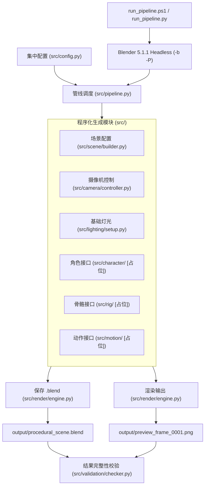

# ARCHITECTURE: 系统架构与模块设计蓝图

> [!NOTE]
> 当前阶段已完成【任务 2：Git 版本控制与程序化动画工程骨架建立】。已落地标准模块化工程结构与最小可执行管线。

## 1. 系统总体架构设计

系统设计为解耦的模块化 Python 架构，由统一的 CLI Pipeline 驱动 Blender Headless (无界面后台) 进程运行。



---

## 2. 落地子模块职责与目录结构

```text
ProceduralAnimation/
├── src/
│   ├── __init__.py
│   ├── config.py             # 统一参数集中管理 (PipelineConfig: FPS 24, 360帧, 1280x720, Workbench, 种子等)
│   ├── pipeline.py           # 整体执行流程调度入口
│   ├── scene/                # 场景初始化与时间线、分辨率参数注入
│   │   ├── __init__.py
│   │   └── builder.py
│   ├── camera/               # 摄像机构建与运镜控制
│   │   ├── __init__.py
│   │   └── controller.py
│   ├── lighting/             # 场景照明体系
│   │   ├── __init__.py
│   │   └── setup.py
│   ├── character/            # 角色生成接口（待实现）
│   │   └── __init__.py
│   ├── rig/                  # 骨骼控制接口（待实现）
│   │   └── __init__.py
│   ├── motion/               # 连续动作状态机接口（待实现）
│   │   └── __init__.py
│   ├── render/               # 渲染引擎设置与图片输出、.blend保存
│   │   ├── __init__.py
│   │   └── engine.py
│   └── validation/           # 产物存在性、非空性与二进制尺寸校验
│       ├── __init__.py
│       └── checker.py
├── tests/                    # 单元与工具链环境测试套件
│   ├── test_env.py
│   ├── verify_blend.py
│   ├── run_validation.py
│   └── run_test.ps1
├── output/                   # 运行产物输出目录 (受 .gitignore 保护)
├── run_pipeline.py           # 统一双模入口脚本 (宿主CLI / Blender无头均可执行)
├── run_pipeline.ps1          # PowerShell快捷启动入口
└── .gitignore                # 严格过滤产物、缓存与临时二进制
```

---

## 3. 依赖与环境要求
* **Blender**：本机已验证版本 `Blender 5.1.1`（路径：`C:\Program Files\Blender Foundation\Blender 5.1\blender.exe`）。
* **Python**：Blender 内置 `Python 3.13.9`（含 `bpy`, `mathutils`）。
* **外部调用**：PowerShell / Python 调用无头命令行。
* **外部资源原则**：零第三方非标准库依赖，100% 纯代码程序化构建。
