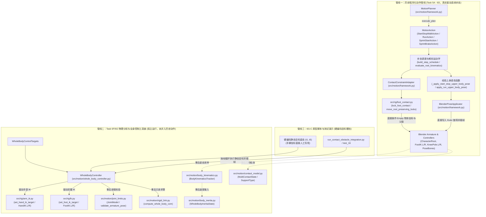
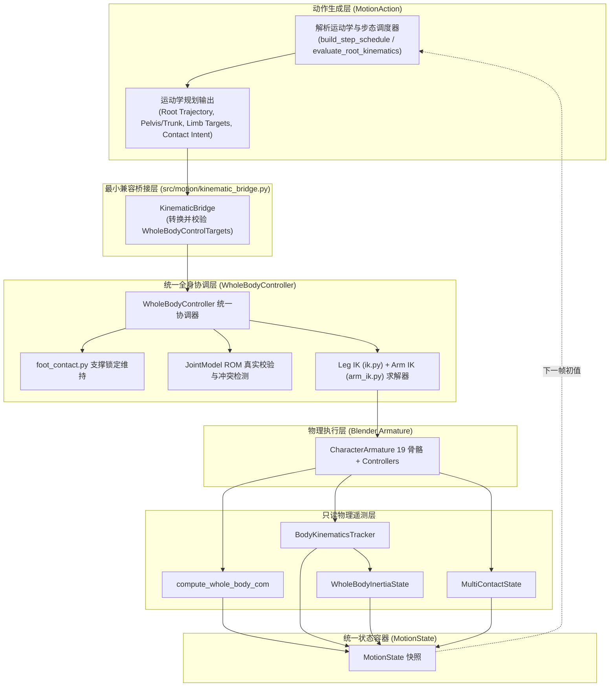
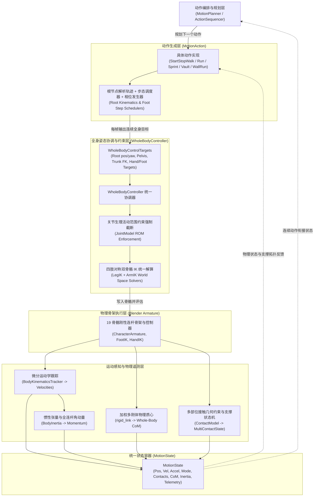

# ARCHITECTURE: 全程序化 3D 动画系统架构与工程规范蓝图

> **最新架构审计版本**：v2.2 (Task 6G-C-R3B-1-Final 桥接层接口补全与自动化同步规范)  
> **审计基准 Git SHA**：`892116c` / `a8987ac`  
> **核心原则**：磁盘源码与真实可运行调用链是唯一事实标准。严禁将“设计目标”或“仅存在于测试/独立脚本中的调用”描述为已经完成集成的生产架构。严格区分当前真实架构、R3B 逐步集成架构与未来规划能力。

---

## 1. 核心架构设计思想与关键原则 (Core Architectural Principles)

全系统在运动生成与控制上必须严格遵循以下十项基本原则：

1. **MotionAction 是连续运动目标的生成者**：`MotionAction` 负责根据时间参数、步态调度或动作意图，解析计算根节点位移、质心起伏、四肢末端期望轨迹及接触意图。它不直接操作底层约束 Empty 或骨骼欧拉角。
2. **WholeBodyController 是统一姿态协调器**：`WholeBodyController`（WBC）负责统一协调并分配全身姿态，集中调度双腿 IK、双臂 IK/FK、骨盆偏移与脊柱姿态。**WBC 绝不负责步态调度、步幅规划或时间轴演化**。
3. **现有 IK/FK 是实际骨架求解执行机构**：Blender 的两骨 IK 约束与旋转复制（Copy Rotation）是骨架运动解算的真实底层执行机构，WBC 通过驱动控制器 Empty 物体与骨骼局部属性驱动求解器。
4. **JointModel 负责 ROM 检查，严禁截断后虚报成功**：`JointModel` 负责解剖生理活动范围（ROM）校验。若采用 ROM 投影截断（Clamp Mode），**必须重新求解或检查四肢末端目标误差；若 ROM 截断导致四肢末端脱离规划目标超过公差，必须真实返回 `ROM_CONFLICT` 错误且标记 `success = False`，绝对不得截断后虚假汇报成功**。
5. **ContactModel 负责接触状态与几何检查，不直接取代脚部锁定执行器**：`ContactModel` 负责四肢接触几何检测（法向间隙、穿透深度、切向滑移）、接触生命周期状态机与支撑状态分类，它不直接操作 `FootIK` Empty 物体。
6. **FootContactAdapter (foot_contact.py) 负责执行实际世界空间接触锁定**：真实的零漂移足部锁定由 `src/rig/foot_contact.py` 通过解除 `FootIK` 父级并在世界坐标系下原位固定来执行，这是足部地面零漂移的唯一底层保障。
7. **BodyKinematics、CoM、BodyInertia 当前是纯只读评估模块**：`rigid_link.py`（CoM）、`body_kinematics.py`（速度/加速度）、`body_inertia.py`（惯性张量/角动量）目前均为事后只读遥测模块，**严禁宣称它们已参与力矩驱动或动力学闭环控制**。
8. **MotionState 负责保存已执行姿态对应的真实状态**：`MotionState` 是不可变的帧状态快照，用于持久化当前帧实际评估得到的位姿、真实线速度/角速度、接触字典与物理遥测指标，供后续动作或时间步读取。
9. **状态回传不等同于主动反馈控制，更不等于真实动力学仿真**：将物理遥测数据写入 `MotionState.params` 仅为只读数据持久化，在缺少受力计算与主动误差修正回路前，系统本质上仍是开环运动学驱动。
10. **未来动力学约束求解器应前置发挥作用**：未来 6G-D 引入的接触力、冲量与质心平衡约束，应在运动目标应用之前或协调求解过程中发挥前向调整作用，不能仅做最终姿态的事后被动检查。

---

## 2. 统一物理与世界坐标约定 (Physical & World Coordinate Conventions)

所有模块（场景、环境障碍物、角色网格、骨架 Armature、IK 约束、动力学模型与摄像机系统）必须严格执行以下物理世界坐标约定，严禁任何局部私有坐标混淆：

* **坐标轴定义**：
  * **$+Z$ 轴向上**（天顶方向，$-Z$ 为重力指向地心方向）。
  * **$+X$ 轴向右**（角色右侧，$-X$ 为角色左侧）。
  * **$+Y$ 轴向前**（深度前进主走廊，角色初始正对方向）。
* **地面基准参考面**：
  * **地面顶表面严格处于 $Z = 0.0\text{ m}$**。
  * 角色静止站立时，脚底接触面与地面零点严格切齐（$Z_{\text{sole}} = 0.0\text{ m}$，踝关节原点位于 $Z_{\text{ankle}} = 0.070\text{ m}$）。
* **物理度量单位**：
  * 长度单位：**米 (m)**。
  * 时间单位：**秒 (s)**（主时间轴标准帧率：$24\text{ FPS}$，单帧时间步长 $\Delta t = 1/24\approx 0.041667\text{ s}$）。
  * 速度单位：**米/秒 ($\text{m/s}$)**。
  * 角速度单位：**弧度/秒 ($\text{rad/s}$)** 或 度/秒 ($\text{deg/s}$)。
  * 质量单位：**千克 (kg)**（标准成人参考体质量 $75.0\text{ kg}$）。
  * 转动惯量单位：**$\text{kg}\cdot\text{m}^2$**。
* **运动空间与安全走廊走势**：
  * 起点站立区：$(0.0, -8.0, 0.0)\text{ m}$。
  * 主直线运动通道：沿 $+Y$ 轴从 $Y = -8.0\text{ m}$ 延伸至 $Y = 0.0\text{ m}$（以及后续扩展）。
  * 走廊安全净空带宽：沿走廊中心线保持半径 $\ge 2.4\text{ m}$ 的无碰撞净空，环境布局算法禁止非规划障碍物侵入。

---

## 3. 三级架构演进视图 (Three-Tier Architecture Evolution View)

工程必须严格区分以下三个阶段，严禁提前声称未来能力已经完成：

### 3.1 阶段一：当前真实架构 (Current Real Architecture, Git `d283ba8`)
当前工程中客观存在三套互不相通、分立并行的执行管线：
* **管线一（历史动作管线）**：`StartStopWalkAction`、`RunAction`、`SprintStartAction`、`SprintBrakeAction` 使用私有姿态函数与 `ContactConstraintAdapter` 直接驱动骨架，完全绕过 `WholeBodyController`、`JointModel` 与 `ContactModel`。
* **管线二（物理分析与全身控制工具链）**：`WholeBodyController`、`JointModel`、`rigid_link`、`body_kinematics`、`body_inertia`、`contact_model` 仅在独立测试与原型脚本中运行，对已生成的姿态进行事后只读采样。
* **管线三（障碍物原型演示脚本）**：`run_contact_obstacle_integration.py` 脱离动作系统，在 30 帧循环中对完全相同的硬编码静态目标重复调用 WBC，呈现 5 张静态定格切片。

---

### 3.2 阶段二：R3B 逐步集成架构 (R3B Integrated Architecture with Bridge Layer)
在 Task 6G-C-R3B 中，引入**最小兼容桥接层 (`KinematicBridge`)**，消除历史动作与 WBC 之间的调用鸿沟：
* 历史动作（`StartStopWalkAction` 等）保持自身步态调度与解析运动学不变；
* 桥接层支持显式时间步长与时间戳自动推导（`dt > 0.0`，严格单调递增），保证数值微分与惯性计算的物理时间尺度一致；
* 彻底解耦手部 IK 激活与接触意图（`enabled` vs `contact_intent` vs `is_locked`），自由空间伸手抓空绝不产生虚假环境接触；
* 桥接层将历史动作中的根节点位移、骨盆偏移、躯干倾角、双脚世界目标、接地锁定状态及双臂姿态，**无损打包为 `WholeBodyControlTargets`**；
* 由 `WholeBodyController` 独占 Blender 骨架与控制器写入权，统一调用 `foot_contact.py` 维持支撑锁定，驱动 LegIK / ArmIK，执行 ROM 校验与真实冲突检测；
* 姿态解算完成后，在 Phase 5 自动整合连杆质心、速度差分、全身体惯性张量与自转/轨道角动量遥测，统一写入不可变 `MotionState`。

---

### 3.3 阶段三：未来规划架构 (Future Architectures: 6G-D, 6H, 7A - 尚未实现)
* **Task 6G-D（动力学闭环初探）**：引入基于质心动量与接触力的前向约束求解器，在目标应用前动态微调躯干倾角与迈步位置（**未实现**）。
* **Task 6H（动态平衡恢复）**：引入推力扰动恢复与捕获点（Capture Point）步频/步幅自适应调整（**未实现**）。
* **Task 7A（特技动作扩展）**：正式构建基于连续时间轴的 `VaultTouchAction`、`WallRunAction`、`SlideAction`（**未实现**）。

---

## 4. 统一单帧 6 阶段执行协议 (Unified Single-Frame 6-Phase Execution Protocol)

全系统任何单帧姿态的生成与评估，必须严格遵循以下 6 阶段协议，严禁跳步或逆向穿透：

| 执行阶段 | 阶段名称 | 职责与核心操作 | 输入 (Inputs) | 输出 (Outputs) | 坐标系 | 状态所有权 (Ownership) | 禁止绕过规则 |
| :--- | :--- | :--- | :--- | :--- | :--- | :--- | :--- |
| **Phase 1** | **动作运动学规划 (Kinematic Planning)** | 计算连续时间步下的根节点轨迹、质心高度起伏、四肢期望世界目标、躯干 FK 角度及接触意图 | $t, \Delta t$，上一帧 `MotionState`，步态调度器配置 | `PlannedMotionTargets` (根位姿, 躯干角, 四肢末端, 接触意图) | World Space / Bone Local | 归属于当前具体 `MotionAction` | 严禁在该阶段直接修改 Blender 骨骼或 Empty 物体 |
| **Phase 2** | **接触协调与锁定 (Contact Coordination)** | 解释接触意图。维持已有支撑脚世界锚点（零漂移）；对摆动脚执行解锁；手部抓握建立锚点 | 接触意图, 历史接触记录, 目标接地坐标 | 确认后的 `EndEffectorTarget`（标明 `is_locked` 布尔值） | World Space ($Z=0$) | 由 `foot_contact.py` 独占足部世界锁定状态 | 严禁在根节点位移前解锁支撑脚；严禁多模块重复写入 FootIK |
| **Phase 3** | **统一姿态求解 (WBC Pose Solve)** | 将完整目标送入 WBC；执行根节点位移；应用骨盆与躯干 FK；驱动两骨腿部与双臂 IK 约束求解器 | 统一 `WholeBodyControlTargets` 实例 | Blender Pose 姿态更新 | World $\rightarrow$ Armature Local | 由 `WholeBodyController` 独占骨架姿态写入权 | 严禁使用私有姿态函数绕过 WBC 直接修改骨骼欧拉角 |
| **Phase 4** | **真实性与冲突校验 (Truthful Validation)** | 提取求解姿态，由 `JointModel` 校验解剖 ROM，计算四肢末端追踪误差与接触几何穿透。若超限真实报警 | 求解后的骨骼矩阵, 目标位置, 生理 ROM 阈值 | `WholeBodyControlResult` (含 `is_valid`, `tracking_errors`, `rom_violations`) | Bone Local / World | 由 `JointModel` 独占 ROM 校验职责 | **严禁在 ROM 截断后虚报成功；存在无法满足的末端目标必须返回失败** |
| **Phase 5** | **场景评估与物理遥测 (Evaluation & Telemetry)** | 调用 `depsgraph.update()` 刷新场景；执行只读物理遥测计算：CoM、有限差分速度、惯性张量、角动量及接触分类 | 已评估的 Blender Armature 姿态 | `WholeBodyCoMResult`, `BodyKinematicsResult`, `WholeBodyInertiaState`, `MultiContactState` | World Space (以 CoM 为动量参考) | 各遥测模块拥有独立纯函数，无写入权 | 严禁将只读遥测结果直接当做反馈力矩驱动骨骼 |
| **Phase 6** | **状态提交与持久化 (State Commit)** | 将执行结果、追踪误差及物理遥测打包为不可变 `MotionState`，打入当前帧关键帧并存入时间线列表 | 真实运动学指标, 接触字典, 遥测数据字典 | 不可变 `MotionState` 快照对象 | World Space | 归属于 `MotionAction.states` 与 `MotionPlanner` | 严禁篡改或跳过任何物理遥测字段 |

---

## 5. 模块数据流合同 (Module Data Flow Contracts)

下表对工程中涉及运动生成的全部 12 个核心模块制定严格的数据合同：

| 模块名称 | 主要输入 (Input) | 主要输出 (Output) | 坐标系 (Coords) | 单位 (Units) | 调用者 (Caller) | 被调用者 (Callee) | 状态读写责任 (State R/W) | 每帧执行阶段 |
| :--- | :--- | :--- | :--- | :--- | :--- | :--- | :--- | :--- |
| **MotionPlanner** | 动作序列名列表, `initial_state` | 连续 `List[MotionState]`, 帧范围 | World Space | m, deg, s | 顶层管线 / 运行脚本 | 各具体 `MotionAction` | 读初始状态，聚合最终状态轨迹 | 序列调度层 |
| **MotionAction** | `MotionState`, `MotionRuntimeContext` | `ActionExecutionResult` (含 per-frame 姿态与步态) | World + Local | m, m/s, deg | `MotionPlanner` | 步态调度器, `KinematicBridge` | 读前序状态，生成新状态帧序列 | Phase 1 |
| **KinematicBridge** | 历史动作运动学参数 (根位移, 躯干角, 步态相) | 规范化 `WholeBodyControlTargets` | World + Local | m, deg | `MotionAction` / 测试套件 | `WholeBodyControlTargets` | 纯转换层，无骨骼写入权 | Phase 1 $\rightarrow$ 2 |
| **WholeBodyController** | `WholeBodyControlTargets` (根位姿, 躯干FK, 四肢IK目标) | `WholeBodyControlResult` (追踪误差, ROM合规性, CoM) | World (外) / Local (内) | m, deg, mm | `KinematicBridge` / 动作层 | `arm_ik`, `ik`, `foot_contact`, `joint_limits`, `rigid_link` | 独占写入 Blender 骨架与 IK Empty 物体 | Phase 2 $\rightarrow$ 4 |
| **foot_contact.py** | 锁定/摆动足部世界坐标, 步态相位 | 底层锁定状态, `FootIK` 世界矩阵 | World Space | m, mm, deg | `WholeBodyController` | Blender Constraint / Object API | 读写 `FootIK` 物理层约束与父级 | Phase 2 |
| **src/rig/ik.py** | 双腿踝关节世界目标 `(x, y, z)`, 偏航角 | `FootIK.L/R` 物体变换, 膝关节弯曲姿态 | World $\rightarrow$ Bone Local | m, deg | `WholeBodyController` | Blender `IK` Constraint Solver | 写入 `FootIK` 与 `KneePole` 物体位姿 | Phase 3 |
| **src/rig/arm_ik.py** | 双手手腕世界目标 `(x, y, z)`, 3D 旋转目标 | `HandIK.L/R` 物体变换, 肘关节后外侧弯曲 | World $\rightarrow$ Bone Local | m, deg | `WholeBodyController` | Blender `IK` + `CopyRotation` | 写入 `HandIK` 与 `ElbowPole` 物体位姿 | Phase 3 |
| **joint_limits.py** | Blender 评估骨骼当前局部旋转 | ROM 越界诊断列表, 截断后欧拉角 | Bone Local Axis | rad, deg | `WholeBodyController` | 纯数学算法，无外部依赖 | 只读校验；截断模式下覆盖骨骼旋转并触发重检 | Phase 4 |
| **rigid_link.py** | Armature 对象当前全局矩阵与骨骼变换 | 全身物理质心 `com_world`, 分段质心 | World Space | m, kg | `WholeBodyController`, 遥测器 | 纯数学矩阵变换 | 只读前向运动学计算，无写权限 | Phase 5 |
| **body_kinematics.py** | 连续多帧骨架姿态快照 `BodyPoseSnapshot` | 根节点/CoM/关节/连杆线速度与角速度 | World + Bone Local | m/s, rad/s | 动作后处理 / 遥测器 | 纯数值有限差分 | 只读微分推导，注入 `MotionState.params` | Phase 5 |
| **body_inertia.py** | 连杆几何规范, 姿态快照, 速度状态 | $3\times 3$ 惯性张量, 自转/轨道角动量 | World Space (CoM) | $\text{kg}\cdot\text{m}^2$, $\text{kg}\cdot\text{m}^2/\text{s}$ | 动作后处理 / 遥测器 | 纯代数张量运算 | 只读张量合成，注入 `MotionState.params` | Phase 5 |
| **contact_model.py** | Armature 骨架, 环境表面列表, 四肢目标 | `MultiContactState` (间隙/穿透/滑移/支撑类型) | World Space | m, mm, 模长无量纲 | 动作后处理 / 视口标记更新 | 纯几何相交与凸包检测 | 只读几何约束评估，更新可视化标记 | Phase 5 |
| **MotionState** | 瞬时运动学参数, 接触字典, 遥测字典 | 不可变快照对象，支持 `.to_dict()`, `.clone_with()` | World Space | m, m/s, m/s², deg | 各阶段输出聚合 | 纯数据类，无下游调用 | 承载单帧完整物理与运动状态 | Phase 6 |

---

## 6. 历史动作复用与实现关系全表 (Historical Action Reuse Matrix)

全工程对历史已验证的 6 大基础动作建立唯一权威实现入口映射表，严禁重复编写步态调度逻辑：

| 动作标识 | 任务编号 | 真实源码实现入口 | 步态调度核心机制 | 使用的 IK / FK 机制 | 接触锁定与防滑机制 | 当前姿态生成路径 | 目标合流状态 (R3B) |
| :--- | :--- | :--- | :--- | :--- | :--- | :--- | :--- |
| **Walk Cycle** | Task 5A | `src/motion/walk_cycle.py` $\rightarrow$ `generate_walk_cycle` | 固定循环周期（36 帧/步），归一化相位 $u \in [0, 1)$ | 两骨腿部 IK（`FootIK.L/R`）；双臂固定正弦波 FK | 每步半周期足部锁定；摆动期正弦抬升 | 直接调用 `set_foot_ik_target` + `set_bone_rotation` 插帧 | **独立历史原型**（保持回归，不迁移） |
| **Forward Walk** | Task 5B | `src/motion/forward_walk.py` $\rightarrow$ `generate_forward_walk` | 沿 $+Y$ 直线匀速前向跨步，步幅累加调度 | 两骨腿部 IK；上身前倾与骨盆起伏经验 FK | `lock_foot_contact` 锁定支撑脚；摆腿跨步 | 直接调用 `move_character_root_with_support` 插帧 | **独立历史原型**（保持回归，不迁移） |
| **StartStopWalkAction** | Task 5C / 6A | `src/motion/start_stop_walk.py` `src/motion/framework.py` | `build_step_schedule`（7 个协调半步）；余弦平滑 $C^1$ 速度曲线 $v(\tau)$（0 $\rightarrow$ 0.24 $\rightarrow$ 0 m/s） | 两骨腿部 IK；骨盆下沉、躯干倾角与反向摆臂经验 FK | `lock_foot_contact` 世界锁定，漂移 $< 0.005\text{ mm}$；摆动相正弦抬升 | 现通过 `ContactConstraintAdapter` + `BlenderPoseApplicator` | **待 R3B-2 完整迁移至 KinematicBridge** |
| **RunAction** | Task 6B | `src/motion/run_cycle.py` $\rightarrow$ `RunAction` | 腾空相步态调度（半步 12 帧，支撑 7 帧，单腾空 5 帧）；高速周期 $v = 1.0\text{ m/s}$ | 两骨腿部 IK；跑动大幅屈肘与大摆幅手臂 FK | 支撑期足底锁定；双脚同时离地进入 `flight` 状态 | 现通过 `ContactConstraintAdapter` 驱动双腿 IK 与根节点位移 | **待 R3B-2 完整迁移至 KinematicBridge** |
| **SprintStartAction** | Task 6C | `src/motion/sprint_start.py` $\rightarrow$ `SprintStartAction` | 三阶段爆发式起跑调度（准备预备 12 帧 $\rightarrow$ 蹬地起步 24 帧 $\rightarrow$ 冲刺加速）；峰值 $v = 3.6\text{ m/s}$ | 两骨腿部 IK；大幅躯干前倾与大步幅交替摆臂 FK | 强力后蹬锁定；长步幅腾空迈步 | 现通过 `contact_adapter` 驱动并平滑过渡到稳态冲刺 | **待 R3B-2 完整迁移至 KinematicBridge** |
| **SprintBrakeAction** | Task 6D | `src/motion/sprint_brake.py` $\rightarrow$ `SprintBrakeAction` | 4 阶段主动急停制动调度（后仰缓冲 $\rightarrow$ 强力前掌滑移制动 $\rightarrow$ 步幅收束 $\rightarrow$ 停步）；加速度达 $-6.0\text{ m/s}^2$ | 两骨腿部 IK；躯干向后反向倾角抵消惯性 | 允许受控前向滑移制动；最终平稳合拢双足锁定 | 现通过 `contact_adapter` 驱动受控减速与停止锁定 | **待 R3B-2 完整迁移至 KinematicBridge** |

---

## 7. 永久架构纪律与反伪造开发守则 (Permanent Architectural Discipline)

后续任何新模块开发或重构，必须无条件遵循以下守则：

1. **统一架构阶段声明**：必须明确指明新增模块接入统一架构单帧执行协议的哪一阶段（Phase 1 至 Phase 6）。
2. **清晰调用链与被调用者**：必须指明真实调用者（Caller）与被调用者（Callee），严禁创建无上游调用的孤立执行分支。
3. **输入输出与状态所有权**：必须明确声明输入参数、输出结构体及对 Blender 骨骼/控制器物体的独占或共享读写权限。
4. **强制复用已有模块**：严禁重复实现已存在的运动学、物理计算或控制能力。
5. **历史回归基线锁定**：每次迭代必须无条件运行历史核心测试套件（Task 5C、6B、6C、6D、6F-D、6G-A、6G-B、6G-C），确保零退化。
6. **严禁独立演示管线冒充生产能力**：禁止编写独立的 Blender 脚本在固定时间轴上手工摆拍姿态，必须通过标准动作生成器与统一执行协议生成连续时间轴动画。
7. **严禁为人为迎合数值阈值破坏姿态自然度**：禁止通过人为强制修改骨骼位置或隐藏误差来通过测试断言。
8. **架构偏差事前审批制度**：若在开发中发现确有必要偏离本架构蓝图，必须先暂停并向用户详细记录架构变更原因及影响，严禁悄悄绕开。

所有模块（场景、环境障碍物、角色网格、骨架 Armature、IK 约束、动力学模型与摄像机系统）必须严格执行以下物理世界坐标约定，严禁任何局部私有坐标混淆：

* **坐标轴定义**：
  * **$+Z$ 轴向上**（天顶方向，$-Z$ 为重力指向地心方向）。
  * **$+X$ 轴向右**（角色右侧，$-X$ 为角色左侧）。
  * **$+Y$ 轴向前**（深度前进主走廊，角色初始正对方向）。
* **地面基准参考面**：
  * **地面顶表面严格处于 $Z = 0.0\text{ m}$**。
  * 角色静止站立时，脚底接触面与地面零点严格切齐（$Z_{\text{sole}} = 0.0\text{ m}$，踝关节原点位于 $Z_{\text{ankle}} = 0.070\text{ m}$）。
* **物理度量单位**：
  * 长度单位：**米 (m)**。
  * 时间单位：**秒 (s)**（主时间轴标准帧率：$24\text{ FPS}$，单帧时间步长 $\Delta t = 1/24\approx 0.041667\text{ s}$）。
  * 速度单位：**米/秒 ($\text{m/s}$)**。
  * 角速度单位：**弧度/秒 ($\text{rad/s}$)** 或 度/秒 ($\text{deg/s}$)。
  * 质量单位：**千克 (kg)**（标准成人参考体质量 $75.0\text{ kg}$）。
  * 转动惯量单位：**$\text{kg}\cdot\text{m}^2$**。
* **运动空间与安全走廊走势**：
  * 起点站立区：$(0.0, -8.0, 0.0)\text{ m}$。
  * 主直线运动通道：沿 $+Y$ 轴从 $Y = -8.0\text{ m}$ 延伸至 $Y = 0.0\text{ m}$（以及后续扩展）。
  * 走廊安全净空带宽：沿走廊中心线保持半径 $\ge 2.4\text{ m}$ 的无碰撞净空，环境布局算法禁止非规划障碍物侵入。

---

## 2. 当前真实架构图 (Current Real Architecture)

根据对仓库受 Git 管理的全部源码审计，当前工程中实际存在**三套互不相通、分立并行的执行管线**：

### 真实调用链核心审计事实：
1. **历史动作管线（管线一）完全独立**：`StartStopWalkAction`、`RunAction`、`SprintStartAction`、`SprintBrakeAction` 在执行中，直接通过 `ContactConstraintAdapter` 和各自私有的 `apply_upper_body` 函数写入 Blender 骨架。**它们完全不调用 `WholeBodyController`，也不调用 `JointModel` ROM 校验，也不调用 `ContactModel`**。
2. **物理分析模块（管线二）仅为事后只读遥测**：`rigid_link.py`（CoM）、`body_kinematics.py`（速度）、`body_inertia.py`（转动惯量与角动量）、`contact_model.py`（接触间隙与支撑分类）目前只对已生成的 Blender 姿态进行后处理读取，并将计算出的浮点数/向量写入 `MotionState.params` 字典。**它们对骨骼姿态的生成没有任何前向驱动、约束反馈或闭环控制作用**。
3. **障碍物原型（管线三）是静态摆拍而不是动作生成**：`run_contact_obstacle_integration.py` 之所以呈现僵硬的 30 帧固定切片，是因为它没有通过任何 `MotionAction` 生成连续运动学曲线，而是直接在 Python 中写死了 5 组静态坐标赋予 `WholeBodyControlTargets`，由 `WholeBodyController` 强行将骨骼吸附在目标点上。

---

## 3. 目标生产级架构图 (Target Production Architecture)

系统最终必须收敛并合流为**唯一定义的单向正向驱动与物理闭环数据流**：

### 目标架构的关键规范：
1. **动作层 (MotionAction)** 负责“期望什么”：通过运动学生成连续的根节点移动、质心高度起伏、四肢末端在世界空间的期望轨迹与接触意图。
2. **协调层 (WholeBodyController)** 负责“合法落地”：统一接收目标，执行解剖 ROM 强制限制，求解 Arm IK 与 Leg IK，确保四肢末端精准达标，杜绝历史私有姿态函数绕过 IK/ROM 的做法。
3. **遥测层 (Kinematics / Inertia / ContactModel)** 负责“真实评估”：从解算后的骨架中提取真实速度、真实角动量、真实质心与真实接触间隙，写入 `MotionState`，为下一帧动作或状态机转移提供反馈依据。

---

## 4. 模块数据流合同 (Module Data Flow Contracts)

下表对工程中涉及运动生成的全部 11 个核心模块制定严格的数据合同：

| 模块名称 | 主要输入 (Input) | 主要输出 (Output) | 坐标系 (Coords) | 单位 (Units) | 调用者 (Caller) | 被调用者 (Callee) | 状态读写责任 (State R/W) | 每帧执行阶段 |
| :--- | :--- | :--- | :--- | :--- | :--- | :--- | :--- | :--- |
| **MotionPlanner** | 动作序列名列表, `initial_state` | 连续 `List[MotionState]`, 帧范围 | World Space | m, deg, s | 顶层管线 / 运行脚本 | 各具体 `MotionAction` | 读初始状态，聚合最终状态轨迹 | 动作序列级调度 |
| **MotionAction** | `MotionState`, `MotionRuntimeContext` | `ActionExecutionResult` (含 per-frame 姿态与步态) | World + Local | m, m/s, deg | `MotionPlanner` | 步态调度器, `WholeBodyController` | 读前序状态，生成新状态帧序列 | 帧循环驱动核心 |
| **MotionState** | 瞬时运动学参数, 接触字典, 遥测字典 | 不可变快照对象，支持 `.to_dict()`, `.clone_with()` | World Space | m, m/s, m/s², deg | `MotionAction`, 各遥测模块 | 纯数据类，无下游调用 | 承载单帧完整物理与运动状态 | 状态持久化容器 |
| **WholeBodyController** | `WholeBodyControlTargets` (根位姿, 躯干FK, 四肢IK目标) | `WholeBodyControlResult` (追踪误差, ROM合规性, CoM) | World (外) / Local (内) | m, deg, mm | `MotionAction` (目标) / 原型脚本 | `arm_ik`, `ik`, `joint_limits`, `rigid_link` | 写入 Blender 骨架与 IK Empty 物体 | 帧姿态求解与写入 |
| **ContactConstraintAdapter** | 锁定/摆动足部世界坐标, 步态相位 | 底层锁定状态, `ContactPointState` | World Space | m, mm, deg | 现有 `MotionAction` | `foot_contact.py`, `ik.py` | 读写 `FootIK` 物理层约束与父级 | 姿态应用前/后 |
| **src/rig/ik.py** | 双腿踝关节世界目标 `(x, y, z)`, 偏航角 | `FootIK.L/R` 物体变换, 膝关节弯曲姿态 | World $\rightarrow$ Bone Local | m, deg | `ContactConstraintAdapter`, `WBC` | Blender `IK` Constraint Solver | 写入 `FootIK` 与 `KneePole` 物体位姿 | IK 求解器阶段 |
| **src/rig/arm_ik.py** | 双手手腕世界目标 `(x, y, z)`, 3D 旋转目标 | `HandIK.L/R` 物体变换, 肘关节后外侧弯曲 | World $\rightarrow$ Bone Local | m, deg | `WholeBodyController` | Blender `IK` + `CopyRotation` | 写入 `HandIK` 与 `ElbowPole` 物体位姿 | IK 求解器阶段 |
| **joint_limits.py** | Blender 评估骨骼当前局部旋转 | ROM 越界诊断列表, 截断后欧拉角 | Bone Local Axis | rad, deg | `WholeBodyController` | 纯数学算法，无外部依赖 | 只读校验；截断模式下覆盖骨骼旋转 | IK 求解后校验/截断 |
| **rigid_link.py** | Armature 对象当前全局矩阵与骨骼变换 | 全身物理质心 `com_world`, 分段质心 | World Space | m, kg | `WholeBodyController`, 遥测器 | 纯数学矩阵变换 | 只读前向运动学计算，无写权限 | 姿态生成后遥测 |
| **body_kinematics.py** | 连续多帧骨架姿态快照 `BodyPoseSnapshot` | 根节点/CoM/关节/连杆线速度与角速度 | World + Bone Local | m/s, rad/s | 动作后处理 / 测试套件 | 纯数值有限差分 | 只读微分推导，注入 `MotionState.params` | 姿态生成后遥测 |
| **body_inertia.py** | 连杆几何规范, 姿态快照, 速度状态 | $3\times 3$ 惯性张量, 自转/轨道角动量 | World Space (CoM) | $\text{kg}\cdot\text{m}^2$, $\text{kg}\cdot\text{m}^2/\text{s}$ | 动作后处理 / 测试套件 | 纯代数张量运算 | 只读张量合成，注入 `MotionState.params` | 速度学求出后遥测 |
| **contact_model.py** | Armature 骨架, 环境表面列表, 四肢目标 | `MultiContactState` (间隙/穿透/滑移/支撑类型) | World Space | m, mm, 模长无量纲 | 动作后处理 / 视口标记更新 | 纯几何相交与凸包检测 | 只读几何约束评估，更新可视化标记 | 姿态解算后物理校验 |

---

## 5. 历史动作复用与实现关系全表 (Historical Action Reuse Matrix)

为彻底防止重新造轮子或编造伪动作，全工程对历史已验证的 6 大基础动作建立唯一权威实现入口映射表：

| 动作标识 | 任务编号 | 真实源码实现入口 | 步态调度核心机制 | 使用的 IK / FK 机制 | 接触锁定与防滑机制 | Blender 姿态生成路径 | 生产集成状态 |
| :--- | :--- | :--- | :--- | :--- | :--- | :--- | :--- |
| **Walk Cycle** | Task 5A | `src/motion/walk_cycle.py` $\rightarrow$ `generate_walk_cycle` | 固定循环周期（36 帧/步），归一化相位 $u \in [0, 1)$ | 两骨腿部 IK（`FootIK.L/R`）；双臂固定正弦波 FK | 每步半周期足部锁定；摆动期正弦抬升 | 直接调用 `set_foot_ik_target` + `set_bone_rotation` 插帧 | **独立原型算法**（未封装为 MotionAction） |
| **Forward Walk** | Task 5B | `src/motion/forward_walk.py` $\rightarrow$ `generate_forward_walk` | 沿 $+Y$ 直线匀速前向跨步，步幅累加调度 | 两骨腿部 IK；上身前倾与骨盆起伏经验 FK | `lock_foot_contact` 锁定支撑脚；摆腿跨步 | 直接调用 `move_character_root_with_support` 插帧 | **独立原型算法**（未封装为 MotionAction） |
| **StartStopWalkAction** | Task 5C / 6A | `src/motion/start_stop_walk.py` $\rightarrow$ `generate_start_stop_walk` `src/motion/framework.py` $\rightarrow$ `StartStopWalkAction` | `build_step_schedule`（7 个协调半步）；余弦平滑 $C^1$ 速度曲线 $v(\tau)$（0 $\rightarrow$ 0.24 $\rightarrow$ 0 m/s） | 两骨腿部 IK；骨盆下沉、躯干倾角与反向摆臂经验 FK | `lock_foot_contact` 世界锁定，漂移 $< 0.05\text{ mm}$；摆动相正弦抬升 | 通过 `ContactConstraintAdapter` + `BlenderPoseApplicator` 插帧 | **已完全封装为标准 MotionAction** |
| **RunAction** | Task 6B | `src/motion/run_cycle.py` $\rightarrow$ `RunAction` | 腾空相步态调度（半步 12 帧，支撑 7 帧，单腾空 5 帧）；高速周期 $v = 1.0\text{ m/s}$ | 两骨腿部 IK；跑动大幅屈肘与大摆幅手臂 FK | 支撑期足底锁定；双脚同时离地进入 `flight` 状态 | 通过 `ContactConstraintAdapter` 驱动双腿 IK 与根节点位移 | **已完全封装为标准 MotionAction** |
| **SprintStartAction** | Task 6C | `src/motion/sprint_start.py` $\rightarrow$ `SprintStartAction` | 三阶段爆发式起跑调度（准备预备 12 帧 $\rightarrow$ 蹬地起步 24 帧 $\rightarrow$ 冲刺加速）；峰值 $v = 3.6\text{ m/s}$ | 两骨腿部 IK；大幅躯干前倾与大步幅交替摆臂 FK | 强力后蹬锁定；长步幅腾空迈步 | 通过 `contact_adapter` 驱动并平滑过渡到稳态冲刺 | **已完全封装为标准 MotionAction** |
| **SprintBrakeAction** | Task 6D | `src/motion/sprint_brake.py` $\rightarrow$ `SprintBrakeAction` | 4 阶段主动急停制动调度（后仰缓冲 $\rightarrow$ 强力前掌滑移制动 $\rightarrow$ 步幅收束 $\rightarrow$ 停步）；加速度达 $-6.0\text{ m/s}^2$ | 两骨腿部 IK；躯干向后反向倾角抵消惯性 | 允许受控前向滑移制动；最终平稳合拢双足锁定 | 通过 `contact_adapter` 驱动受控减速与停止锁定 | **已完全封装为标准 MotionAction** |

---

## 6. 当前工程断裂点与架构缺口审计 (Architectural Break Points)

严禁对架构现实进行粉饰。磁盘代码显示当前系统存在以下明确断裂点：

### 6.1 已经真实集成的部分 (Truly Integrated)
1. 19 骨骼层级与 13 占位网格装配体系（`src/rig/builder.py`）；
2. 双腿两骨 IK、极向引导与世界空间达程保护（`src/rig/ik.py`）；
3. 双脚世界空间零漂移锁定与解锁机制（`src/rig/foot_contact.py`，实测漂移严格 $< 0.005\text{ mm}$）；
4. 四大核心运动动作（`StartStopWalkAction`, `RunAction`, `SprintStartAction`, `SprintBrakeAction`）在各自的运动学规划内高度成熟、平滑、零穿穿帮、零超程；
5. `MotionPlanner` 能够按顺序串联上述动作，并在动作边界无缝衔接位移与速度。

### 6.2 仅通过适配器连接或单向只读的部分 (Connected via Adapter / Read-Only Only)
1. **`WholeBodyController` 未接入现有动作**：`WholeBodyController` 作为 Task 6F-D 的成果，理论上具备同时调度双臂 IK、双腿 IK、骨盆与躯干的能力，但**所有现有的 `MotionAction` 根本没有调用它**，仍然通过旧有的 `ContactConstraintAdapter` 和硬编码私有上身函数工作。
2. **`ContactModel` 仅在事后做几何检测**：`src/motion/contact_model.py` 拥有完善的接触记录（`ContactRecord`）、生命周期（`ContactLifecycle`）和支撑状态机（`SupportType`），但**它目前完全不参与前向控制**，既不负责锁定脚部，也不向上层传递法向推力约束，仅在每一帧姿态生成完毕后，计算一下当前脚底离地面的距离与滑移量。
3. **CoM、惯性与动量未参与姿态平衡**：`rigid_link.py`、`body_kinematics.py`、`body_inertia.py` 能够极其精确地计算全身质心位置、线速度、空间角速度、惯性张量与自转/轨道角动量，但这些物理量仅仅被写入 `MotionState.params` 作为日志和字典数据存储，**没有任何控制器读取质心来调整躯干倾角，没有任何反作用力反馈**。

### 6.3 被演示脚本绕过与硬编码伪造的部分 (Bypassed by Demo Scripts)
1. **障碍物演示脚本彻底脱离了动作系统**：
   * 在 `run_contact_obstacle_integration.py` 中，角色在不同障碍物之间的姿态展示完全没有调用任何 `MotionAction`，没有经过任何物理步态调度；
   * 脚本直接构造离散静态目标（例如金库跳箱支撑、脚踩竖直墙、双手抓单杠），直接调用 `WholeBodyController.execute_frame()` 将角色瞬间定位并硬性保持 30 帧；
   * **这是导致障碍物原型僵硬、缺乏连续运动学过渡的根本原因**。它是一个纯静态的姿态评估测试，不是连续程序化动画系统。
2. **尚未存在生产级障碍物动作 (Missing Parkour MotionActions)**：
   * 系统中目前**完全不存在**针对障碍物交互的动作类（如 `VaultAction` 撑越动作、`WallRunAction` 蹬墙动作、`LedgeClimbAction` 攀爬动作、`JumpHurdleAction` 跨越动作）；
   * 在没有编写这些具体动作的连续运动学生成器之前，试图用一段连续时间线同时展示行走和障碍物接触，必然会导致伪造滑行（如 R2 返工中的单腿平移 2 米）或静态片段切片（如 R3 原型中的 30 帧静止展台）。

---

## 7. 架构合流路线图 (Integration Convergence Path: R3B 及后续规划)

为了彻底根除上述断裂点，后续阶段必须按以下顺序实施合流，禁止跳步：

1. **第一步（底层调用链合流）**：
   * 将 `BlenderPoseApplicator` 与 `ContactConstraintAdapter` 进行统一重构，使其内部调度收敛至 `WholeBodyController`；
   * 确保 `StartStopWalkAction`、`RunAction` 在生成每一帧时，统一输出 `WholeBodyControlTargets` 交由 `WholeBodyController` 执行解算与 ROM 校验，消除姿态生成的双轨制。
2. **第二步（接触模型前向闭环）**：
   * 改造 `src/rig/foot_contact.py`，将其底层的 `lock_foot_contact` / `unlock_foot_contact` 与 `ContactModel` 的 `ContactRecord`（`ESTABLISHED` / `RELEASED`）直接绑定；
   * 使足部和手部的接地/抓握锁定直接成为 `ContactModel` 约束执行的具象化体现，消除两套接触状态字段的不一致。
3. **第三步（规范化实现首个连续障碍物交互动作）**：
   * 严禁再在展示脚本中硬编码摆放身体姿态；
   * 正式构建标准的 `VaultTouchAction(MotionAction)` 或 `StepOverObstacleAction(MotionAction)`，从 `MotionState` 继承前向速度，通过严谨的时间轴运动学曲线计算身体腾空、单手触碰跳箱支撑、身体推离与双脚落地的完整连续轨迹，彻底解决“僵硬片段”问题。
