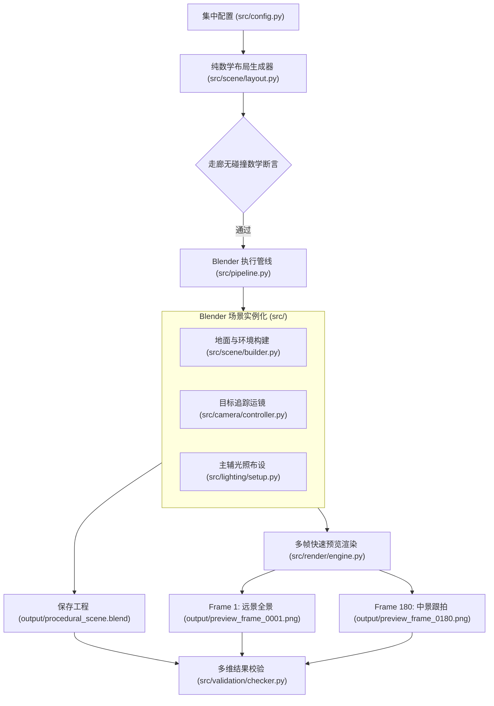

# ARCHITECTURE: 系统架构与模块设计蓝图

> [!NOTE]
> 当前阶段已完成【任务 3：程序化三维场景、灯光与摄像机基础系统】。已建立世界坐标约定、程序化地面/环境元素、角色走廊净空算法、双光源照明与摄像机追踪关键帧系统。

---

## 1. 统一世界坐标约定 (World Coordinate Conventions)

为了确保各子系统（地面、环境障碍、未来角色、骨骼、动画状态机与摄像机追踪）能够严丝合缝地协同工作，全项目确立并执行以下不可冲突的物理世界坐标规范：

* **坐标轴定义**：
  * **$Z$ 轴向上**（+Z 指向天空，-Z 指向地心）。
  * **$X$ 轴向右**（+X 指向东方/画面右侧）。
  * **$Y$ 轴向前**（+Y 指向北方/深度纵深前进方向）。
* **地面基准参考面**：
  * **地面顶表面严格处于 $Z = 0.0\text{ m}$**。
  * 地面厚度向下延伸至负 Z 区域（例如厚度为 $0.2\text{ m}$ 的地台，其中心处于 $Z = -0.1\text{ m}$，底面在 $Z = -0.2\text{ m}$，顶面精准处于 $Z = 0.0\text{ m}$）。
  * 角色站立时脚底与地面接触面严格基准为 $Z = 0.0\text{ m}$。
* **物理度量单位**：
  * 全系统统一采用**米 (Meters)** 为基础长度单位。
* **角色预留走廊与运动空间约定**：
  * **初始站立区 (Stand Area)**：$(0.0, -8.0, 0.0)$，半径 $1.5\text{ m}$。
  * **行走主走廊 (Walking Segment)**：从 $(0.0, -8.0, 0.0)$ 沿 $+Y$ 直线前行至 $(0.0, 0.0, 0.0)$。
  * **减速与转身区 (Turn Area)**：中心在 $(0.0, 0.0, 0.0)$，半径 $2.0\text{ m}$。
  * **离场轨迹 (Exit Segment)**：从 $(0.0, 0.0, 0.0)$ 转向并迈步至 $(3.5, 7.0, 0.0)$。
  * **安全净空缓冲带宽 (Corridor Clearance)**：沿走廊全长保持 $\ge 2.4\text{ m}$ 净空半径，程序化布局生成器严格禁止任何环境障碍物侵入该区域。

---

## 2. 系统总体架构与数据流



---

## 3. 落地模块划分与职责

```text
ProceduralAnimation/
├── src/
│   ├── config.py             # 统一配置（FPS 24, 360帧, 1280x720, 走廊路径, 光照, 种子等）
│   ├── pipeline.py           # 端到端无头执行管线总调度
│   ├── scene/
│   │   ├── layout.py         # 纯 Python 确定性几何布局算法与点线距离走廊净空检查
│   │   └── builder.py        # Blender 场景、地台 (Z=0)、建筑体块与柱状障碍物实例化
│   ├── camera/
│   │   └── controller.py     # 摄像机 50mm 镜头、Track-To 观察目标与 360 帧关键帧运镜插值
│   ├── lighting/
│   │   └── setup.py          # 主光 (2500W暖光)、辅光 (800W冷光) 与世界环境天光
│   ├── character/            # 角色生成接口占位 (任务 4+)
│   ├── rig/                  # 骨骼控制接口占位 (任务 4+)
│   ├── motion/               # 连续动作状态机接口占位 (任务 5+)
│   ├── render/
│   │   └── engine.py         # Workbench 视口渲染引擎封装与多帧预览图输出
│   └── validation/
│       └── checker.py        # 空间约束 (Z=0)、净空断言、相机位移与分辨率多维校验
├── tests/
│   ├── test_task3_spatial.py # 空间种子确定性与走廊净空单测套件
│   ├── verify_task3_blend.py # 重新载入 .blend 场景对象多维校验器
│   └── ...
├── output/                   # 运行产物输出目录 (受 .gitignore 保护)
├── run_pipeline.py           # 宿主/Blender 双模执行脚本
└── run_pipeline.ps1          # PowerShell 一键触发脚本
```
