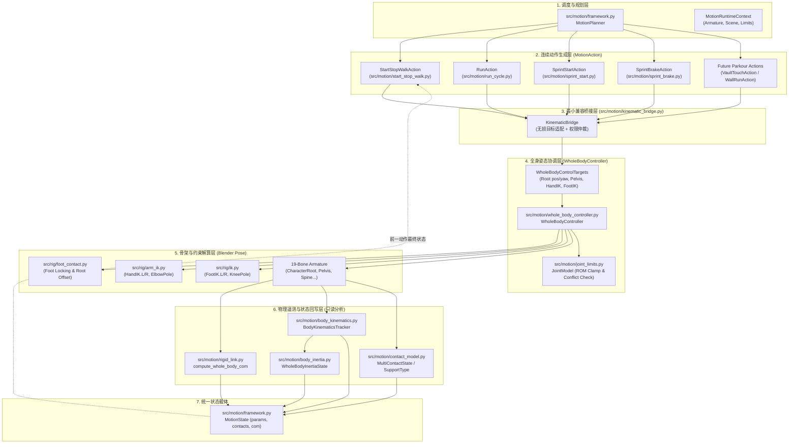

# ARCHITECTURE_SYNC: 架构同步与模块调用规范卡片

> **最新架构审计基准版本**：v3.0 (Task 6G-D-C2-FINAL 6G 动力学最终收口、全量工程审计与运动底座架构冻结)  
> **审计基准 Git SHA**：`d0d73d476e2f2d3f3b629d767744ab12ba867bf8`  
> **权威架构文档集合**：详见 [`docs/FOUNDATION_ASSET_AUDIT.md`](docs/FOUNDATION_ASSET_AUDIT.md)、[`docs/FOUNDATION_ARCHITECTURE_AUDIT.md`](docs/FOUNDATION_ARCHITECTURE_AUDIT.md)、[`docs/FOUNDATION_DEPENDENCY_MAP.md`](docs/FOUNDATION_DEPENDENCY_MAP.md)、[`docs/FOUNDATION_STATE_OWNERSHIP.md`](docs/FOUNDATION_STATE_OWNERSHIP.md)、[`docs/ROADMAP_FOUNDATION_TO_FULLBODY.md`](docs/ROADMAP_FOUNDATION_TO_FULLBODY.md) 与 [`docs/C2_FINAL_VALIDATION.md`](docs/C2_FINAL_VALIDATION.md)  
> **当前状态**：动力学 73 状态（Frame 1..73）全闭环对齐，接触力二次规划求解与辛前向积分经 100% 机器遥测硬断言通过；底座正式冻结进入只读维护，严禁自动衍生 C2-B/C3/6G-E 分支，严格停止等待人类指令  
> **核心原则**：磁盘代码与真实运行调用链是唯一事实依据。单刚体集总 CoM 动力学内核与历史成熟步态保持 100% 兼容与零退化。

---

## 1. 架构版本与十项核心原则 (Architecture Version & 10 Core Principles)

全系统在运动生成与姿态求解中必须严格遵循以下十项基本原则：

1. **MotionAction 是连续运动目标的生成者**：负责解析计算连续时间轴上的根节点运动轨迹、质心高度起伏、四肢末端世界空间期望轨迹及接触意图。它绝不直接操作底层约束 Empty 或骨骼欧拉角。
2. **WholeBodyController 是统一姿态协调器**：负责统一协调全身姿态分配，集中调度双腿 IK、双臂 IK/FK、骨盆位移与脊柱姿态。**WBC 绝不负责步态调度、步频计算或时间轴演化**。
3. **现有 IK/FK 是实际骨架求解执行机构**：Blender 的两骨 IK 约束与旋转复制约束是骨架运动解算的真实底层执行机构，WBC 通过控制器 Empty 物体驱动求解器。
4. **JointModel 负责 ROM 检查，严禁截断后虚报成功**：若启用 ROM 投影截断（Clamp Mode），**必须重新检查四肢末端目标误差；若 ROM 截断导致四肢末端脱离规划目标超过公差，必须真实返回 `ROM_CONFLICT` 错误且标记 `success = False`，绝对不得截断后虚报成功**。
5. **ContactModel 负责接触状态与几何检查，不直接取代脚部锁定执行器**：`ContactModel` 负责四肢接触几何检测（法向间隙、穿透深度、切向滑移）、接触生命周期状态机与支撑状态分类，它不直接操作 `FootIK` Empty 物体。
6. **FootContactAdapter (foot_contact.py) 负责执行实际世界空间接触锁定**：真实的零漂移足部锁定由 `src/rig/foot_contact.py` 通过解除 `FootIK` 父级并在世界坐标系下原位固定来执行。
7. **BodyKinematics、CoM、BodyInertia 当前是纯只读评估模块**：`rigid_link.py`（CoM）、`body_kinematics.py`（速度/加速度）、`body_inertia.py`（惯性张量/角动量）目前均为事后只读遥测模块，**严禁宣称它们已参与动力学闭环控制**。
8. **MotionState 负责保存已执行姿态对应的真实状态**：`MotionState` 是不可变的帧状态快照，用于持久化当前帧实际评估得到的位姿、真实线速度/角速度、接触字典与物理遥测指标，供后续动作或时间步读取。
9. **状态回传不等同于主动反馈控制，更不等于真实动力学仿真**：将物理遥测数据写入 `MotionState.params` 仅为只读数据持久化，在缺少受力计算与主动误差修正回路前，系统本质上仍是开环运动学驱动。
10. **未来动力学约束求解器应前置发挥作用**：未来 6G-D 引入的接触力、冲量与质心平衡约束，应在运动目标应用之前或协调求解过程中发挥前向调整作用，不能仅做最终姿态的事后被动检查。

---

## 2. 模块依赖关系与数据流向图 (Module Dependency Graph)

---

## 3. 官方认可的连续运动管线单帧 6 阶段执行协议 (Official 6-Phase Pipeline)

在后续所有任务中，唯一合法的单帧生成数据流必须严格遵循以下 **6 个阶段**：

1. **Phase 1: 动作运动学规划 (Kinematic Planning)**  
   * 动作实例（`MotionAction`）根据当前时间步 $t$、步态周期 $u$ 及上一状态 $S_{k-1}$，解析计算出：
     * 角色根节点期望世界位置与朝向：$P_{\text{root}}(t), \theta_{\text{root}}(t)$；
     * 双脚踝关节世界空间目标坐标与接地/摆动布尔标记（接触意图）；
     * 双手手腕世界空间目标坐标（或手臂 FK 姿态角度）；
     * 骨盆下沉高度与脊柱躯干倾角。
   * 产物：`WholeBodyControlTargets` 或规划目标结构体。
   * 状态所有者：归属于具体 `MotionAction`。严禁在此阶段直接修改 Blender 骨骼。

2. **Phase 2: 接触状态协调与锁定 (Contact Coordination & Locking)**  
   * 解释接触意图。维持已有支撑脚世界锚点（零漂移，`parent = None`）；对摆动脚执行解锁；手部抓握建立锚点。
   * 状态所有者：足部世界锁定状态独占归属于 `foot_contact.py`。
   * 禁止绕过规则：严禁在根节点位移前解锁支撑脚；严禁多模块同时重复写入 `FootIK`。

3. **Phase 3: 全身姿态统一求解 (WBC Pose Solve)**  
   * `WholeBodyController.execute_frame(armature, targets)` 接收目标：
     * 执行根节点世界位移（`CharacterRoot`）；
     * 应用骨盆局部偏移与躯干 FK 欧拉角；
     * 驱动四肢两骨双轴 IK 求解器（`arm_ik` 与 `ik`）。
   * 状态所有者：`WholeBodyController` 独占对骨架与控制器写入权。杜绝私有姿态函数绕过。

4. **Phase 4: 真实性与冲突校验 (Truthful Validation)**  
   * 调用 `depsgraph.update()`。
   * 由 `JointModel` 校验解剖 ROM，计算四肢末端追踪误差与接触几何穿透。
   * **若启用 ROM 截断（Clamp），必须重新检查末端误差；若因截断导致末端超差，真实报告 `ROM_CONFLICT` 且 `success = False`，绝不虚报成功**。

5. **Phase 5: 场景评估与物理遥测 (Evaluation & Telemetry)**  
   * 从更新后的骨架姿态中提取纯只读遥测：
     * `compute_whole_body_com`：真实物理质心世界坐标 $(X_{\text{com}}, Y_{\text{com}}, Z_{\text{com}})$；
     * `BodyKinematicsTracker`：有限差分计算根节点、连杆、质心的瞬时线速度与角速度；
     * `WholeBodyInertiaState`：合成全身体惯性张量与自转/轨道角动量；
     * `ContactModel`：评估肢体末端与环境的间隙、穿透、滑移和支撑状态分类（`SupportType.DOUBLE_STANCE` / `SINGLE_STANCE_L` / `SINGLE_STANCE_R` / `FLIGHT` 等）。

6. **Phase 6: 状态回写与持久化 (State Commit)**  
   * 将上述遥测数据组装为新的 `MotionState`，打入当前帧关键帧并存入动作的 `frame_states` 列表，为下一时间步或动作切换提供初值。

---

## 4. 历史动作入口点与重用规范 (Historical Action Reuse Matrix)

所有历史动作必须通过其官方类与生成器重用，**严禁重新编写重复的步态生成逻辑**：

| 动作标识 | 任务编号 | 源码实现位置 | 核心调用入口 | 步态与速度特性 | 当前状态 |
| :--- | :--- | :--- | :--- | :--- | :--- |
| **Walk Cycle** | Task 5A | `src/motion/walk_cycle.py` | `generate_walk_cycle(armature, frames=72)` | 固定原地循环周期（36 帧/步），归一化相位 $u \in [0, 1)$ | 历史原型（保持回归） |
| **Forward Walk** | Task 5B | `src/motion/forward_walk.py` | `generate_forward_walk(armature, steps=4)` | 沿 $+Y$ 直线前向跨步，步幅累加调度 | 历史原型（保持回归） |
| **StartStopWalkAction** | Task 5C / 6A | `src/motion/start_stop_walk.py` `src/motion/framework.py` | `StartStopWalkAction(steps=7, step_duration=12)` `generate_start_stop_walk(...)` | 7 个连续步态调度；$C^1$ 速度曲线（0 $\rightarrow$ 0.24 $\rightarrow$ 0 m/s）；世界空间零漂移锁定 | **已迁移至统一桥接层 (已验证)** |
| **RunAction** | Task 6B | `src/motion/run_cycle.py` | `RunAction(cycles=4, half_period_frames=12)` | 具备双脚离地单腾空相（支撑 7 帧，腾空 5 帧）；速度 $1.0\text{ m/s}$；跑动屈肘；生理踝俯仰 | **已迁移至统一桥接层 (已验证)** |
| **SprintStartAction** | Task 6C | `src/motion/sprint_start.py` | `SprintStartAction(prep_frames=12, drive_frames=24)` | 三阶段爆发式起跑；躯干深俯；峰值速度 $3.6\text{ m/s}$；冲刺踝俯仰 | **已迁移至统一桥接层 (已验证)** |
| **SprintBrakeAction** | Task 6D | `src/motion/sprint_brake.py` | `SprintBrakeAction(target_stop_pos=...)` | 4 阶段主动急停；躯干后仰制动；峰值减速度 $-6.0\text{ m/s}^2$；制动踝俯仰 | **已迁移至统一桥接层 (已验证)** |

---

## 5. WholeBodyController 真实定位与调用规范

* **模块位置**：`src/motion/whole_body_controller.py`。
* **真实定位**：**姿态求解与约束协调器（Pose Coordinator）**。它不是动作发生器（Action Generator），不维护时间轴轨迹，不自行决定脚何时离地。
* **输入规范**：必须接收 `WholeBodyControlTargets` 实例。
* **FK 与 IK 优先级规则**：
  * **手臂**：`hand_tgt.enabled == True` 时激活 IK（权重 `weight`），覆盖 FK；`hand_tgt.enabled == False` 时禁用 IK，骨骼由 `fk_joint_rotations_deg` 独占控制。
  * **腿部**：若 `foot_tgt.is_locked == True`，为 Stance 支撑相，由 `foot_contact.py` 维持世界空间锁定（`parent = None`）；若 `is_locked == False`，为 Swing 摆动相，解锁后由 `set_foot_ik_target` 驱动。
* **独占写入原则**：严禁出现两个模块同时向同一骨骼或 IK 控制物体写入位姿。

---

## 6. 统一枚举名与模块名修正表 (Corrected Enums & Module Reference)

为消除历史 AI 描述偏差，全系统枚举与模块名称以源码为唯一标准核准如下：

| 概念分类 | 源码标准名称 | 源码定义位置 | 曾用或错误名称（严禁再用） | 合法枚举值列表 |
| :--- | :--- | :--- | :--- | :--- |
| **支撑类型** | `SupportType` | `src/motion/contact_model.py` | `STABLE_FEET`, `StableStance` | `DOUBLE_STANCE`, `SINGLE_STANCE_L`, `SINGLE_STANCE_R`, `HAND_SUPPORT`, `WALL_FOOT_STANCE`, `LEDGE_HANG`, `MULTI_SURFACE`, `FLIGHT` |
| **接触类型** | `ContactType` | `src/motion/contact_model.py` | `UnilateralContact`, `HardContact` | `UNILATERAL`, `GRASP`, `FREE` |
| **接触生命周期** | `ContactLifecycle` | `src/motion/contact_model.py` | `ContactState` | `CANDIDATE`, `ESTABLISHED`, `RELEASED`, `BROKEN` |
| **ROM 约束模式** | `ConstraintMode` | `src/motion/joint_limits.py` | `ROMMode`, `LimitType` | `BOX_EULER`, `ELLIPTICAL_CONE`, `HINGE_1D` |
| **运动模式** | `MotionMode` | `src/motion/framework.py` | `GaitMode` | `STAND`, `WALK`, `RUN`, `SPRINT`, `BRAKE`, `JUMP`, `FALL`, `CUSTOM` |
| **足部世界锁定** | `lock_foot_contact` | `src/rig/foot_contact.py` | `FootLockAdapter`, `ContactLock` | 函数：`lock_foot_contact(arm, side, ...)` |
| **双腿 IK 求解** | `set_foot_ik_target` | `src/rig/ik.py` | `LegIKSolver` | 函数：`set_foot_ik_target(arm, side, ...)` |
| **双臂 IK 求解** | `set_hand_ik_target` | `src/rig/arm_ik.py` | `ArmIKSolver` | 函数：`set_hand_ik_target(arm, side, ...)` |

---

## 7. 模块分类清单 (Module Classification List)

* **7.1 已集成生产模块 (Integrated Production Modules)**：
  - `src/motion/framework.py`：`MotionPlanner`, `MotionState`, `ContactConstraintAdapter`, `BlenderPoseApplicator`
  - `src/motion/start_stop_walk.py`：`StartStopWalkAction`, 7 步步态调度器
  - `src/motion/run_cycle.py`：`RunAction`, 腾空相步态发生器
  - `src/motion/sprint_start.py`：`SprintStartAction`, 爆发起跑运动学
  - `src/motion/sprint_brake.py`：`SprintBrakeAction`, 急停制动运动学
  - `src/rig/builder.py`：19 骨骼层级与 13 分段占位体装配
  - `src/rig/ik.py`：腿部两骨 IK 求解与极向约束
  - `src/rig/foot_contact.py`：脚部世界坐标锁定与根节点零漂移移动
  - `src/rig/arm_ik.py`：手臂双骨 IK 求解与手部空间姿态对齐
  - **`src/motion/kinematic_bridge.py`**（Task 6G-C-R3B-1 新增）：最小兼容桥接层与目标转换器
* **7.2 统一姿态与只读评估模块 (Coordinator & Read-Only Modules)**：
  - `src/motion/whole_body_controller.py`：姿态求解与约束协调器
  - `src/motion/joint_limits.py`：解剖 ROM 校验与冲突报告器
  - `src/motion/rigid_link.py`：前向运动学多连杆质心计算器
  - `src/motion/body_kinematics.py`：事后微分运动学速度分析器
  - `src/motion/body_inertia.py`：事后惯性张量与全身体角动量分析器
  - `src/motion/contact_model.py`：事后多部位接触几何与支撑分类器
* **7.3 统一桥接层已迁移历史动作 (Migrated Historical Actions via KinematicBridgeExecutor)**：
  - `StartStopWalkAction`、`RunAction`、`SprintStartAction`、`SprintBrakeAction` 已 100% 接入 `KinematicBridgeExecutor` 与 `WholeBodyController`，经独立回归套件及统一 462 帧连续动画管线验证通过。

---

## 8. 永久架构纪律与反伪造开发守则 (Permanent Architectural Discipline)

后续任何新模块开发或重构，必须无条件遵循以下守则：

1. **统一架构阶段声明**：必须明确指明新增模块接入统一架构单帧执行协议的哪一阶段（Phase 1 至 Phase 6）。
2. **清晰调用链与被调用者**：必须指明真实调用者（Caller）与被调用者（Callee），严禁创建无上游调用的孤立执行分支。
3. **输入输出与状态所有权**：必须明确声明输入参数、输出结构体及对 Blender 骨骼/控制器物体的独占或共享读写权限。
4. **强制复用已有模块**：严禁重复实现已存在的运动学、物理计算或控制能力。
5. **历史回归基线锁定**：每次迭代必须无条件运行历史核心测试套件（Task 5C、6B、6C、6D、6F-D、6G-A、6G-B、6G-C），确保零退化。
6. **严禁独立演示管线冒充生产能力**：禁止编写独立的 Blender 脚本在固定时间轴上手工摆拍姿态，必须通过标准动作生成器与统一执行协议生成连续时间轴动画。
7. **严禁为人为迎合数值阈值破坏姿态自然度**：禁止通过人为强制修改骨骼位置或隐藏误差来通过测试断言。
8. **架构偏差事前审批制度**：若在开发中发现确有必要偏离本架构蓝图，必须先暂停并向用户详细记录架构变更原因及影响，严禁悄悄绕开。

---

## 9. 本次同步依据的 Git Commit SHA

* **底层基准 Commit**：`d76f035`
* **当前任务**：Task 6G-C-R3B-2（历史动作无损迁移至统一桥接层与全身控制架构）
* **工作树状态**：干净、严格受版本控制。
