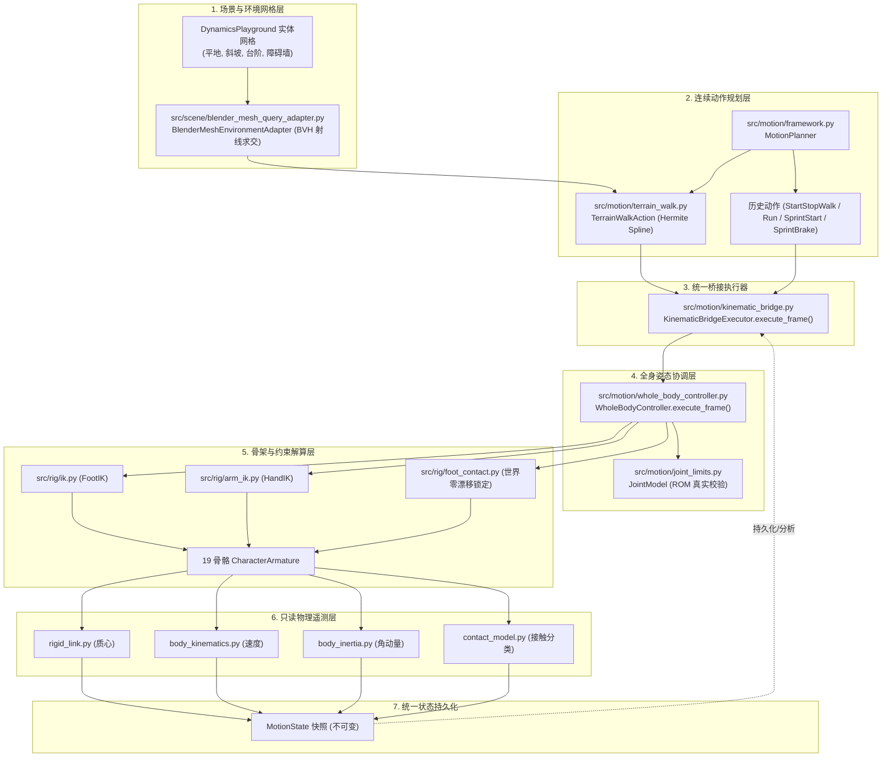

# ARCHITECTURE_SYNC: 架构同步与模块调用规范卡片

> **最新架构审计基准版本**：v4.0 (Environment Gate 01 最终架构审计与全工程状态同步)  
> **审计基准 Git SHA**：`7a3e244825cd87bf3d787c530318055dc94a3e1f`  
> **权威架构文档集合**：详见 [`ARCHITECTURE.md`](ARCHITECTURE.md)、[`docs/audit/environment_gate01_final/`](docs/audit/environment_gate01_final/)  
> **当前状态**：Environment Gate 01（Unit 1 至 Unit 4）全部验收并审计通过；四级测试全绿（quick 18/18, physics 21/21, motion 11/11, full 35/35）；无遗留 BLOCKER；底座正式冻结，等待用户确认后进入 Phase 7B  
> **核心原则**：磁盘代码与真实运行调用链是唯一事实依据。19 骨骼人体运动系统为纯运动学驱动伴随真实几何环境感知，底层纯 Python 动力学算子作为算法储备库保持独立。

---

## 1. 架构版本与十项核心原则 (Architecture Version & 10 Core Principles)

全系统在运动生成与姿态求解中必须严格遵循以下十项基本原则：

1. **MotionAction 是连续运动目标的生成者**：负责解析计算连续时间轴上的根节点运动轨迹、质心高度起伏、四肢末端世界空间期望轨迹及接触意图。它绝不直接操作底层约束 Empty 或骨骼欧拉角。
2. **WholeBodyController 是统一姿态协调器**：负责统一协调全身姿态分配，集中调度双腿 IK、双臂 IK/FK、骨盆位移与脊柱姿态。**WBC 绝不负责步态调度、步频计算或时间轴演化**。
3. **现有 IK/FK 是实际骨架求解执行机构**：Blender 的两骨 IK 约束与旋转复制约束是骨架运动解算的真实底层执行机构，WBC 通过控制器 Empty 物体驱动求解器。
4. **JointModel 负责 ROM 检查，严禁截断后虚报成功**：若启用 ROM 投影截断（Clamp Mode），**必须重新检查四肢末端目标误差；若 ROM 截断导致四肢末端脱离规划目标超过公差，必须真实返回 `ROM_CONFLICT` 错误且标记 `success = False`，绝对不得截断后虚报成功**。
5. **ContactModel 负责接触状态与几何检查，不直接取代脚部锁定执行器**：`ContactModel` 负责四肢接触几何检测（法向间隙、穿透深度、切向滑移）、接触生命周期状态机与支撑状态分类，它不直接操作 `FootIK` Empty 物体。
6. **FootContactAdapter (foot_contact.py) 负责执行实际世界空间接触锁定**：真实的零漂移足部锁定由 `src/rig/foot_contact.py` 通过解除 `FootIK` 父级并在世界坐标系下原位固定来执行。
7. **BodyKinematics、CoM、BodyInertia 当前是纯只读评估模块**：`rigid_link.py`（CoM）、`body_kinematics.py`（速度/加速度）、`body_inertia.py`（惯性张量/角动量）目前均为事后只读遥测模块，**严禁宣称它们已参与动力学闭环控制**。
8. **MotionState 负责保存已执行姿态对应的真实状态**：`MotionState` 是不可变的帧状态快照，用于持久化当前帧实际评估得到的位姿、真实线速度/角速度、接触字典与物理遥测指标，供后续动作或时间步读取。
9. **状态回传不等同于主动反馈控制，更不等于真实动力学仿真**：将物理遥测数据写入 `MotionState.params` 仅为只读数据持久化，在缺少受力计算与主动误差修正回路前，系统本质上仍是开环运动学驱动。
10. **环境网格查询作为单一几何几何感知源**：真实几何环境感知统一收敛至 [`src/scene/blender_mesh_query_adapter.py`](src/scene/blender_mesh_query_adapter.py)，严禁在真实地形运动中退回到硬编码解析地面。

---

## 2. 生产主执行链依赖拓扑 (Production Call Chain)

---

## 3. 权威模块集成状态矩阵 (Authoritative Integration Matrix)

根据 Audit A 审计结果，全工程模块当前集成状态划分为 7 级，严禁混淆：

| 模块集成等级 | 核心定义 | 包含的典型模块 | 生产主链调用状态 |
| :--- | :--- | :--- | :--- |
| **`PRODUCTION_ACTIVE`** | 处于 19 骨骼主执行链中，直接影响骨骼位姿或地形感知 | `framework.py`, `terrain_walk.py`, `kinematic_bridge.py`, `whole_body_controller.py`, `blender_mesh_query_adapter.py`, `foot_contact.py`, `ik.py`, `arm_ik.py` | 每一帧真实执行，独占写入 |
| **`PARTIALLY_INTEGRATED`** | 处于主循环但存在功能局限或开环告警 | `TerrainRouteInput`（单走廊限制）, `JointModel`（ROM 校验开环） | 处于主链但能力受限 |
| **`TELEMETRY_ONLY`** | 每一帧在主链执行，但结果仅作为只读日志或字典保存，无控制反馈 | `rigid_link.py` (CoM), `body_kinematics.py`, `body_inertia.py`, `contact_model.py` | 仅读取姿态，零写入/零反馈 |
| **`TEST_ONLY`** | 纯算法实现完备且测试通过，但未接入 19 骨骼人体主循环 | `contact_force_solver.py`, `forward_dynamics.py`, `contact_dynamics.py`, `closed_loop_dynamics.py` | 仅在独立单元测试中运行 |
| **`PROTOTYPE_ONLY`** | 早期独立动作原型，未封装为标准 MotionAction | `walk_cycle.py`, `forward_walk.py` | 仅供历史回归参考 |
| **`UNUSED`** | 早期弃用或完全被新模块替代的遗留接口 | 旧版无头解析环境替代函数 | 无生产调用 |
| **`UNVERIFIED`** | 尚未经过机器自动化验证的模块 | 本工程当前为 0 | 0 |

---

## 4. 后续任务准入规则 (Next Stage Admission)

1. **Phase 7B (独立上肢运动学)**：
   * **当前状态**：AUDITED / AUTHORIZED TO PROCEED
   * **准入约束**：必须首先解耦 `TerrainWalkAction` 中写死的正弦摆臂（FIND-01），利用已就绪的 `arm_ik.py` 和 WBC 槽位实现双臂独立 IK 轨迹控制。
2. **Phase 7C (动力学主循环接入)**：
   * **当前状态**：NOT AUTHORIZED
   * **准入约束**：待 7B 验收后方可准入，届时复用现有 `contact_force_solver.py`。
3. **Phase 7D / 双向动力学**：
   * **当前状态**：NOT AUTHORIZED
