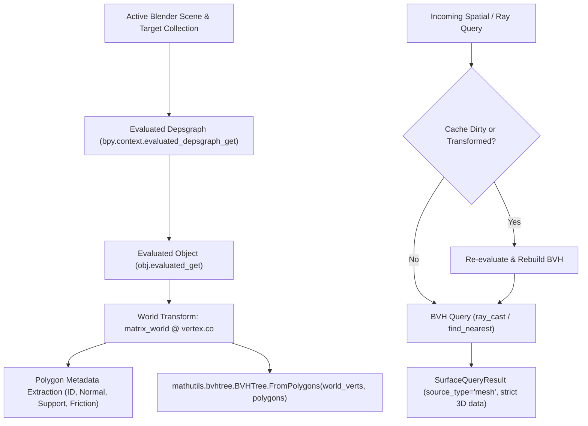

# Environment Mesh Query Architecture & Data Authenticity Semantics

> **Document Status**: COMPLETED ARCHITECTURAL SPECIFICATION & SEMANTICS  
> **Milestone**: Environment Gate 01  
> **Target Date**: 2026-10-27  
> **Source Modules**: `src/scene/blender_mesh_query_adapter.py`, `src/scene/environment_query.py`  
> **Automated Verification**: `tests/test_mesh_environment_query.py`  

---

## 1. Resolution of the Dual Source of Truth

Prior to Environment Gate 01, the ProceduralAnimation codebase suffered from a fundamental architectural tension identified in `AUDIT-03`:
* **Mesh Construction**: `src/scene/builder.py` built 3D polygonal meshes (`Surface_FlatGround`, `Surface_Ramp_Up`, `Surface_Stair_01`..`05`, `Surface_Ramp_TopPlatform`, etc.) inside Blender.
* **Environment Querying**: `src/scene/environment_query.py` evaluated an independent database of mathematical `OrientedSurface` plane equations.
* **Consequence**: The analytical planner remained completely blind to scene modifications, mesh deformations, translations, or artist edits.

### The Single Ground Truth Policy:
Under Environment Gate 01, the authority of data is explicitly codified:
1. **Live Blender Runtime**: The actual evaluated 3D mesh (`bpy.types.Mesh` under `depsgraph`) is the **sole geometric source of truth**.
2. **Analytical Surfaces**: Retained exclusively for pure Python unit testing and legacy backward compatibility without Blender.
3. **Traceability**: Every query result explicitly stamps its data provenance via `source_type` (`"mesh"`, `"analytical"`, `"default"`, or `"none"`).
4. **Zero Silent Fallback**: If a directional ray misses all evaluated geometry, it returns `success=False` with a diagnostic error reason. It is strictly prohibited from fabricating a flat ground plane at $Z = 0.0\text{ m}$.

---

## 2. World-Space BVH Tree Architecture

The real-geometry adapter [`src/scene/blender_mesh_query_adapter.py`](file:///c:/Users/64701/OneDrive/Desktop/ProceduralAnimation/src/scene/blender_mesh_query_adapter.py) implements world-space spatial partitioning via Blender's accelerated C-kernel bounding volume hierarchy (`mathutils.bvhtree.BVHTree`).



### 2.1 Geometric Evaluation & Normal Calculation
1. **Evaluated Mesh Extraction**:
   For each tracked mesh object, the adapter queries its evaluated state via `obj.evaluated_get(depsgraph).to_mesh()`. This applies all active modifiers, sub-surf deformations, and shape keys.
2. **Direct World-Space Coordinate Mapping**:
   Vertices are multiplied by the object's 4x4 world matrix:
   $$\mathbf{v}_{\text{world}} = \mathbf{M}_{\text{world}} \begin{bmatrix} v_x \\ v_y \\ v_z \\ 1 \end{bmatrix}$$
3. **Vertex-Derived Normal Vectors**:
   Rather than relying on local polygon normals subject to non-uniform object scale shear, the outward unit normal $\mathbf{N}$ is calculated directly from the world-space triangle edge cross-products:
   $$\mathbf{e}_1 = \mathbf{v}_1 - \mathbf{v}_0, \quad \mathbf{e}_2 = \mathbf{v}_2 - \mathbf{v}_0$$
   $$\mathbf{N} = \frac{\mathbf{e}_1 \times \mathbf{e}_2}{\|\mathbf{e}_1 \times \mathbf{e}_2\|}$$
   This guarantees that outward normals are exact unit vectors reflecting the true world orientation of the surface.

---

## 3. Cache & Invalidation Rules

To avoid redundant depsgraph evaluations while guaranteeing that scene edits are immediately reflected in query results, the adapter implements a strict three-tier cache policy:

| Rule | Trigger | Behavior | Performance / Overhead |
| :--- | :--- | :--- | :--- |
| **Pristine Cache** | Query executed without scene mutations | Reuses existing `BVHTree` and polygon metadata | $O(\log N)$ BVH traversal ($\sim 5\mu s$) |
| **Transform Drift Detection** | Object translated or rotated in Blender | `refresh()` detects $\Delta \mathbf{M}_{\text{world}} > 10^{-6}$ and triggers `rebuild()` | Detects transform in $O(M)$ objects, rebuilds in $\sim 1ms$ |
| **Vertex Edit Invalidation** | Raw vertices or faces edited in mesh | Explicit `invalidate()` or `rebuild()` | Re-extracts evaluated geometry and rebuilds BVH tree |

---

## 4. Query Contract & Semantic Data Fields

The query engine standardizes all returns via `SurfaceQueryResult`. The semantic definitions of its fields when backed by live mesh geometry are as follows:

```python
@dataclass
class SurfaceQueryResult:
    surface_id: str                   # "mesh:<object_name>:<polygon_index>" or "none"
    surface_type: str                 # "horizontal_ground", "sloped_ramp", "stair_tread", "vertical_wall", etc.
    contact_point_world: Tuple[float, float, float]  # Exact (x, y, z) intersection on mesh surface in meters
    surface_normal_world: Tuple[float, float, float] # Unit outward normal vector (nx, ny, nz)
    signed_distance: float            # Signed distance: >0 gap (in front), 0.0 on face, <0 penetration (behind)
    friction_coeff: float             # Static friction coefficient (e.g. 0.65)
    allows_regular_support: bool      # True if surface is eligible for foot stance support; False for walls/ledges
    success: bool                     # True if surface was intersected/found; False on miss
    ray_hit_distance: Optional[float] = None  # Non-negative Euclidean distance traveled along ray
    error_reason: Optional[str] = None        # Diagnostic message on failure; None on success
    source_type: str = "analytical"   # Data provenance: "mesh", "analytical", "default", "none"
```

### 4.1 Regular Foot Support Eligibility (`allows_regular_support`)
A surface is **not** eligible for human foot support simply because a ray struck it. The adapter enforces strict biomechanical admissibility:
* **Horizontal Ground & Platforms** ($N_z \ge 0.99$): `allows_regular_support = True`.
* **Sloped Ramps** ($0.50 \le N_z < 0.99$, slope angle $\le 60^\circ$): `allows_regular_support = True`.
* **Vertical Obstacle Walls & Stair Risers** ($|N_z| < 0.15$): `allows_regular_support = False`.
* **Overhangs & Ceilings** ($N_z < 0$): `allows_regular_support = False`.
* **Explicit Property Override**: If `obj["allows_regular_support"]` is set on the Blender object, its boolean value overrides geometric heuristics.

### 4.2 Friction Metadata Policy
* **Scene-Defined Friction**: If an object or its assigned material defines `"friction_coeff"`, that value is extracted and used.
* **Default Fallback**: If no friction property exists, the adapter assigns a standard default ($\mu = 0.65$) without fabricating a measured property.
* **Integrity Guarantee**: When no surface is hit, friction is strictly reported as `0.0`.

### 4.3 Ground Height Query vs. Gap / Cliff Detection
* **Legacy Compatible Interface (`ground_height_at(x, y) -> float`)**:
  Casts a vertical downward ray from $(x, y, 50.0\text{ m})$. If a walkable mesh surface is struck, returns its exact elevation $Z$. If no surface is struck, falls back to `ground_z` ($0.0\text{ m}$) to satisfy legacy float return contracts.
* **Strict Physical Interface (`ray_ground_elevation(x, y) -> Optional[float]`)**:
  Casts a vertical downward ray. Returns `float` only if an actual walkable mesh is intersected; returns `None` when crossing empty air, cliffs, or open chasms. The locomotion planner must use this interface to detect drops and prevent walking into space.

---

## 5. Host Adapter Decoupling & Engine Independence

In accordance with Section 2 of the project specifications:
* **Host Layer (`src/scene/blender_mesh_query_adapter.py`)**: Couples with Blender's `bpy` and `mathutils.bvhtree` C-extensions.
* **Core Interface (`src/scene/environment_query.py`)**: Contains zero `bpy` imports. Retains pure Python dataclasses and mathematical methods.
* **Pluggable Architecture**: `DynamicsEnvironmentQuery` accepts `mesh_adapter` via dependency injection (`set_mesh_adapter`). In headless environments without Blender or during fast mathematical CI tests, `DynamicsEnvironmentQuery` runs purely in Python with 100% backward compatibility.

---

## 6. Candidate Scope Isolation & Surface Filter Semantics (Repair Unit 1)

Following the audit of Environment Gate 01, three semantic defects in candidate scope and surface filtering were identified and resolved under Repair Unit 1:

### 6.1 Strict Candidate Scope Isolation (Defect A03)
When gathering target mesh objects from the scene, the adapter strictly adheres to three mutually exclusive modes:
1. **Explicit Collection Mode (`collection_names is not None`)**:
   Queries meshes strictly contained within the specified collections (retaining recursive subcollection traversal). Never includes other collections and **never falls back to a full scene scan**, even if a collection does not exist or contains zero meshes (in which case it evaluates to $\emptyset$).
2. **Explicit Object Mode (`object_names is not None`)**:
   Queries specified mesh object names only. Non-existent names or non-mesh objects are ignored; duplicate names are deduplicated; never falls back to full scene scan.
3. **Explicit Full-Scene Mode (`collection_names is None and object_names is None`)**:
   Permitted exclusively when both parameters are explicitly passed as `None`. Full-scene scanning is strictly prohibited as an implicit fallback.

**Data Invariant**:
$$\text{QueriedObjects} \subseteq \text{ExplicitlyAllowedObjects}, \quad \text{NonExistentCollection} \implies \text{QueriedObjects} = \emptyset$$

### 6.2 Raycast Surface Filtering Semantics (Defect A01 & T03 Iteration Mechanics)
1. **Unfiltered Raycast (`surface_type_filter is None`)**:
   Returns the nearest physical surface hit along the ray path. Never penetrates or searches behind the first intersection.
2. **Filtered Raycast (`surface_type_filter is not None`)**:
   Searches forward along the ray path up to `distance` for the closest surface matching `surface_type_filter`.
   * Advances forward past non-matching intersections using high-precision step push `step_epsilon = 1e-6` ($1\mu m$), with dynamic adaptive scaling if numerical polygon re-hits occur.
   * Resolves thin geometric layers down to $50\mu m$ without skipping.
   * Guaranteed positive progression and termination within at most `max_steps` (default 64 steps).
   * `ray_hit_distance` strictly reports the cumulative Euclidean distance from the original ray origin, not a local step distance.
   * *Note*: This is a geometric query and does not imply human body penetration feasibility across obstacle surfaces.

### 6.3 Nearest Point Surface Filtering Semantics (Defect A02)
1. **Unfiltered Nearest Point (`surface_type_filter is None`)**:
   Returns the globally nearest mesh surface to the query point within `max_distance`.
2. **Filtered Nearest Point (`surface_type_filter is not None`)**:
   Performs a native accelerated range search (`find_nearest_range(point, max_distance)`) and selects the surface matching `surface_type_filter` with the minimal Euclidean distance to the query point. If no matching surface exists within `max_distance`, strictly returns `success = False`.

### 6.4 Error Reason Disambiguation & Diagnostics (T03)
When a query returns `success=False`, `error_reason` explicitly distinguishes between geometric misses and iteration limits:
* `SEARCH_LIMIT_REACHED:` Step budget (`max_steps`) was exhausted before reaching query distance while searching for filtered surface.
* `NO_HIT:` Ray completed search up to query distance without intersecting any surface matching the filter (or no surface at all).

Evidence artifacts, coverage matrices, and real fault injection execution logs are preserved in [`docs/evidence/environment_gate01_ru1/`](file:///c:/Users/64701/OneDrive/Desktop/ProceduralAnimation/docs/evidence/environment_gate01_ru1/).

---

## 7. BVH Cache Invalidation, Geometry Consistency & Lifecycle State Machine (Repair Unit 2)

Following the audit of Environment Gate 01, six critical cache invalidation and geometry consistency defects (C01 through C06) were resolved under Repair Unit 2:

### 7.1 Five-State Cache Lifecycle (`AdapterCacheState`)
Legacy implementations relied exclusively on `_bvh is None` as an implicit cache dirty check, which broke down in empty environments (causing repeated rebuilds on every query). Repair Unit 2 introduces an explicit state machine:

| Cache State | Description | Invariants & Guarantees |
|---|---|---|
| `INVALID` | Uninitialized or explicitly marked dirty via `invalidate()` | Forces rebuild on next spatial or ray query (Path B) |
| `VALID_EMPTY` | Evaluated collection confirmed to contain 0 meshes or 0 polygons | `has_bvh=False`, `is_empty=True`, `polygon_count=0`. Reused across queries with **0 rebuilds**; returns `success=False` without fabricating ground |
| `VALID_NON_EMPTY` | Evaluated geometry compiled into world-space `BVHTree` | `has_bvh=True`, `is_empty=False`, `polygon_count>0`. Reused across unchanged queries |
| `REBUILDING` | Active transient state during `rebuild()` execution | Guards against reentrant evaluation calls |
| `FAILED` | Exception occurred during depsgraph evaluation or BVH build | Rollback state; prevents publishing partial/corrupted geometry; sets `dirty=True` |

### 7.2 Dual Invalidation Paths (Path A vs Path B)
1. **Path A: Automatic Scene Change Detection (`_check_scene_changed()`)**:
   Evaluated automatically on every spatial query (`refresh()`). Inspects:
   * **Transformation Matrices**: Compares all 16 elements of `matrix_world` with $|\Delta| > 10^{-6}$. Accurately detects translation, rotation, non-uniform scale, and parent-child hierarchy transform propagation.
   * **Raw Geometry Coordinates**: Computes fast memory buffer hash (`array.array('f', ...)` + `foreach_get('co', ...)`) of raw vertex coordinates in $0.04\text{ ms}$, detecting sub-millimeter coordinate edits.
   * **Loop Topology**: Computes buffer hash of polygon loop vertex indices (`foreach_get('vertex_index', ...)`), detecting face additions, face deletions, and edge flips.
   * **Modifier State**: Inspects RNA properties of all modifiers, tracking parameter changes (e.g. solidify thickness, displace strength), modifier additions, deletions, and `show_viewport` toggles.
   * **Collection Membership**: Tracks object identities via `obj.session_uid` sets, detecting objects linked, unlinked, or deleted in target collections.
   * **In-Place Rename Optimization**: When an object is renamed without geometric or transform changes, `session_uid` matches the snapshot. The adapter updates `_poly_metadata` object names and surface IDs in-place with **zero BVH rebuilds** (`rebuild_count` unchanged).
2. **Path B: Explicit Invalidation (`adapter.invalidate()`)**:
   External callers trigger invalidation via `adapter.invalidate()`. The adapter sets `_dirty = True` and transitions to `AdapterCacheState.INVALID`. The caller is **not** required to call `rebuild()`; the very next regular query automatically detects dirty state, rebuilds BVH atomically, and returns fresh results.

### 7.3 Atomic Commit & Exception Safety
- All new vertices, polygons, metadata, and snapshots are staged in local variables before compiling the BVH.
- Evaluated mesh copies (`obj.evaluated_get(depsgraph).to_mesh()`) are tracked in an `eval_objs_to_clear` list and released in `finally:` via `eval_obj.to_mesh_clear()`, eliminating Blender memory leaks.
- If depsgraph evaluation or BVH construction fails, the adapter transitions to `AdapterCacheState.FAILED`, rolls back, and re-raises the exception without publishing partial state.

### 7.4 Verification & Counter-Factual Evidence
Unit 2 test cases (`test_33` through `test_42` in [`tests/test_mesh_environment_query.py`](file:///c:/Users/64701/OneDrive/Desktop/ProceduralAnimation/tests/test_mesh_environment_query.py)) verify:
- **C01**: 100 queries against empty environment execute with `rebuild_count = 1`.
- **C02**: Translation, rotation, non-uniform scale, and parent hierarchy propagation trigger rebuilds.
- **C03**: Vertex moves (Path A), topology additions, geometry deletions, and `invalidate()` (Path B).
- **C04**: Modifier additions, parameter adjustments, viewport toggles, and atomic rollback.
- **C05**: Collection membership changes and in-place rename without BVH rebuild.
- **C06**: 300 unchanged queries (100 same ray, 100 diff ray, 100 nearest) execute with `rebuild_count = 1`.

### 7.5 Invalidation Boundary Delineation & Final Closure Verification

#### 7.5.1 Invalidation Boundary: Automatically Detected vs Explicit Invalidation Required
To guarantee absolute architectural clarity and avoid cache desynchronization, the boundary between automatic detection (Path A) and explicit invalidation (Path B) is formally codified:

1. **Automatically Detected by Path A (`refresh()` on query)**:
   - **Transforms**: Object translation, rotation, scale, and world transforms propagated through parent-child hierarchies ($|\Delta| > 10^{-6}$).
   - **Mesh Geometry**: Edit-mode raw vertex movements, python vertex writes (`foreach_get('co')` buffer hash).
   - **Mesh Topology**: Face additions, deletions, edge flips (`foreach_get('vertex_index')` loop index buffer hash).
   - **Modifier Stack**: Modifier parameter changes, modifier additions/deletions, `show_viewport` visibility toggles (RNA property fingerprint).
   - **Collection Scopes**: Objects linked, unlinked, or deleted across allowed collections (including recursive subcollections) via `session_uid` tracking.
   - **Object Renames**: In-place rename without BVH rebuild.

2. **Explicit Invalidation Required via Path B (`adapter.invalidate()`)**:
   - **External Modifier Drivers**: Modifiers or geometry nodes driven by unqueried external scene objects or custom properties where depsgraph update events are not triggered on the queried object.
   - **Armature Bone Deformations / Physics Point Caches**: Complex bone deforms or physics simulation caches evaluated outside standard depsgraph scene evaluation.
   - **Timeline Playback without Property Dirtying**: Frame advancement where procedural scripts modify geometry without updating Blender RNA data properties.

#### 7.5.2 Real Geometric Scanning Overhead
The automatic detection path (`refresh()`) hashes vertex coordinates and inspects matrices to bypass expensive BVH rebuilding:
- **Hashing vs Rebuilding Performance**:
  - Scanning $100$ vertices costs $\approx 0.04\text{ ms}$, whereas full BVH compilation and normal calculation costs $\sim 1\text{ ms}$ to $10\text{ ms}$. Path A provides a $\sim 25\times$ to $250\times$ speedup when geometry is unchanged.
- **Scanning Overhead Statement**:
  - Scanning is **not** zero cost ($0\text{ ms}$). When scanning a scene with dozens of complex candidate objects, calling `_gather_target_objects()` and hashing millions of vertices on every query would introduce non-trivial CPU latency.
  - Therefore, candidate collection scoping (`collection_names` parameter, hardened in Repair Unit 1) is an architectural prerequisite: it bounds the scanning budget strictly to relevant terrain collections.

#### 7.5.3 Final Closure Verification (C05-1 through C05-4 & C06)
Repair Unit 2 Final Closure verifies five advanced lifecycle cases (`test_43` through `test_47`):
- **C05-1**: Unlinking an object from an allowed collection without deleting it from `bpy.data.objects` triggers exactly 1 rebuild, completely removes it from spatial/raycast query results, and strictly ignores objects in forbidden collections (`test_43`).
- **C05-2**: Real object deletion via `bpy.data.objects.remove(obj, do_unlink=True)` cleans cache metadata and triggers 1 rebuild with 0 dangling pointers and no exceptions (`test_44`).
- **C05-3**: When all objects are unlinked from a collection, state transitions from `VALID_NON_EMPTY` to `VALID_EMPTY`. Across 100 consecutive queries, `rebuild_count` remains unchanged (0 rebuilds), queries return `success=False` with `source_type="none"` without fabricating ground, and adding a new mesh cleanly recovers state to `VALID_NON_EMPTY` (`test_45`).
- **C05-4**: Recursive collection traversal (`col.all_objects`), unlinking from child collections, adding new meshes to child collections, and strict isolation of sibling collections (`test_46`).
- **C06**: Rebuild exception safety across candidate gather, snapshot computation, and BVH compilation (`mathutils.bvhtree.BVHTree.FromPolygons`), ensuring rollback to `AdapterCacheState.FAILED`, marking `_dirty = True`, releasing evaluated meshes, and self-healing recovery upon subsequent query (`test_47`).

#### 7.5.4 Expanded Counter-Factual Proofs (F01, F02, F03)
In addition to C01, C03, and C05, three dedicated counter-factual mutations were executed in Blender 5.1.1 Headless to physically prove falsifiability:
- **F01 (Member Retention Leak)**: Mutating `_check_scene_changed()` to check only `issubset` causes unlinked members to be retained in the BVH; test fails with Exit Code 1 (`AssertionError: True is not false : Unlinked Surface_A must no longer be hit by query`). Production code passes with Exit Code 0.
- **F02 (Empty BVH Repeated Rebuild Leak)**: Mutating `refresh()` to check `self._bvh is None` causes repeated rebuilds across 100 empty queries; test fails with Exit Code 1 (`AssertionError: 102 != 2 : Zero rebuilds allowed across 100 empty queries`). Production code passes with Exit Code 0.
- **F03 (Exception Residual in Rebuilding)**: Placing `_gather_target_objects()` outside `try:` leaves the adapter permanently stuck in `REBUILDING`; test fails with Exit Code 1 (`AssertionError: <AdapterCacheState.REBUILDING: 'rebuilding'> != <AdapterCacheState.FAILED: 'failed'>`). Production code passes with Exit Code 0.

Evidence logs and boundary reports are preserved in [`docs/evidence/environment_gate01_ru2/`](file:///c:/Users/64701/OneDrive/Desktop/ProceduralAnimation/docs/evidence/environment_gate01_ru2/).

