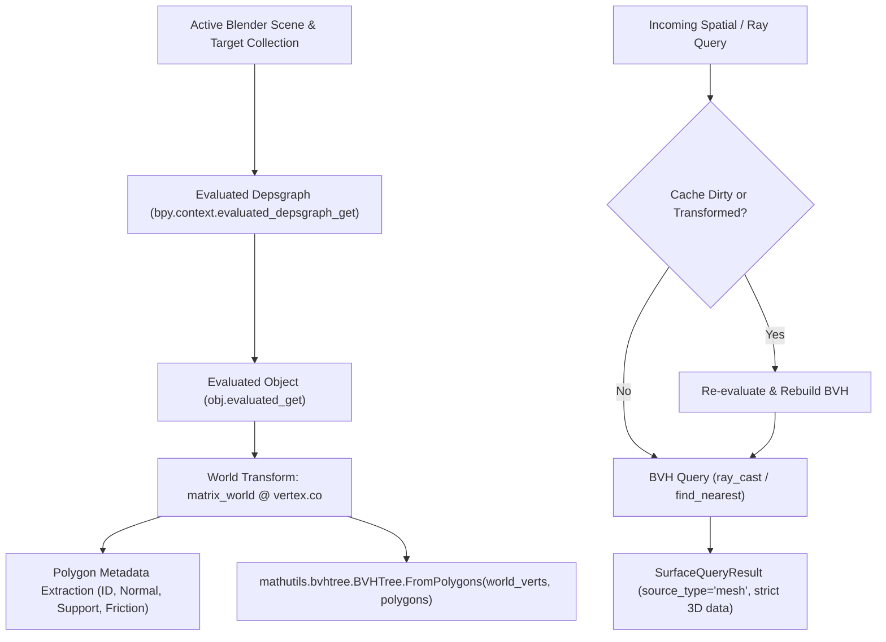

# Environment Mesh Query Architecture & Data Authenticity Semantics

> **Document Status**: COMPLETED ARCHITECTURAL SPECIFICATION & SEMANTICS  
> **Milestone**: Environment Gate 01  
> **Target Date**: 2026-10-27  
> **Source Modules**: `src/scene/blender_mesh_query_adapter.py`, `src/scene/environment_query.py`  
> **Automated Verification**: `tests/test_mesh_environment_query.py`  

---

## 1. Resolution of the Dual Source of Truth

Prior to Environment Gate 01, the ProceduralAnimation codebase suffered from a fundamental architectural tension identified in `AUDIT-03`:
* **Mesh Construction**: `src/scene/builder.py` built 3D polygonal meshes (`Surface_FlatGround`, `Surface_Ramp_Up`, `Surface_Stair_01`..`05`, `Surface_Ramp_TopPlatform`, etc.) inside Blender.
* **Environment Querying**: `src/scene/environment_query.py` evaluated an independent database of mathematical `OrientedSurface` plane equations.
* **Consequence**: The analytical planner remained completely blind to scene modifications, mesh deformations, translations, or artist edits.

### The Single Ground Truth Policy:
Under Environment Gate 01, the authority of data is explicitly codified:
1. **Live Blender Runtime**: The actual evaluated 3D mesh (`bpy.types.Mesh` under `depsgraph`) is the **sole geometric source of truth**.
2. **Analytical Surfaces**: Retained exclusively for pure Python unit testing and legacy backward compatibility without Blender.
3. **Traceability**: Every query result explicitly stamps its data provenance via `source_type` (`"mesh"`, `"analytical"`, `"default"`, or `"none"`).
4. **Zero Silent Fallback**: If a directional ray misses all evaluated geometry, it returns `success=False` with a diagnostic error reason. It is strictly prohibited from fabricating a flat ground plane at $Z = 0.0\text{ m}$.

---

## 2. World-Space BVH Tree Architecture

The real-geometry adapter [`src/scene/blender_mesh_query_adapter.py`](file:///c:/Users/64701/OneDrive/Desktop/ProceduralAnimation/src/scene/blender_mesh_query_adapter.py) implements world-space spatial partitioning via Blender's accelerated C-kernel bounding volume hierarchy (`mathutils.bvhtree.BVHTree`).



### 2.1 Geometric Evaluation & Normal Calculation
1. **Evaluated Mesh Extraction**:
   For each tracked mesh object, the adapter queries its evaluated state via `obj.evaluated_get(depsgraph).to_mesh()`. This applies all active modifiers, sub-surf deformations, and shape keys.
2. **Direct World-Space Coordinate Mapping**:
   Vertices are multiplied by the object's 4x4 world matrix:
   $$\mathbf{v}_{\text{world}} = \mathbf{M}_{\text{world}} \begin{bmatrix} v_x \\ v_y \\ v_z \\ 1 \end{bmatrix}$$
3. **Vertex-Derived Normal Vectors**:
   Rather than relying on local polygon normals subject to non-uniform object scale shear, the outward unit normal $\mathbf{N}$ is calculated directly from the world-space triangle edge cross-products:
   $$\mathbf{e}_1 = \mathbf{v}_1 - \mathbf{v}_0, \quad \mathbf{e}_2 = \mathbf{v}_2 - \mathbf{v}_0$$
   $$\mathbf{N} = \frac{\mathbf{e}_1 \times \mathbf{e}_2}{\|\mathbf{e}_1 \times \mathbf{e}_2\|}$$
   This guarantees that outward normals are exact unit vectors reflecting the true world orientation of the surface.

---

## 3. Cache & Invalidation Rules

To avoid redundant depsgraph evaluations while guaranteeing that scene edits are immediately reflected in query results, the adapter implements a strict three-tier cache policy:

| Rule | Trigger | Behavior | Performance / Overhead |
| :--- | :--- | :--- | :--- |
| **Pristine Cache** | Query executed without scene mutations | Reuses existing `BVHTree` and polygon metadata | $O(\log N)$ BVH traversal ($\sim 5\mu s$) |
| **Transform Drift Detection** | Object translated or rotated in Blender | `refresh()` detects $\Delta \mathbf{M}_{\text{world}} > 10^{-6}$ and triggers `rebuild()` | Detects transform in $O(M)$ objects, rebuilds in $\sim 1ms$ |
| **Vertex Edit Invalidation** | Raw vertices or faces edited in mesh | Explicit `invalidate()` or `rebuild()` | Re-extracts evaluated geometry and rebuilds BVH tree |

---

## 4. Query Contract & Semantic Data Fields

The query engine standardizes all returns via `SurfaceQueryResult`. The semantic definitions of its fields when backed by live mesh geometry are as follows:

```python
@dataclass
class SurfaceQueryResult:
    surface_id: str                   # "mesh:<object_name>:<polygon_index>" or "none"
    surface_type: str                 # "horizontal_ground", "sloped_ramp", "stair_tread", "vertical_wall", etc.
    contact_point_world: Tuple[float, float, float]  # Exact (x, y, z) intersection on mesh surface in meters
    surface_normal_world: Tuple[float, float, float] # Unit outward normal vector (nx, ny, nz)
    signed_distance: float            # Signed distance: >0 gap (in front), 0.0 on face, <0 penetration (behind)
    friction_coeff: float             # Static friction coefficient (e.g. 0.65)
    allows_regular_support: bool      # True if surface is eligible for foot stance support; False for walls/ledges
    success: bool                     # True if surface was intersected/found; False on miss
    ray_hit_distance: Optional[float] = None  # Non-negative Euclidean distance traveled along ray
    error_reason: Optional[str] = None        # Diagnostic message on failure; None on success
    source_type: str = "analytical"   # Data provenance: "mesh", "analytical", "default", "none"
```

### 4.1 Regular Foot Support Eligibility (`allows_regular_support`)
A surface is **not** eligible for human foot support simply because a ray struck it. The adapter enforces strict biomechanical admissibility:
* **Horizontal Ground & Platforms** ($N_z \ge 0.99$): `allows_regular_support = True`.
* **Sloped Ramps** ($0.50 \le N_z < 0.99$, slope angle $\le 60^\circ$): `allows_regular_support = True`.
* **Vertical Obstacle Walls & Stair Risers** ($|N_z| < 0.15$): `allows_regular_support = False`.
* **Overhangs & Ceilings** ($N_z < 0$): `allows_regular_support = False`.
* **Explicit Property Override**: If `obj["allows_regular_support"]` is set on the Blender object, its boolean value overrides geometric heuristics.

### 4.2 Friction Metadata Policy
* **Scene-Defined Friction**: If an object or its assigned material defines `"friction_coeff"`, that value is extracted and used.
* **Default Fallback**: If no friction property exists, the adapter assigns a standard default ($\mu = 0.65$) without fabricating a measured property.
* **Integrity Guarantee**: When no surface is hit, friction is strictly reported as `0.0`.

### 4.3 Ground Height Query vs. Gap / Cliff Detection
* **Legacy Compatible Interface (`ground_height_at(x, y) -> float`)**:
  Casts a vertical downward ray from $(x, y, 50.0\text{ m})$. If a walkable mesh surface is struck, returns its exact elevation $Z$. If no surface is struck, falls back to `ground_z` ($0.0\text{ m}$) to satisfy legacy float return contracts.
* **Strict Physical Interface (`ray_ground_elevation(x, y) -> Optional[float]`)**:
  Casts a vertical downward ray. Returns `float` only if an actual walkable mesh is intersected; returns `None` when crossing empty air, cliffs, or open chasms. The locomotion planner must use this interface to detect drops and prevent walking into space.

---

## 5. Host Adapter Decoupling & Engine Independence

In accordance with Section 2 of the project specifications:
* **Host Layer (`src/scene/blender_mesh_query_adapter.py`)**: Couples with Blender's `bpy` and `mathutils.bvhtree` C-extensions.
* **Core Interface (`src/scene/environment_query.py`)**: Contains zero `bpy` imports. Retains pure Python dataclasses and mathematical methods.
* **Pluggable Architecture**: `DynamicsEnvironmentQuery` accepts `mesh_adapter` via dependency injection (`set_mesh_adapter`). In headless environments without Blender or during fast mathematical CI tests, `DynamicsEnvironmentQuery` runs purely in Python with 100% backward compatibility.
