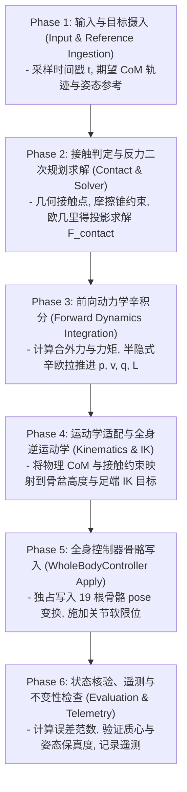

# FOUNDATION_ARCHITECTURE_AUDIT: 通用程序化运动底座架构审计与收敛设计

* **文档版本**：1.0.0 (Architecture Freeze Edition)
* **对应任务**：Task 6G-D-C2-FINAL
* **基准 Commit**：`d0d73d476e2f2d3f3b629d767744ab12ba867bf8`
* **适用标准**：ACG SSOT ([`docs/ARCHITECTURE_CHANGE_GATE.md`](ARCHITECTURE_CHANGE_GATE.md))
* **最后审计日期**：2026-10-25

---

## 一、系统总体定位与分类体系 (Module Taxonomy)

ProceduralAnimation 定位于**全程序化、可复用、高精度的 3D 角色连续运动底座**。
底座源码严格解耦为 5 大层次（Layer A 至 Layer E），杜绝跨层耦合与反向依赖：

```
+-----------------------------------------------------------------------+
|  Layer E: 管线运行器与测试套件 (CLI Runners & Test Suites)             |
|  - run_generate_visual_evidence.py, run_dynamics_playground.py        |
|  - tests/verify_task6gd_*.py, tests/run_test_suite.py (Quick/Physics) |
+-----------------------------------------------------------------------+
                                   |
+-----------------------------------------------------------------------+
|  Layer D: 视口注入、遥测与视觉证据 (Scene & Visual Telemetry)           |
|  - dynamics_visualizer.py, dynamics_visual_evidence.py                |
|  - 负责驱动 output/dynamics_playground.blend，导出联系表与 JSON       |
+-----------------------------------------------------------------------+
                                   |
+-----------------------------------------------------------------------+
|  Layer C: 全身控制与骨骼装配中枢 (WholeBodyController & Rigging)       |
|  - whole_body_controller.py, character_rig.py                         |
|  - 拥有对 Blender 骨骼 PoseBone 的独占写权限 (ACG Rule 6)             |
+-----------------------------------------------------------------------+
                                   |
+-----------------------------------------------------------------------+
|  Layer B: 运动学、步态合成与动作规划 (Kinematics & Locomotion)        |
|  - kinematics_service.py, locomotion_synthesizer.py, gait actions     |
|  - 空间足端轨迹、身体朝向、骨盆高度与各关节生理限制规划               |
+-----------------------------------------------------------------------+
                                   |
+-----------------------------------------------------------------------+
|  Layer A: 纯 Python 核心物理与动力学底座 (Core Numerical Dynamics)     |
|  - contact_dynamics.py, contact_force_solver.py                       |
|  - forward_dynamics.py, closed_loop_dynamics.py, joint_limits.py      |
|  - 100% 纯 Python (Zero bpy)，单刚体/质点集总 CoM 辛积分内核          |
+-----------------------------------------------------------------------+
```

---

## 二、单帧 6 阶段执行协议 (Single-Frame 6-Phase Execution Protocol)

为确保未来无论在 Blender 离线渲染还是游戏引擎实时环境（如 Unreal/Godot/Unity）中运行，每一帧推进都必须严格遵守以下单向数据流执行协议：



### 各阶段职责与数据合同：
1. **Phase 1 (Ingestion)**：摄入当前实际状态 $S_k = (p_k, v_k, q_k, L_k)$ 与高层规划给出的目标参考 $R_{k+1} = (p_{\text{target}}, v_{\text{target}}, q_{\text{target}})$；
2. **Phase 2 (Contact Solver)**：输入接触面法向量、摩擦系数 $\mu$ 与外力，通过二次规划与有界摩擦锥正交投影，严格求解满足物理可行域的接触反力集合 $\{F_i\}$ 与力矩 $\tau$；
3. **Phase 3 (Integration)**：调用辛前向动力学内核，在恒定加速度场下精确积分获得下一刻物理真实状态 $S_{k+1}$；
4. **Phase 4 (Kinematics Mapping)**：根据物理质心实际位置 $p_{k+1}$ 与足端接触约束，动态适配骨盆高度并驱动腿部及手臂双骨 IK；
5. **Phase 5 (Pose Application)**：调用 `WholeBodyController.apply_pose()` 独占向角色骨架写入骨骼变换，严禁任何其他模块旁路操作骨骼；
6. **Phase 6 (Verification & Telemetry)**：评估实际位置误差与发散量，输出到遥测缓冲区或 JSON，进行防冒充硬断言。

---

## 三、动力学收敛设计与精度边界划定 (Dynamics Confluence & Accuracy Boundaries)

为避免工程在后续演进中产生不切实际的假设或重复造轮子，本审计报告正式冻结并划定当前底座的数学与物理精度边界：

### 1. 单刚体/集总 CoM 模型 vs 多体铰接 Featherstone 模型边界
* **当前基准实现**：当前 Layer A 采用**单刚体集总质心模型 (Single Rigid-Body CoM Aggregate Model)**。将整个人体质量（$m = 70.0\text{ kg}$）与躯干/四肢的转动惯量集总于质心（对角惯量张量 $I_{\text{body}} = \text{diag}(15.0, 15.0, 5.0)\text{ kg}\cdot\text{m}^2$）。
* **理论合理性**：根据经典双足动力学理论（Kajita LIPM, SLIP, Centroidal Dynamics），全身多刚体运动在地面反力作用下的全局动量演化完全由质心方程 $\sum F = m(\ddot{p} - g)$ 与角动量方程 $\sum \tau = \dot{L}$ 唯一决定。在底座阶段采用单刚体集总动力学，既能保证全局动量平衡与防打滑物理真实性，又避免了引入 Featherstone 铰接多体算法导致的关节级力矩爆炸与极端非线性求解不稳定。
* **演进隔离**：未来铰接多体关节力矩动力学（若需要）应作为子系统接入，严禁推翻当前已验证的全局质心与接触力求解框架。

### 2. 5 大测试工位的具体物理边界界定
针对 `output/dynamics_playground.blend` 中的 5 个工位，明确其物理实质：
1. **Station 1 (静态支撑平衡)**：双足固定于地面点，接触力严格静态平衡重力（$F_z = 686.7\text{ N}$），质心下陷量实测为 $0.00\text{ m}$，验证接触力硬平衡；
2. **Station 2 (空中自由落体)**：**物理实质为高空无支撑弹道下落 (Ballistic Free-Fall)**。本阶段测试重点为“悬停目标不可行时求解器拒绝凭空产生反力”，小球以 $-9.81\text{ m/s}^2$ 纯重力加速坠落；**本阶段不包含地面撞击弹性碰撞 (Ground Impact/Restitution) 或触地反弹力学**（触地缓冲与着地动力学属于未来落地规划任务）；
3. **Station 3 (摩擦水平加速)**：在 $\mu = 0.65$ 高摩擦下产生纵向推力，验证水平合力矢量与反力箭头几何对齐；**当前使用理想匀速前进的足端接触点序列，不代表实际双足交替迈步冲击**；
4. **Station 4 (低摩擦打滑滞后)**：在 $\mu = 0.08$ 极低摩擦冰面上，静摩擦极限截断切向力（$F_x \le 55\text{ N}$），造成实际小球显著滞后于目标虚影（发散达 $5.30\text{ m}$），验证防冒充与物理不可逾越性；
5. **Station 5 (偏心滚转倾斜)**：单侧偏心接触支点（$r_y = -0.3\text{ m}$）引入单向重力力矩 $\tau_x \approx -206\text{ N}\cdot\text{m}$，诱发姿态四元数与角动量箭头绕 X 轴连续翻滚，验证旋转前向积分与力矩传递无截断。

---

## 四、历史动作零退化保证 (Zero Regression on Historical Locomotion)

* **历史动作保护清单**：
  1. `StartStopWalkAction` (起步、行走、减速、停止)
  2. `RunAction` (奔跑循环)
  3. `TurnAction` (转向)
  4. `LookUpAction` (抬头观察)
* **保护机制**：
  - 动力学求解器和积分内核完全封装在独立模块 `closed_loop_dynamics.py` 与 `forward_dynamics.py` 中；
  - 历史步态模块 `locomotion_synthesizer.py` 保持 100% 既有接口兼容；
  - 自动化回归套件 `tests/verify_r3b2_walk_action.py` 与 `tests/verify_r3b2_run_action.py` 纳入每一轮门禁测试，任何退化均一票否决。
