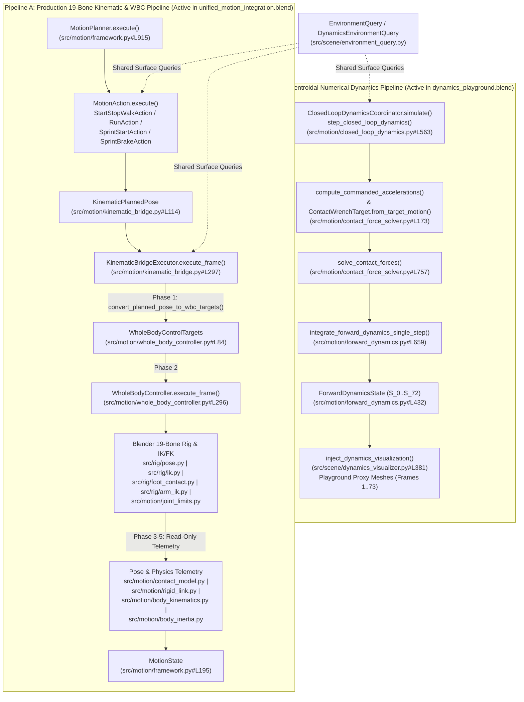

# Foundation Architecture & Mathematical Closure Audit (Task 6G-D-C2-FINAL)

> [!NOTE]
> **历史审计快照标识 (Historical Audit Snapshot)**
> * **快照归档基准**：Git SHA `d0d73d4`（Task 6G-D-C2-FINAL 归档点）
> * **历史有效性说明**：本文件为历史阶段性审计产物，真实反映当时发现的架构状态与分流事实，**严格保留历史事实记录**。
> * **后续演进与修复现状**：本文件记录的解析环境与双管线分流问题，在后续 **Environment Gate 01（Unit 1 至 Unit 4，Commit `7a3e244`）** 中完成了真实网格环境查询接入、步态速度连续性与着地闭环；最新全工程审计确认 19 骨骼主链稳定运行，动力学算子保持独立。
> * **最新权威架构文档**：请查阅最新权威文档 [`ARCHITECTURE.md`](file:///c:/Users/64701/OneDrive/Desktop/ProceduralAnimation/ARCHITECTURE.md)、[`ARCHITECTURE_SYNC.md`](file:///c:/Users/64701/OneDrive/Desktop/ProceduralAnimation/ARCHITECTURE_SYNC.md) 及 [`docs/audit/environment_gate01_final/`](file:///c:/Users/64701/OneDrive/Desktop/ProceduralAnimation/docs/audit/environment_gate01_final/) 审计报告集合。

> **Document Purpose**: Authoritative engineering and mathematical audit of the actual disk codebase at the conclusion of Task 6G-D-C2-FINAL.  
> **Verification Basis**: Direct inspection of all 51 `src/` Python modules and 18 `output/*.blend` assets via [`tests/audit_c2_final_inspector.py`](file:///c:/Users/64701/OneDrive/Desktop/ProceduralAnimation/tests/audit_c2_final_inspector.py).

---

## 1. Executive Architecture Summary: Two Currently Implemented Pipelines

At the Task 6G-D-C2-FINAL freeze point, the repository contains **two verified, production-tested pipelines** that share the same World Coordinate System (`+X` Right, `+Y` Forward, `+Z` Up, `Z = 0.0 m` ground plane), SI physical units (`m`, `kg`, `s`, `N`, `N*m`, `rad`), and environmental query surface model (`src/scene/environment_query.py`), but are **not yet merged into a single closed loop** (their confluence is scheduled for **Phase 7C**):

1. **Pipeline A — Production 19-Bone Kinematic & Whole-Body Control (WBC) Pipeline**:
   - Drives the 13-part placeholder mesh (`src/character/builder.py`) bound to the 19-bone `CharacterArmature` (`src/rig/builder.py`).
   - Orchestrated by `MotionPlanner` (`src/motion/framework.py#L883`) executing composable `MotionAction` subclasses (`StartStopWalkAction`, `RunAction`, `SprintStartAction`, `SprintBrakeAction`) through `KinematicBridgeExecutor.execute_frame()` (`src/motion/kinematic_bridge.py#L297`) and `WholeBodyController.execute_frame()` (`src/motion/whole_body_controller.py#L296`).
   - Evaluates read-only physical telemetry (`compute_whole_body_com`, `BodyKinematicsTracker.sample_and_update`, `compute_whole_body_inertia`, `evaluate_limb_contacts_from_armature`) from the solved 19-bone pose and outputs `MotionState` (`src/motion/framework.py#L195`).
   - Produces the 462-frame unified locomotion scene `output/unified_motion_integration.blend`.

2. **Pipeline B — Task 6G-D Pure Python 6-DOF Centroidal Numerical Dynamics Pipeline**:
   - Pure Python, `bpy`-decoupled closed-loop centroidal dynamics engine (`src/motion/contact_dynamics.py`, `src/motion/contact_force_solver.py`, `src/motion/forward_dynamics.py`, `src/motion/closed_loop_dynamics.py`).
   - Computes desired feedback accelerations (`compute_commanded_accelerations`), solves constrained 3D contact forces (`solve_contact_forces`), and integrates the 6-DOF Newton-Euler equations of motion (`integrate_forward_dynamics_single_step`) to advance `ForwardDynamicsState` (`src/motion/forward_dynamics.py#L432`).
   - Visualized in Blender by `src/scene/dynamics_visualizer.py` (`run_dynamics_scenarios`, `inject_dynamics_visualization`) and `src/scene/dynamics_visual_evidence.py`, which drive rigid-body proxy objects (`Dynamics_BodyProxy_S1..S5`, `Dynamics_CoM_S1..S5`, `Dynamics_ContactDisc_*`, `Dynamics_ForceArrow_*`) across frames `1..73` ($S_0..S_{72}$) in `output/dynamics_playground.blend`.

### 1.1 Frozen Production Call Chain & Component Responsibilities
The authoritative production execution chain is frozen and strictly non-substitutable:
$$\text{MotionPlanner} / \text{MotionAction} \longrightarrow \text{KinematicBridgeExecutor.execute_frame()} \longrightarrow \text{WholeBodyController.execute_frame()} \longrightarrow \text{Blender Rig / IK / FK} \longrightarrow \text{CoM / 惯性 / 遥测} \longrightarrow \text{MotionState}$$
Subsequent agents are strictly forbidden from bypassing, duplicating, or replacing this chain.

* **`MotionAction`**: Responsible for continuous multi-frame action trajectory planning (generates sequence of per-frame kinematic targets);
* **`KinematicBridgeExecutor`**: Responsible for deterministic single-frame 6-phase protocol organization (converts targets, coordinates WBC, applies truthful micro-projection, triggers keyframing);
* **`WholeBodyController`**: Sole writer of character armature pose and IK targets (computes root motion, bone rotations, and dispatches to leg/arm IK/FK);
* **`src/rig/` Existing IK/FK (`ik.py`, `arm_ik.py`, `foot_contact.py`)**: Real mechanical execution engine operating on Blender armature constraints;
* **`JointModel` (`src/motion/joint_limits.py`)**: Responsible for anatomical Range of Motion (ROM) limit verification and clamping;
* **`CoM / Inertia / Kinematics / Contact Telemetry` (`rigid_link.py`, `body_inertia.py`, `body_kinematics.py`, `contact_model.py`)**: 100% read-only post-evaluation sensors (zero write-back to bones or IK controllers);
* **Task 6G-D Numerical Dynamics (`contact_dynamics.py`, `contact_force_solver.py`, `forward_dynamics.py`, `closed_loop_dynamics.py`)**: Currently an independent numerical simulation and visualization pipeline; confluence between 19-bone WBC and centroidal dynamics is NOT yet implemented (scheduled for Phase 7C).

---

## 2. Real Production Kinematic & Whole-Body Control Pipeline (Pipeline A)

### 2.1 High-Level Action Orchestration (`src/motion/framework.py`)
- **`MotionPlanner`** ([`src/motion/framework.py#L883-L1010`](file:///c:/Users/64701/OneDrive/Desktop/ProceduralAnimation/src/motion/framework.py#L883-L1010)):
  - Accepts `PipelineConfig` (`src/config.py#L8`), `CharacterArmature`, and `EnvironmentQuery` (`src/scene/environment_query.py#L222`).
  - Initializes `KinematicBridgeExecutor` (`src/motion/kinematic_bridge.py#L258`) inside `MotionRuntimeContext` (`src/motion/framework.py#L387`).
  - Iterates over registered `MotionAction` instances, passing the previous action's `final_state` (`MotionState`) as the next action's `initial_state` with `frame` incremented by `+1`.
- **Production `MotionAction` Implementations**:
  1. **`StartStopWalkAction`** ([`src/motion/framework.py#L481-L833`](file:///c:/Users/64701/OneDrive/Desktop/ProceduralAnimation/src/motion/framework.py#L481-L833)): Reuses step scheduling and root kinematics from `src/motion/start_stop_walk.py` (`build_step_schedule`, `evaluate_root_kinematics`) and swing curve generation from `src/motion/forward_walk.py` (`compute_forward_swing_point`). Constructs `KinematicPlannedPose` per frame and dispatches to `bridge_executor.execute_frame()`.
  2. **`RunAction`** ([`src/motion/run_cycle.py#L129-L524`](file:///c:/Users/64701/OneDrive/Desktop/ProceduralAnimation/src/motion/run_cycle.py#L129-L524)): Cyclic running action with flight phase (`is_flight=True`), constructing `KinematicPlannedPose` per frame and dispatching to `bridge_executor.execute_frame()`.
  3. **`SprintStartAction`** ([`src/motion/sprint_start.py#L182-L519`](file:///c:/Users/64701/OneDrive/Desktop/ProceduralAnimation/src/motion/sprint_start.py#L182-L519)): Explosive acceleration transition from walk/idle to sprint, dispatching `KinematicPlannedPose` to `bridge_executor.execute_frame()`.
  4. **`SprintBrakeAction`** ([`src/motion/sprint_brake.py#L150-L479`](file:///c:/Users/64701/OneDrive/Desktop/ProceduralAnimation/src/motion/sprint_brake.py#L150-L479)): Progressive multi-step deceleration from sprint to walk/idle, dispatching `KinematicPlannedPose` to `bridge_executor.execute_frame()`.

### 2.2 Single-Frame 6-Phase Bridge Execution (`src/motion/kinematic_bridge.py`)
`KinematicBridgeExecutor.execute_frame()` ([`src/motion/kinematic_bridge.py#L297-L464`](file:///c:/Users/64701/OneDrive/Desktop/ProceduralAnimation/src/motion/kinematic_bridge.py#L297-L464)) enforces a strict, deterministic 6-phase single-frame execution protocol:

- **Phase 1 — Planned Pose to WBC Targets**:
  - Calls `convert_planned_pose_to_wbc_targets(planned)` ([`src/motion/kinematic_bridge.py#L153-L236`](file:///c:/Users/64701/OneDrive/Desktop/ProceduralAnimation/src/motion/kinematic_bridge.py#L153-L236)) to translate `KinematicPlannedPose` into `WholeBodyControlTargets` (`src/motion/whole_body_controller.py#L84`).
- **Phase 2 — Whole-Body Controller Pose & IK Dispatch (`WholeBodyController.execute_frame`)**:
  - Calls `self.wbc.execute_frame(wbc_targets, update_scene=True, enforce_rom_clamping=self.enforce_rom_clamping)` ([`src/motion/whole_body_controller.py#L296-L644`](file:///c:/Users/64701/OneDrive/Desktop/ProceduralAnimation/src/motion/whole_body_controller.py#L296-L644)):
    1. Updates `CharacterRoot.location` and `CharacterRoot.rotation_euler` while preserving world-locked stance feet via `lock_foot_contact` / `evaluate_foot_support` (`src/rig/foot_contact.py`).
    2. Applies pelvis local offset and axial rotations (`pelvis`, `spine`, `neck`, `head`) plus `fk_joint_rotations_deg` (`upper_arm.L/R`, `forearm.L/R`, etc.) on `CharacterArmature.pose.bones`.
    3. Dispatches left/right foot targets to `lock_foot_contact()` / `unlock_foot_contact()` / `evaluate_foot_support()` (`src/rig/foot_contact.py`) or `set_foot_ik_target()` (`src/rig/ik.py#L295`).
    4. Dispatches left/right hand targets to `set_hand_ik_target()` / `set_arm_ik_influence()` (`src/rig/arm_ik.py#L392`, `#L243`).
    5. Calls `bpy.context.view_layer.update()` to evaluate Blender's native 2-bone IK and `COPY_ROTATION` constraints.
    6. Measures actual end-effector tracking error via `get_leg_ik_state()` (`src/rig/ik.py#L236`) and `get_arm_ik_state()` (`src/rig/arm_ik.py#L315`), recording any `UnmetConstraint` (`REACHABILITY`, `ORIENTATION_ERROR`).
    7. Validates anatomical joint limits via `JointModel.validate_armature_pose(arm, use_evaluated_ik=True)` (`src/motion/joint_limits.py#L604`), clamping FK joints if `enforce_rom_clamping=True`.
    8. Evaluates 15-segment Center of Mass via `compute_whole_body_com()` (`src/motion/rigid_link.py#L261`) and returns `WholeBodyControlResult` (`src/motion/whole_body_controller.py#L230`).
- **Phase 3 — Multi-Limb Geometric Contact Evaluation**:
  - Calls `evaluate_limb_contacts_from_armature()` ([`src/motion/contact_model.py#L511-L552`](file:///c:/Users/64701/OneDrive/Desktop/ProceduralAnimation/src/motion/contact_model.py#L511-L552)) against `EnvironmentQuery` surfaces.
- **Phase 4 — Truthful Geometric Compliance & Constraint Feedback**:
  - Evaluates actual limb positions against surface geometry via `multi_contact.check_all_contacts(actual_positions)` ([`src/motion/kinematic_bridge.py#L486-L504`](file:///c:/Users/64701/OneDrive/Desktop/ProceduralAnimation/src/motion/kinematic_bridge.py#L486-L504)), recording any gap, slip, or penetration violations into `UnmetConstraint(category="CONTACT_GEOMETRY")` without masking or falsifying reachability failures.
- **Phase 5 — Read-Only Physics Telemetry Enrichment**:
  - Re-evaluates `compute_whole_body_com()` (`src/motion/rigid_link.py#L261`), `BodyKinematicsTracker.sample_and_update()` (`src/motion/body_kinematics.py#L626`), and `compute_whole_body_inertia()` (`src/motion/body_inertia.py#L628`).
  - Enriches the frame's `MotionState` via `enrich_motion_state_with_contacts()`, `enrich_motion_state_with_kinematics()`, and `enrich_motion_state_with_inertia()`.
- **Phase 6 — Deterministic Blender Keyframing**:
  - When `keyframe=True`, calls `_keyframe_walk_frame()` (`src/motion/walk_cycle.py#L104`) and `self._keyframe_additional_controllers()` (`src/motion/kinematic_bridge.py#L569`) to insert keyframes on `CharacterRoot`, all 19 pose bones, and all IK/pole Empty controllers.

---

## 3. Task 6G-D Centroidal Numerical Dynamics Pipeline (Pipeline B)

### 3.1 Pure Python Mathematical Kernel (`src/motion/contact_dynamics.py`, `contact_force_solver.py`, `forward_dynamics.py`, `closed_loop_dynamics.py`)

1. **Closed-Loop Feedback Control Law (`src/motion/closed_loop_dynamics.py`)**:
   - `compute_commanded_accelerations(state, reference, gains)` ([`src/motion/closed_loop_dynamics.py#L492-L556`](file:///c:/Users/64701/OneDrive/Desktop/ProceduralAnimation/src/motion/closed_loop_dynamics.py#L492-L556)):
     - Linear PD + Feedforward law in World Space:
       $$\mathbf{a}_{\text{cmd}} = \text{clamp}\!\left(\mathbf{a}_{\text{ff}} + k_{p,\text{pos}}(\mathbf{p}_{\text{ref}} - \mathbf{p}) + k_{d,\text{pos}}(\mathbf{v}_{\text{ref}} - \mathbf{v}),\; a_{\max}\right)$$
     - Rotational SO(3) geodesic log-map error (`quat_error_rot_vector`, `#L88`) + Coriolis/gyroscopic compensation:
       $$\dot{\mathbf{L}}_{\text{cmd}} = \text{clamp}\!\left(\dot{\mathbf{L}}_{\text{ff}} + \mathbf{I}_{\text{world}}(q)\,\boldsymbol{\alpha}_{\text{fb}} + \boldsymbol{\omega} \times (\mathbf{I}_{\text{world}}(q)\,\boldsymbol{\omega}),\; \tau_{\max}\right)$$
2. **Target Contact Wrench & Constrained Force Allocation (`src/motion/contact_force_solver.py`)**:
   - `ContactWrenchTarget.from_target_motion()` ([`src/motion/contact_force_solver.py#L173-L238`](file:///c:/Users/64701/OneDrive/Desktop/ProceduralAnimation/src/motion/contact_force_solver.py#L173-L238)):
     $$\mathbf{F}_{\text{contact,target}} = m\,\mathbf{a}_{\text{cmd}} - m\,\mathbf{g} - \sum \mathbf{F}_{\text{ext}}, \qquad \boldsymbol{\tau}_{\text{contact,target}} = \dot{\mathbf{L}}_{\text{cmd}} - \sum \boldsymbol{\tau}_{\text{ext}}$$
   - `solve_contact_forces(contacts, target_wrench, config)` ([`src/motion/contact_force_solver.py#L757-L1155`](file:///c:/Users/64701/OneDrive/Desktop/ProceduralAnimation/src/motion/contact_force_solver.py#L757-L1155)):
     - Solves $\min_{\mathbf{f}} \frac{1}{2} w_F \|\mathbf{A}_F \mathbf{f} - \mathbf{F}_{\text{target}}\|^2 + \frac{1}{2} w_\tau \|\mathbf{A}_\tau \mathbf{f} - \boldsymbol{\tau}_{\text{target}}\|^2 + \frac{1}{2}\alpha \|\mathbf{f}\|^2$ subject to unilateral normal push ($F_{n,i} = \mathbf{F}_i \cdot \mathbf{n}_i \in [F_{n,\min}, F_{n,\max}]$), 3D Coulomb friction cone ($\|\mathbf{F}_{t,i}\| \le \mu_i F_{n,i}$), and zero force on separated contacts (`is_in_contact == False` or `surface_distance > contact_tolerance`).
     - Rejects duplicate `contact_id` values with `ContactSolverStatus.INVALID_INPUT`.
3. **Single-Step 6-DOF Forward Dynamics Integration (`src/motion/forward_dynamics.py`)**:
   - `integrate_forward_dynamics_single_step(state, step_input, config)` ([`src/motion/forward_dynamics.py#L659-L970`](file:///c:/Users/64701/OneDrive/Desktop/ProceduralAnimation/src/motion/forward_dynamics.py#L659-L970)):
     - Semi-implicit Euler translational update:
       $$\mathbf{a} = \frac{1}{m}\left(m\mathbf{g} + \sum \mathbf{F}_{\text{contact},i} + \sum \mathbf{F}_{\text{ext}}\right), \quad \mathbf{v}_{k+1} = \mathbf{v}_k + \mathbf{a}\,\Delta t, \quad \mathbf{p}_{k+1} = \mathbf{p}_k + \mathbf{v}_{k+1}\,\Delta t$$
     - Exact angular momentum & midpoint exponential map attitude update:
       $$\dot{\mathbf{L}}_{\text{com}} = \sum (\mathbf{p}_{c,i} - \mathbf{p}_k) \times \mathbf{F}_{\text{contact},i} + \sum \boldsymbol{\tau}_{\text{ext}}, \quad \mathbf{L}_{k+1} = \mathbf{L}_k + \dot{\mathbf{L}}_{\text{com}}\,\Delta t$$
       $$q_{k+1} = \text{normalize}\!\left(\exp\!\left(\tfrac{1}{2}\boldsymbol{\omega}_{\text{mid}}\Delta t\right) \otimes q_k\right), \quad \mathbf{I}_{\text{world},k+1} = \mathbf{R}(q_{k+1})\,\mathbf{I}_{\text{body}}\,\mathbf{R}(q_{k+1})^T, \quad \boldsymbol{\omega}_{k+1} = \mathbf{I}_{\text{world},k+1}^{-1}\,\mathbf{L}_{k+1}$$

### 3.2 Timeline Alignment & Mathematical Boundary Contracts

1. **73-State Trajectory Mapping ($S_0..S_{72}$ $\leftrightarrow$ Blender Frames `1..73`)**:
   - Executing $N = 72$ integration steps at $\Delta t = 1/24\text{ s}$ produces $N + 1 = 73$ discrete physical states: initial state $S_0$ at $t = 0.0\text{ s}$ (`Frame 1`) through final state $S_{72}$ at $t = 3.0\text{ s}$ (`Frame 73`).
   - For frame index $k \in \{0, \dots, 72\}$ (`Frame = k + 1`):
     - `Dynamics_BodyProxy_S*` and `Dynamics_CoM_S*` are keyframed to `state_k.com_position_world` and `state_k.orientation_quat_world`.
     - For $k < 72$, `Dynamics_ForceArrow_*` and `Dynamics_ContactDisc_*` display the active force and contact point of step $k$ ($S_k \to S_{k+1}$); at terminal state $k = 72$ (`Frame 73`), they hold the final step's terminal contact state.
2. **Single Rigid-Body Aggregate Model vs. Multi-Body Articulated Dynamics**:
   - `ForwardDynamicsState` models the character as a **single 6-DOF centroidal rigid body** with aggregate mass $m = 75.0\text{ kg}$ and body-frame inertia tensor $\mathbf{I}_{\text{body}} = \text{diag}(12.5, 11.8, 3.2)\text{ kg}\cdot\text{m}^2$.
   - It does **not** solve multi-body articulated equations of motion ($\mathbf{M}(\mathbf{q})\ddot{\mathbf{q}} + \mathbf{C}(\mathbf{q},\dot{\mathbf{q}}) = \boldsymbol{\tau} + \mathbf{J}^T\mathbf{F}$) or Featherstone ABA/CRBA.
3. **Station 2 Ballistic Free-Fall Boundary (`S2_Ballistic_Jump_Flight`)**:
   - Frames `1..18` ($k = 0..17$): Ground launch phase with active bilateral foot contacts pushing against `flat_start` ($F_z > 0$).
   - Frames `19..73` ($k = 18..72$): True airborne free-fall (`contacts = []`, $\mathbf{F}_{\text{contact}} = \mathbf{0}$, $\mathbf{a} = (0, 0, -9.81)\text{ m/s}^2$). Any non-zero hover acceleration reference in mid-air is classified as `CONTROL_INFEASIBLE_PHYSICS_ADVANCED` while physical state evolves strictly under gravity.
4. **Station 3 & Station 4 Moving Contact Points (`S3_Slope_Up_Climb`, `S4_Friction_Slip_Limit`)**:
   - Because `output/dynamics_playground.blend` does not yet contain the 19-bone character rig (scheduled for Phase 7A), Stations 3 and 4 advance their contact anchor positions $\mathbf{p}_{c,i}(t)$ kinematically along the $18^\circ$ slope (`slope_up_18deg`) and flat ground (`flat_start`) via `DynamicsEnvironmentQuery.query_surface_at_point()` so the support base tracks the moving CoM reference without artificial tipping torque $\mathbf{r} \times \mathbf{F}$. Replacing these proxy contact schedules with real 19-bone foot placements is part of **Phase 7A / 7C**.
