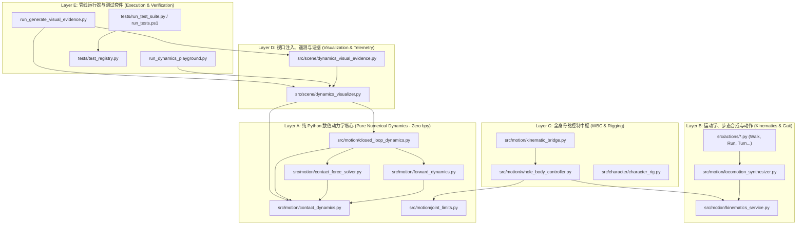

# FOUNDATION_DEPENDENCY_MAP: 模块依赖拓扑、单向数据流与架构隔离矩阵

* **文档版本**：1.0.0 (Architecture Freeze Edition)
* **对应任务**：Task 6G-D-C2-FINAL
* **基准 Commit**：`d0d73d476e2f2d3f3b629d767744ab12ba867bf8`
* **适用标准**：ACG SSOT ([`docs/ARCHITECTURE_CHANGE_GATE.md`](ARCHITECTURE_CHANGE_GATE.md))
* **最后审计日期**：2026-10-25

---

## 一、模块分类与依赖拓扑图 (Dependency Topology)

系统严格禁止循环引用与反向依赖。依赖关系呈现严格自底向上的分层单向拓扑：

---

## 二、跨层级接口依赖与调用矩阵 (Inter-Layer Import Matrix)

| 被调用方 (Callee) $\to$ 调用方 (Caller) $\downarrow$ | Layer A (Dynamics) | Layer B (Kinematics) | Layer C (WBC/Rig) | Layer D (Viz/Telem) | Blender API (`bpy`/`mathutils`) |
| :--- | :---: | :---: | :---: | :---: | :---: |
| **Layer A** (纯数学动力学内核) | **内部自包含** | **严禁调用** | **严禁调用** | **严禁调用** | **绝对禁止 (0 依赖)** |
| **Layer B** (运动学与步态合成) | 仅引用类型规范 | **内部组合** | **严禁调用** | **严禁调用** | 允许（仅数学矩阵/向量） |
| **Layer C** (全身骨骼控制器) | 引用物理限制/合同 | 调用 IK 接口 | **独占控制** | **严禁调用** | 允许（独占操作 PoseBones） |
| **Layer D** (视口渲染与遥测) | 调用动力学闭环推演 | 仅视口需要时参考 | 不直接操作 | **内部协同** | 允许（创建 Visualizer 物体） |
| **Layer E** (运行器与测试套件) | 测试全覆盖 | 测试全覆盖 | 测试全覆盖 | 调用一键生成 | 允许（无头调用） |

---

## 三、层级隔离与无环保证 (Acyclic & Isolation Invariants)

1. **纯 Python 数值核心零污染原则 (Zero `bpy` Pollution)**：
   - `src/motion/contact_dynamics.py`
   - `src/motion/contact_force_solver.py`
   - `src/motion/forward_dynamics.py`
   - `src/motion/closed_loop_dynamics.py`
   - `src/motion/joint_limits.py`
   上述 5 个模块经 AST 语法树机器静态扫描，`bpy`、`mathutils`、`bmesh` 引用计数严格为 **0**。这保证了动力学底座可随时脱离 Blender 移植至独立计算节点或游戏引擎物理循环。
2. **状态不可变性防篡改 (Defensive Immutability)**：
   - `ForwardDynamicsState`、`ContactWrenchTarget`、`ClosedLoopFrameData` 全部采用 `@dataclass(frozen=True)`；
   - 内部三维向量、四元数及接触力字典在入参 `__post_init__()` 时全部转换为不可变 `tuple` 与浅复制防御副本，外部调用方持有的指针变动绝不影响内部状态。
3. **单一骨骼写入权 (Single Bone Writer SSOT)**：
   - 整个代码库中，仅 `WholeBodyController.apply_pose()` 拥有向 `bpy.types.PoseBone` 写入 `location` 与 `rotation_quaternion` 的权威。
   - `locomotion_synthesizer.py`、`dynamics_visualizer.py` 等模块绝不允许越权直接遍历操作角色姿态骨骼。
4. **动力学基准场景唯一性 (Single Blend Scene SSOT)**：
   - 所有动力学与接触仿真视口验证，唯一权威绑定于 `output/dynamics_playground.blend`；
   - 动力学视口几何体全部隔离在 `Playground_Dynamics_Visualization` 单一集合中，与场景 45 个静态环境物体完全解耦。
