# Foundation Dependency Map & Call Graph (Task 6G-D-C2-FINAL)

> **Verification Basis**: Machine-extracted AST import and call-site analysis across all 51 `src/` modules and 19 `run_*.py` scripts via [`tests/audit_c2_final_inspector.py`](file:///c:/Users/64701/OneDrive/Desktop/ProceduralAnimation/tests/audit_c2_final_inspector.py) and [`docs/evidence/task6gd_c2a/codebase_and_blend_audit.json`](file:///c:/Users/64701/OneDrive/Desktop/ProceduralAnimation/docs/evidence/task6gd_c2a/codebase_and_blend_audit.json).  
> **Strict Rule**: Only modules, classes, and functions that physically exist on disk in `master` appear in the current architecture diagrams and dependency tables below. Planned future connections are strictly isolated in Section 4 (`Future Architecture`).

---

## 1. Current Production Call Graph (Verified Disk Codebase)

```mermaid
flowchart TD
    subgraph Runners["Root Entry Scripts (run_*.py)"]
        R_UMP["run_unified_motion_pipeline.py"]
        R_GVE["run_generate_visual_evidence.py"]
        R_DP["run_dynamics_playground.py"]
    end

    subgraph ActionLayer["Action & Planning Layer (src/motion/)"]
        FW["src/motion/framework.py<br/>MotionPlanner / MotionAction /<br/>StartStopWalkAction / MotionState"]
        RC["src/motion/run_cycle.py<br/>RunAction"]
        SS["src/motion/sprint_start.py<br/>SprintStartAction"]
        SB["src/motion/sprint_brake.py<br/>SprintBrakeAction"]
        SSW["src/motion/start_stop_walk.py<br/>build_step_schedule / evaluate_root_kinematics"]
        FWDW["src/motion/forward_walk.py<br/>compute_forward_swing_point"]
        WC["src/motion/walk_cycle.py<br/>_keyframe_walk_frame"]
    end

    subgraph BridgeWBC["Single-Frame Bridge & WBC Layer (src/motion/)"]
        KB["src/motion/kinematic_bridge.py<br/>KinematicBridgeExecutor.execute_frame()<br/>convert_planned_pose_to_wbc_targets()"]
        WBC["src/motion/whole_body_controller.py<br/>WholeBodyController.execute_frame()"]
        JL["src/motion/joint_limits.py<br/>JointModel.validate_armature_pose()<br/>JointModel.clamp_armature_pose()"]
    end

    subgraph RigLayer["Character & Blender Rig Layer (src/character/, src/rig/)"]
        CB["src/character/builder.py<br/>build_character() / world_min_z()"]
        RB["src/rig/builder.py<br/>build_rig() / bind_character_to_rig()"]
        RP["src/rig/pose.py<br/>reset_pose() / set_bone_rotation()"]
        RIK["src/rig/ik.py<br/>setup_leg_ik() / set_foot_ik_target() /<br/>get_leg_ik_state()"]
        RFC["src/rig/foot_contact.py<br/>lock_foot_contact() / unlock_foot_contact() /<br/>evaluate_foot_support()"]
        RAIK["src/rig/arm_ik.py<br/>setup_arm_ik() / set_hand_ik_target() /<br/>set_arm_ik_influence() / get_arm_ik_state()"]
    end

    subgraph TelemetryLayer["Read-Only Physics Telemetry Layer (src/motion/)"]
        RL["src/motion/rigid_link.py<br/>compute_whole_body_com()"]
        BK["src/motion/body_kinematics.py<br/>BodyKinematicsTracker.sample_and_update()<br/>enrich_motion_state_with_kinematics()"]
        BI["src/motion/body_inertia.py<br/>compute_whole_body_inertia()<br/>enrich_motion_state_with_inertia()"]
        CM["src/motion/contact_model.py<br/>evaluate_limb_contacts_from_armature()<br/>enrich_motion_state_with_contacts()"]
    end

    subgraph DynamicsLayer["Task 6G-D Centroidal Numerical Dynamics Layer (src/motion/, src/scene/)"]
        DVE["src/scene/dynamics_visual_evidence.py<br/>collect_frame_telemetry() / render_keyframe_images()"]
        DV["src/scene/dynamics_visualizer.py<br/>run_dynamics_scenarios() / inject_dynamics_visualization()"]
        CLD["src/motion/closed_loop_dynamics.py<br/>ClosedLoopDynamicsCoordinator.simulate()<br/>step_closed_loop_dynamics()"]
        CFS["src/motion/contact_force_solver.py<br/>ContactWrenchTarget.from_target_motion()<br/>solve_contact_forces()"]
        FD["src/motion/forward_dynamics.py<br/>integrate_forward_dynamics_single_step()<br/>ForwardDynamicsState"]
        CD["src/motion/contact_dynamics.py<br/>SingleContactDynamics / MultiContactDynamics"]
        SB_SCENE["src/scene/builder.py<br/>build_dynamics_playground()"]
        EQ["src/scene/environment_query.py<br/>EnvironmentQuery / DynamicsEnvironmentQuery"]
    end

    R_UMP --> FW
    R_UMP --> RC
    R_UMP --> SS
    R_UMP --> SB
    R_UMP --> CB
    R_UMP --> RB

    FW --> SSW
    FW --> FWDW
    FW --> KB
    RC --> KB
    SS --> KB
    SB --> KB

    KB --> WBC
    KB --> RL
    KB --> BK
    KB --> BI
    KB --> CM
    KB --> WC

    WBC --> JL
    WBC --> RL
    WBC --> RIK
    WBC --> RFC
    WBC --> RAIK
    WBC --> RP

    RFC --> RIK
    RIK --> CB
    RB --> CB
    BK --> RL
    BK --> JL
    BI --> RL
    BI --> BK
    CM --> FW

    R_DP --> SB_SCENE
    SB_SCENE --> EQ
    R_GVE --> DV
    R_GVE --> DVE
    DV --> CLD
    DV --> EQ
    CLD --> CFS
    CLD --> FD
    CLD --> CD
    CFS --> CD
    CFS --> EQ
    CD --> EQ
```

---

## 2. Verifiable Dependency Edges — Pipeline A (Kinematic Motion, WBC, Rig & Telemetry)

Every dependency edge below is backed by an exact `import` line and call-site line in the repository:

| # | Caller File | Caller Class / Function | Callee File | Callee Class / Function | Import Line & Call Site Basis |
| :---: | :--- | :--- | :--- | :--- | :--- |
| 1 | `run_unified_motion_pipeline.py` | `run_unified_motion_pipeline(L45)` | `src/character/builder.py` | `build_character(L124)` | Imported at `L24`; called at `L65` |
| 2 | `run_unified_motion_pipeline.py` | `run_unified_motion_pipeline(L45)` | `src/rig/builder.py` | `build_rig(L84)`, `bind_character_to_rig(L144)` | Imported at `L28`; called at `L66-L67` |
| 3 | `run_unified_motion_pipeline.py` | `run_unified_motion_pipeline(L45)` | `src/motion/framework.py` | `MotionPlanner(L883)`, `StartStopWalkAction(L481)` | Imported at `L18`; called at `L75-L78` |
| 4 | `run_unified_motion_pipeline.py` | `run_unified_motion_pipeline(L45)` | `src/motion/sprint_start.py` | `SprintStartAction(L182)` | Imported at `L22`; called at `L79` |
| 5 | `run_unified_motion_pipeline.py` | `run_unified_motion_pipeline(L45)` | `src/motion/sprint_brake.py` | `SprintBrakeAction(L150)` | Imported at `L21`; called at `L80` |
| 6 | `run_unified_motion_pipeline.py` | `run_unified_motion_pipeline(L45)` | `src/motion/run_cycle.py` | `RunAction(L129)` | Imported at `L20`; called at `L81` |
| 7 | `src/motion/framework.py` | `MotionPlanner.execute(L915)` | `src/motion/kinematic_bridge.py` | `KinematicBridgeExecutor(L258)` | Imported at `L942`; instantiated at `L943` |
| 8 | `src/motion/framework.py` | `MotionPlanner.execute(L915)` | `src/rig/ik.py` | `setup_leg_ik(L112)`, `reset_leg_ik(L211)` | Imported at `L50`; called at `L936-L937` |
| 9 | `src/motion/framework.py` | `StartStopWalkAction.execute(L497)` | `src/motion/start_stop_walk.py` | `build_step_schedule(L116)`, `evaluate_root_kinematics(L60)` | Imported at `L36`; called at `L534`, `L552` |
| 10 | `src/motion/framework.py` | `StartStopWalkAction.execute(L497)` | `src/motion/forward_walk.py` | `compute_forward_swing_point(L47)` | Imported at `L35`; called at `L654` |
| 11 | `src/motion/framework.py` | `StartStopWalkAction.execute(L497)` | `src/motion/kinematic_bridge.py` | `KinematicPlannedPose(L114)`, `KinematicBridgeExecutor.execute_frame(L294)` | Imported at `L511`; called at `L701`, `L725` |
| 12 | `src/motion/run_cycle.py` | `RunAction.execute(L153)` | `src/motion/kinematic_bridge.py` | `KinematicPlannedPose(L114)`, `KinematicBridgeExecutor.execute_frame(L294)` | Imported at `L37`; called at `L383`, `L407` |
| 13 | `src/motion/sprint_start.py` | `SprintStartAction.execute(L213)` | `src/motion/kinematic_bridge.py` | `KinematicPlannedPose(L114)`, `KinematicBridgeExecutor.execute_frame(L294)` | Imported at `L36`; called at `L382`, `L406` |
| 14 | `src/motion/sprint_brake.py` | `SprintBrakeAction.execute(L178)` | `src/motion/kinematic_bridge.py` | `KinematicPlannedPose(L114)`, `KinematicBridgeExecutor.execute_frame(L294)` | Imported at `L46`; called at `L342`, `L366` |
| 15 | `src/motion/kinematic_bridge.py` | `KinematicBridgeExecutor.execute_frame(L294)` | `src/motion/kinematic_bridge.py` | `convert_planned_pose_to_wbc_targets(L153)` | Defined at `L153`; called at `L332` (Phase 1) |
| 16 | `src/motion/kinematic_bridge.py` | `KinematicBridgeExecutor.execute_frame(L294)` | `src/motion/whole_body_controller.py` | `WholeBodyController.execute_frame(L296)` | Imported at `L63`; called at `L344` (Phase 2/3) |
| 17 | `src/motion/kinematic_bridge.py` | `KinematicBridgeExecutor.execute_frame(L294)` | `src/motion/rigid_link.py` | `compute_whole_body_com(L261)` | Imported at `L62`; called at `L363` (Phase 5A) |
| 18 | `src/motion/kinematic_bridge.py` | `KinematicBridgeExecutor.execute_frame(L294)` | `src/motion/body_kinematics.py` | `BodyKinematicsTracker.sample_and_update(L626)`, `enrich_motion_state_with_kinematics(L759)` | Imported at `L37`; called at `L367`, `L532` (Phase 5B) |
| 19 | `src/motion/kinematic_bridge.py` | `KinematicBridgeExecutor.execute_frame(L294)` | `src/motion/body_inertia.py` | `compute_whole_body_inertia(L628)`, `enrich_motion_state_with_inertia(L863)` | Imported at `L30`; called at `L374`, `L533` (Phase 5C) |
| 20 | `src/motion/kinematic_bridge.py` | `KinematicBridgeExecutor.execute_frame(L294)` | `src/motion/contact_model.py` | `evaluate_limb_contacts_from_armature(L511)`, `enrich_motion_state_with_contacts(L463)` | Imported at `L38`; called at `L467`, `L531` (Phase 5D) |
| 21 | `src/motion/kinematic_bridge.py` | `KinematicBridgeExecutor.execute_frame(L294)` | `src/motion/walk_cycle.py` | `_keyframe_walk_frame(L104)` | Imported at `L542`; called at `L543` (Phase 6) |
| 22 | `src/motion/whole_body_controller.py` | `WholeBodyController.execute_frame(L296)` | `src/rig/foot_contact.py` | `lock_foot_contact(L70)`, `unlock_foot_contact(L149)`, `evaluate_foot_support(L194)` | Imported at `L49`; called at `L389`, `L396`, `L399` |
| 23 | `src/motion/whole_body_controller.py` | `WholeBodyController.execute_frame(L296)` | `src/rig/ik.py` | `set_foot_ik_target(L295)`, `get_leg_ik_state(L236)` | Imported at `L54`; called at `L400`, `L459`, `L607` |
| 24 | `src/motion/whole_body_controller.py` | `WholeBodyController.execute_frame(L296)` | `src/rig/arm_ik.py` | `set_hand_ik_target(L392)`, `set_arm_ik_influence(L243)`, `get_arm_ik_state(L315)` | Imported at `L40`; called at `L415`, `L425`, `L515`, `L592` |
| 25 | `src/motion/whole_body_controller.py` | `WholeBodyController.execute_frame(L296)` | `src/motion/joint_limits.py` | `JointModel.validate_armature_pose(L604)`, `JointModel.clamp_armature_pose(L747)` | Imported at `L27`; called at `L568`, `L586` |
| 26 | `src/motion/whole_body_controller.py` | `WholeBodyController.execute_frame(L296)` | `src/motion/rigid_link.py` | `compute_whole_body_com(L261)` | Imported at `L34`; called at `L622` |
| 27 | `src/rig/foot_contact.py` | `lock_foot_contact(L70)`, `evaluate_foot_support(L194)` | `src/rig/ik.py` | `setup_leg_ik(L112)`, `get_leg_ik_state(L236)` | Imported at `L26`; called at `L53`, `L246` |
| 28 | `src/rig/ik.py` | `get_leg_ik_state(L236)` | `src/character/builder.py` | `world_min_z(L210)` | Imported at `L23`; called at `L277` |
| 29 | `src/motion/body_kinematics.py` | `sample_body_pose_snapshot(L286)` | `src/motion/rigid_link.py`, `src/motion/joint_limits.py` | `compute_whole_body_com(L261)`, `extract_evaluated_bone_rotation_rad(L566)` | Imported at `L34`, `L41`; called at `L329`, `L388` |
| 30 | `src/motion/body_inertia.py` | `compute_whole_body_inertia(L628)` | `src/motion/rigid_link.py`, `src/motion/body_kinematics.py` | `compute_whole_body_com(L261)`, `BodyVelocityState(L195)` | Imported at `L32`, `L41`; called at `L657` |

---

## 3. Verifiable Dependency Edges — Pipeline B (Task 6G-D Numerical Dynamics & Playground Visualization)

| # | Caller File | Caller Class / Function | Callee File | Callee Class / Function | Import Line & Call Site Basis |
| :---: | :--- | :--- | :--- | :--- | :--- |
| 31 | `run_dynamics_playground.py` | `main(L22)` | `src/scene/builder.py` | `build_dynamics_playground(L257)` | Imported at `L17`; called at `L29` |
| 32 | `src/scene/builder.py` | `build_dynamics_playground(L257)` | `src/scene/environment_query.py` | `create_standard_dynamics_playground_query(L700)` | Imported at `L20`; called at `L276` |
| 33 | `run_generate_visual_evidence.py` | `main(L46)` | `src/scene/dynamics_visualizer.py` | `run_dynamics_scenarios(L76)`, `inject_dynamics_visualization(L381)` | Imported at `L25`; called at `L65`, `L81` |
| 34 | `run_generate_visual_evidence.py` | `main(L46)` | `src/scene/dynamics_visual_evidence.py` | `build_and_register_station_cameras(L304)`, `collect_frame_telemetry(L351)`, `render_keyframe_images(L561)`, `build_contact_sheet_image(L616)`, `encode_animated_gif(L141)`, `generate_interactive_html_player(L776)`, `generate_validation_markdown_report(L984)`, `create_evidence_zip_package(L1073)` | Imported at `L29`; called at `L88-L176` |
| 35 | `src/scene/dynamics_visualizer.py` | `run_dynamics_scenarios(L76)` | `src/scene/environment_query.py` | `create_standard_dynamics_playground_query(L700)`, `DynamicsEnvironmentQuery.query_spatial_surface(L519)` | Imported at `L48`; called at `L92`, `L104-L105`, `L179-L180`, `L232-L233`, `L275` |
| 36 | `src/scene/dynamics_visualizer.py` | `run_dynamics_scenarios(L76)` | `src/motion/closed_loop_dynamics.py` | `ClosedLoopDynamicsCoordinator.simulate(L891)` | Imported at `L41`; called at `L96`, `L132`, `L162`, `L215`, `L259`, `L305` |
| 37 | `src/motion/closed_loop_dynamics.py` | `ClosedLoopDynamicsCoordinator.simulate(L891)` | `src/motion/closed_loop_dynamics.py` | `ClosedLoopDynamicsCoordinator.step(L875)` $\to$ `step_closed_loop_dynamics(L563)` | Defined at `L563`, `L875`; called at `L948`, `L883` |
| 38 | `src/motion/closed_loop_dynamics.py` | `step_closed_loop_dynamics(L563)` | `src/motion/closed_loop_dynamics.py` | `compute_commanded_accelerations(L492)` | Defined at `L492`; called at `L587` |
| 39 | `src/motion/closed_loop_dynamics.py` | `step_closed_loop_dynamics(L563)` | `src/motion/contact_force_solver.py` | `ContactWrenchTarget.from_target_motion(L173)` | Imported at `L54`; called at `L592` |
| 40 | `src/motion/closed_loop_dynamics.py` | `step_closed_loop_dynamics(L563)` | `src/motion/contact_force_solver.py` | `solve_contact_forces(L757)` | Imported at `L54`; called at `L657` |
| 41 | `src/motion/closed_loop_dynamics.py` | `step_closed_loop_dynamics(L563)` | `src/motion/forward_dynamics.py` | `ForwardDynamicsStepInput.from_solution_and_specs(L556)`, `integrate_forward_dynamics_single_step(L659)` | Imported at `L62`; called at `L768`, `L779` |
| 42 | `src/motion/contact_force_solver.py` | `solve_contact_forces(L757)` | `src/motion/contact_force_solver.py` | `build_contact_mapping_matrix(L298)`, `project_to_friction_cone(L381)` | Defined at `L298`, `L381`; called at `L886`, `L533` |
| 43 | `src/motion/contact_force_solver.py` | `solution_to_multi_contact_dynamics(L1207)` | `src/motion/contact_dynamics.py` | `SingleContactDynamics(L156)`, `MultiContactDynamics(L433)` | Imported at `L57`; called at `L1223`, `L1239` |
| 44 | `src/motion/contact_dynamics.py` | `create_contact_dynamics_from_environment(L628)` | `src/scene/environment_query.py` | `DynamicsEnvironmentQuery.query_surface_at(L432)` | Imported at `L26`; called at `L659` |

---

## 4. Future Architecture (Planned Post-Freeze Confluence — Phases 7A to 6H)

> **IMPORTANT**: The edges in this section represent **planned future integration** and do **not** exist in the current `master` codebase. No fake modules are created to pre-populate these edges.

1. **Phase 7A (Real 19-Bone Character Enters `DynamicsPlayground` for Lower-Limb Traversal)**:
   - Will connect `src/character/builder.py` (`build_character`) + `src/rig/builder.py` (`build_rig`, `bind_character_to_rig`) + `src/motion/framework.py` (`MotionPlanner`) + `src/motion/kinematic_bridge.py` (`KinematicBridgeExecutor`) directly into `output/dynamics_playground.blend` using `DynamicsEnvironmentQuery` (`src/scene/environment_query.py`).
2. **Phase 7B (Upper-Limb Independent Motion & End-Effector Target Verification)**:
   - Will drive `PlannedHandTarget` (`src/motion/kinematic_bridge.py#L98`) $\to$ `WholeBodyController.execute_frame()` (`src/motion/whole_body_controller.py#L413`) $\to$ `set_hand_ik_target()` / `set_arm_ik_influence()` (`src/rig/arm_ik.py#L392`) against 3D obstacle surfaces (`high_wall`, `climb_ledge`, `vault_block`, `handrail`) in `DynamicsPlayground`.
3. **Phase 7C (Confluence of `KinematicBridgeExecutor`, `WholeBodyController`, `CoM`, and 6G-D Centroidal Dynamics)**:
   - Will connect the 19-bone pose telemetry (`compute_whole_body_com` in `src/motion/rigid_link.py`, `compute_whole_body_inertia` in `src/motion/body_inertia.py`, and `evaluate_limb_contacts_from_armature` in `src/motion/contact_model.py`) with `ClosedLoopDynamicsCoordinator` / `step_closed_loop_dynamics()` (`src/motion/closed_loop_dynamics.py`) and `integrate_forward_dynamics_single_step()` (`src/motion/forward_dynamics.py`), closing the loop between whole-body 19-bone posture and centroidal 6-DOF dynamics.
4. **Phases 7D, 7E, 7F, and 6H**:
   - Multi-joint dynamic coordination (7D), dynamic cooperation and contact switching of existing IK/FK solvers (`src/rig/ik.py`, `src/rig/arm_ik.py`, `src/rig/foot_contact.py`) (7E), whole-body continuous training ground traversal (7F), and active balance compensation (6H).
