# Roadmap: Frozen 6G-D Foundation to Full-Body Traversal & Active Balance (Task 6G-D-C2-FINAL)

> **Baseline Status**: Task 6G-D Numerical & Visual Closed-Loop Dynamics is **FROZEN**.  
> **Strict Gate**: All subsequent phases must build directly upon the real existing modules in `src/` and the single training ground SSOT `output/dynamics_playground.blend` without creating duplicate controllers, duplicate IK solvers, or isolated training grounds.

---

## 1. Authoritative Phase Sequence (Phases 7A $\to$ 7F $\to$ 6H)

```mermaid
flowchart LR
    FREEZE["6G-D-C2-FINAL<br/>(Frozen Foundation)"] --> P7A["Phase 7A<br/>19-Bone Character Enters<br/>DynamicsPlayground &<br/>Lower-Limb Traversal"]
    P7A --> P7B["Phase 7B<br/>Upper-Limb Independent<br/>Motion & End-Effector<br/>Target Verification"]
    P7B --> P7C["Phase 7C<br/>Confluence of<br/>KinematicBridge, WBC,<br/>CoM & Dynamics State"]
    P7C --> P7D["Phase 7D<br/>Multi-Joint<br/>Dynamic Coordination"]
    P7D --> P7E["Phase 7E<br/>Dynamic Cooperation &<br/>Contact Switching of<br/>Existing IK/FK Solvers"]
    P7E --> P7F["Phase 7F<br/>Whole-Body Locomotion,<br/>Grasp/Support/Release &<br/>Continuous Traversal"]
    P7F --> P6H["Phase 6H<br/>Dynamic Balance &<br/>Active Compensation"]
```

---

## 2. Detailed Phase Specifications & Real Codebase Reuse Boundaries

### Phase 7A: Real 19-Bone Character Enters `DynamicsPlayground` & Basic Lower-Limb Continuous Traversal
- **Core Objective**:
  - Bring the existing 13-part placeholder character (`src/character/builder.py` $\to$ `build_character`) and 19-bone `CharacterArmature` (`src/rig/builder.py` $\to$ `build_rig`, `bind_character_to_rig`) into the existing `output/dynamics_playground.blend` training ground (`src/scene/builder.py` $\to$ `build_dynamics_playground`), and execute basic lower-limb continuous traversal across terrain zones (flat ground, slopes, steps/platforms).
- **Role of Foot Placement Planning**:
  - Foot placement planning (querying terrain height and surface normals via `DynamicsEnvironmentQuery` in `src/scene/environment_query.py`) is an **internal capability of 7A lower-limb locomotion**, **not** a standalone pure-math project that replaces 19-bone character integration in `DynamicsPlayground`.
- **Mandatory Reuse**:
  - `src/character/builder.py`, `src/rig/builder.py`, `src/rig/ik.py`, `src/rig/foot_contact.py`, `src/motion/framework.py` (`MotionPlanner`, `MotionAction`, `MotionState`), `src/motion/kinematic_bridge.py` (`KinematicBridgeExecutor.execute_frame`), `src/motion/whole_body_controller.py` (`WholeBodyController.execute_frame`), and `src/scene/environment_query.py` (`DynamicsEnvironmentQuery`).

### Phase 7B: Upper-Limb Independent Motion & End-Effector Target Verification
- **Core Objective**:
  - Drive independent 3D upper-limb motion and hand end-effector target tracking on the 19-bone character inside `DynamicsPlayground` (reaching, wall/ledge/rail target acquisition, and 3D hand orientation alignment).
- **Mandatory Reuse**:
  - `src/rig/arm_ik.py` (`setup_arm_ik`, `set_hand_ik_target`, `set_arm_ik_influence`, `get_arm_ik_state`), `PlannedHandTarget` (`src/motion/kinematic_bridge.py#L98`), `WholeBodyController.execute_frame()` (`src/motion/whole_body_controller.py#L412-L426`, `#L495-L564`), and `JointModel` ROM validation (`src/motion/joint_limits.py`).

### Phase 7C: Confluence of Existing `KinematicBridge`, `WholeBodyController`, `CoM`, and Overall Dynamics State
- **Core Objective**:
  - Merge Pipeline A (the 19-bone kinematic/WBC pipeline) and Pipeline B (the 6G-D 6-DOF centroidal dynamics pipeline) into a unified execution loop:
    1. Connect 19-bone whole-body CoM (`compute_whole_body_com` in `src/motion/rigid_link.py`), whole-body inertia (`compute_whole_body_inertia` in `src/motion/body_inertia.py`), and 4-limb geometric contact state (`evaluate_limb_contacts_from_armature` in `src/motion/contact_model.py`) with `ClosedLoopDynamicsCoordinator` / `step_closed_loop_dynamics()` (`src/motion/closed_loop_dynamics.py`).
    2. Use the physically integrated `ForwardDynamicsState` (`src/motion/forward_dynamics.py`) and solved contact forces (`src/motion/contact_force_solver.py`) to drive `KinematicPlannedPose` $\to$ `KinematicBridgeExecutor.execute_frame()` $\to$ `WholeBodyController.execute_frame()` on the 19-bone character.
- **Mandatory Reuse**:
  - `src/motion/kinematic_bridge.py`, `src/motion/whole_body_controller.py`, `src/motion/rigid_link.py`, `src/motion/body_kinematics.py`, `src/motion/body_inertia.py`, `src/motion/contact_model.py`, `src/motion/contact_dynamics.py`, `src/motion/contact_force_solver.py`, `src/motion/forward_dynamics.py`, and `src/motion/closed_loop_dynamics.py`.

### Phase 7D: Multi-Joint Dynamic Coordination
- **Core Objective**:
  - Coordinate pelvis, spine, neck/head, and upper/lower limb joints dynamically under whole-body CoM and angular momentum constraints ($\mathbf{L}_{\text{com}}$ from `src/motion/body_inertia.py` and `src/motion/forward_dynamics.py`), ensuring physiological ROM compliance (`src/motion/joint_limits.py`) during dynamic maneuvers.

### Phase 7E: Dynamic Cooperation & Contact Switching of Existing IK/FK Solvers
- **Core Objective**:
  - Orchestrate seamless, artifact-free transitions between FK swing (`set_arm_ik_influence(0.0)` / unlocked foot IK) and world-locked IK contact (`lock_foot_contact` / `set_arm_ik_influence(1.0)`) across all 4 limbs (`foot_L`, `foot_R`, `hand_L`, `hand_R`) without creating a second IK/FK solver.
  - Correctly track contact lifecycle progression via `ContactLifecycle` (`CANDIDATE` $\to$ `ESTABLISHED` $\to$ `RELEASED` / `BROKEN` in `src/motion/contact_model.py#L53`), where touchdown is treated strictly as the discrete kinetic engagement event triggering `CANDIDATE` $\to$ `ESTABLISHED` (distinguishing instantaneous engagement events from continuous lifecycle states).

### Phase 7F: Whole-Body Locomotion, Grasping, Support, Release & Continuous Training Ground Traversal
- **Core Objective**:
  - Chain multi-limb locomotion, hand grasping/support on obstacles (`vault_block`, `climb_ledge`, `high_wall`, `handrail`, `balance_beam`), contact release, and landing into continuous multi-action traversal across `output/dynamics_playground.blend`.

### Phase 6H: Dynamic Balance & Active Compensation
- **Core Objective**:
  - Build active balance recovery and perturbation compensation (ankle/hip/stepping/arm-windmilling strategies) atop the integrated full-body dynamics loop from Phases 7A–7F, reacting to external pushes (`external_forces_world`), low-friction slips (`low_friction_patch`), and narrow supports (`balance_beam`).
  - **Strict Admission Gate**: Phase 6H dynamic balance is strictly contingent upon the completion and verification of Phases 7A through 7F; developing active balance compensation prior to full character scene integration is prohibited.

---

## 3. Non-Negotiable Architectural Guardrails Across All Future Phases

1. **Single Scene SSOT for Dynamics & Traversal**: All 7A–7F and 6H scene verification must use `output/dynamics_playground.blend` (`src/scene/builder.py` + `src/scene/environment_query.py`). Creating a second isolated playground is forbidden.
2. **Single Pose & IK Writer**: All 19-bone pose and IK mutations must pass through `KinematicBridgeExecutor.execute_frame()` $\to$ `WholeBodyController.execute_frame()`.
3. **Single Dynamics Integrator & Force Solver**: All centroidal force allocation and 6-DOF state integration must use `solve_contact_forces()` (`src/motion/contact_force_solver.py`) and `integrate_forward_dynamics_single_step()` (`src/motion/forward_dynamics.py`).
4. **Zero Historical Gait Degradation**: Historical actions (`StartStopWalkAction`, `RunAction`, `SprintStartAction`, `SprintBrakeAction`) and `output/unified_motion_integration.blend` must remain 100% green across all regression tiers.
5. **Task Naming Convention**: Subsequent tasks must strictly adhere to the `Task <Phase>-<Index>` format (e.g., `Task 7A-1`, `Task 7A-2`, `Task 7B-1`). Defect fixes remain under the scope of their original task acceptance; creating arbitrary sub-phases or derivative task letters (such as C2-B, C3, 6G-E) is forbidden.
6. **Strict Prohibitions**:
   - Do NOT redefine Phase 7A as pure foot-placement research; foot placement is an internal sub-capability of 7A lower-limb continuous traversal on the 19-bone character.
   - Do NOT redefine Phase 7B as centroidal dynamics development.
   - Do NOT redefine Phase 7C as upper-body momentum compensation.
   - Do NOT develop dynamic balance compensation before the real character completes continuous scene traversal.
   - Do NOT create a second character system or second armature.
   - Do NOT create a second dynamics training ground.
   - Do NOT mislabel future planned interfaces as currently implemented production modules.
