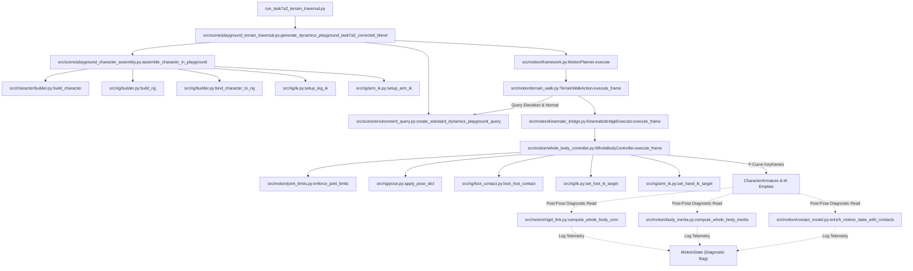
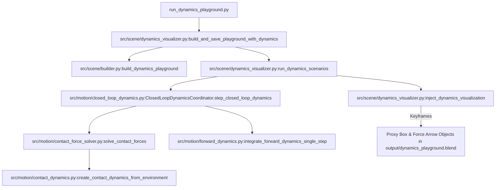

# ProceduralAnimation: Full-Repository Call Graph Audit (7A→7B Gate)

> [!NOTE]
> **历史审计快照标识 (Historical Audit Snapshot)**
> * **快照归档基准**：Git SHA `670766a`（Phase 7A 阶段审计归档点，2026-10-27）
> * **历史有效性说明**：本文件为历史阶段性调用图谱产物，**严格保留历史事实记录**。
> * **最新实际生产调用链**：请直接查阅最新经逐行核实并通过验证的 [`docs/audit/environment_gate01_final/PRODUCTION_CALL_CHAIN.md`](file:///c:/Users/64701/OneDrive/Desktop/ProceduralAnimation/docs/audit/environment_gate01_final/PRODUCTION_CALL_CHAIN.md)。
> * **最新权威架构文档**：请查阅最新权威文档 [`ARCHITECTURE.md`](file:///c:/Users/64701/OneDrive/Desktop/ProceduralAnimation/ARCHITECTURE.md) 与 [`ARCHITECTURE_SYNC.md`](file:///c:/Users/64701/OneDrive/Desktop/ProceduralAnimation/ARCHITECTURE_SYNC.md)。

> **Document Status**: COMPLETED ARCHITECTURE AUDIT BASELINE  
> **Target Milestone**: Admission Gate Phase 7A → Phase 7B  
> **Audit Date**: 2026-10-27  
> **Git Reference**: `670766a26fa7b2ba1f8feee609625d01de98cd39`  

---

## 1. Production Runtime Call Graph (The Active 19-Bone Humanoid Pipeline)

The diagram below maps the actual runtime call graph for generating character locomotion across terrain in Phase 7A (executed in `run_task7a2_terrain_traversal.py` and `src/scene/playground_terrain_traversal.py`):

### Call Chain Classification:
1. **Direct Production Calls (Solid Lines)**:
   * Mandatory execution path per frame.
   * 100% covered by Phase 7 automated integration tests.
2. **Post-Pose Read-Only Telemetry (Dotted Lines)**:
   * Executed during frame validation to extract CoM, inertia, and contact status.
   * Output is stored in `MotionState` but **never re-enters the planner loop**.

---

## 2. Isolated Modules & Standalone Numerical Dynamics Pipeline

The following four modules form an independent numerical dynamics simulation cluster (Pipeline B). They are invoked strictly by `run_dynamics_playground.py` and dedicated verification tests:

### Audit Findings on Pipeline B:
* **Isolation Level**: Complete isolation from `CharacterArmature` and 19-bone humanoid logic.
* **Physics Model**: Centroidal single-rigid-body model with lumped mass ($m = 70.0 kg$) and lumped inertia.
* **Ground Reaction Forces**: Mathematically optimal QP solution using SPG and SLSQP solvers satisfying Coulomb friction cones ($\mu = 0.6$).
* **Reusability Potential for Phase 7C**: The mathematics in `contact_force_solver.py` and `forward_dynamics.py` is robust and unit-tested. In Phase 7C/7D, this solver can be connected to the whole-body CoM and foot contact locations provided by Pipeline A.

---

## 3. Test-Only Call Graphs & Historical Entry Points

The repository contains 21 root `run_*.py` scripts and 47 test files in `tests/`. Their invocation relationships are categorized below:

### 3.1 Historical Milestone Runners (Phase 4 - Phase 6 Prototypes)
* `run_character_prototype.py` $\to$ calls `src/character/prototype.py` (Task 4A)
* `run_rig_prototype.py` $\to$ calls `src/rig/prototype.py` (Task 4B)
* `run_ik_prototype.py` $\to$ calls `src/rig/ik_prototype.py` (Task 4C)
* `run_foot_contact_prototype.py` $\to$ calls `src/rig/foot_contact_prototype.py` (Task 4D)
* `run_walk_cycle_prototype.py` $\to$ calls `src/motion/walk_cycle_prototype.py` (Task 5A)
* `run_forward_walk_prototype.py` $\to$ calls `src/motion/forward_walk_prototype.py` (Task 5B)
* `run_start_stop_walk_prototype.py` $\to$ calls `src/motion/start_stop_walk_prototype.py` (Task 5C)
* `run_motion_framework_prototype.py` $\to$ calls `src/motion/framework.py` (Task 6A)
* `run_run_prototype.py` $\to$ calls `src/motion/run_cycle.py` (Task 6B)
* `run_sprint_prototype.py` $\to$ calls `src/motion/sprint_start.py` (Task 6C)
* `run_sprint_brake_prototype.py` $\to$ calls `src/motion/sprint_brake.py` (Task 6D)
* `run_arm_ik_prototype.py` $\to$ calls `src/rig/arm_ik.py` (Task 6F-A)
* `run_contact_model_prototype.py` $\to$ calls `src/motion/contact_model.py` (Task 6G-C)
* *Audit Status*: **Preserved Legacy Test Fixtures**. Retained to guarantee 100% reproducibility of historical milestones without regression.

### 3.2 Phase 7 Production Entry Points
* `run_task7a1_character_playground.py`: Assembles the 19-bone character into `output/dynamics_playground.blend` and executes flat-ground 204-frame walk verification.
* `run_task7a2_terrain_traversal.py`: Generates continuous terrain traversal across flat, ramp, and platform surfaces (`output/dynamics_playground_task7a2_corrected.blend`).
* `run_unified_motion_pipeline.py`: Executes the comprehensive Task 6 integration sequence.
* *Audit Status*: **Active Production Entry Points**.
