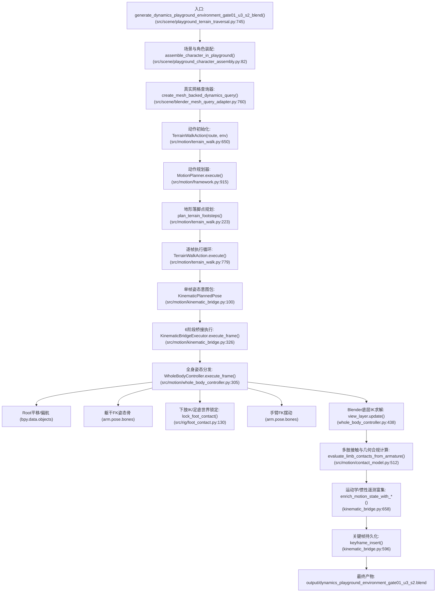

# PRODUCTION_CALL_CHAIN: 实际生产调用链与权威逐层追踪

**审计基准 Commit**：`7a3e244825cd87bf3d787c530318055dc94a3e1f`  
**审计时间**：2026-10-29  
**所属门禁**：Environment Gate 01 — Final Architecture Audit (Audit B)  

---

## 1. 实际生产生成链路总览

当前生成 19 骨骼标准人形角色在复杂 3D 地形中 700 帧连续行走动画的真实生产调用链路如下：



---

## 2. 逐层详细调用关系与数据流动

### Phase 1: 场景装配与环境查询器初始化
1. **源文件**：[`src/scene/playground_terrain_traversal.py:561-600`](file:///c:/Users/64701/OneDrive/Desktop/ProceduralAnimation/src/scene/playground_terrain_traversal.py#L561-L600)
2. **函数**：`generate_dynamics_playground_environment_gate01_u3_blend()`
3. **执行逻辑**：
   - 打开基准场景 `output/dynamics_playground.blend`；
   - 调用 `ensure_ramp_corridor_ground_surfaces()` 补全地表网格；
   - 调用 `assemble_character_in_playground()` 生成 19 骨骼 `CharacterArmature` 与 13 占位网格；
   - 调用 `create_mesh_backed_dynamics_query(scene, collection_names=("Playground_Surfaces",), prefer_mesh=True)`。
4. **输出对象**：`env: DynamicsEnvironmentQuery`，其内部持有基于 `Playground_Surfaces` 集合构建的 `BlenderMeshEnvironmentAdapter`（依赖 `mathutils.bvhtree.BVHTree`）。

### Phase 2: 地形步态预规划 (Footstep Schedule)
1. **源文件**：[`src/motion/terrain_walk.py:223-380`](file:///c:/Users/64701/OneDrive/Desktop/ProceduralAnimation/src/motion/terrain_walk.py#L223-L380)
2. **函数**：`plan_terrain_footsteps(route: TerrainRouteInput, environment: EnvironmentQuery)`
3. **执行逻辑**：
   - 从 `route.start_pos` $(0.0, 10.20, 0.0)$ 出发，沿 Y 轴走廊步进；
   - 对前向预选落脚点调用 `environment.query_ground_support_at(x, y)` 获取真实地表高度与法线；
   - 调用 `_adjust_footfall_for_seams_and_edges()` 探查足底前后边缘法线跳变，规避坡道接缝与台阶边缘悬空；
   - 生成 42 步离散步态计划 `List[TerrainStepPlan]`，预先确定每单步的 `stance_xyz`、`stance_pitch_deg`、`swing_end_xyz`、`swing_end_pitch_deg`。

### Phase 3: 动作级逐帧插值与姿态解耦 (Per-Frame Action Execution)
1. **源文件**：[`src/motion/terrain_walk.py:779-1077`](file:///c:/Users/64701/OneDrive/Desktop/ProceduralAnimation/src/motion/terrain_walk.py#L779-L1077)
2. **函数**：`TerrainWalkAction.execute(initial_state, context)`
3. **执行逻辑**：
   - 提取 `knot_frames, knot_y, knot_v = _build_continuous_root_forward_spline(schedule, fps)`，在步态边界采用 Hermite 样条维持 C1 连续前向速度；
   - 计算单步归一化时间 $\alpha = \text{smoothstep01}(step\_progress)$（其中末帧通过 $dur - 1$ 精确收敛到 1.0）；
   - 计算摆动脚轨迹：水平平滑插值，垂直方向通过纯数学正弦加权包络函数 `_compute_swing_clearance_z` 实现无跳变起降；
   - 依据地表坡度几何投影计算骨盆沉降量 `pelvis_dz` 与躯干前倾角 `forward_lean`；
   - 打包生成统一姿态意图数据包 `KinematicPlannedPose`。

### Phase 4: 动力学桥接层调度 (Kinematic Bridge Executor)
1. **源文件**：[`src/motion/kinematic_bridge.py:326-683`](file:///c:/Users/64701/OneDrive/Desktop/ProceduralAnimation/src/motion/kinematic_bridge.py#L326-L683)
2. **函数**：`KinematicBridgeExecutor.execute_frame(planned: KinematicPlannedPose)`
3. **执行逻辑**：
   - **Phase 1 (Intent Extraction)**：解析 `planned.foot_L` 与 `planned.foot_R`；
   - **Phase 2 (Environment Integration)**：根据足底局部锚点在当前世界位姿变换后的投影坐标，调用 `self.environment.query_ground_support_at()`；
   - **严格准入拦截**：执行 `if query_res.success and query_res.allows_regular_support:`，拒绝非支撑表面并标记 `BROKEN`；
   - **Phase 3 (WBC Targets Assembly)**：组装 `WholeBodyControlTargets`，将锁定支撑脚与摆动脚目标提交给 WBC；
   - **Phase 4 (WBC Execution)**：调用 `self.wbc.execute_frame(targets)`。

### Phase 5: 全身姿态底层分发与原生解算 (WholeBodyController)
1. **源文件**：[`src/motion/whole_body_controller.py:305-440`](file:///c:/Users/64701/OneDrive/Desktop/ProceduralAnimation/src/motion/whole_body_controller.py#L305-L440)
2. **函数**：`WholeBodyController.execute_frame(targets: WholeBodyControlTargets)`
3. **执行逻辑**：
   - 写入 `CharacterRoot` 的 `location` 与 `rotation_euler.z`；
   - 写入 `pelvis` 姿态骨局部平移与旋转；
   - 写入 `spine`, `neck`, `head` 姿态骨旋转；
   - 写入手臂与腿部 FK 姿态骨旋转；
   - 写入足部 IK：支撑脚调用 `lock_foot_contact()` 将 `FootIK` Empty 严格锁定在世界坐标地表，摆动脚调用 `set_foot_ik_target()`；
   - 调用 `bpy.context.view_layer.update()` 触发 Blender 底层双骨骼 IK 求解器。

### Phase 6: 物理遥测富集与关键帧持久化
1. **源文件**：[`src/motion/kinematic_bridge.py:527-660`](file:///c:/Users/64701/OneDrive/Desktop/ProceduralAnimation/src/motion/kinematic_bridge.py#L527-L660)
2. **执行逻辑**：
   - 调用 `evaluate_limb_contacts_from_armature()` 提取骨骼实际姿态，与网格表面核对气隙、穿透与滑移；
   - 检验解剖学生理活动范围 (`check_armature_joint_limits`)；
   - 计算 19 骨骼刚体质心 (`compute_whole_body_com`)；
   - 计算骨骼线/角速度 (`compute_segment_velocities`) 与惯性张量 (`compute_whole_body_inertia`)；
   - 针对 `CharacterRoot`、所有 `pose.bones` 以及 IK Control Empties 插入 `keyframe_insert("location")` 与 `keyframe_insert("rotation_euler")`；
   - 打包返回 `BridgeExecutionResult` 与 `MotionState`。

---

## 3. 核心架构问答 (Questions B01 – B12)

### B01: 当前真实 Mesh 查询从哪里创建？
* **真实代码位置**：[`src/scene/playground_terrain_traversal.py:596-600`](file:///c:/Users/64701/OneDrive/Desktop/ProceduralAnimation/src/scene/playground_terrain_traversal.py#L596-L600)
* **实现**：
  ```python
  env = create_mesh_backed_dynamics_query(
      scene=scene,
      collection_names=("Playground_Surfaces",),
      prefer_mesh=True,
  )
  ```
  在 `src/scene/blender_mesh_query_adapter.py:760` 中实例化底层 `BlenderMeshEnvironmentAdapter`，并注入 `DynamicsEnvironmentQuery`。

### B02: Mesh 高度、法线和 surface_id 由哪个函数返回？
* **真实代码位置**：[`src/scene/environment_query.py:474-531`](file:///c:/Users/64701/OneDrive/Desktop/ProceduralAnimation/src/scene/environment_query.py#L474-L531)
* **函数签名**：`DynamicsEnvironmentQuery.query_ground_support_at(x, y, start_z=50.0, max_fall=100.0) -> SurfaceQueryResult`
* **底层实现**：当 `prefer_mesh=True` 时，调用 `BlenderMeshEnvironmentAdapter.ray_cast(origin=(x, y, start_z), direction=(0, 0, -1), distance=max_fall)`，通过 BVH 树单次物理射线求交返回单次命中结果（高度 Z、法向量、`surface_id`、`allows_regular_support` 与摩擦系数）。

### B03: 这些数据真正影响了哪些运动目标？
真实代码中环境查询数据直接决定了以下 4 项运动学目标：
1. **离散落脚点规划** ([`terrain_walk.py:248-350`](file:///c:/Users/64701/OneDrive/Desktop/ProceduralAnimation/src/motion/terrain_walk.py#L248-L350))：决定每一步支撑脚世界位置 `stance_xyz` 与目标倾角 `stance_pitch_deg`；
2. **摆动脚三维轨迹与足底越障高度** ([`terrain_walk.py:882-933`](file:///c:/Users/64701/OneDrive/Desktop/ProceduralAnimation/src/motion/terrain_walk.py#L882-L933))：决定摆动基准高程 $z\_base$、足底多点检测越障高度 $sw\_z\_clean$ 及脚踝俯仰倾角 $sw\_pitch$；
3. **骨盆下沉量与躯干前倾角** ([`terrain_walk.py:980-1047`](file:///c:/Users/64701/OneDrive/Desktop/ProceduralAnimation/src/motion/terrain_walk.py#L980-L1047))：依据 Root 正下方坡度 `slope_pitch_deg` 调整 `pelvis_dz` 与 `spine.rotation_euler.x`；
4. **桥接层支撑脚接触锚点** ([`kinematic_bridge.py:410-440`](file:///c:/Users/64701/OneDrive/Desktop/ProceduralAnimation/src/motion/kinematic_bridge.py#L410-L440))：决定世界空间锁定支撑脚的目标坐标 `target_world` 与动态环境曲面注册。

### B04: 哪个模块决定 Root 位置？
* **真实代码位置**：[`src/motion/terrain_walk.py:963-973`](file:///c:/Users/64701/OneDrive/Desktop/ProceduralAnimation/src/motion/terrain_walk.py#L963-L973)
* **计算逻辑**：
  - $X$ 轴：`root_x = init_corridor_x`（固定走廊横向中心，当前为 $0.0\text{ m}$）；
  - $Y$ 轴：`root_y = _evaluate_root_y_hermite(...)`（单调 C1 连续 Hermite 样条解耦插值）；
  - $Z$ 轴：`root_z = 0.5 * (st_xyz[2] + z_base)`（双足基准平均高程）。
* **写入者**：通过 `KinematicPlannedPose.root_position` 传递给 `WholeBodyController.execute_frame()`，最终直接赋值给 `root_obj.location`（[`whole_body_controller.py:337`](file:///c:/Users/64701/OneDrive/Desktop/ProceduralAnimation/src/motion/whole_body_controller.py#L337)）。

### B05: 哪个模块决定 Swing Foot 目标？
* **真实代码位置**：[`src/motion/terrain_walk.py:877-934`](file:///c:/Users/64701/OneDrive/Desktop/ProceduralAnimation/src/motion/terrain_walk.py#L877-L934)
* **模块**：`TerrainWalkAction.execute()`
* **计算逻辑**：水平方向对起飞点与着地点执行平滑插值，垂直方向由正弦加权包络函数 `_compute_swing_clearance_z()` 叠加地形越障抬升量，生成 `PlannedFootTarget(world_xyz=(sw_x, sw_y, sw_z_clean + ANKLE_REST_Z), is_locked=False)`。

### B06: 哪个模块真正写入骨骼和 IK 控制器？
* **唯一真实写入者**：[`src/motion/whole_body_controller.py:336-435`](file:///c:/Users/64701/OneDrive/Desktop/ProceduralAnimation/src/motion/whole_body_controller.py#L336-L435) 的 `WholeBodyController.execute_frame()`
* **写入明细**：
  - `root_obj.location = Vector(targets.root_position)`
  - `root_obj.rotation_euler.z = math.radians(targets.root_yaw_deg)`
  - `p_pelvis.location` 与 `p_pelvis.rotation_euler`
  - 姿态骨 `spine`, `neck`, `head`, `upper_arm.*`, `forearm.*`, `hand.*` 的 `rotation_euler`
  - 下肢 IK：调用 `lock_foot_contact()` 或 `set_foot_ik_target()` 写入 `FootIK.L` / `FootIK.R` 控制物体的世界位姿；
  - 上肢 IK：调用 `set_hand_ik_target()` 写入 `HandIK.L` / `HandIK.R` 控制物体。

### B07: ContactModel 的结果是否影响下一帧规划？
* **结论**：**否（开环无反馈，OPEN-LOOP ONLY）**。
* **证据**：
  - 在 [`kinematic_bridge.py:527-591`](file:///c:/Users/64701/OneDrive/Desktop/ProceduralAnimation/src/motion/kinematic_bridge.py#L527-L591)，`evaluate_limb_contacts_from_armature` 计算出 `MultiContactState`，核验气隙、穿透与滑移；
  - 违规项被记录入 `unmet_constraints` 与遥测字典，并在终端输出警告；
  - `TerrainWalkAction` 在执行前已将全场 42 步离散步态计划 `schedule` 全部固化生成完毕，在逐帧推进中**从未读取 `last_multi_contact`** 来调整下一帧的步长、支撑脚位置或行进步速。

### B08: CoM 是否影响人体运动？
* **结论**：**否（纯遥测指标，TELEMETRY ONLY）**。
* **证据**：
  - [`whole_body_controller.py:553`](file:///c:/Users/64701/OneDrive/Desktop/ProceduralAnimation/src/motion/whole_body_controller.py#L553) 调用 `compute_whole_body_com()` 计算出 $70.0\text{kg}$ 全身质心坐标 `com_world`；
  - 该值仅被赋予 `WholeBodyControlResult.com_world`，进而存入 `motion_state.params["com_world"]` 和诊断视窗标记物；
  - 质心坐标完全没有接入倒立摆模型 (LIPM) 或 ZMP 平衡方程，不反向驱动 Root 位移或脚步落点。

### B09: ForwardDynamics 是否影响 19 骨骼人体实际状态？
* **结论**：**否（完全脱节，TEST ONLY）**。
* **证据**：
  - `src/motion/forward_dynamics.py` (`ForwardDynamicsIntegrator`) 仅在单元测试 `tests/verify_task6gd_forward_dynamics.py` 与 `tests/verify_task6gd_playground_dynamics.py` 中被调用；
  - 生产主链入口 `generate_dynamics_playground_environment_gate01_u3_blend()` 及其衍生函数中**根本未引入或实例化 `ForwardDynamicsIntegrator`**；
  - 生产场景中运动中的 19 骨骼角色骨架其动力学自由度为 0。

### B10: ClosedLoopDynamics 是否连接到现有生产动作？
* **结论**：**否（完全未连接，TEST/PROTOTYPE ONLY）**。
* **证据**：
  - `src/motion/closed_loop_dynamics.py` (`MultiFrameDynamicsController`) 仅在 `tests/verify_task6gd_closed_loop_dynamics.py` 中运行；
  - 该控制器仅作用于基准训练场中的单一单刚体质心代理物体（`Playground_Dynamics_Visualization`），与 19 骨骼角色无任何数据通路。

### B11: IK 不可达结果是否反馈给规划器？
* **结论**：**否（仅打印警告，WARNING ONLY）**。
* **证据**：
  - [`src/motion/terrain_walk.py:1084-1090`](file:///c:/Users/64701/OneDrive/Desktop/ProceduralAnimation/src/motion/terrain_walk.py#L1084-L1090)：
    ```python
    if not bridge_res.wbc_result.is_all_reachable:
        for uc in bridge_res.unmet_constraints:
            print(f"[WARN] IK Unreachable at Frame {current_frame}: ...")
        unreachable_count += 1
    ```
  - 遇到肢体不可达时，仅打印警告信息并递增计数器 `unreachable_count`；规划器不会缩短步长、不会自适应下沉骨盆，也不会重新触发规划。

### B12: 有哪些数据仅被保存到日志，没有实际影响人体运动？
全量排查，以下 7 大数据项目前仅作为只读遥测存在：
1. **刚体惯性张量与角动量**：`motion_state.params["inertia_state"]`（来自 `body_inertia.py`）；
2. **全身质心坐标**：`motion_state.params["com_world"]`（来自 `rigid_link.py`）；
3. **多接触面瞬时状态**：`bridge.last_multi_contact`（来自 `contact_model.py`）；
4. **几何合规指标**：`contact_geometry_errors`（包含气隙 `gap_m`、滑移 `slip_m` 与穿透深度 `penetration_m`）；
5. **未满足约束列表**：`bridge_res.unmet_constraints`（记录 IK 超限与接触断开理由）；
6. **末端执行器跟踪误差**：`bridge_res.tracking_errors`（IK 目标与姿态骨实际位置偏差）；
7. **6 阶段视窗诊断记录**：`scene["task7a2_control_chain_diagnostics"]`（逐帧遥测 JSON）。
