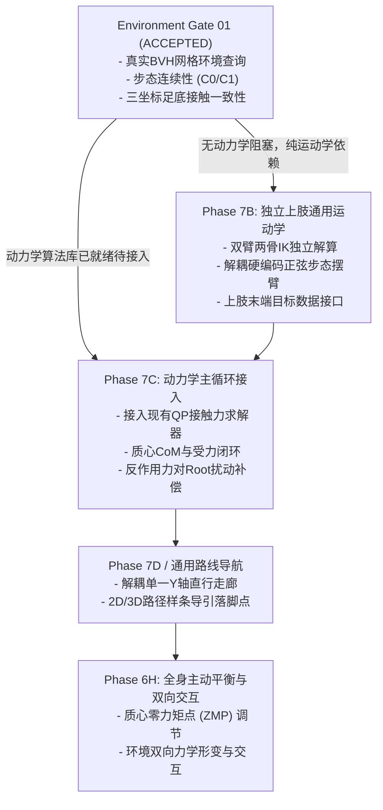

# ProceduralAnimation — Audit I: 后续架构路线与依赖收敛报告

**文档标识**：`docs/audit/environment_gate01_final/ROADMAP_RECONCILIATION.md`  
**审计基准 HEAD**：`7a3e244825cd87bf3d787c530318055dc94a3e1f`  
**审计性质**：Environment Gate 01 最终独立架构审计（Audit I）

---

## 1. 架构演进路线与阶段依赖总览

本项目坚持模块化、分阶段逐级准入原则（$7\text{A} \to 7\text{B} \to 7\text{C} \to 7\text{D} \to 7\text{E} \to 7\text{F} \to 6\text{H}$），严禁跨级研发。本审计在不改变已有发展顺序的前提下，重新核实后续关键阶段的接口依赖与前置条件。

---

## 2. Phase 7B：独立上肢通用运动学接入审计

### 2.1 现有基础与可用资产
* **手臂两骨 IK 算法已就绪**：[`src/rig/arm_ik.py`](file:///c:/Users/64701/OneDrive/Desktop/ProceduralAnimation/src/rig/arm_ik.py) 实现了标准双骨骼解析解算器（上臂 $0.28\,\text{m}$，前臂 $0.25\,\text{m}$，最大伸展 $0.53\,\text{m}$，含 $0.999$ 防奇异点截断），左右臂解算完全独立。
* **全身控制器 WBC 控制槽位已就绪**：[`src/motion/whole_body_controller.py`](file:///c:/Users/64701/OneDrive/Desktop/ProceduralAnimation/src/motion/whole_body_controller.py) 的 `WholeBodyController.execute_frame()` 已具备 `left_arm_ik` 和 `right_arm_ik` 参数入口，可无缝向 Armature 骨骼 `hand_ik.L` / `hand_ik.R` 及其极向目标写入位姿。
* **姿态传递结构已定义**：`KinematicPlannedPose` 已经包含左右手目标字段。

### 2.2 Phase 7B 准入的前置解耦要点（核心发现）
1. **解除 `TerrainWalkAction` 对手臂旋转角的强行绑定**：
   * 当前在 [`src/motion/terrain_walk.py#L1128-L1134`](file:///c:/Users/64701/OneDrive/Desktop/ProceduralAnimation/src/motion/terrain_walk.py#L1128-L1134) 中，左右肩关节与手臂欧拉角被硬编码为对侧正弦摆动：
     $$\text{arm\_l\_rx} = -\text{arm\_swing\_amp} \times \sin(2\pi \cdot \text{gait\_u})$$
   * **7B 改造要求**：必须在规划层将手臂动作解耦为独立的 `UpperLimbAction` 或允许外部直接向 `KinematicPlannedPose` 注入左右手末端目标空间位置。预设轨迹可用于单元测试，但不得作为唯一的运动来源。
2. **修复 `kinematic_bridge.py` 中的休眠枚举错误**：
   * 在 [`src/motion/kinematic_bridge.py#L512`](file:///c:/Users/64701/OneDrive/Desktop/ProceduralAnimation/src/motion/kinematic_bridge.py#L512) 中，手臂接触意图处理分支错误引用了不存在的枚举成员 `ContactLifecycle.TOUCHDOWN`（正确的意图枚举应为 `CANDIDATE`）。当未来在 7B 中激活手臂支撑或攀爬接触时，此错误会被触发，必须在 7B 开启时修正。

---

## 3. 后续动力学路线审计（Phase 7C / 6H）

### 3.1 动力学算法复用规范（严禁重复实现）
全工程动力学核心算子已在 `src/motion/` 下完成独立单元研发与严谨测试，严禁重复编写第二套求解器：
* **接触力求解**：直接复用 [`src/motion/contact_force_solver.py`](file:///c:/Users/64701/OneDrive/Desktop/ProceduralAnimation/src/motion/contact_force_solver.py)（QP 凸优化求解器）。
* **多接触状态与摩擦锥**：直接复用 [`src/motion/contact_dynamics.py`](file:///c:/Users/64701/OneDrive/Desktop/ProceduralAnimation/src/motion/contact_dynamics.py)（`MultiContactDynamics`）。
* **分段质心与惯量**：直接复用 [`src/motion/rigid_link.py`](file:///c:/Users/64701/OneDrive/Desktop/ProceduralAnimation/src/motion/rigid_link.py) 与 [`src/motion/body_inertia.py`](file:///c:/Users/64701/OneDrive/Desktop/ProceduralAnimation/src/motion/body_inertia.py)。
* **闭环动力学反馈器**：直接复用 [`src/motion/closed_loop_dynamics.py`](file:///c:/Users/64701/OneDrive/Desktop/ProceduralAnimation/src/motion/closed_loop_dynamics.py)。

### 3.2 接入人体主循环的拓扑合同
未来的双向闭环动力学必须建立在 Environment Gate 01 建立的真实网格几何接触基础之上：
$$\text{真实网格查询} \to \text{几何接触点 (Point B)} \to \text{法向与摩擦锥约束} \to \text{QP接触力求解} \to \text{Root扰动加速度} \to \text{WBC主动平衡}$$
在 Phase 7C 准入前，严格保持上述数据流作为理论预留，严禁提前私自打通。

---

## 4. 通用路线导航接口解耦审计（Phase 7D）

* **现状限制**：[`src/motion/terrain_walk.py#L243`](file:///c:/Users/64701/OneDrive/Desktop/ProceduralAnimation/src/motion/terrain_walk.py#L243) 将落脚点固定在 $X=x_0$ 直线走廊上，沿 $+Y$ 单向排布。
* **解耦规范**：未来应将 `plan_terrain_footsteps` 重构为接收任意参数化航点列表 `List[Waypoint2D(x, y)]` 或航向角序列 $\theta(t)$，通过切线方向计算步长向量 $(\Delta x, \Delta y)$，从单一直线走廊扩展为真正的三维地形曲面导航。
