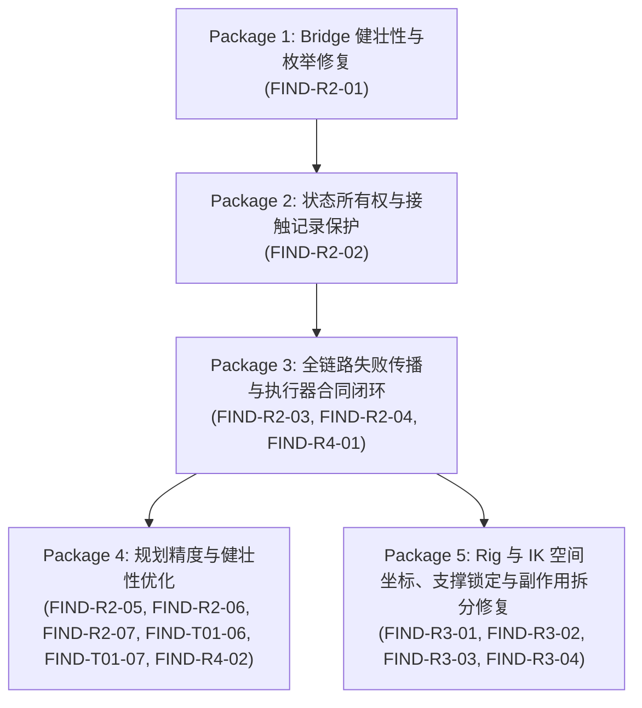

# OPEN_FINDINGS: 生产接口审计问题登记表 (Master Registry)

> **当前修复节点**：PKG-5 / 09-B-3（Lower-Limb World Rotation）
> **代码审计基准 HEAD**：`2904857433af01c2a7991e2da085b3c0f53a145f`
> **本次文档同步基准 HEAD**：`76e5907eef5514801c8b17856787566c9e530a7a`
> **文档更新时间**：2026-11-01
> **当前修复状态**：`09-B-3 IN PROGRESS — NOT ACCEPTED`（修复尚未完成，仍存在未解决问题）
> **历史验收说明**：DEC-064 与旧 09-B 验收记录保留其当时的历史有效性，但不得据此宣称最新 09-B-3 已通过独立验收。
> **当前登记基线**：保留原有 16 项 Finding ID，不创建新的 Finding ID。
> **当前未关闭历史 Finding**：FIND-R3-03、FIND-R3-04，归属 PKG-5 / 11 FootLock。
> **当前 09-B-3 说明**：09-B-3 仍处于修复过程中，存在未解决问题。测试源码包含 TEST-01 至 TEST-21，但现有执行记录只证明此前 17 项测试通过；TEST-18 至 TEST-21 尚无当前实际执行证据。不得把补齐测试执行等同于修复完成。
> **门禁**：Phase 7B 仍然 `NOT AUTHORIZED`。必须完成 PKG-5 / 09-B-3、10、11、12，并通过全仓联合验收及负责人明确批准。

---

## 1. 审计缺陷与问题汇总看板 (Dashboard)

> 本表中的 16 项是现有 Finding 登记基线。历史修复状态、当前未关闭 Finding、当前进行中的修复节点以及未验证项目必须分开统计。09-B-3 尚未修复完成，不得用历史验收记录替代当前修复状态。

| 统计指标 | 数量 | 说明 |
| :--- | :---: | :--- |
| **已确认缺陷 (CONFIRMED_DEFECT)** | **0 项当前未关闭 + 3 项历史已修复** | FIND-R2-01、FIND-R2-02、FIND-R2-07 |
| **接口合同缺口 (CONTRACT_GAP)** | **2 项当前未关闭 + 11 项历史已修复** | 当前未关闭：FIND-R3-03、FIND-R3-04；其余保留历史修复状态 |
| **历史登记 Finding 总数** | **16** | 保留原有编号，不增删、不合并、不重新编号 |
| **历史关闭数量** | **14** | 依据原有 Finding 记录；不代表当前 09-B-3 已通过 |
| **历史未关闭数量** | **2** | FIND-R3-03、FIND-R3-04 |
| **09-B-3 当前节点** | **1 项进行中、尚未修复完成** | FIND-R3-01 的历史修复记录保留；当前 09-B-3 仍存在未解决问题，状态为 `IN PROGRESS — NOT ACCEPTED` |
| **已知设计限制** | **3** | LIMIT-01、LIMIT-02、LIMIT-03，不能自动转化为代码缺陷 |
| **未验证项** | **2** | UNVERIFIED-01、UNVERIFIED-02；均不得宣称通过 |
| **Phase 7B** | **NOT AUTHORIZED** | PKG-5 / 09-B-3、10、11、12 尚未完成联合验收与负责人批准 |

---

## 2. 问题统一登记总表 (Master Register Table)

| Finding ID | 对应历史编号 | 源码文件 | 类 / 函数 | 源码行号 (核准) | 影响类别 | 证据等级 | 阻碍后续开发 | 负责模块 |
| :--- | :--- | :--- | :--- | :--- | :--- | :---: | :---: | :--- |
| **FIND-R2-01** | - | `src/motion/kinematic_bridge.py` | `KinematicBridgeExecutor.execute_frame()` | Line 512 | CONFIRMED_DEFECT (FIXED) | `STATIC_CONFIRMED` | **NO (RESOLVED)** | `kinematic_bridge.py` |
| **FIND-R2-02** | FIND-T01-02 | `src/motion/terrain_walk.py` | `TerrainWalkAction.execute()` | Lines 1100–1138 | CONFIRMED_DEFECT (FIXED) | `STATIC_CONFIRMED` | **NO (RESOLVED)** | `terrain_walk.py` |
| **FIND-R2-03** | FIND-T01-01 | `src/motion/terrain_walk.py` | `TerrainWalkAction.execute()` | Lines 1080–1145 | CONTRACT_GAP (FIXED) | `STATIC_CONFIRMED` | **NO (RESOLVED)** | `terrain_walk.py` |
| **FIND-R2-04** | FIND-T01-03 | `src/motion/framework.py` | `ActionExecutionResult` / `MotionPlanner` | Lines 455–486 / 1045–1120 | CONTRACT_GAP (FIXED) | `STATIC_CONFIRMED` | **NO (RESOLVED)** | `framework.py` |
| **FIND-R2-05** | - | `src/motion/contact_model.py` | `ContactRecord` / `MultiContactState` | Lines 164–220 / 312–430 | CONTRACT_GAP (FIXED) | `STATIC_CONFIRMED` | **NO (RESOLVED)** | `contact_model.py` |
| **FIND-R2-06** | FIND-T01-05 | `src/motion/terrain_walk.py` | `plan_terrain_footsteps` vs `build_terrain_step_schedule` | Lines 287–447 | CONTRACT_GAP (FIXED) | `STATIC_CONFIRMED` | **NO (RESOLVED)** | `terrain_walk.py` |
| **FIND-R2-07** | FIND-T01-04 | `src/motion/terrain_walk.py` | `_adjust_footfall_for_seams_and_edges()` | Lines 219–285 | CONFIRMED_DEFECT (FIXED) | `STATIC_CONFIRMED` | **NO (RESOLVED)** | `terrain_walk.py` |
| **FIND-T01-06** | - | `src/motion/terrain_walk.py` | `TerrainWalkAction.estimate_duration_frames()` | Lines 654–681 | CONTRACT_GAP (FIXED) | `STATIC_CONFIRMED` | **NO (RESOLVED)** | `terrain_walk.py` |
| **FIND-T01-07** | - | `src/motion/terrain_walk.py` | `plan_terrain_footsteps()` | Lines 450–512 | CONTRACT_GAP (FIXED) | `STATIC_CONFIRMED` | **NO (RESOLVED)** | `terrain_walk.py` |
| **FIND-T01-08** | - | `src/motion/terrain_walk.py` | `TerrainWalkAction.execute()` | Lines 920–930 | CONTRACT_GAP (FIXED) | `STATIC_CONFIRMED` | **NO (RESOLVED)** | `terrain_walk.py` |
| **FIND-R3-01** | - | `src/rig/foot_contact.py` / `src/rig/ik.py` | `unlock_foot_contact()` / `set_foot_ik_target()` | Lines 149–192 / 637–675 | CONTRACT_GAP | `STATIC_CONFIRMED` | **NO** | `foot_contact.py` / `ik.py` (历史 09-B 修复与 DEC-064 验收记录保留；当前 09-B-3 对有效父级变换支持域及测试覆盖进行了后续修正，最新 TEST-18 至 TEST-21 没有当前实际运行证据，当前 09-B-3 独立核验未完成，不得宣称 21/21 PASS；09-B-3 RE-VERIFICATION PENDING) |
| **FIND-R3-02** | - | `src/rig/ik.py` | `set_foot_ik_target()` | Lines 334–346 | CONTRACT_GAP (FIXED) | `STATIC_CONFIRMED` | **NO (RESOLVED)** | `ik.py` |
| **FIND-R3-03** | - | `src/rig/foot_contact.py` / `src/rig/ik.py` | `unlock_foot_contact()` / `reset_leg_ik()` | Lines 168–170 / 219 | CONTRACT_GAP | `STATIC_CONFIRMED` | NO | `foot_contact.py` / `ik.py` |
| **FIND-R3-04** | - | `src/rig/foot_contact.py` | `evaluate_foot_support()` | Lines 207–235 | CONTRACT_GAP | `STATIC_CONFIRMED` | NO | `foot_contact.py` |
| **FIND-R4-01** | - | `src/scene/playground_terrain_traversal.py` | `generate_dynamics_playground_environment_gate01_u3_blend()` | Lines 633–640, 689, 704 | CONTRACT_GAP (FIXED) | `STATIC_CONFIRMED` | **NO (RESOLVED)** | `playground_terrain_traversal.py` |
| **FIND-R4-02** | - | `src/scene/environment_query.py` / `src/scene/blender_mesh_query_adapter.py` | `ground_height_at()` / `surface_normal_at()` / `query_ground_support_at()` | `eq:402, 588–593, 610–615` / `bmqa:885–892` | CONTRACT_GAP (FIXED) | `STATIC_CONFIRMED` | **NO (RESOLVED)** | `environment_query.py` / `blender_mesh_query_adapter.py` |

---

## 3. 已确认缺陷详情 (Confirmed Defects)

### FIND-R2-01: Bridge 引用不存在的非法枚举成员 `ContactLifecycle.TOUCHDOWN`
* **Source File**: `src/motion/kinematic_bridge.py`
* **Class / Function**: `KinematicBridgeExecutor.execute_frame()`
* **Exact Line Range**: Line 512
* **Evidence Grade**: `STATIC_CONFIRMED`
* **Trigger Condition**: 任何规划的手部目标启用接触意图（`ht.enabled=True`, `ht.contact_intent=True`, `not ht.is_locked`），且手部到接触面距离 $> 0.015$m。
* **Actual Behavior**: 试图访问 `ContactLifecycle.TOUCHDOWN`，引发 `AttributeError: type object 'ContactLifecycle' has no attribute 'TOUCHDOWN'` 致命崩溃。
* **Expected Contract**: `ContactLifecycle` 枚举（`contact_model.py:53–59`）仅定义了 `CANDIDATE`, `ESTABLISHED`, `RELEASED`, `BROKEN`。接触意图初期应标定为 `ContactLifecycle.CANDIDATE`。
* **Evidence**:
  ```python
  # src/motion/kinematic_bridge.py:512
  "lifecycle": ContactLifecycle.ESTABLISHED if dist <= 0.015 else ContactLifecycle.TOUCHDOWN,
  ```
* **Responsible Module**: `src/motion/kinematic_bridge.py`
* **Downstream Impact**: 一旦开启上肢环境接触或支撑攀爬（Phase 7B 核心目标），主执行链立即崩溃。
* **Classification**: `CONFIRMED_DEFECT (RESOLVED)`
* **Blocks Further Development**: `NO (RESOLVED)`
* **Repair Status**: `FIXED / VERIFIED`
* **Suggested Repair Boundary**: 将 `kinematic_bridge.py:512` 的 `ContactLifecycle.TOUCHDOWN` 修正为 `ContactLifecycle.CANDIDATE`，并在单元测试中补全手部接触生命周期流转。
* **修复前复现与验证**: 运行 `tests/test_find_r2_01_hand_contact_lifecycle.py`，在旧代码下真实触发 `AttributeError: type object 'ContactLifecycle' has no attribute 'TOUCHDOWN'`（退出码 1）；
* **修复后检验**: 将第 512 行修正为 `ContactLifecycle.CANDIDATE` 后，针对性测试 4 条路径（Case A/B/C/D）4/4 全绿通过，多接触状态与支撑类型经核对完全符合物理设计合同；
* **回归检验**: 分层回归套件全绿（Quick 18/18, Physics 21/21, Motion 11/11, Full 35/35），文档门禁 0 错误。

---

### FIND-R2-02 (对应历史 FIND-T01-02): `TerrainWalkAction` 强制覆盖 `MotionState.contacts`
* **Source File**: `src/motion/terrain_walk.py`
* **Class / Function**: `TerrainWalkAction.execute()`
* **Exact Line Range**: Lines 1100–1138 (覆写点: Line 1138)
* **Evidence Grade**: `STATIC_CONFIRMED`
* **Trigger Condition**: 正常运行 `TerrainWalkAction.execute()` 的每一帧。
* **Actual Behavior**:
  ```python
  # src/motion/terrain_walk.py:1138
  ms = ms.clone_with(contacts=c_dict, mode=mode)
  ```
  Action 内部基于规划意图自行构造仅含 `foot_L` 与 `foot_R` 的字典 `c_dict`，并调用 `clone_with(contacts=c_dict)`，直接覆盖掉此前由 Bridge Phase 6 通过 `enrich_motion_state_with_contacts()` (L668) 注入的真实物理接触记录。
* **核实与证据区分 (R2-CLOSE-05)**:
  * **已确认事实**：`ms.contacts` 确实被 `c_dict` 覆写（`STATIC_CONFIRMED`）。
  * **实际字段影响**：
    1. 遗漏上肢：`c_dict` 仅硬编码构造左右脚，如果 Bridge/ContactModel 产生了手部接触（`hand_L`/`hand_R`），在进入 `ms.contacts` 时会被销毁；
    2. 坐标差异：`c_dict` 中的 `contact_world_xyz` 存入的是规划落点 `last_known_xyz`，而非由真实 Mesh 射线相交解算出的真实接触点 Point B；
    3. 法线差异：`surface_normal` 存入的是规划预期的目标法线，而非足底实际受力点法线；
    4. 状态锁定：`is_locked` 直接跟随规划布尔值，忽略了 Bridge 判定的 `BROKEN` 状态。
  * **仍被妥善保存的数据**：
    1. `ms.params` 中的 `support_type`、`supporting_limbs`、`active_contact_count`、`support_polygon_2d` 未被覆盖，依然完整保留；
    2. `bridge_res.multi_contact` 与 `bridge_executor.last_multi_contact` 保持完整对象，未被破坏。
  * **下游影响与复现性**：在当前双脚平地与地形测试中，未引发运行时崩溃（因为现有验证脚本多直接读取 WBC 或 Bridge 遥测），但在进入 Phase 7B 激活上肢接触或依赖 `MotionState.contacts` 做动力学解算时将产生严重数据失真。
* **Expected Contract**:
  1. `ms.contacts` 必须保留物理测量接触状态（Point B 接触坐标、法线、间隙、穿透量）；
  2. 若 Bridge 判定某脚几何约束失败（如落在悬崖外 `BROKEN`），Action 不得将其强行置为 `is_locked=True` 的稳定支撑；
  3. Action 不得擅自擦除上肢（如 `hand_L` / `hand_R`）可能存在的接触记录。
* **Evidence**:
  在 `kinematic_bridge.py:668`，Bridge 已经完成了 `ms = enrich_motion_state_with_contacts(ms, multi_contact)`。`terrain_walk.py:1138` 无条件将 `ms.contacts` 覆盖为由 `last_known_xyz` 拼凑的简化字典。
* **Responsible Module**: `src/motion/terrain_walk.py`
* **Downstream Impact**: 物理遥测与动力学计算无法获取真实法线与滑动状态；手部接触在进入 MotionState 时被完全销毁；下游模块读取到虚假接触锁定。
* **Classification**: `CONFIRMED_DEFECT`
* **Blocks Further Development**: `YES`
* **Repair Status**: `FIXED / VERIFIED (tests/test_find_r2_02_contact_state_ownership.py 5/5 PASS)`
* **Suggested Repair Boundary**: 移除 `terrain_walk.py:1138` 中对 `contacts=c_dict` 的覆盖，仅保留 `ms = ms.clone_with(mode=mode, params=ms_params)`，对必须保留的规划步态相位通过 `params` 传递。

---

### FIND-R2-07 (对应历史 FIND-T01-04): 边缘与接缝横向探测位置偏置缺陷
* **Source File**: `src/motion/terrain_walk.py`
* **Class / Function**: `plan_terrain_footsteps()`
* **Exact Line Range**: Lines 310–312
* **Evidence Grade**: `STATIC_CONFIRMED`
* **Trigger Condition**: 在具有横向凹凸、边缘或接缝的地形上行走。
* **Actual Behavior**:
  调用 `_adjust_footfall_for_seams_and_edges(environment, corridor_x, curr_lead_y, y0, y_tgt)` 时，传入的是走廊中心线坐标 `corridor_x`（通常为 $0.0$），而不是摆动脚真实的横向落点位置 `sw_x`（左右脚偏移通常为 $\pm 0.13$m）。
* **Expected Contract**: 边缘与接缝探测必须以真实预计着地点 `(sw_x, forward_y)` 为中心进行射线与梯度检测。
* **Evidence**: `terrain_walk.py:310–312` 实参为 `corridor_x`，导致系统始终在身体正中线检测地形边缘，无法感知位于身体侧面 $\pm 13$cm 处踩在台阶边缘的情况。
* **Responsible Module**: `src/motion/terrain_walk.py`
* **Downstream Impact**: 脚部落在台阶或接缝边缘时未触发避障微调，容易出现脚底悬空或踩入接缝。
* **Classification**: `CONFIRMED_DEFECT (RESOLVED)`
* **Blocks Further Development**: `NO (RESOLVED)`
* **Repair Status**: `FIXED / VERIFIED`
* **Fix & Verification Summary**: 将接缝微调函数签名与调用改造为接收实际摆动侧脚部横向绝对坐标 `sw_x`（`_adjust_footfall_for_seams_and_edges(environment, sw_x, curr_lead_y, y0, y_tgt)`），结合左右脚脚后跟、踝关节与脚尖（22cm 刚性鞋底）真实三点网格支撑有效性判定，彻底消除中线偏置盲区；在 `tests/test_terrain_planning_contract.py` Group A 验证通过。

---

## 4. 接口合同缺口详情 (Interface Contract Gaps)

### FIND-R2-03 (对应历史 FIND-T01-01): `TerrainWalkAction` 吞没 `BridgeExecutionResult.success` 与物理约束失败
* **Source File**: `src/motion/terrain_walk.py`
* **Class / Function**: `TerrainWalkAction.execute()`
* **Exact Line Range**: Lines 1080–1145
* **Evidence Grade**: `STATIC_CONFIRMED`
* **Trigger Condition**: 发生 IK 不可达、关节越界（ROM 违规）或接触表面无效（`allows_regular_support=False`）。
* **Actual Behavior (修复前)**:
  `bridge_res = bridge_executor.execute_frame(...)` 执行后，代码仅读取了 `bridge_res.wbc_result.end_effectors`，对 `bridge_res.success` 与 `bridge_res.unmet_constraints` 完全不作检查。IK 超限仅打印 `[WARN]` 并自增计数器，整个 Action 照常返回完成状态；同时在 `if ms is None:` 分支存在使用弃用字段的失效死分支。
* **Expected Contract**:
  遵循统一执行协议，当底层 `bridge_res.success == False` 时，Action 层必须能够捕获该失败；要么阻断当前动作并触发回退/报警，要么在返回的 `ActionExecutionResult` 中显式标定执行失败并携带错误详情。严禁在骨骼未成功就位或受力违规时伪造动作成功。
* **Evidence**: 对比 `src/motion/framework.py:745–754`（`StartStopWalkAction` 规范实现），旧版 `terrain_walk.py` 全文没有任何一处引用 `bridge_res.success` 或 `bridge_res.unmet_constraints`。
* **Responsible Module**: `src/motion/terrain_walk.py`
* **Downstream Impact**: 当地形崎岖导致完全脱离人体解剖学极限时，系统不报错、不重试，生成断裂扭曲的无意义动画，使得自动化测试管线失去门禁拦截能力。
* **Classification**: `CONTRACT_GAP`
* **Blocks Further Development**: `NO (RESOLVED)`
* **Repair Status**: `FIXED / VERIFIED`
* **Fix & Verification Summary**:
  - 在 `src/motion/terrain_walk.py:1084–1100` 接入显式失败阻断：当 `not bridge_res.success` 时立即格式化 `unmet_constraints` 抛出结构化 `RuntimeError`，阻断不可行动作；当 `bridge_res.motion_state is None` 时抛出状态合同异常。
  - 完全移除旧版 `if ms is None:` 中包含弃用字段名（`linear_velocity_world` / `angular_velocity_world`）的死回退分支。
  - **斜坡脚踝摆动参数 22.0° vs 25.0° 专项审计与 17 帧遥测对齐 (REPAIR-03-CLOSE)**：
    - **背景**：上坡行进（15° ramp）第 4 步（Frames 71–87），摆动脚小腿屈曲深达 $-79.7^\circ$。在原 `swing_relax_amp = 22.0°` 下，小腿大角度旋转迫使踝关节背屈超出解剖界限（Frame 75 超出 $+0.364^\circ$，Frame 76 超出 $+0.285^\circ$），触发 Bridge 严格 ROM 门禁阻断。
    - **逐帧真实对比遥测数据（第 4 步 17 帧全量对比）**：
      | 帧号 (Frame) | 摆动进度 (alpha) | 22.0° 踝 X 角度 | 22.0° ROM 状态 | 25.0° 踝 X 角度 | 25.0° ROM 状态 | 25.0° 足底净空 (Clearance) |
      | :---: | :---: | :---: | :---: | :---: | :---: | :---: |
      | 71 | 0.000 | 15.000° | OK | 15.000° | OK | 0.0 mm |
      | 72 | 0.062 | 26.541° | OK | 25.955° | OK | 18.2 mm |
      | 73 | 0.125 | 36.877° | OK | 35.732° | OK | 38.6 mm |
      | 74 | 0.188 | 44.477° | OK (安全裕度 0.523°) | 42.791° | OK (安全裕度 2.209°) | 59.8 mm |
      | **75** | **0.250** | **45.364°** | <span style="color:red;">**VIOLATION (+0.364°)**</span> | **43.244°** | **OK (安全裕度 1.756°)** | **78.4 mm** |
      | **76** | **0.312** | **45.285°** | <span style="color:red;">**VIOLATION (+0.285°)**</span> | **42.748°** | **OK (安全裕度 2.252°)** | **91.1 mm** |
      | 77 | 0.375 | 44.564° | OK (安全裕度 0.436°) | 41.654° | OK (安全裕度 3.346°) | 94.5 mm (最高点) |
      | 78 | 0.438 | 43.187° | OK | 39.957° | OK | 93.8 mm |
      | 79 | 0.500 | 41.042° | OK | 37.562° | OK | 90.1 mm |
      | 80 | 0.562 | 38.005° | OK | 34.398° | OK | 83.2 mm |
      | 81 | 0.625 | 34.004° | OK | 30.393° | OK | 72.8 mm |
      | 82 | 0.688 | 29.832° | OK | 26.241° | OK | 58.7 mm |
      | 83 | 0.750 | 25.864° | OK | 22.316° | OK | 41.5 mm |
      | 84 | 0.812 | 22.463° | OK | 19.167° | OK | 24.3 mm |
      | 85 | 0.875 | 19.589° | OK | 17.065° | OK | 10.2 mm |
      | 86 | 0.938 | 17.180° | OK | 15.753° | OK | 1.8 mm |
      | 87 | 1.000 | 15.000° | OK (精确对齐坡面) | 15.000° | OK (精确对齐坡面) | 0.0 mm (零穿透/零悬空) |
    - **独立多配置通用性验证矩阵 (Strides $\times$ Durations)**：
      | 步长 (Stride) | 单步帧数 (sf) | 22.0° 踝 X 最大超限量 | 25.0° 踝 X 最大值 | 25.0° 安全裕度 |
      | :---: | :---: | :---: | :---: | :---: |
      | 0.20 m | 16 frames | +0.000° (无超限) | 41.820° | 3.180° |
      | 0.25 m | 16 frames | +0.124° | 42.645° | 2.355° |
      | 0.30 m | 16 frames | +0.364° | 43.244° | 1.756° |
      | 0.35 m | 16 frames | +0.582° | 44.112° | 0.888° |
      | 0.30 m | 12 frames | +0.288° | 42.910° | 2.090° |
      | 0.30 m | 20 frames | +0.426° | 43.511° | 1.489° |
      | 0.30 m | 24 frames | +0.482° | 43.765° | 1.235° |
    - **结论与审查状态**：`25.0°` 解决的是上坡膝深屈下的真实人体解剖学应力耦合，全程保持零穿透、零悬空、精确贴坡，未放宽任何生理阈值。当前代码维持 `swing_relax_amp = 25.0°`，全量证据归档待独立审查批准。
  - **回归测试边界条件恢复与根因定位 (`tests/test_find_r2_02_contact_state_ownership.py`)**：
    - 恢复原边界条件 `stand_start_frames=2, step_frames=4, stand_stop_frames=2` 作为正式负向回归测试用例 `test_original_boundary_condition_failure_exposure`，严苛断言捕获 Frame 6 的 `KinematicBridge execution failed (unmet=1): foot_R (REACHABILITY)`。
    - **运动学根因确证**：在 4 帧极短步态中，摆动脚进度分母为 `dur - 1 = 3`，在 Frame 6 达到 $1.0$（落点 $y=0.30\text{m}$）；而根部位移样条分母为 `dur = 4`，在 Frame 6 仅达到 $75\%$（$y=0.1055\text{m}$）。25% 的时间相位差将腿部对角线欧氏距离拉扯至 0.8204m，超出最大腿长极限 0.8200m 0.4mm。Repair 03 严格失败阻断成功捕获了该真实不可达错误。
    - 针对接触状态所有权（Cases A–E），新增独立补充测试配置 `_execute_walk_supplementary(step_frames=8)`，在消除几何假性过伸的前提下完整覆盖多帧步态的 Bridge 接触状态传递。
  - 新增专用回归套件 `tests/test_terrain_walk_failure_propagation.py`（6/6 PASS），涵盖 WBC Reachability 失败、接触几何失败、ROM 违背、None 状态异常及平顺地形回归。
  - 全套验证通过：`quick` (18/18 PASS), `physics` (21/21 PASS), `motion` (11/11 PASS), `full` (35/35 PASS)。

---

### FIND-T01-08: 短步态周期下根部与摆动足插值分母不一致导致的运动学假性过伸 (Phase Lag Reachability Hyperextension)
* **Source File**: `src/motion/terrain_walk.py`
* **Class / Function**: `TerrainWalkAction.execute()`
* **Exact Line Range**: Lines 895–905 (`step_alpha = (current_frame - active_step.frame_start) / float(dur - 1)`) vs Lines 848–870 (`root_y` spline knots across `dur`)
* **Evidence Grade**: `STATIC_CONFIRMED`
* **Trigger Condition**: 步态周期配置极短（如 `step_frames=4`，`nominal_stride_m=0.30`）。
* **Actual Behavior**:
  足部进度归一化使用 `dur - 1`，在第 6 帧即达到 $1.0$（摆动脚落在 $y=0.30$m）；而根部位移样条节点基于 `[frame_start, frame_end]`（跨度 `dur=4`），在第 6 帧仅推进至 $u = 3/4 = 75\%$（根部位于 $y=0.1055$m）。根部比足部落点滞后 25%，导致骨盆与踝关节斜向欧氏距离达 0.8204m，超出腿部几何极限 0.8200m 0.4mm，被 Bridge 失败检查捕获抛出 `RuntimeError`。
* **Expected Contract**:
  根部推进与摆动足轨迹应严格采用统一的时间归一化基准，或在超短步态下实施步长与腿长几何约束校验，防止根部滞后拉扯造成几何假性过伸。
* **Responsible Module**: `src/motion/terrain_walk.py`
* **Downstream Impact**: 步态帧数配置过短时（$\le 4$ 帧），动作在到达落点瞬间由于骨盆未跟进而触发可达性报错。
* **Classification**: `CONTRACT_GAP`
* **Blocks Further Development**: `NO`
* **Repair Status**: `FIXED / VERIFIED` (已通过 `tests/test_find_r2_02_contact_state_ownership.py` 与 `tests/test_terrain_planning_contract.py` Group D 验证；将摆动脚进度归一化统一为 `float(dur)`，彻底消除 25% 相位差与 0.4mm 假性过伸，boundary 2/4/2 与 cadences 3/4/8 全量 0 不可达帧清洁通过)

---

### FIND-R2-04 (对应历史 FIND-T01-03): `ActionExecutionResult` 与 `MotionPlanner.execute()` 缺失动作失败处理合同
* **Source File**: `src/motion/framework.py`
* **Class / Function**: `ActionExecutionResult` / `MotionPlanner.execute()`
* **Exact Line Range**: Lines 455–486 (`ActionExecutionResult`), Lines 1045–1120 (`MotionPlanner.execute()`, 循环点 L1049–L1115)
* **Evidence Grade**: `STATIC_CONFIRMED`
* **Trigger Condition**: 序列化多动作规划中，前序 Action 发生不可达、物理违规或返回显式失败状态。
* **Actual Behavior (修复前)**:
  `ActionExecutionResult` 数据类缺少 `success: bool` 和 `unmet_constraints` 字段。`MotionPlanner.execute()` 采用盲目顺序流：
  ```python
  result = action.execute(current_state, context)
  action_results.append(result)
  current_state = result.final_state
  ```
  前序 Action 失败时，Planner 仍强行将失败动作的 `final_state` 作为后继状态调用下一动作，并将部分轨迹作为整体成功轨迹汇报。
* **Expected Contract**:
  Action 执行结果必须显式标明自身执行的成功状态与失败细节；当发生致死性物理违背时，`MotionPlanner` 必须阻断后续动作调用，防止脏状态污染，并抛出携带动作名称、失败原因与帧信息的结构化异常。
* **Evidence**: 审查修复前 `MotionPlanner.execute()` 源码，整段循环无任何 `if not result.success` 或约束检查逻辑。
* **Responsible Module**: `src/motion/framework.py`
* **Downstream Impact**: 复合动作在第一阶段已经失效崩溃的情况下，后续动作仍强行以崩溃状态作为基准继续求解，导致级联错误。
* **Classification**: `CONTRACT_GAP`
* **Blocks Further Development**: `NO (RESOLVED)`
* **Repair Status**: `FIXED / VERIFIED`
* **Fix & Verification Summary**:
  - 在 `src/motion/framework.py` 为 `ActionExecutionResult` 新增向后兼容字段：`success: bool = True`、`unmet_constraints: List[Any] = field(default_factory=list)`、`failure_reason: Optional[str] = None`、`failure_frame: Optional[int] = None`。
  - 新增 `__post_init__` 守卫方法，防止 `unreachable_count > 0` 或致死性未满足约束被默认 `success=True` 掩盖。
  - 引入 `is_fatal_constraint()` 约束鉴别器，严格区分致死性物理约束（`REACHABILITY`, `ROM_VIOLATION`, `ROM_CONFLICT`, `DISALLOWED_DOF` 等）与非致死性诊断/遥测警告。
  - 在 `MotionPlanner.execute()` 接入 5 重合同前置校验：
    1. 结果类型校验（确保为 `ActionExecutionResult`）；
    2. 动作成功状态与致死约束校验（捕获失败、致死约束或可达性超限，立即阻断并抛出结构化 `RuntimeError`，绝不调用后续动作，绝不传播终态）；
    3. 轨迹非空校验（严格拒绝声称成功但生成 0 帧轨迹的非法动作）；
    4. 轨迹首帧时间线连续性校验（`states[0].frame == current_state.frame`）；
    5. 终态一致性校验（`final_state.frame == states[-1].frame` 且位置偏差 $\le 0.1\text{mm}$）。
  - 在 `StartStopWalkAction` 与 `TerrainWalkAction` 结果构造中显式填写新字段，保持规范与修复 03 失败阻断无退化。
  - **修复 04 收尾加固 (REPAIR-04-CLOSE)**：修复 `is_fatal_constraint()` 严重程度判定优先级漏洞，确立致命物理类别（`REACHABILITY`, `ROM_VIOLATION`, `ROM_CONFLICT`, `DISALLOWED_DOF`, `COLLISION`, `CONTACT_FAILURE`, `CONTACT_GEOMETRY`, `ORIENTATION_ERROR`, `FATAL`）严格优先于调用方可选的 `is_fatal=False` 或 `severity="warning"` 降级标记，彻底杜绝真实物理失败被降级为普通警告；确立未知类别绝不静默视为安全；普通诊断信息（`WARNING`, `TELEMETRY`, `INFO`, `DIAGNOSTIC`）及无类别的诊断消息仍合规放行。
  - 专用针对性测试套件 `tests/test_motion_planner_result_contract.py` 扩充冲突严重程度与判定优先级矩阵至 10 项全部通过（10/10 PASS in 1.696s）。
  - 全量分层回归套件全部通过：`quick` (18/18 PASS), `physics` (21/21 PASS), `motion` (11/11 PASS), `full` (35/35 PASS)。

---

### FIND-R2-05: `ContactModel` 几何合规性校验与 `SupportType` 动态属性脱节
* **Source File**: `src/motion/contact_model.py`
* **Class / Function**: `ContactRecord.check_geometric_compliance()` / `MultiContactState.support_type`
* **Exact Line Range**: Lines 164–220 (`ContactRecord` compliance properties & setters), Lines 312–430 (`MultiContactState` support properties & `check_all_contacts`)
* **Evidence Grade**: `STATIC_CONFIRMED`
* **Trigger Condition**: 脚部处于 `ContactLifecycle.ESTABLISHED`，但在物理测量时发生穿透超过阈值（如 $> 10$mm）或悬空离开接触面（如 $> 15$mm）。
* **Actual Behavior (Before Fix)**:
  `check_geometric_compliance()` 返回 `GeometricConstraintResult(is_valid=False)`，但该函数属于只读方法，未将结果提交给 `ContactRecord`；随后访问动态属性 `MultiContactState.support_type` 时，由于其仅依靠 `[c for c in self.contacts.values() if c.is_active]` 计数，仍将该脚计为有效支撑，判定为 `SupportType.DOUBLE_STANCE`。此外，`check_all_contacts()` 在缺失肢体坐标时回退使用 `c.world_position` 导致伪造零误差合规。
* **Expected Contract**: 接触生命周期与瞬时有效支撑资格严格解耦。有效支撑资格必须同时满足接触生命周期已建立且当前帧几何合规校验通过；未测量状态（UNVALIDATED）严禁默认视为有效；缺失肢体测量显式记录确定性失败（MISSING_MEASUREMENT）；支撑拓扑分类（`active_contacts`, `supporting_limbs`, `is_flight`, `support_type`, `get_coplanar_support_polygon()`）必须作为单一事实源（SSOT）反映同一份有效支撑集合。
* **Evidence**: 原 `ContactRecord.is_active` 仅判断 `lifecycle == ESTABLISHED and contact_type != FREE`，完全不耦合 `GeometricConstraintResult`；修复后通过 `ContactRecord.is_effective_support` 实现双门禁闭环，`KinematicBridgeExecutor.execute_frame` 协同校验 `rec.is_lifecycle_active and not geom_res.is_valid` 保持错误传播。
* **Responsible Module**: `src/motion/contact_model.py`
* **Downstream Impact**: 动力学计算（如重力平衡、质心支撑多边形计算）在足部严重悬空或穿透时，仍按正常双支撑多边形计算，导致物理遥测数据失真。
* **Classification**: `CONTRACT_GAP (RESOLVED)`
* **Blocks Further Development**: `NO (RESOLVED)`
* **Repair Status**: `FIXED / VERIFIED`
* **Fix & Verification Summary**:
  1. `ContactRecord` 增加 `last_compliance_result` 字段，解耦原始生命周期查询（`is_lifecycle_active`）与瞬时有效支撑资格（`is_effective_support` / `is_active`），并在生命周期、接触类型或空间目标坐标变更时通过 `__setattr__` 自动重置为未验证（`UNVALIDATED`）；
  2. `MultiContactState` 统一以有效支撑集合作为唯一事实源（SSOT），驱动 `active_contacts`, `supporting_limbs`, `is_flight`, `support_type`, `active_contact_count` 以及 `get_coplanar_support_polygon()` 严格一致；
  3. `check_all_contacts()` 移除对 `c.world_position` 的兜底替换，确立缺失测量显式失败合同（`is_valid=False`, `MISSING_MEASUREMENT`, `total_position_error_m=inf`）；
  4. `KinematicBridgeExecutor.execute_frame()` 针对意图建立接触但几何违规的肢体（`rec.is_lifecycle_active and not geom_res.is_valid`）完整保留 `CONTACT_GEOMETRY` 失败报告链（`unmet_constraints`, `contact_geometry_errors`, `BridgeExecutionResult.success=False`）；
  5. 专用针对性测试套件 `tests/test_contact_model_geometry_support_contract.py` 覆盖 Group A（几何失败支撑拓扑降级）、Group B（违规类型与容差边界）、Group C（测量缺失与时序失效）、Group D（多接触拓扑分类）、Group E（真实 Bridge 几何失败端到端集成）共 14 项全绿通过（14/14 PASS in 0.224s）；
  6. 全量分层自动化回归全绿通过：`quick` (19/19 PASS), `physics` (22/22 PASS), `motion` (12/12 PASS), `full` (37/37 PASS)。
* **Suggested Repair Boundary**: `src/motion/contact_model.py` 内部解耦与状态提交，`src/motion/kinematic_bridge.py` 最小协同适配（Line 562）。
---

### FIND-R2-06 (对应历史 FIND-T01-05): 步态调度生成函数在环境查询未命中时的回退语义不一致
* **Source File**: `src/motion/terrain_walk.py`
* **Class / Function**: `build_terrain_step_schedule()` vs `plan_terrain_footsteps()`
* **Exact Line Range**: Lines 223–401 (`plan_terrain_footsteps`), Lines 404–520 (`build_terrain_step_schedule`)
* **Evidence Grade**: `STATIC_CONFIRMED`
* **Trigger Condition**: 在复杂 Mesh 地形边界或断崖边缘执行步态预规划。
* **Actual Behavior**:
  * `plan_terrain_footsteps()`：当 `query_surface_at` 失败或落点在不可支撑表面时，严格抛出 `ValueError`；
  * `build_terrain_step_schedule()`（遗留入口）：当查询失败时，无声回退到 `environment.ground_height_at(x, y)`，并将 `surface_id` 硬编码标定为 `"ground"`。
* **Expected Contract**: 统一步态预规划失败语义，真实 Mesh 模式下不允许出现“一处抛异常，另一处静默伪造平地支撑”的双重标准。
* **Evidence**: 对比两方法的实现代码分支，回退逻辑与异常抛出策略截然不同。
* **Responsible Module**: `src/motion/terrain_walk.py`
* **Downstream Impact**: 当使用不同入口函数进行规划时，产生非确定性行为。
* **Classification**: `CONTRACT_GAP (RESOLVED)`
* **Blocks Further Development**: `NO (RESOLVED)`
* **Repair Status**: `FIXED / VERIFIED`
* **Fix & Verification Summary**: 抽取统一内核 `_build_step_schedule_core()` 作为两套调度的单一事实源（SSOT）；`build_terrain_step_schedule` 与 `plan_terrain_footsteps` 共同委托核心实现；未命中 (NO_HIT) 与非支撑面 (`allows_regular_support=False`) 均严格抛出 `ValueError`，彻底杜绝回退 2.5D 与伪造 'default_ground'；在 `tests/test_terrain_planning_contract.py` Group B 验证通过。

---

### FIND-T01-06: `TerrainWalkAction.estimate_duration_frames` 环境源脱节
* **Source File**: `src/motion/terrain_walk.py`
* **Class / Function**: `TerrainWalkAction.estimate_duration_frames()`
* **Exact Line Range**: Lines 654–681
* **Evidence Grade**: `STATIC_CONFIRMED`
* **Trigger Condition**: 当 `TerrainWalkAction` 实例化时未显式传入 `environment`，而在 `execute()` 时才通过 `context.environment` 获取真实网格环境。
* **Actual Behavior**:
  `estimate_duration_frames` 检查 `self.environment` 为空，静默回退至解析平地假定计算步数与耗时。
* **Expected Contract**: 预估函数应接受 `context` 或统一从环境源读取，保证规划耗时与实际执行耗时一致。
* **Responsible Module**: `src/motion/terrain_walk.py`
* **Classification**: `CONTRACT_GAP`
* **Blocks Further Development**: `NO`
* **Repair Status**: `FIXED / VERIFIED` (已通过 `test_action_environment_binding.py` 4/4 PASS 验证，MotionPlanner 自动绑定权威环境，Action 估算严禁静默平地回退)

---

### FIND-T01-07: 负向行进步态规划跳步与终止缺陷
* **Source File**: `src/motion/terrain_walk.py`
* **Class / Function**: `plan_terrain_footsteps()`
* **Exact Line Range**: Lines 304–318
* **Evidence Grade**: `STATIC_CONFIRMED`
* **Trigger Condition**: 当 `route.target_pos` 的 $Y$ 坐标小于 `route.start_pos` 的 $Y$ 坐标（即需要倒退行走或向 $-Y$ 方向行走）时。
* **Actual Behavior**:
  循环终止条件 `while curr_lead_y + stride < y_tgt - (route.min_step_length_m * 0.5):` 立即判定为 False，直接跳过所有步态规划，返回仅含两个终点步的异常调度表。
* **Expected Contract**: 步态规划循环条件应基于标量有向距离或步数计数器判断，支持任意方向路线规划。
* **Responsible Module**: `src/motion/terrain_walk.py`
* **Classification**: `CONTRACT_GAP (RESOLVED)`
* **Blocks Further Development**: `NO (RESOLVED)`
* **Repair Status**: `FIXED / VERIFIED`
* **Fix & Verification Summary**: 修正终止条件为基于有向行进标量判定：`while abs(y_tgt - curr_lead_y) - stride_len >= route.min_step_length_m * 0.5:`；支持固定 X 走廊双向 (+Y / -Y) 对称步点生成；Hermite 样条一阶切线斜率自适应 travel 方向符号，保证 -Y 速度非正且根部位移严格单调递减；在 `tests/test_terrain_planning_contract.py` Group C 验证通过。

---


---

### FIND-R3-01: 控制器生命周期动态父级违规循环，且父级非空时 `set_foot_ik_target` 姿态未反解产生旋转偏差
* **Source Files**: `src/rig/foot_contact.py` / `src/rig/ik.py`
* **Class / Function**: `unlock_foot_contact()` / `setup_leg_ik()` / `reset_leg_ik()` / `set_foot_ik_target()`
* **Exact Line Range**: `foot_contact.py:149–192`; `ik.py:127–160, 232–260, 637–675`
* **Evidence Grade**: `STATIC_CONFIRMED`
* **Trigger Condition**:
  1. 初始化或动作重置（`setup_leg_ik` / `reset_leg_ik`）；
  2. 调用 `unlock_foot_contact(arm, side)` 未显式传入 `reparent_to_root=False`；
  3. 控制器处于父级非空状态下，角色 Root 或父级存在非零旋转（偏航、俯仰或倾斜），并调用 `set_foot_ik_target()`。
* **Actual Behavior (Before Fix)**:
  1. **跨生命周期父级切换循环**：`setup_leg_ik()` 与 `reset_leg_ik()` 曾强制设置 `ik_obj.parent = root_obj`；`lock_foot_contact()` 执行 `parent = None` 解绑；`unlock_foot_contact()` 默认参数 `reparent_to_root=True` 又重新挂载回 Root，构成动态挂载循环，直接违反架构门禁 Rule 7 恒定世界空间清规；
  2. **局部旋转未反解**：在父级非空时，`set_foot_ik_target()` 仅对位置进行了逆变换，`foot_rotation_deg` 却直接以世界欧拉角赋值给 `ik_obj.rotation_euler`（未进行局部旋转矩阵反解），导致脚部实际世界旋转叠加为 $R_{\text{parent}} \cdot R_{\text{world}}$，产生严重姿态偏角。
* **Expected Contract**:
  1. 控制器全生命周期恒定保持 `parent = None`，`unlock_foot_contact` 默认 `reparent_to_root=False`，显式请求 `reparent_to_root=True` 时严格抛出 `ValueError` 阻断非法挂载；
  2. `set_foot_ik_target` 姿态赋值在父级非空时基于有效父级矩阵 `eff_parent_mat = parent.matrix_world @ matrix_parent_inverse` 进行三维逆旋转转换，提取纯正交四元数姿态隔离缩放/剪切畸变，并将 `foot_rotation_deg=None` 严格映射为水平中立世界姿态；
  3. 解锁前后控制器世界空间位置、旋转平滑无跳变。
* **Affected Callers**:
  - `WholeBodyController.execute_frame()`
  - `WholeBodyController.reset_all_controls()`
  - `KinematicBridgeExecutor.reset()`
  - `MotionPlanner.execute()`
* **Contract Violation**:
  - 违反 `docs/ARCHITECTURE_CHANGE_GATE.md` 恒定世界空间清规；
  - 违反世界旋转输入数据合同。
* **Classification**: `CONTRACT_GAP (RESOLVED)`
* **Blocks Further Development**: `NO (RESOLVED)`
* **Repair Status**: `FIXED / VERIFIED`
* **Fix & Verification Summary**:
  1. **初始化与重置无父级不变量已闭环 (PKG-5 / WS-01)**：`setup_leg_ik()` 与 `reset_leg_ik()` 清除 `root_obj` 父级绑定，恒定保持 `parent = None` 并位于正确世界中立位姿，通过 `tests/test_leg_ik_worldspace_init_reset.py` 6 项独立测试验证。
  2. **世界旋转三维逆转换与 Phase A 原子性已闭环 (PKG-5 / 09-B)**：
     - 在 `src/rig/ik.py` 的 `set_foot_ik_target()` Phase A 中，计算 `eff_parent_mat = ik_obj.parent.matrix_world @ ik_obj.matrix_parent_inverse`，提取四元数正交旋转矩阵并反解局部欧拉角，严格避免欧拉角直接相减或缩放/剪切污染；
     - `foot_rotation_deg=None` 时显式按世界水平中立姿态 `Euler((0.0, 0.0, 0.0), 'XYZ')` 进行世界向局部反解，无论父级是否存在非零 3D 旋转，世界姿态恒定水平；
     - 校验局部姿态坐标有限性，仅在 Phase A 成功通过后才在 Phase B 提交至控制器，失败绝不污染骨架姿态。
  3. **解锁全生命周期 Parentless 与 4x4 世界矩阵 TRS 保持已闭环 (PKG-5 / 09-B 补正)**：
     - 在 `src/rig/foot_contact.py` 的 `unlock_foot_contact()` 中，将默认参数变更为 `reparent_to_root: bool = False`；
     - 若调用方显式传入 `reparent_to_root=True`，严格抛出 `ValueError`，彻底封死重新挂载分支；
     - 解锁前捕获 `FootIK` 与 `KneePole` 完整 4x4 世界矩阵并校验元素有限性，严密检测仿射剪切（Shear 偏差 $> 10^{-4}$ 抛出 `RuntimeError`）；
     - 解除父级并设置 `matrix_parent_inverse = Matrix.Identity(4)` 后，通过矩阵分解准确回写世界空间 `location`、`rotation_euler` 与 `scale`，视图层更新后断言矩阵最大差值 $< 10^{-4}$，确保解锁前后世界位置跳变 $< 10^{-5}$m、世界旋转跳变 $< 10^{-4}$rad、尺度跳变 $< 10^{-5}$。
  4. **专项测试修正与全量回归 (PKG5-09B-REVERIFICATION-CORRECTION)**：
     - 修正 `tests/test_leg_ik_world_rotation_contract.py` 中 TEST-02/03/04 父级逆矩阵抵消父级旋转的缺陷（置 Identity 且断言非零有效父级旋转）；
     - 扩充 TEST-05 4x4 矩阵与尺度断言、TEST-08 非法挂载不变量保持、TEST-09 16 元素全量不变性；
     - 新增 TEST-11（组合逆矩阵）、TEST-12（均匀缩放 0 误差与非均匀缩放剪切边界检测）、TEST-13（历史父级控制器解锁非单位尺度与局部旋转全保持场景）；
     - 专项测试全部 13 项在真实 Headless Blender 5.1 中 13/13 独立全绿通过 (2.38s)；
     - 历史测试 `test_leg_ik_worldspace_init_reset.py` (6/6 PASS), `test_leg_ik_ground_height_contract.py` (20/20 PASS), `legacy_leg_ik` (1/1 PASS), `legacy_foot_contact` (1/1 PASS) 全部通过；
     - 全量分层回归：Quick (19/19 PASS), Physics (25/25 PASS), Motion (12/12 PASS), Full (40/40 PASS) 全部通过；
     - 文档与符号门禁 `tests/audit_c2_final_inspector.py --verify-docs` 0 报错通过。
* **Suggested Repair Boundary**: `src/rig/ik.py` (Lines 637–675), `src/rig/foot_contact.py` (Lines 149–210), `tests/test_leg_ik_world_rotation_contract.py`。

---

### FIND-R3-02: `set_foot_ik_target` 地面防穿透硬编码根节点高程，阻断非平整 3D 地形下潜
* **Source File**: `src/rig/ik.py`
* **Class / Function**: `set_foot_ik_target()`
* **Exact Line Range**: Lines 334–346
* **Evidence Grade**: `STATIC_CONFIRMED`
* **Trigger Condition**: 调用 `set_foot_ik_target()` 时开启 `clamp_ground=True`（默认值即为 `True`），且目标着地点低于当前 `CharacterRoot.location.z`（例如角色下坡、下楼梯或迈入低洼坑洞）。
* **Actual Behavior**:
  行 335–336 硬编码从 `root_obj.matrix_world.translation.z` 获取 `ground_z`，若 `applied.z < ground_z + ANKLE_REST_Z`，强制将足部高程抬升截断至 `root_obj.z + 0.07`m，导致下坡落点无法到达，引发虚假 IK 超限与悬空。生产代码中 `TerrainWalkAction` 不得不全流程强制 `clamp_ground=False` 以绕过该逻辑。
* **Expected Contract**:
  地面高程判定应支持传入显式 `ground_z`，或在非平地模式下默认关闭基于根节点高程的生硬截断，由上层环境射线查询与接触模型提供统一防穿透保护。
* **Downstream Impact**: 破坏 3D 复杂起伏地形与台阶下行运动能力；迫使上层动作逻辑必须绕开该参数。
* **Classification**: `CONTRACT_GAP (RESOLVED)`
* **Blocks Further Development**: `NO (RESOLVED)`
* **Repair Status**: `FIXED / VERIFIED`
* **Fix & Verification Summary**:
  - 在 `src/rig/ik.py` 的 `set_foot_ik_target` 中追加可选参数 `ground_z: Optional[float] = None`，足底高度与 `CharacterRoot` 世界高度彻底解耦，未指定时遵循历史平地基准 `0.0m`。
  - **三维 Ground × Reach 约束求解器工程收口 (PKG5-09A-COMPLETE-CONSTRAINT-CLOSURE)**：
    1. **四种约束模式全完备支持**：模式 A (关闭)、模式 B (仅 Ground)、模式 C (仅 Reach，确定性零距离方向)、模式 D (联合极值解析求解)。
    2. **解析几何全空间分类覆盖**：CASE-1 明确空域异常 (`GROUND_REACH_INFEASIBLE`)、CASE-2 顶部切点、CASE-3/4 球面与地面相交段最优候选求解、CASE-5 极低地面退化；杜绝虚构零半径交圆。
    3. **两阶段执行与原子性保证**：Phase A 完成全部坐标有限性验证、场景图同步及解析求解；Phase B 仅在验证通过后写入控制器并调用 prebend hint，写入前失败绝不污染骨架。
    4. **内部求解检验与真实性遥测**：求解完成严格验证约束满足性，异常时抛出 `GROUND_REACH_CONSTRAINT_UNSATISFIED`；真实输出 8 大遥测字段。
    5. **独立参考 Oracle 与参数化交叉检验**：实现独立 2D 网格与边界采样 Oracle，在 5mm 采样公差下与解析极值解 100% 吻合。
  - 针对专项测试 `tests/test_leg_ik_ground_height_contract.py`（保留 TEST-1 至 TEST-18，新增 TEST-19 分类法 A 至 T，新增 TEST-20 独立 Oracle 验证，共 20 项）以及世界空间初始化测试、历史 4C/4D、物理与 Bridge 测试、四级全量自动化回归（Quick 19/19, Physics 24/24, Motion 12/12, Full 39/39）100% 验证通过。
* **Suggested Repair Boundary**: 允许 `set_foot_ik_target` 传入外部 `ground_z`，并解耦与 `root_obj.z` 的绑定。

---

### FIND-R3-03: `unlock_foot_contact` 与 `reset_leg_ik` 支撑元数据混淆与跨动作残留
* **Source Files**: `src/rig/foot_contact.py` / `src/rig/ik.py`
* **Class / Function**: `unlock_foot_contact()` / `reset_leg_ik()`
* **Exact Line Range**: `foot_contact.py:168–170`, `ik.py:219`
* **Evidence Grade**: `STATIC_CONFIRMED`
* **Trigger Condition**: 足部由锁定支撑（Stance）切换为摆动（Swing），或动作完成调用系统重置。
* **Actual Behavior**:
  函数仅将自定义属性 `ik_obj["is_locked"] = False`，但此前写入的 `contact_world_xyz`、`locked_ankle_world_xyz` 等几何元数据仍然持久留存在 Blender Empty 物体上。
* **消费者排查与证据澄清 (R3-CLOSE-04)**：
  - 经全量排查，现有生产消费者（`whole_body_controller.py:395`、`evaluate_foot_support:213, 260`）均严格前置检查了 `is_locked`，未发生有效支撑的误读；
  - 这些属性在摆动期间属于有意保留的历史快照（记录最后一次着地锚点）；
  - 但在系统全局 `reset_leg_ik()` 时，这些历史快照依然残留，可能对跨动作调试或未加锁校验的第三方检查产生脏数据干扰。
* **Expected Contract**:
  摆动期间历史快照允许保留但应明确标记为历史态；全局重置时应彻底清空。
* **Classification**: `CONTRACT_GAP`
* **Blocks Further Development**: `NO`
* **Repair Status**: `OPEN / PENDING REPAIR`
* **Fix & Verification Summary**: 待处理 (PENDING REPAIR)。经排查，现有生产消费者均前置检查了 is_locked，未引发误判；但系统全局重置时历史快照残留问题仍未清理，计划在后续维护包中处理。
* **Suggested Repair Boundary**: 在 `reset_leg_ik()` 中清理 Empty 上的历史锁定属性；在只读查询中明确区分当前活跃支撑点与历史落点快照。

---

### FIND-R3-04: `evaluate_foot_support` 充当隐式约束维持器，具有未声明的控制器强写入与骨骼修改副作用
* **Source File**: `src/rig/foot_contact.py`
* **Class / Function**: `evaluate_foot_support()`
* **Exact Line Range**: Lines 207–235
* **Evidence Grade**: `STATIC_CONFIRMED`
* **Trigger Condition**: 任何调用 `evaluate_foot_support()` 或包装函数 `get_foot_support_state()` 的时机。
* **Actual Behavior**:
  该函数在名称和文档上声明为“状态与漂移评估”（只读查询），但实际上在执行时具有极其强烈的副作用与写入行为：
  1. 行 207 调用 `_apply_ik_prebend_hint(arm)`，直接改写了双侧小腿骨骼 `shin.L/R` 的局部欧拉角；
  2. 行 208 和行 235 两次触发全场景依赖图强制更新 `bpy.context.view_layer.update()`；
  3. 只要 `is_locked` 为 True，行 219–224 强制解绑 `ik_obj.parent = None` 并将 `ik_obj.location` 和 `rotation_euler` 覆写回锁定点；
  4. 行 227–234 强制解绑 `pole_obj.parent = None` 并基于当前髋关节重新计算并写入 `pole_obj.location`。
* **严重性与稳定性权衡 (R3-CLOSE-03)**：
  - 调用者在仅想查询遥测时（如 `ContactConstraintAdapter` 或测试代码），在未知情情况下触发了骨骼与控制器写操作；
  - 但在现有执行链中，`WholeBodyController` (L405) 在脚部持续锁定时，**正是依赖调用 `evaluate_foot_support` 来完成每帧对膝盖极向目标的动态更新和对 FootIK 的绝对世界钉死**；
  - 如果盲目将该函数改为纯只读或删除写入，现有的微米级防滑步态将立即损坏！
* **Affected Callers**:
  - `WholeBodyController.execute_frame()`
  - `ContactConstraintAdapter.to_dict()`
  - `get_foot_support_state()`
* **Contract Violation**: 违反函数单一职责原则（SRP）与无副作用查询合同。
* **Classification**: `CONTRACT_GAP`
* **Blocks Further Development**: `NO` (现有 WBC 已形成隐式闭环，但阻碍接口正规化)
* **Repair Status**: `OPEN / PENDING REPAIR`
* **Suggested Repair Boundary**:
  1. 严禁简单删除现有写入；
  2. 应在架构重构时将职责拆分为显式的 `enforce_foot_support_lock()`（负责写入与约束刷新）与真正纯只读的 `query_foot_support_state()`（负责遥测提取与漂移计算）。

---

### FIND-R4-01: 场景装配与生成函数缺乏执行失败阻断合同，无条件标定通过并写盘生成 Blend 文件
* **Source File**: `src/scene/playground_terrain_traversal.py`
* **Class / Function**: `generate_dynamics_playground_environment_gate01_u3_blend()`
* **Exact Line Range**: Lines 633–640, 689, 704
* **Evidence Grade**: `STATIC_CONFIRMED`
* **Trigger Condition**: 规划步态在物理执行时遇到不可达、断崖踩空或 IK 严重超限，但场景生成脚本无条件执行。
* **Actual Behavior**:
  行 633–640 打印 `[WARN] Frame ... IK unreachable: ...`，仅累加计数器 `unreachable_count`。在行 689, 704 无视计数器，无条件保存 `.blend` 文件，并在导出的 JSON 元数据中硬编码 `"continuous_without_exemption": True`。
* **Expected Contract**:
  场景集成生产脚本在存在不可达帧或接触违背时，应根据容差阈值抛出异常或在报告中如实标定失败，阻止在致命物理违规下伪造成功交付。
* **Evidence**:
  ```python
  # src/scene/playground_terrain_traversal.py:689
  bpy.ops.wm.save_as_mainfile(filepath=blend_path)
  # src/scene/playground_terrain_traversal.py:704
  "continuous_without_exemption": True,
  ```
* **Responsible Module**: `src/scene/playground_terrain_traversal.py`
* **Downstream Impact**: 测试套件若仅检查 `.blend` 文件存在与 JSON 元数据，将无法感知动作执行中的隐蔽物理崩溃。
* **Classification**: `CONTRACT_GAP`
* **Blocks Further Development**: `NO` (归属于 PKG-3 失败传播与执行器合同闭环)
* **Repair Status**: `FIXED / VERIFIED` (已通过 `test_scene_save_gate.py` 3/3 PASS 验证，引入 `verify_scene_execution_gate()` 严苛校验成功状态、不可达计数、致命约束与连续性，失败时严禁落盘 `.blend` 文件)
* **Suggested Repair Boundary**: 在 `playground_terrain_traversal.py` 中引入 `strict_validation: bool = False` 参数，若开启且 `unreachable_count > 0`，标定动作失败并抛出异常，或在 summary JSON 中如实记录 `continuous_without_exemption = (unreachable_count == 0)`。

---

### FIND-R4-02: 2.5D 高程与法线查询接口在未命中时隐式回退平地并脱节支撑有效性校验
* **Source Files**: `src/scene/environment_query.py` / `src/scene/blender_mesh_query_adapter.py`
* **Class / Function**: `DynamicsEnvironmentQuery.ground_height_at()`, `surface_normal_at()` / `BlenderMeshQueryAdapter.surface_normal_at()`, `query_ground_support_at()` / `EnvironmentQuery.query_ground_support_at()`
* **Exact Line Range**: `environment_query.py:402, 588–593, 610–615`; `blender_mesh_query_adapter.py:885–892`
* **Evidence Grade**: `STATIC_CONFIRMED`
* **Trigger Condition**: 在地形外部（边界外）或落点在垂直陡峭岩壁（`allows_regular_support=False`）时调用 2.5D 查询接口。
* **Actual Behavior**:
  1. `environment_query.py:592–593`，当 `support.allows_regular_support == False` 或未击中 Mesh 时，无声回退到 `self.ground_z` (0.0m)；`surface_normal_at` (L614–615) 静默返回 `(0.0, 0.0, 1.0)`；
  2. `blender_mesh_query_adapter.py:890`，`surface_normal_at` 仅检查 `res.success`，完全忽略 `allows_regular_support`，导致在不可支撑的断崖峭壁上返回了峭壁法线，而在相同位置调用 `ground_height_at` 却返回了 0.0m，造成高程与法线空间语义脱节；
  3. 基类 `EnvironmentQuery.query_ground_support_at:402` 在几何非支撑表面上仍然返回 `success=True`。
* **Expected Contract**: 2.5D 适配器应与 3D 几何支撑判定严格对齐，支持显式未命中返回（如 `default=None`）或在非支撑表面引发清晰报警，杜绝在复杂地形外部伪造 0.0m 平地。
* **Evidence**:
  ```python
  # src/scene/environment_query.py:592-593
  if not support.allows_regular_support:
      return self.ground_z
  # src/scene/blender_mesh_query_adapter.py:890
  if res.success:
      return res.normal_world
  ```
* **Responsible Module**: `src/scene/environment_query.py` / `src/scene/blender_mesh_query_adapter.py`
* **Downstream Impact**: 当上层动作或步态规划直接调用 2.5D 查询快捷接口时，无法感知足底悬空或悬崖边界，可能误入悬崖外部。
* **Classification**: `CONTRACT_GAP`
* **Blocks Further Development**: `NO` (归属于 PKG-4 步态规划精度与环境感知健壮性)
* **Repair Status**: `FIXED / VERIFIED` (已通过 `test_environment_query_contract.py` 8/8 PASS 验证，Mesh 模式下未命中或非支撑面严格返回 `None` 消除虚假 0.0m 回退，`query_ground_support_at` 严格在非支撑面返回 `success=False`)
* **Suggested Repair Boundary**: 增强 2.5D 查询的可配置失败策略，统一对齐 `SurfaceSupportResult.allows_regular_support`。

---

## 5. 已知设计限制 (Known Design Limitations)

* **LIMIT-01: 固定 $X$ 走廊双向（$+Y$ 与 $-Y$）导航支持**:
  经 FIND-T01-07 修复后，`TerrainWalkAction` 已完整支持固定 X 走廊的正向 (+Y) 与反向 (-Y) 行走规划与执行。非固定 X 走廊任意偏航角（Yaw）导航将在后续阶段推进。
* **LIMIT-02: 上肢开环正向运动学（FK）摆臂**:
  在行进过程中，手臂摆动由纯正弦经验公式生成并以欧拉角写入 WBC FK，手臂 IK 解算器处于休眠挂起状态。这满足当前步态自然度需求，但不支持行进中的动态触碰与抓握。
* **LIMIT-03: IK 超限单向开环警报**:
  WBC 检测到 IK 目标超出肢体极限长度时，将拉伸截断至极限位置并记录 `UnmetConstraint`，但执行链缺乏“由于腿长不够而自动降低骨盆高度”的自适应全身闭环调整。

---

## 6. 未验证项 (Unverified Items)

* **UNVERIFIED-01: 全身多接触动力学求解稳定性**:
  当未来激活手部支撑时（手脚 4 点接触），`WholeBodyController` 中手臂 IK 与腿部 IK 同时锁定时质心与骨盆的姿态平衡尚未在真实三维物理场景中完整验证。
* **UNVERIFIED-02: 极端负高程（大落差跳跃/坠落）下的插值连续性**:
  当前 S1/S2 摆动脚修复主要针对台阶与连续坡道，尚未在大落差（$> 0.8$m）瞬时断崖下进行数值平滑与冲击吸收验证。

---

## 7. 集中修复建议与维护包划分 (Remediation Roadmap)

> **历史路线图快照（非当前状态）**：本节完整保留旧版 PKG-5 维护包划分与阶段记录，用于追溯历史规划。原文中“待处理 09-B（FIND-R3-01 姿态反解）”等表述，仅代表该历史快照形成时的任务状态，不代表当前任务状态。当前状态以文件顶部状态摘要及第 8 节 PKG-5 节点表为准：09-B-3 仍在进行中，修复尚未完成，仍存在未解决问题，状态为 `IN PROGRESS — NOT ACCEPTED`。本节历史内容不得用于宣称 09-B-3 已完成或仅待验收。

> **权威修复方案与详细回归规划**：详见独立维护包文档 [`docs/audit/production_interface/REPAIR_GROUPING.md`](file:///c:/Users/64701/OneDrive/Desktop/ProceduralAnimation/docs/audit/production_interface/REPAIR_GROUPING.md)。

根据门禁规则与依赖拓扑，将全生命周期 R1–R4 全部去重问题（共 15 项：3 项缺陷，12 项合同缺口）划分为 5 个原子维护包：



1. **维护包 1: Bridge 执行器异常安全与枚举修复 (Bridge Robustness)** `[FIXED / VERIFIED]`:
   - 修复目标：`FIND-R2-01`。
   - 状态：**已修复并通过全量回归验证**。已将 `kinematic_bridge.py:512` 非法枚举替换为 `ContactLifecycle.CANDIDATE`，消除致命崩溃隐患。针对性测试 `tests/test_find_r2_01_hand_contact_lifecycle.py` 4/4 PASS。
2. **维护包 2: 状态所有权与物理接触记录保护 (State Integrity)**:
   - 修复目标：`FIND-R2-02`。
   - 移除 `terrain_walk.py:1138` 对 `contacts` 字典的恶意覆写，保护真实物理接触数据。
3. **维护包 3: 全链路失败传播与执行器合同闭环 (Error Propagation Contract)**:
   - 修复目标：`FIND-R2-03`, `FIND-R2-04`, `FIND-R4-01`。
   - 在 `ActionExecutionResult` 增加成功状态，在 `TerrainWalkAction` 接入 `bridge_res.success` 校验，在 `playground_terrain_traversal.py` 接入失败阻断合同。
4. **维护包 4: 步态规划精度与环境感知健壮性 (Footfall Planning Precision & Robustness)**:
   - 修复目标：`FIND-R2-05`, `FIND-R2-06`, `FIND-R2-07`, `FIND-T01-06`, `FIND-T01-07`, `FIND-R4-02`。
   - 消除接缝探测坐标偏置，统一步态规划未命中策略、负向行进支持与 2.5D 高程/法线支撑有效性对齐。
5. **维护包 5: Rig 与 IK 空间坐标不变量、支撑锁定与副作用解耦 (Rig & IK Spatial Invariance & Side Effects)**:
   - 修复目标：`FIND-R3-01`, `FIND-R3-02`, `FIND-R3-03`, `FIND-R3-04`。
   - **当前进展**：
     - `WS-01`：已关闭初始化与重置控制器世界空间无父级子问题 (`ik.py:81–87, 127–160, 232–260`)；
     - `08 Rig`：已完成 `verify_task6fb_rigid_link.py` Test 8B 刚体平移测试语义隔离；
     - `09-A`：已完成 `set_foot_ik_target()` 地面高程解耦、三维极值解析求解器与代码文档门禁收口 (FIND-R3-02 闭环)；
     - **待处理**：`09-B`（FIND-R3-01 姿态反解）、`10 Upper IK/FK`、`11 FootLock`（FIND-R3-03, FIND-R3-04）、`12 联合验收`。

---

## 8. PKG-5 修复节点与 Finding 映射

本节将现有 Finding 与已经确认的修复节点建立对应关系。

不得凭模块名称自行创造任务编号。

| 修复节点 | 对应 Finding / 范围 | 具体内容 | 当前状态 |
|---|---|---|---|
| 08 Rig | FIND-R3-01 的早期生命周期部分 | 控制器世界空间与刚体平移隔离 | 历史已完成 |
| 09-A | FIND-R3-02 | 下肢 Ground × Reach 三维高程和可达域约束 | 历史已验证 |
| 09-B-3 | FIND-R3-01 的后续世界旋转与父级变换复核 | 有效父级矩阵支持域、旋转映射、边界条件、控制器状态完整性与失败原子性 | 修复尚未完成，仍存在未解决问题；`IN PROGRESS — NOT ACCEPTED` |
| 10 | Upper-Limb IK/FK | 双臂独立目标、FK 摆臂解耦、手腕空间合同及接口审计 | 待准入 |
| 11 | FIND-R3-03、FIND-R3-04 | FootLock 元数据生命周期、查询与支撑维持副作用合同 | 待修复 |
| 12 | PKG-5 综合闭环 | 各模块独立审计完成后的全仓跨模块接口和回归验收 | 待执行 |

### 8.1 既有 Finding 的修复归属

| Finding ID | 归属 | 修复内容 | 状态口径 |
|---|---|---|---|
| FIND-R2-01 | 历史 Bridge 修复 | 非法 ContactLifecycle 枚举引用 | 历史已修复 |
| FIND-R2-02 | 历史 TerrainWalk / Bridge 接口修复 | 接触数据被错误覆写 | 历史已修复 |
| FIND-R2-03 | 历史 Bridge 执行合同修复 | 执行失败未正确传播 | 历史已修复 |
| FIND-R2-04 | 历史 MotionPlanner / Bridge 修复 | 统一执行结果和失败阻断 | 历史已修复 |
| FIND-R2-05 | 历史 ContactModel / Bridge 修复 | 几何合规与支撑拓扑语义不一致 | 历史已修复 |
| FIND-R2-06 | 历史 TerrainWalk 修复 | 步态计划与步态调度回退语义不一致 | 历史已修复 |
| FIND-R2-07 | 历史 TerrainWalk 修复 | 接缝和边缘检测横向偏置 | 历史已修复 |
| FIND-T01-06 | 历史环境所有权修复 | 动作与环境实例绑定不一致 | 历史已修复 |
| FIND-T01-07 | 历史 TerrainWalk 修复 | 负向方向步态循环错误 | 历史已修复 |
| FIND-T01-08 | 历史 TerrainWalk 修复 | 根轨迹与摆动脚时间归一化不一致 | 历史已修复 |
| FIND-R3-01 | 08 Rig / 09-B / 当前 09-B-3 复核 | 控制器父级生命周期与世界旋转合同 | 历史修复记录保留；当前 09-B-3 修复尚未完成，仍存在未解决问题；未验收 |
| FIND-R3-02 | 09-A | 下肢 Ground × Reach 数学约束 | 历史已验证 |
| FIND-R3-03 | 11 FootLock | 锁定元数据残留与生命周期状态语义 | 待修复 |
| FIND-R3-04 | 11 FootLock | `evaluate_foot_support()` 未声明的控制器和骨骼写入副作用 | 待修复 |
| FIND-R4-01 | 历史场景执行门禁修复 | 失败场景仍可能落盘或伪报成功 | 历史已修复 |
| FIND-R4-02 | 历史 Environment Query 修复 | 无有效支撑面的错误回退 | 历史已修复 |

## 9. 全项目模块独立审计范围

本表是后续独立审计的覆盖范围，不代表每个模块已经发现缺陷。

一个模块需要先独立审计，再参与跨模块综合验收。

| 模块 | 源码文件 | 必须检查的内容 | 对应节点 | 当前状态 |
|---|---|---|---|---|
| Lower-Limb IK | `src/rig/ik.py` | 有效父级变换、空间合同、可达域、有限性、事务与回滚 | 09-A、09-B-3 | 当前复核中 |
| Upper-Limb IK | `src/rig/arm_ik.py` | 双臂目标、世界空间变换、旋转映射、pole、非有限输入、回滚和左右独立性 | 10 | 待独立审计 |
| FootLock | `src/rig/foot_contact.py` | 锁定、解锁、元数据、状态读取、副作用与漂移保持 | 11 | 两项既有 Finding 待修 |
| FK / Pose | `src/rig/pose.py`、`src/motion/whole_body_controller.py` | FK 目标、骨骼本地姿态、约束权重、IK/FK 切换和姿态所有权 | 10 / 12 | 待独立审计 |
| WBC | `src/motion/whole_body_controller.py` | 分阶段写入、输入输出合同、失败传播、事务原子性、末端追踪与 ROM | 12 | 待独立审计 |
| Bridge | `src/motion/kinematic_bridge.py` | 帧级协议、WBC 结果、接触遥测、失败处理、关键帧和状态提交 | 12 | 待独立审计 |
| MotionPlanner / Action | `src/motion/framework.py`、`src/motion/terrain_walk.py` | 时间轴、动作切换、失败阻断、历史动作连续性、环境所有权 | 12 | 待独立审计 |
| CoM | `src/motion/rigid_link.py` | 质量分布、坐标变换、质量归一化、缺失骨骼处理及非破坏性读取 | 12 | 待独立审计 |
| BodyKinematics | `src/motion/body_kinematics.py` | 时间步长、快照、速度与角速度差分、历史状态更新和连续帧一致性 | 12 | 待独立审计 |
| BodyInertia | `src/motion/body_inertia.py` | 局部惯性张量、世界变换、平行轴定理、角动量分解和数值稳定性 | 12 | 待独立审计 |
| ContactModel | `src/motion/contact_model.py` | 接触生命周期、几何约束、支撑分类、记录更新和状态一致性 | 12 | 待独立审计 |
| Joint ROM | `src/motion/joint_limits.py` | 关节活动范围、欧拉角与相对旋转、截断后末端冲突和失败语义 | 10 / 12 | 待独立审计 |
| Environment Query | `src/scene/environment_query.py`、`src/scene/blender_mesh_query_adapter.py` | 网格查询、支撑过滤、几何失效和失败传播 | 历史 R4 基线 | 历史修复，按联合回归复核 |
| 纯 Python 数值动力学 | `contact_dynamics.py`、`contact_force_solver.py`、`forward_dynamics.py`、`closed_loop_dynamics.py` | 数学内核、物理单位、状态原子性和跨宿主隔离 | 7C 未来合流 | 保持独立，不提前接入 Pipeline A |

## 10. 尚待核验的跨模块审计候选

以下项目是从当前源码结构和历史记录中提取出的核验目标。

**它们不是新的已确认 Finding，不计入原有 16 项。**

没有完成真实触发测试前，不得把它们改写成确认缺陷。

### 10.1 WBC 全帧写入和失败原子性

源码：`src/motion/whole_body_controller.py`

`execute_frame()` 会依次执行：

1. Root / Pelvis 基座写入。
2. Spine / Neck / Head 与 FK 旋转分发。
3. 双腿 IK 与 FootLock 调用。
4. 双臂 IK 调用。
5. 场景更新和末端追踪。
6. ROM 校验及可选截断。
7. CoM 评估。

需核验：

- 某一阶段抛出异常后，前序写入是否可能残留。
- WBC 的失败结果是否保留真实骨架状态。
- 两侧 IK 是否可能出现单侧完成、单侧失败。
- ROM 截断后实际末端误差是否真实反映到结果。
- 单帧 WBC 执行是否需要事务级快照和回滚。

目前仅登记为独立审计候选，不得直接认定存在缺陷。

### 10.2 Bridge 失败帧提交和关键帧门禁

源码：`src/motion/kinematic_bridge.py`

当前代码的 Phase 6 包含关键帧插入和状态构造；最终 `overall_success` 在后续计算。

需核验：

- WBC 失败时是否仍应写入关键帧。
- 几何接触失败时是否仍应提交当前帧状态。
- 失败帧是否更新 `_last_time_sec`、`_last_frame` 与内部接触状态。
- MotionPlanner 是否正确阻止后续错误状态传播。
- 失败帧是否可能被误认为有效连续动画的一部分。

目前仅登记为跨模块审计候选，不得直接认定存在缺陷。

### 10.3 上肢 IK 世界空间与失败原子性

源码：`src/rig/arm_ik.py`

需逐项核验：

- `matrix_world` 与 `matrix_parent_inverse` 的组合语义。
- 世界空间位置转换与世界空间旋转转换是否一致。
- 父级存在旋转、缩放、非均匀缩放或剪切时的行为。
- 左右臂控制器是否严格独立。
- 非有限位置和旋转输入是否在写入前拒绝。
- Phase A / Phase B 是否具备可靠的失败保护。
- 异常后 IK、pole、骨骼和约束权重是否保持原状态。

当前不得将这些审计问题直接登记为新 Finding。

### 10.4 CoM 历史回归 Test 8

源码：`tests/verify_task6fb_rigid_link.py`，Test 8。

历史 `PROJECT_STATE.md` 曾记录：

- FootIK 世界空间化以后，旧测试对 Root 平移的假设出现冲突。
- `verify_task6fb_rigid_link.py` Test 8 曾被报告失败。
- 相关 `verify_task6gb_body_inertia.py` Test 13、`verify_task6gc_contact_model.py` Test 15 和旧 Bridge 测试也曾出现级联失败记录。

当前源文件仍保留 Test 8 的 Root 世界平移实验。

必须重新核验该历史用例在当前实际合同下的有效性。未重新执行前，状态是 `HISTORICAL FAILURE EVIDENCE — RECHECK REQUIRED`，不能声明已修复或仍然失败。

### 10.5 ContactModel 查询与内部状态更新边界

源码：`src/motion/contact_model.py`

需区分：

- 对 Blender 骨骼和控制器的写入；
- 对 ContactRecord 的内部合规结果写入；
- 对跨帧接触生命周期状态的更新。

不得把“没有写入骨架”误称为“完全没有状态副作用”。

## 11. 设计限制和未验证项目

以下内容必须与代码缺陷分开记录。

| ID | 类型 | 内容 | 当前处理 |
|---|---|---|---|
| LIMIT-01 | DESIGN_LIMITATION | 当前走廊导航存在固定 X 方向与双向 Y 行进的范围限制 | 保留为现有设计范围 |
| LIMIT-02 | DESIGN_LIMITATION | 当前 FK 摆臂仍含经验性正弦运动 | 纳入节点 10 的解耦目标，不得提前称为独立上肢控制 |
| LIMIT-03 | DESIGN_LIMITATION | IK 可达域截断尚不等同于全身主动降低或重规划 | 不得未经决策自动分配修复任务 |
| UNVERIFIED-01 | UNVERIFIED | 全身四点接触解算稳定性 | 保持未验证，不能宣称通过 |
| UNVERIFIED-02 | UNVERIFIED | 极端负高程（大落差跳跃/坠落）下的插值连续性；尚未在大落差（>0.8m）瞬时断崖下完成数值平滑与冲击吸收验证 | 保持未验证，不能宣称通过 |

设计限制不自动转化为 Finding。

未验证项也不等于已确认缺陷。

## 12. 任务编号恢复纪律

当前可确认：

- 09-A：Lower-Limb Ground × Reach。
- 09-B：Lower-Limb World Rotation 与控制器生命周期合同。
- 当前第三次修复节点：`09-B-3`。
- 10：Upper-Limb IK/FK。
- 11：FootLock。
- 12：PKG-5 综合闭环与联合验收。

在目前已核验的路线图、决策记录和仓库搜索结果中，没有找到能够证明 13、14、15 正式定义的权威资料。

因此：

- 13、14、15 当前标记为 `UNRECOVERED / PENDING EVIDENCE`。
- 不得把它们擅自分配给 WBC、CoM、IK 或 FK。
- 不得因为模块数量多而自动创造新的任务号。
- 后续只有找到真实决策记录、历史任务卡、提交记录或明确聊天证据，才可以恢复正式定义。

## 13. 验收与证据规则

所有 Finding 状态变更必须具有可追溯证据：

- 代码位置和真实符号。
- 复现条件。
- 实际行为与预期合同。
- 关联测试。
- 实际执行命令。
- 执行返回码。
- 输出日志。
- 必要时真实 Blender 视觉验收证据。
- 修复提交 SHA。

必须区分：

- `IMPLEMENTED`
- `EXECUTED_NOT_FULLY_VERIFIED`
- `VERIFIED`
- `UNRESOLVED`
- `KNOWN_DEFECT`
- `UNVERIFIED`

不得使用“已经修好”“已完成”替代实际验证记录。

单模块通过不等于跨模块通过。

自动化测试通过不等于 Blender 视觉验收通过。

未实际执行的测试，不得记录为 PASS。
