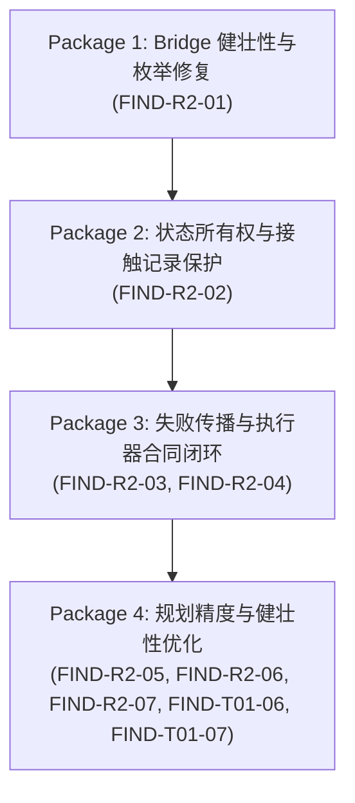

# OPEN_FINDINGS: 生产接口审计问题登记表 (Master Registry)

> **当前阶段**：Production Interface Audit (生产接口复核与缺陷归档)  
> **审计基准 Commit**：`3fc9896f6867d49a01f6d5c39b9819d51200c7a0`  
> **最后更新时间**：2026-10-29  
> **当前状态**：`AUDIT_ARCHIVED / PENDING_REPAIR`  
> **门禁约束**：Phase 7B 仍然严格禁止，禁止提前开发环境双向动力学。所有生产代码维持只读，待用户与人类团队审查批准后按维护包开展修复。

---

## 1. 审计缺陷与问题汇总看板 (Dashboard)

| 统计指标 | 数量 | 说明 |
| :--- | :---: | :--- |
| **已确认缺陷 (CONFIRMED_DEFECT)** | **3** | FIND-R2-01 (非法枚举崩溃), FIND-R2-02/T01-02 (接触状态覆盖), FIND-R2-07/T01-04 (接缝横向偏置) |
| **接口合同缺口 (CONTRACT_GAP)** | **5** | FIND-R2-03/T01-01 (失败吞没), FIND-R2-04/T01-03 (Action失败合同), FIND-R2-05 (几何与支撑脱节), FIND-R2-06/T01-05 (预规划双轨制), FIND-T01-06 (环境源脱节), FIND-T01-07 (负向行进) |
| **已知设计限制 (DESIGN_LIMITATION)** | **3** | LIMIT-01 (+Y 单一走廊), LIMIT-02 (FK 正弦摆臂), LIMIT-03 (IK 截断无全身降位) |
| **未验证项 (UNVERIFIED)** | **2** | UNVERIFIED-01 (全身4点接触解算稳定性), UNVERIFIED-02 (极端负高程断崖吸收) |
| **阻碍后续开发 (Blocks Further Dev: YES)** | **4** | FIND-R2-01, FIND-R2-02, FIND-R2-03, FIND-R2-04 |

---

## 2. 问题统一登记总表 (Master Register Table)

| Finding ID | 对应历史编号 | 源码文件 | 类 / 函数 | 影响类别 | 阻碍后续开发 | 状态 | 负责模块 |
| :--- | :--- | :--- | :--- | :--- | :---: | :---: | :--- |
| **FIND-R2-01** | - | `src/motion/kinematic_bridge.py` | `KinematicBridgeExecutor.execute_frame()` | CONFIRMED_DEFECT | **YES** | OPEN | `kinematic_bridge.py` |
| **FIND-R2-02** | FIND-T01-02 | `src/motion/terrain_walk.py` | `TerrainWalkAction.execute()` | CONFIRMED_DEFECT | **YES** | OPEN | `terrain_walk.py` |
| **FIND-R2-03** | FIND-T01-01 | `src/motion/terrain_walk.py` | `TerrainWalkAction.execute()` | CONTRACT_GAP | **YES** | OPEN | `terrain_walk.py` |
| **FIND-R2-04** | FIND-T01-03 | `src/motion/framework.py` | `ActionExecutionResult` / `MotionPlanner` | CONTRACT_GAP | **YES** | OPEN | `framework.py` |
| **FIND-R2-05** | - | `src/motion/contact_model.py` | `ContactRecord` / `MultiContactState` | CONTRACT_GAP | NO | OPEN | `contact_model.py` |
| **FIND-R2-06** | FIND-T01-05 | `src/motion/terrain_walk.py` | `build_terrain_step_schedule()` | CONTRACT_GAP | NO | OPEN | `terrain_walk.py` |
| **FIND-R2-07** | FIND-T01-04 | `src/motion/terrain_walk.py` | `TerrainWalkAction.execute()` | CONFIRMED_DEFECT | NO | OPEN | `terrain_walk.py` |
| **FIND-T01-06** | - | `src/motion/terrain_walk.py` | `TerrainWalkAction.estimate_duration_frames()` | CONTRACT_GAP | NO | OPEN | `terrain_walk.py` |
| **FIND-T01-07** | - | `src/motion/terrain_walk.py` | `plan_terrain_footsteps()` | CONTRACT_GAP | NO | OPEN | `terrain_walk.py` |

---

## 3. 已确认缺陷详情 (Confirmed Defects)

### FIND-R2-01: Bridge 引用不存在的非法枚举成员 `ContactLifecycle.TOUCHDOWN`
* **Source File**: `src/motion/kinematic_bridge.py`
* **Class / Function**: `KinematicBridgeExecutor.execute_frame()`
* **Exact Line Range**: Line 512
* **Trigger Condition**: 任何规划的手部目标启用接触意图（`pht.enabled=True`, `pht.contact_intent=True`），但尚未锁定（`pht.is_locked=False`）且手部到接触面距离 $> 0.015$m。
* **Actual Behavior**: 试图访问 `ContactLifecycle.TOUCHDOWN`，引发 `AttributeError: type object 'ContactLifecycle' has no attribute 'TOUCHDOWN'` 致命崩溃。
* **Expected Contract**: `ContactLifecycle` 枚举（`contact_model.py:45-51`）仅定义了 `CANDIDATE`, `ESTABLISHED`, `RELEASED`, `BROKEN`。接触意图初期应标定为 `ContactLifecycle.CANDIDATE`。
* **Evidence**:
  ```python
  # src/motion/kinematic_bridge.py:512
  lifecycle = ContactLifecycle.ESTABLISHED if (dist <= 0.015 or pht.is_locked) else ContactLifecycle.TOUCHDOWN
  ```
* **Responsible Module**: `src/motion/kinematic_bridge.py`
* **Downstream Impact**: 一旦开启上肢环境接触或支撑攀爬（Phase 7B 核心目标），主执行链立即崩溃。
* **Classification**: `CONFIRMED_DEFECT`
* **Blocks Further Development**: `YES`
* **Repair Status**: `OPEN / PENDING REPAIR`
* **Suggested Repair Boundary**: 将 `kinematic_bridge.py:512` 的 `ContactLifecycle.TOUCHDOWN` 修正为 `ContactLifecycle.CANDIDATE`，并在单元测试中补全手部接触生命周期流转。

---

### FIND-R2-02 (FIND-T01-02): `TerrainWalkAction` 强制覆盖 `MotionState.contacts` 导致上肢接触丢失与虚假物理确认
* **Source File**: `src/motion/terrain_walk.py`
* **Class / Function**: `TerrainWalkAction.execute()`
* **Exact Line Range**: Lines 1137-1138
* **Trigger Condition**: 正常运行 `TerrainWalkAction.execute()` 的每一帧。
* **Actual Behavior**:
  ```python
  ms = ms.clone_with(contacts=c_dict, mode=mode)
  ```
  Action 内部基于规划意图自行构造仅含 `foot_L` 与 `foot_R` 的字典 `c_dict`，并调用 `clone_with(contacts=c_dict)`，直接覆盖掉此前由 Bridge Phase 5 通过 `enrich_motion_state_with_contacts()` 计算出的真实物理接触记录。
* **Expected Contract**:
  1. `ms.contacts` 必须保留物理测量接触状态（Point B 接触坐标、法线、间隙、穿透量）；
  2. 若 Bridge 判定某脚几何约束失败（如落在悬崖外 `BROKEN`），Action 不得将其强行置为 `is_locked=True` 的稳定支撑；
  3. Action 不得擅自擦除上肢（如 `hand_L` / `hand_R`）可能存在的接触记录。
* **Evidence**:
  在 `kinematic_bridge.py:557`，Bridge 已经完成了 `ms = enrich_motion_state_with_contacts(ms, multi_contact)`。`terrain_walk.py:1138` 无条件将 `ms.contacts` 覆盖为由 `last_known_xyz` 拼凑的简化字典。
* **Responsible Module**: `src/motion/terrain_walk.py`
* **Downstream Impact**: 物理遥测与动力学计算无法获取真实法线与滑动状态；手部接触在进入 MotionState 时被完全销毁；下游模块读取到虚假接触锁定。
* **Classification**: `CONFIRMED_DEFECT`
* **Blocks Further Development**: `YES`
* **Repair Status**: `OPEN / PENDING REPAIR`
* **Suggested Repair Boundary**: 移除 `terrain_walk.py:1138` 中对 `contacts=c_dict` 的覆盖，仅保留 `ms = ms.clone_with(mode=mode, params=ms_params)`，对必须保留的规划步态相位通过 `params` 传递。

---

### FIND-R2-07 (FIND-T01-04): 边缘与接缝横向探测位置偏置缺陷
* **Source File**: `src/motion/terrain_walk.py`
* **Class / Function**: `TerrainWalkAction.execute()`
* **Exact Line Range**: Line 950
* **Trigger Condition**: 在具有横向凹凸、边缘或接缝的地形上行走。
* **Actual Behavior**:
  调用 `_adjust_footfall_for_seams_and_edges(env, corridor_x, forward_y, ...)` 时，传入的是走廊中心线坐标 `corridor_x`（通常为 $0.0$），而不是摆动脚真实的横向落点位置 `sw_x`（左右脚偏移通常为 $\pm 0.13$m）。
* **Expected Contract**: 边缘与接缝探测必须以真实预计着地点 `(sw_x, forward_y)` 为中心进行射线与梯度检测。
* **Evidence**: `terrain_walk.py:950` 实参为 `corridor_x`，导致系统始终在身体正中线检测地形边缘，无法感知位于身体侧面 $\pm 13$cm 处踩在台阶边缘的情况。
* **Responsible Module**: `src/motion/terrain_walk.py`
* **Downstream Impact**: 脚部落在台阶或接缝边缘时未触发避障微调，容易出现脚底悬空或踩入接缝。
* **Classification**: `CONFIRMED_DEFECT`
* **Blocks Further Development**: `NO`
* **Repair Status**: `OPEN / PENDING REPAIR`
* **Suggested Repair Boundary**: 将 `corridor_x` 替换为实际落点横向坐标 `sw_x`。

---

## 4. 接口合同缺口详情 (Interface Contract Gaps)

### FIND-R2-03 (FIND-T01-01): `TerrainWalkAction` 吞没 `BridgeExecutionResult.success` 与物理约束失败
* **Source File**: `src/motion/terrain_walk.py`
* **Class / Function**: `TerrainWalkAction.execute()`
* **Exact Line Range**: Lines 988-1025
* **Trigger Condition**: 发生 IK 不可达、关节越界（ROM 违规）或接触表面无效（`allows_regular_support=False`）。
* **Actual Behavior**:
  `bridge_res = bridge_executor.execute_frame(...)` 执行后，代码仅读取了 `bridge_res.wbc_result.end_effectors`，对 `bridge_res.success` 与 `bridge_res.unmet_constraints` 完全不作检查。IK 超限仅打印 Warning 并自增计数器，整个 Action 照常返回完成状态。
* **Expected Contract**:
  遵循统一执行协议，当底层 `bridge_res.success == False` 时，Action 层必须能够捕获该失败；要么阻断当前动作并触发回退/报警，要么在返回的 `ActionExecutionResult` 中显式标定执行失败并携带错误详情。严禁在骨骼未成功就位或受力违规时伪造动作成功。
* **Evidence**: 对比 `src/motion/framework.py:745-753`（`StartStopWalkAction` 规范实现），`terrain_walk.py` 全文没有任何一处引用 `bridge_res.success` 或 `bridge_res.unmet_constraints`。
* **Responsible Module**: `src/motion/terrain_walk.py`
* **Downstream Impact**: 当地形崎岖导致完全脱离人体解剖学极限时，系统不报错、不重试，生成断裂扭曲的无意义动画，使得自动化测试管线失去门禁拦截能力。
* **Classification**: `CONTRACT_GAP`
* **Blocks Further Development**: `YES`
* **Repair Status**: `OPEN / PENDING REPAIR`
* **Suggested Repair Boundary**: 统一 `TerrainWalkAction` 与 `StartStopWalkAction` 的失败处理协议，接入 `bridge_res.success` 校验与 `unmet_constraints` 统计汇总。

---

### FIND-R2-04 (FIND-T01-03): `ActionExecutionResult` 与 `MotionPlanner.execute()` 缺失动作失败处理合同
* **Source File**: `src/motion/framework.py`
* **Class / Function**: `ActionExecutionResult` / `MotionPlanner.execute()`
* **Exact Line Range**: Lines 405-419, Lines 832-865
* **Trigger Condition**: 序列化多动作规划中，前序 Action 发生不可达或物理违规。
* **Actual Behavior**:
  `ActionExecutionResult` 数据类缺少 `success: bool` 和 `unmet_constraints` 字段。`MotionPlanner.execute()` 采用盲目顺序流：
  ```python
  result = action.execute(current_state, ctx)
  results.append(result)
  current_state = result.final_state
  ```
* **Expected Contract**:
  Action 执行结果必须显式标明自身执行的成功状态；当发生致死性物理违背时，`MotionPlanner` 必须决定是阻断流程、回退重试还是触发应急过渡。
* **Evidence**: 审查 `MotionPlanner.execute()` 源码，整段循环无任何 `if not result.success` 检查逻辑。
* **Responsible Module**: `src/motion/framework.py`
* **Downstream Impact**: 复合动作在第一阶段已经失效崩溃的情况下，后续动作仍强行以崩溃状态作为基准继续求解，导致级联错误。
* **Classification**: `CONTRACT_GAP`
* **Blocks Further Development**: `YES`
* **Repair Status**: `OPEN / PENDING REPAIR`
* **Suggested Repair Boundary**: 在 `ActionExecutionResult` 中增加 `success: bool = True` 与 `unmet_constraints: List[Any] = field(default_factory=list)` 字段，并在 `MotionPlanner.execute()` 中建立基于动作执行状态的异常流转合同。

---

### FIND-R2-05: `ContactModel` 几何合规性校验与 `SupportType` 拓扑判定脱节
* **Source File**: `src/motion/contact_model.py`
* **Class / Function**: `ContactRecord.check_geometric_compliance()` / `MultiContactState.update_support_type()`
* **Exact Line Range**: Lines 180-213, Lines 243-263
* **Trigger Condition**: 脚部处于 `ContactLifecycle.ESTABLISHED`，但在物理测量时发生穿透超过阈值（如 $> 10$mm）或悬空离开接触面（如 $> 15$mm）。
* **Actual Behavior**:
  `check_geometric_compliance()` 返回 `GeometricConstraintResult(is_valid=False)`，但该函数属于只读方法，不会修改 `ContactRecord` 本身；随后 `MultiContactState.update_support_type()` 仅依靠 `[c for c in feet if c.is_active]` 计数，仍将该脚计为有效支撑，判定为 `SupportType.DOUBLE_STANCE`。
* **Expected Contract**: 当几何接触严重失效或离开支撑面时，支撑拓扑状态应能感知到该接触已失效（或由 Bridge 协同置为 `BROKEN`），避免在无物理支撑的情况下误判为双脚着地。
* **Evidence**: `MultiContactState.update_support_type()` 源码统计仅判断 `c.is_active`，而 `is_active` 仅要求 `lifecycle == ESTABLISHED and contact_type != FREE`，完全不耦合 `GeometricConstraintResult`。
* **Responsible Module**: `src/motion/contact_model.py`
* **Downstream Impact**: 动力学计算（如重力平衡、质心支撑多边形计算）在足部严重悬空或穿透时，仍按正常双支撑多边形计算，导致物理遥测数据失真。
* **Classification**: `CONTRACT_GAP`
* **Blocks Further Development**: `NO`
* **Repair Status**: `OPEN / PENDING REPAIR`
* **Suggested Repair Boundary**: 在 `kinematic_bridge.py` Phase 5 中，当 `check_geometric_compliance()` 返回 `is_valid=False` 且间隙过大时，显式将该记录标记为 `ContactLifecycle.BROKEN`，并同步刷新 `multi_contact.update_support_type()`。

---

### FIND-R2-06 (FIND-T01-05): 地形步态预规划在环境查询未命中时的回退语义不一致
* **Source File**: `src/motion/terrain_walk.py`
* **Class / Function**: `build_terrain_step_schedule()` vs `plan_terrain_footsteps()`
* **Exact Line Range**: Lines 473-510, Lines 577-628
* **Trigger Condition**: 在复杂 Mesh 地形边界或断崖边缘执行步态预规划。
* **Actual Behavior**:
  * `plan_terrain_footsteps()`：当 `query_surface_at` 失败或落点在不可支撑表面时，严格抛出 `ValueError`；
  * `build_terrain_step_schedule()`（遗留入口）：当查询失败时，无声回退到 `environment.ground_height_at(x, y)`，并将 `surface_id` 硬编码标定为 `"ground"`。
* **Expected Contract**: 统一步态预规划失败语义，真实 Mesh 模式下不允许出现“一处抛异常，另一处静默伪造平地支撑”的双重标准。
* **Evidence**: 对比两方法的实现代码分支，回退逻辑与异常抛出策略截然不同。
* **Responsible Module**: `src/motion/terrain_walk.py`
* **Downstream Impact**: 当使用不同入口函数进行规划时，产生非确定性行为。
* **Classification**: `CONTRACT_GAP`
* **Blocks Further Development**: `NO`
* **Repair Status**: `OPEN / PENDING REPAIR`
* **Suggested Repair Boundary**: 将 `build_terrain_step_schedule()` 废弃或重构为 `plan_terrain_footsteps()` 的兼容包装，统一未命中时的拦截策略。

---

### FIND-T01-06: `TerrainWalkAction.estimate_duration_frames` 环境源脱节
* **Source File**: `src/motion/terrain_walk.py`
* **Class / Function**: `TerrainWalkAction.estimate_duration_frames()`
* **Exact Line Range**: Lines 654-681
* **Trigger Condition**: 在调用 `estimate_duration_frames` 时，Action 初始化时未显式传入 `environment`，而是在 `execute()` 时才通过 `context.environment` 获取真实网格环境。
* **Actual Behavior**:
  `estimate_duration_frames` 检查 `self.environment` 为空，静默回退至解析平地假定计算步数与耗时。
* **Expected Contract**: 预估函数应接受 `context` 或统一从环境源读取，保证规划耗时与实际执行耗时一致。
* **Responsible Module**: `src/motion/terrain_walk.py`
* **Classification**: `CONTRACT_GAP`
* **Blocks Further Development**: `NO`
* **Repair Status**: `OPEN / PENDING REPAIR`

---

### FIND-T01-07: 负向行进步态规划跳步与终止缺陷
* **Source File**: `src/motion/terrain_walk.py`
* **Class / Function**: `plan_terrain_footsteps()`
* **Exact Line Range**: Lines 280-320
* **Trigger Condition**: 当 `route.target_pos` 的 $Y$ 坐标小于 `route.start_pos` 的 $Y$ 坐标（即需要倒退行走或向 $-Y$ 方向行走）时。
* **Actual Behavior**:
  循环终止条件 `while current_y < target_y:` 立即判定为 False，直接跳过所有步态规划，返回仅含初始站立步的调度表。
* **Expected Contract**: 循环条件应基于标量有向距离或步数计数器判断，支持任意方向路线规划。
* **Responsible Module**: `src/motion/terrain_walk.py`
* **Classification**: `CONTRACT_GAP`
* **Blocks Further Development**: `NO`
* **Repair Status**: `OPEN / PENDING REPAIR`

---

## 5. 已知设计限制 (Known Design Limitations)

* **LIMIT-01: 单一前进走廊 $+Y$ 导航假定**:
  当前 `TerrainWalkAction` 及其动力学计算均硬编码沿世界坐标 $+Y$ 轴前进，未解耦世界坐标系与角色局部导航坐标系（Heading）。此为 Phase 6/7A 的设计范围边界，非代码缺陷。
* **LIMIT-02: 上肢开环正向运动学（FK）摆臂**:
  在行进过程中，手臂摆动由纯正弦经验公式生成并以欧拉角写入 WBC FK，手臂 IK 解算器处于休眠挂起状态。这满足当前步态自然度需求，但不支持行进中的动态触碰与抓握。
* **LIMIT-03: IK 超限单向开环警报**:
  WBC 检测到 IK 目标超出肢体极限长度时，将拉伸截断至极限位置并记录 `UnmetConstraint`，但执行链缺乏“由于腿长不够而自动降低骨盆高度”的自适应全身闭环调整。

---

## 6. 未验证项 (Unverified Items)

* **UNVERIFIED-01: 全身多接触动力学求解稳定性**:
  当未来激活手部支撑时（手脚 4 点接触），`WholeBodyController` 中手臂 IK 与腿部 IK 同时锁定时质心与骨盆的姿态平衡尚未在真实三维物理场景中完整验证。
* **UNVERIFIED-02: 极端负高程（大落差跳跃/坠落）下的插值连续性**:
  当前 S1/S2 摆动脚修复主要针对台阶与连续坡道，尚未在大落差（$> 0.8$m）瞬时断崖下进行数值平滑与冲击吸收验证。

---

## 7. 集中修复建议与维护包划分 (Remediation Roadmap)

根据门禁规则与依赖拓扑，将上述未关闭问题划分为 4 个原子维护包：



1. **维护包 1: Bridge 健壮性与枚举修复 (Bridge Robustness)**:
   - 修复 FIND-R2-01。
   - 消除 `ContactLifecycle.TOUCHDOWN` 致命崩溃隐患。
2. **维护包 2: 状态所有权与接触记录保护 (State Integrity)**:
   - 修复 FIND-R2-02。
   - 移除 `terrain_walk.py:1138` 对 `contacts` 字典的恶意覆写，保护真实物理接触数据。
3. **维护包 3: 失败传播与执行器合同闭环 (Error Propagation Contract)**:
   - 修复 FIND-R2-03 与 FIND-R2-04。
   - 在 `ActionExecutionResult` 增加成功状态，在 `TerrainWalkAction` 接入 `bridge_res.success` 校验。
4. **维护包 4: 规划精度与健壮性优化 (Footfall Planning Precision & Robustness)**:
   - 修复 FIND-R2-05, FIND-R2-06, FIND-R2-07, FIND-T01-06, FIND-T01-07。
   - 消除接缝探测坐标偏置，统一步态规划未命中策略与负向行进支持。
