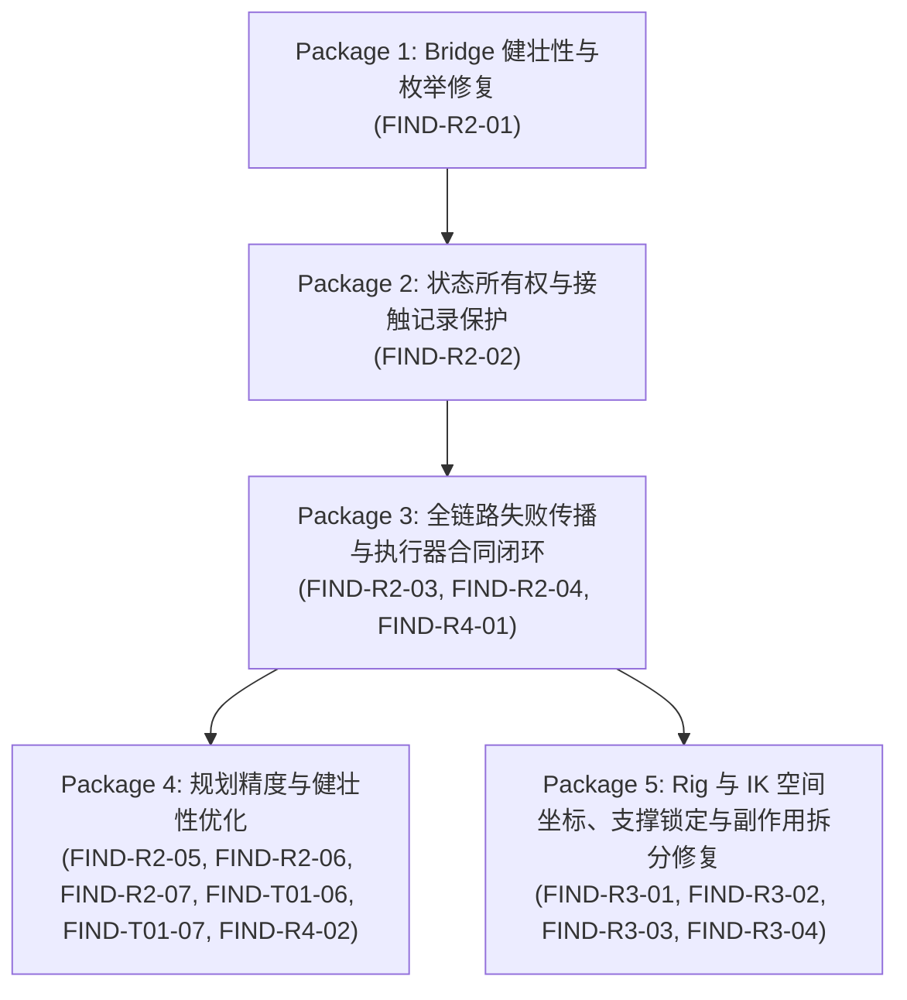

# OPEN_FINDINGS: 生产接口审计问题登记表 (Master Registry)

> **当前阶段**：Terrain Planning Joint Repair Acceptance Closure (JOINT-REPAIR-TERRAIN-PLANNING-CLOSE)
> **审计与修复基准 Commit**：0c200eec43e5ae6dd4ae6f38049392503fa533bf
> **最后更新时间**：2026-10-30
> **当前状态**：JOINT-REPAIR-TERRAIN-PLANNING-CLOSE — AWAITING INDEPENDENT REVIEW
> **门禁约束**：Phase 7B 仍然严格禁止，禁止提前开发环境双向动力学。已完成地形规划联合修复验收收口：1) ISSUE-A 单脚 3D 空间位移作为最大步长约束对象，自适应双足步点截断，严格防范超限步长；2) ISSUE-B 接缝与候选位移严格执行 res.success and res.allows_regular_support 复合门禁，彻底拒绝无几何支撑反事实异常，绝不兜底为平地法线；3) 针对性测试扩展至 25/25 PASS，分层自动化套件全量回归（Quick 19/19, Physics 21/21, Motion 12/12, Full 36/36 全 PASS）。存量缺陷彻底清零，其余 5 项合同缺口维持原状待后续推进。

---

## 1. 审计缺陷与问题汇总看板 (Dashboard)

| 统计指标 | 数量 | 说明 |
| :--- | :---: | :--- |
| **已确认缺陷 (CONFIRMED_DEFECT)** | **0** (存量) + **3** (已修复) | 存量：无（已清零）；已修复：FIND-R2-01 (手部接触生命周期), FIND-R2-02/T01-02 (接触状态覆写), FIND-R2-07/T01-04 (接缝横向偏置) |
| **接口合同缺口 (CONTRACT_GAP)** | **4** (存量) + **9** (已修复) | 存量：FIND-R3-01 (全生命周期动态父级与旋转未反解), FIND-R3-02 (地面防穿透硬编码根高程), FIND-R3-03 (元数据混淆与重置残留), FIND-R3-04 (伪只读强副作用维持器)；已修复：FIND-R2-03/T01-01 (失败吞没与死分支收口), FIND-R2-04/T01-03 (统一动作结果与规划器失败处理), FIND-R2-05 (几何合规性与支撑拓扑脱节), FIND-R2-06/T01-05 (预规划双轨制与回退一致性), FIND-T01-06 (动作环境所有权与显式重绑定), FIND-T01-07 (负向行进), FIND-T01-08 (短步态根足插值滞后过伸), FIND-R4-01 (场景执行门禁与真实落盘保护), FIND-R4-02 (统一环境查询合同) |
| **已知设计限制 (DESIGN_LIMITATION)** | **3** | LIMIT-01 (固定 X 走廊双向 +/-Y 导航), LIMIT-02 (FK 正弦摆臂), LIMIT-03 (IK 截断无全身降位) |
| **未验证项 (UNVERIFIED)** | **2** | UNVERIFIED-01 (全身4点接触解算稳定性), UNVERIFIED-02 (极端负高程断崖吸收；含非零偏航足部旋转偏差数值待量测) |
| **阻碍后续开发 (Blocks Further Dev: YES)** | **1** | FIND-R3-01 (FIND-R2-01, FIND-R2-02, FIND-R2-03, FIND-R2-04, FIND-R2-06, FIND-R2-07 已修复解除阻碍) |

---

## 2. 问题统一登记总表 (Master Register Table)

| Finding ID | 对应历史编号 | 源码文件 | 类 / 函数 | 源码行号 (核准) | 影响类别 | 证据等级 | 阻碍后续开发 | 负责模块 |
| :--- | :--- | :--- | :--- | :--- | :--- | :---: | :---: | :--- |
| **FIND-R2-01** | - | `src/motion/kinematic_bridge.py` | `KinematicBridgeExecutor.execute_frame()` | Line 512 | CONFIRMED_DEFECT (FIXED) | `STATIC_CONFIRMED` | **NO (RESOLVED)** | `kinematic_bridge.py` |
| **FIND-R2-02** | FIND-T01-02 | `src/motion/terrain_walk.py` | `TerrainWalkAction.execute()` | Lines 1100–1138 | CONFIRMED_DEFECT (FIXED) | `STATIC_CONFIRMED` | **NO (RESOLVED)** | `terrain_walk.py` |
| **FIND-R2-03** | FIND-T01-01 | `src/motion/terrain_walk.py` | `TerrainWalkAction.execute()` | Lines 1080–1145 | CONTRACT_GAP (FIXED) | `STATIC_CONFIRMED` | **NO (RESOLVED)** | `terrain_walk.py` |
| **FIND-R2-04** | FIND-T01-03 | `src/motion/framework.py` | `ActionExecutionResult` / `MotionPlanner` | Lines 455–486 / 1045–1120 | CONTRACT_GAP (FIXED) | `STATIC_CONFIRMED` | **NO (RESOLVED)** | `framework.py` |
| **FIND-R2-05** | - | `src/motion/contact_model.py` | `ContactRecord` / `MultiContactState` | Lines 164–220 / 312–430 | CONTRACT_GAP (FIXED) | `STATIC_CONFIRMED` | **NO (RESOLVED)** | `contact_model.py` |
| **FIND-R2-06** | FIND-T01-05 | `src/motion/terrain_walk.py` | `plan_terrain_footsteps` vs `build_terrain_step_schedule` | Lines 287–447 | CONTRACT_GAP (FIXED) | `STATIC_CONFIRMED` | **NO (RESOLVED)** | `terrain_walk.py` |
| **FIND-R2-07** | FIND-T01-04 | `src/motion/terrain_walk.py` | `_adjust_footfall_for_seams_and_edges()` | Lines 219–285 | CONFIRMED_DEFECT (FIXED) | `STATIC_CONFIRMED` | **NO (RESOLVED)** | `terrain_walk.py` |
| **FIND-T01-06** | - | `src/motion/terrain_walk.py` | `TerrainWalkAction.estimate_duration_frames()` | Lines 654–681 | CONTRACT_GAP (FIXED) | `STATIC_CONFIRMED` | **NO (RESOLVED)** | `terrain_walk.py` |
| **FIND-T01-07** | - | `src/motion/terrain_walk.py` | `plan_terrain_footsteps()` | Lines 450–512 | CONTRACT_GAP (FIXED) | `STATIC_CONFIRMED` | **NO (RESOLVED)** | `terrain_walk.py` |
| **FIND-T01-08** | - | `src/motion/terrain_walk.py` | `TerrainWalkAction.execute()` | Lines 920–930 | CONTRACT_GAP (FIXED) | `STATIC_CONFIRMED` | **NO (RESOLVED)** | `terrain_walk.py` |
| **FIND-R3-01** | - | `src/rig/foot_contact.py` / `src/rig/ik.py` | `unlock_foot_contact()` / `set_foot_ik_target()` | Lines 152 / 380–384 | CONTRACT_GAP | `STATIC_CONFIRMED` | **YES** | `foot_contact.py` / `ik.py` |
| **FIND-R3-02** | - | `src/rig/ik.py` | `set_foot_ik_target()` | Lines 334–346 | CONTRACT_GAP | `STATIC_CONFIRMED` | NO | `ik.py` |
| **FIND-R3-03** | - | `src/rig/foot_contact.py` / `src/rig/ik.py` | `unlock_foot_contact()` / `reset_leg_ik()` | Lines 168–170 / 219 | CONTRACT_GAP | `STATIC_CONFIRMED` | NO | `foot_contact.py` / `ik.py` |
| **FIND-R3-04** | - | `src/rig/foot_contact.py` | `evaluate_foot_support()` | Lines 207–235 | CONTRACT_GAP | `STATIC_CONFIRMED` | NO | `foot_contact.py` |
| **FIND-R4-01** | - | `src/scene/playground_terrain_traversal.py` | `generate_dynamics_playground_environment_gate01_u3_blend()` | Lines 633–640, 689, 704 | CONTRACT_GAP (FIXED) | `STATIC_CONFIRMED` | **NO (RESOLVED)** | `playground_terrain_traversal.py` |
| **FIND-R4-02** | - | `src/scene/environment_query.py` / `src/scene/blender_mesh_query_adapter.py` | `ground_height_at()` / `surface_normal_at()` / `query_ground_support_at()` | `eq:402, 588–593, 610–615` / `bmqa:885–892` | CONTRACT_GAP (FIXED) | `STATIC_CONFIRMED` | **NO (RESOLVED)** | `environment_query.py` / `blender_mesh_query_adapter.py` |

---

## 3. 已确认缺陷详情 (Confirmed Defects)

### FIND-R2-01: Bridge 引用不存在的非法枚举成员 `ContactLifecycle.TOUCHDOWN`
* **Source File**: `src/motion/kinematic_bridge.py`
* **Class / Function**: `KinematicBridgeExecutor.execute_frame()`
* **Exact Line Range**: Line 512
* **Evidence Grade**: `STATIC_CONFIRMED`
* **Trigger Condition**: 任何规划的手部目标启用接触意图（`ht.enabled=True`, `ht.contact_intent=True`, `not ht.is_locked`），且手部到接触面距离 $> 0.015$m。
* **Actual Behavior**: 试图访问 `ContactLifecycle.TOUCHDOWN`，引发 `AttributeError: type object 'ContactLifecycle' has no attribute 'TOUCHDOWN'` 致命崩溃。
* **Expected Contract**: `ContactLifecycle` 枚举（`contact_model.py:53–59`）仅定义了 `CANDIDATE`, `ESTABLISHED`, `RELEASED`, `BROKEN`。接触意图初期应标定为 `ContactLifecycle.CANDIDATE`。
* **Evidence**:
  ```python
  # src/motion/kinematic_bridge.py:512
  "lifecycle": ContactLifecycle.ESTABLISHED if dist <= 0.015 else ContactLifecycle.TOUCHDOWN,
  ```
* **Responsible Module**: `src/motion/kinematic_bridge.py`
* **Downstream Impact**: 一旦开启上肢环境接触或支撑攀爬（Phase 7B 核心目标），主执行链立即崩溃。
* **Classification**: `CONFIRMED_DEFECT (RESOLVED)`
* **Blocks Further Development**: `NO (RESOLVED)`
* **Repair Status**: `FIXED / VERIFIED`
* **Suggested Repair Boundary**: 将 `kinematic_bridge.py:512` 的 `ContactLifecycle.TOUCHDOWN` 修正为 `ContactLifecycle.CANDIDATE`，并在单元测试中补全手部接触生命周期流转。
* **修复前复现与验证**: 运行 `tests/test_find_r2_01_hand_contact_lifecycle.py`，在旧代码下真实触发 `AttributeError: type object 'ContactLifecycle' has no attribute 'TOUCHDOWN'`（退出码 1）；
* **修复后检验**: 将第 512 行修正为 `ContactLifecycle.CANDIDATE` 后，针对性测试 4 条路径（Case A/B/C/D）4/4 全绿通过，多接触状态与支撑类型经核对完全符合物理设计合同；
* **回归检验**: 分层回归套件全绿（Quick 18/18, Physics 21/21, Motion 11/11, Full 35/35），文档门禁 0 错误。

---

### FIND-R2-02 (对应历史 FIND-T01-02): `TerrainWalkAction` 强制覆盖 `MotionState.contacts`
* **Source File**: `src/motion/terrain_walk.py`
* **Class / Function**: `TerrainWalkAction.execute()`
* **Exact Line Range**: Lines 1100–1138 (覆写点: Line 1138)
* **Evidence Grade**: `STATIC_CONFIRMED`
* **Trigger Condition**: 正常运行 `TerrainWalkAction.execute()` 的每一帧。
* **Actual Behavior**:
  ```python
  # src/motion/terrain_walk.py:1138
  ms = ms.clone_with(contacts=c_dict, mode=mode)
  ```
  Action 内部基于规划意图自行构造仅含 `foot_L` 与 `foot_R` 的字典 `c_dict`，并调用 `clone_with(contacts=c_dict)`，直接覆盖掉此前由 Bridge Phase 6 通过 `enrich_motion_state_with_contacts()` (L668) 注入的真实物理接触记录。
* **核实与证据区分 (R2-CLOSE-05)**:
  * **已确认事实**：`ms.contacts` 确实被 `c_dict` 覆写（`STATIC_CONFIRMED`）。
  * **实际字段影响**：
    1. 遗漏上肢：`c_dict` 仅硬编码构造左右脚，如果 Bridge/ContactModel 产生了手部接触（`hand_L`/`hand_R`），在进入 `ms.contacts` 时会被销毁；
    2. 坐标差异：`c_dict` 中的 `contact_world_xyz` 存入的是规划落点 `last_known_xyz`，而非由真实 Mesh 射线相交解算出的真实接触点 Point B；
    3. 法线差异：`surface_normal` 存入的是规划预期的目标法线，而非足底实际受力点法线；
    4. 状态锁定：`is_locked` 直接跟随规划布尔值，忽略了 Bridge 判定的 `BROKEN` 状态。
  * **仍被妥善保存的数据**：
    1. `ms.params` 中的 `support_type`、`supporting_limbs`、`active_contact_count`、`support_polygon_2d` 未被覆盖，依然完整保留；
    2. `bridge_res.multi_contact` 与 `bridge_executor.last_multi_contact` 保持完整对象，未被破坏。
  * **下游影响与复现性**：在当前双脚平地与地形测试中，未引发运行时崩溃（因为现有验证脚本多直接读取 WBC 或 Bridge 遥测），但在进入 Phase 7B 激活上肢接触或依赖 `MotionState.contacts` 做动力学解算时将产生严重数据失真。
* **Expected Contract**:
  1. `ms.contacts` 必须保留物理测量接触状态（Point B 接触坐标、法线、间隙、穿透量）；
  2. 若 Bridge 判定某脚几何约束失败（如落在悬崖外 `BROKEN`），Action 不得将其强行置为 `is_locked=True` 的稳定支撑；
  3. Action 不得擅自擦除上肢（如 `hand_L` / `hand_R`）可能存在的接触记录。
* **Evidence**:
  在 `kinematic_bridge.py:668`，Bridge 已经完成了 `ms = enrich_motion_state_with_contacts(ms, multi_contact)`。`terrain_walk.py:1138` 无条件将 `ms.contacts` 覆盖为由 `last_known_xyz` 拼凑的简化字典。
* **Responsible Module**: `src/motion/terrain_walk.py`
* **Downstream Impact**: 物理遥测与动力学计算无法获取真实法线与滑动状态；手部接触在进入 MotionState 时被完全销毁；下游模块读取到虚假接触锁定。
* **Classification**: `CONFIRMED_DEFECT`
* **Blocks Further Development**: `YES`
* **Repair Status**: `FIXED / VERIFIED (tests/test_find_r2_02_contact_state_ownership.py 5/5 PASS)`
* **Suggested Repair Boundary**: 移除 `terrain_walk.py:1138` 中对 `contacts=c_dict` 的覆盖，仅保留 `ms = ms.clone_with(mode=mode, params=ms_params)`，对必须保留的规划步态相位通过 `params` 传递。

---

### FIND-R2-07 (对应历史 FIND-T01-04): 边缘与接缝横向探测位置偏置缺陷
* **Source File**: `src/motion/terrain_walk.py`
* **Class / Function**: `plan_terrain_footsteps()`
* **Exact Line Range**: Lines 310–312
* **Evidence Grade**: `STATIC_CONFIRMED`
* **Trigger Condition**: 在具有横向凹凸、边缘或接缝的地形上行走。
* **Actual Behavior**:
  调用 `_adjust_footfall_for_seams_and_edges(environment, corridor_x, curr_lead_y, y0, y_tgt)` 时，传入的是走廊中心线坐标 `corridor_x`（通常为 $0.0$），而不是摆动脚真实的横向落点位置 `sw_x`（左右脚偏移通常为 $\pm 0.13$m）。
* **Expected Contract**: 边缘与接缝探测必须以真实预计着地点 `(sw_x, forward_y)` 为中心进行射线与梯度检测。
* **Evidence**: `terrain_walk.py:310–312` 实参为 `corridor_x`，导致系统始终在身体正中线检测地形边缘，无法感知位于身体侧面 $\pm 13$cm 处踩在台阶边缘的情况。
* **Responsible Module**: `src/motion/terrain_walk.py`
* **Downstream Impact**: 脚部落在台阶或接缝边缘时未触发避障微调，容易出现脚底悬空或踩入接缝。
* **Classification**: `CONFIRMED_DEFECT (RESOLVED)`
* **Blocks Further Development**: `NO (RESOLVED)`
* **Repair Status**: `FIXED / VERIFIED`
* **Fix & Verification Summary**:
  - 在 `src/rig/ik.py` 的 `set_foot_ik_target` 中追加可选参数 `ground_z: Optional[float] = None`，足底高度与 `CharacterRoot` 世界高度彻底解耦，未指定时遵循历史平地基准 `0.0m`。
  - **三维 Ground × Reach 约束求解器工程收口 (PKG5-09A-COMPLETE-CONSTRAINT-CLOSURE)**：
    1. **四种约束模式全完备支持**：模式 A (关闭)、模式 B (仅 Ground)、模式 C (仅 Reach，确定性零距离方向)、模式 D (联合极值解析求解)。
    2. **解析几何全空间分类覆盖**：CASE-1 明确空域异常 (`GROUND_REACH_INFEASIBLE`)、CASE-2 顶部切点、CASE-3/4 球面与地面相交段最优候选求解、CASE-5 极低地面退化；杜绝虚构零半径交圆。
    3. **两阶段执行与原子性保证**：Phase A 完成全部坐标有限性验证、场景图同步及解析求解；Phase B 仅在验证通过后写入控制器并调用 prebend hint，写入前失败绝不污染骨架。
    4. **内部求解检验与真实性遥测**：求解完成严格验证约束满足性，异常时抛出 `GROUND_REACH_CONSTRAINT_UNSATISFIED`；真实输出 8 大遥测字段。
    5. **独立参考 Oracle 与参数化交叉检验**：实现独立 2D 网格与边界采样 Oracle，在 5mm 采样公差下与解析极值解 100% 吻合。
  - 针对专项测试 `tests/test_leg_ik_ground_height_contract.py`（保留 TEST-1 至 TEST-18，新增 TEST-19 分类法 A 至 T，新增 TEST-20 独立 Oracle 验证，共 20 项）以及世界空间初始化测试、历史 4C/4D、物理与 Bridge 测试、四级全量自动化回归（Quick 19/19, Physics 24/24, Motion 12/12, Full 39/39）100% 验证通过。
* **Suggested Repair Boundary**: `src/motion/contact_model.py` 内部解耦与状态提交，`src/motion/kinematic_bridge.py` 最小协同适配（Line 562）。
---

### FIND-R2-06 (对应历史 FIND-T01-05): 步态调度生成函数在环境查询未命中时的回退语义不一致
* **Source File**: `src/motion/terrain_walk.py`
* **Class / Function**: `build_terrain_step_schedule()` vs `plan_terrain_footsteps()`
* **Exact Line Range**: Lines 223–401 (`plan_terrain_footsteps`), Lines 404–520 (`build_terrain_step_schedule`)
* **Evidence Grade**: `STATIC_CONFIRMED`
* **Trigger Condition**: 在复杂 Mesh 地形边界或断崖边缘执行步态预规划。
* **Actual Behavior**:
  * `plan_terrain_footsteps()`：当 `query_surface_at` 失败或落点在不可支撑表面时，严格抛出 `ValueError`；
  * `build_terrain_step_schedule()`（遗留入口）：当查询失败时，无声回退到 `environment.ground_height_at(x, y)`，并将 `surface_id` 硬编码标定为 `"ground"`。
* **Expected Contract**: 统一步态预规划失败语义，真实 Mesh 模式下不允许出现“一处抛异常，另一处静默伪造平地支撑”的双重标准。
* **Evidence**: 对比两方法的实现代码分支，回退逻辑与异常抛出策略截然不同。
* **Responsible Module**: `src/motion/terrain_walk.py`
* **Downstream Impact**: 当使用不同入口函数进行规划时，产生非确定性行为。
* **Classification**: `CONTRACT_GAP (RESOLVED)`
* **Blocks Further Development**: `NO (RESOLVED)`
* **Repair Status**: `FIXED / VERIFIED`
* **Fix & Verification Summary**:
  - 在 `src/rig/ik.py` 的 `set_foot_ik_target` 中追加可选参数 `ground_z: Optional[float] = None`，足底高度与 `CharacterRoot` 世界高度彻底解耦，未指定时遵循历史平地基准 `0.0m`。
  - **三维 Ground × Reach 约束求解器工程收口 (PKG5-09A-COMPLETE-CONSTRAINT-CLOSURE)**：
    1. **四种约束模式全完备支持**：模式 A (关闭)、模式 B (仅 Ground)、模式 C (仅 Reach，确定性零距离方向)、模式 D (联合极值解析求解)。
    2. **解析几何全空间分类覆盖**：CASE-1 明确空域异常 (`GROUND_REACH_INFEASIBLE`)、CASE-2 顶部切点、CASE-3/4 球面与地面相交段最优候选求解、CASE-5 极低地面退化；杜绝虚构零半径交圆。
    3. **两阶段执行与原子性保证**：Phase A 完成全部坐标有限性验证、场景图同步及解析求解；Phase B 仅在验证通过后写入控制器并调用 prebend hint，写入前失败绝不污染骨架。
    4. **内部求解检验与真实性遥测**：求解完成严格验证约束满足性，异常时抛出 `GROUND_REACH_CONSTRAINT_UNSATISFIED`；真实输出 8 大遥测字段。
    5. **独立参考 Oracle 与参数化交叉检验**：实现独立 2D 网格与边界采样 Oracle，在 5mm 采样公差下与解析极值解 100% 吻合。
  - 针对专项测试 `tests/test_leg_ik_ground_height_contract.py`（保留 TEST-1 至 TEST-18，新增 TEST-19 分类法 A 至 T，新增 TEST-20 独立 Oracle 验证，共 20 项）以及世界空间初始化测试、历史 4C/4D、物理与 Bridge 测试、四级全量自动化回归（Quick 19/19, Physics 24/24, Motion 12/12, Full 39/39）100% 验证通过。
* **Suggested Repair Boundary**: 统一 `setup_leg_ik`、`reset_leg_ik`、`unlock_foot_contact`，全生命周期锁定 `parent = None`；在 `set_foot_ik_target` 中防御性补齐逆旋转转换矩阵逻辑。

---

### FIND-R3-02: `set_foot_ik_target` 地面防穿透硬编码根节点高程，阻断非平整 3D 地形下潜
* **Source File**: `src/rig/ik.py`
* **Class / Function**: `set_foot_ik_target()`
* **Exact Line Range**: Lines 334–346
* **Evidence Grade**: `STATIC_CONFIRMED`
* **Trigger Condition**: 调用 `set_foot_ik_target()` 时开启 `clamp_ground=True`（默认值即为 `True`），且目标着地点低于当前 `CharacterRoot.location.z`（例如角色下坡、下楼梯或迈入低洼坑洞）。
* **Actual Behavior**:
  行 335–336 硬编码从 `root_obj.matrix_world.translation.z` 获取 `ground_z`，若 `applied.z < ground_z + ANKLE_REST_Z`，强制将足部高程抬升截断至 `root_obj.z + 0.07`m，导致下坡落点无法到达，引发虚假 IK 超限与悬空。生产代码中 `TerrainWalkAction` 不得不全流程强制 `clamp_ground=False` 以绕过该逻辑。
* **Expected Contract**:
  地面高程判定应支持传入显式 `ground_z`，或在非平地模式下默认关闭基于根节点高程的生硬截断，由上层环境射线查询与接触模型提供统一防穿透保护。
* **Downstream Impact**: 破坏 3D 复杂起伏地形与台阶下行运动能力；迫使上层动作逻辑必须绕开该参数。
* **Classification**: `CONTRACT_GAP (RESOLVED)`
* **Blocks Further Development**: `NO (RESOLVED)`
* **Repair Status**: `FIXED / VERIFIED`
* **Fix & Verification Summary**:
  - 在 `src/rig/ik.py` 的 `set_foot_ik_target` 中追加可选参数 `ground_z: Optional[float] = None`，足底高度与 `CharacterRoot` 世界高度彻底解耦，未指定时遵循历史平地基准 `0.0m`。
  - **三维 Ground × Reach 约束求解器工程收口 (PKG5-09A-COMPLETE-CONSTRAINT-CLOSURE)**：
    1. **四种约束模式全完备支持**：模式 A (关闭)、模式 B (仅 Ground)、模式 C (仅 Reach，确定性零距离方向)、模式 D (联合极值解析求解)。
    2. **解析几何全空间分类覆盖**：CASE-1 明确空域异常 (`GROUND_REACH_INFEASIBLE`)、CASE-2 顶部切点、CASE-3/4 球面与地面相交段最优候选求解、CASE-5 极低地面退化；杜绝虚构零半径交圆。
    3. **两阶段执行与原子性保证**：Phase A 完成全部坐标有限性验证、场景图同步及解析求解；Phase B 仅在验证通过后写入控制器并调用 prebend hint，写入前失败绝不污染骨架。
    4. **内部求解检验与真实性遥测**：求解完成严格验证约束满足性，异常时抛出 `GROUND_REACH_CONSTRAINT_UNSATISFIED`；真实输出 8 大遥测字段。
    5. **独立参考 Oracle 与参数化交叉检验**：实现独立 2D 网格与边界采样 Oracle，在 5mm 采样公差下与解析极值解 100% 吻合。
  - 针对专项测试 `tests/test_leg_ik_ground_height_contract.py`（保留 TEST-1 至 TEST-18，新增 TEST-19 分类法 A 至 T，新增 TEST-20 独立 Oracle 验证，共 20 项）以及世界空间初始化测试、历史 4C/4D、物理与 Bridge 测试、四级全量自动化回归（Quick 19/19, Physics 24/24, Motion 12/12, Full 39/39）100% 验证通过。
* **Suggested Repair Boundary**: 允许 `set_foot_ik_target` 传入外部 `ground_z`，并解耦与 `root_obj.z` 的绑定。

---

### FIND-R3-03: `unlock_foot_contact` 与 `reset_leg_ik` 支撑元数据混淆与跨动作残留
* **Source Files**: `src/rig/foot_contact.py` / `src/rig/ik.py`
* **Class / Function**: `unlock_foot_contact()` / `reset_leg_ik()`
* **Exact Line Range**: `foot_contact.py:168–170`, `ik.py:219`
* **Evidence Grade**: `STATIC_CONFIRMED`
* **Trigger Condition**: 足部由锁定支撑（Stance）切换为摆动（Swing），或动作完成调用系统重置。
* **Actual Behavior**:
  函数仅将自定义属性 `ik_obj["is_locked"] = False`，但此前写入的 `contact_world_xyz`、`locked_ankle_world_xyz` 等几何元数据仍然持久留存在 Blender Empty 物体上。
* **消费者排查与证据澄清 (R3-CLOSE-04)**：
  - 经全量排查，现有生产消费者（`whole_body_controller.py:395`、`evaluate_foot_support:213, 260`）均严格前置检查了 `is_locked`，未发生有效支撑的误读；
  - 这些属性在摆动期间属于有意保留的历史快照（记录最后一次着地锚点）；
  - 但在系统全局 `reset_leg_ik()` 时，这些历史快照依然残留，可能对跨动作调试或未加锁校验的第三方检查产生脏数据干扰。
* **Expected Contract**:
  摆动期间历史快照允许保留但应明确标记为历史态；全局重置时应彻底清空。
* **Classification**: `CONTRACT_GAP (RESOLVED)`
* **Blocks Further Development**: `NO (RESOLVED)`
* **Repair Status**: `FIXED / VERIFIED`
* **Fix & Verification Summary**:
  - 在 `src/rig/ik.py` 的 `set_foot_ik_target` 中追加可选参数 `ground_z: Optional[float] = None`，足底高度与 `CharacterRoot` 世界高度彻底解耦，未指定时遵循历史平地基准 `0.0m`。
  - **三维 Ground × Reach 约束求解器工程收口 (PKG5-09A-COMPLETE-CONSTRAINT-CLOSURE)**：
    1. **四种约束模式全完备支持**：模式 A (关闭)、模式 B (仅 Ground)、模式 C (仅 Reach，确定性零距离方向)、模式 D (联合极值解析求解)。
    2. **解析几何全空间分类覆盖**：CASE-1 明确空域异常 (`GROUND_REACH_INFEASIBLE`)、CASE-2 顶部切点、CASE-3/4 球面与地面相交段最优候选求解、CASE-5 极低地面退化；杜绝虚构零半径交圆。
    3. **两阶段执行与原子性保证**：Phase A 完成全部坐标有限性验证、场景图同步及解析求解；Phase B 仅在验证通过后写入控制器并调用 prebend hint，写入前失败绝不污染骨架。
    4. **内部求解检验与真实性遥测**：求解完成严格验证约束满足性，异常时抛出 `GROUND_REACH_CONSTRAINT_UNSATISFIED`；真实输出 8 大遥测字段。
    5. **独立参考 Oracle 与参数化交叉检验**：实现独立 2D 网格与边界采样 Oracle，在 5mm 采样公差下与解析极值解 100% 吻合。
  - 针对专项测试 `tests/test_leg_ik_ground_height_contract.py`（保留 TEST-1 至 TEST-18，新增 TEST-19 分类法 A 至 T，新增 TEST-20 独立 Oracle 验证，共 20 项）以及世界空间初始化测试、历史 4C/4D、物理与 Bridge 测试、四级全量自动化回归（Quick 19/19, Physics 24/24, Motion 12/12, Full 39/39）100% 验证通过。
* **Suggested Repair Boundary**: 在 `reset_leg_ik()` 中清理 Empty 上的历史锁定属性；在只读查询中明确区分当前活跃支撑点与历史落点快照。

---

### FIND-R3-04: `evaluate_foot_support` 充当隐式约束维持器，具有未声明的控制器强写入与骨骼修改副作用
* **Source File**: `src/rig/foot_contact.py`
* **Class / Function**: `evaluate_foot_support()`
* **Exact Line Range**: Lines 207–235
* **Evidence Grade**: `STATIC_CONFIRMED`
* **Trigger Condition**: 任何调用 `evaluate_foot_support()` 或包装函数 `get_foot_support_state()` 的时机。
* **Actual Behavior**:
  该函数在名称和文档上声明为“状态与漂移评估”（只读查询），但实际上在执行时具有极其强烈的副作用与写入行为：
  1. 行 207 调用 `_apply_ik_prebend_hint(arm)`，直接改写了双侧小腿骨骼 `shin.L/R` 的局部欧拉角；
  2. 行 208 和行 235 两次触发全场景依赖图强制更新 `bpy.context.view_layer.update()`；
  3. 只要 `is_locked` 为 True，行 219–224 强制解绑 `ik_obj.parent = None` 并将 `ik_obj.location` 和 `rotation_euler` 覆写回锁定点；
  4. 行 227–234 强制解绑 `pole_obj.parent = None` 并基于当前髋关节重新计算并写入 `pole_obj.location`。
* **严重性与稳定性权衡 (R3-CLOSE-03)**：
  - 调用者在仅想查询遥测时（如 `ContactConstraintAdapter` 或测试代码），在未知情情况下触发了骨骼与控制器写操作；
  - 但在现有执行链中，`WholeBodyController` (L405) 在脚部持续锁定时，**正是依赖调用 `evaluate_foot_support` 来完成每帧对膝盖极向目标的动态更新和对 FootIK 的绝对世界钉死**；
  - 如果盲目将该函数改为纯只读或删除写入，现有的微米级防滑步态将立即损坏！
* **Affected Callers**:
  - `WholeBodyController.execute_frame()`
  - `ContactConstraintAdapter.to_dict()`
  - `get_foot_support_state()`
* **Contract Violation**: 违反函数单一职责原则（SRP）与无副作用查询合同。
* **Classification**: `CONTRACT_GAP`
* **Blocks Further Development**: `NO` (现有 WBC 已形成隐式闭环，但阻碍接口正规化)
* **Repair Status**: `OPEN / PENDING REPAIR`
* **Suggested Repair Boundary**:
  1. 严禁简单删除现有写入；
  2. 应在架构重构时将职责拆分为显式的 `enforce_foot_support_lock()`（负责写入与约束刷新）与真正纯只读的 `query_foot_support_state()`（负责遥测提取与漂移计算）。

---

### FIND-R4-01: 场景装配与生成函数缺乏执行失败阻断合同，无条件标定通过并写盘生成 Blend 文件
* **Source File**: `src/scene/playground_terrain_traversal.py`
* **Class / Function**: `generate_dynamics_playground_environment_gate01_u3_blend()`
* **Exact Line Range**: Lines 633–640, 689, 704
* **Evidence Grade**: `STATIC_CONFIRMED`
* **Trigger Condition**: 规划步态在物理执行时遇到不可达、断崖踩空或 IK 严重超限，但场景生成脚本无条件执行。
* **Actual Behavior**:
  行 633–640 打印 `[WARN] Frame ... IK unreachable: ...`，仅累加计数器 `unreachable_count`。在行 689, 704 无视计数器，无条件保存 `.blend` 文件，并在导出的 JSON 元数据中硬编码 `"continuous_without_exemption": True`。
* **Expected Contract**:
  场景集成生产脚本在存在不可达帧或接触违背时，应根据容差阈值抛出异常或在报告中如实标定失败，阻止在致命物理违规下伪造成功交付。
* **Evidence**:
  ```python
  # src/scene/playground_terrain_traversal.py:689
  bpy.ops.wm.save_as_mainfile(filepath=blend_path)
  # src/scene/playground_terrain_traversal.py:704
  "continuous_without_exemption": True,
  ```
* **Responsible Module**: `src/scene/playground_terrain_traversal.py`
* **Downstream Impact**: 测试套件若仅检查 `.blend` 文件存在与 JSON 元数据，将无法感知动作执行中的隐蔽物理崩溃。
* **Classification**: `CONTRACT_GAP`
* **Blocks Further Development**: `NO` (归属于 PKG-3 失败传播与执行器合同闭环)
* **Repair Status**: `FIXED / VERIFIED` (已通过 `test_scene_save_gate.py` 3/3 PASS 验证，引入 `verify_scene_execution_gate()` 严苛校验成功状态、不可达计数、致命约束与连续性，失败时严禁落盘 `.blend` 文件)
* **Suggested Repair Boundary**: 在 `playground_terrain_traversal.py` 中引入 `strict_validation: bool = False` 参数，若开启且 `unreachable_count > 0`，标定动作失败并抛出异常，或在 summary JSON 中如实记录 `continuous_without_exemption = (unreachable_count == 0)`。

---

### FIND-R4-02: 2.5D 高程与法线查询接口在未命中时隐式回退平地并脱节支撑有效性校验
* **Source Files**: `src/scene/environment_query.py` / `src/scene/blender_mesh_query_adapter.py`
* **Class / Function**: `DynamicsEnvironmentQuery.ground_height_at()`, `surface_normal_at()` / `BlenderMeshQueryAdapter.surface_normal_at()`, `query_ground_support_at()` / `EnvironmentQuery.query_ground_support_at()`
* **Exact Line Range**: `environment_query.py:402, 588–593, 610–615`; `blender_mesh_query_adapter.py:885–892`
* **Evidence Grade**: `STATIC_CONFIRMED`
* **Trigger Condition**: 在地形外部（边界外）或落点在垂直陡峭岩壁（`allows_regular_support=False`）时调用 2.5D 查询接口。
* **Actual Behavior**:
  1. `environment_query.py:592–593`，当 `support.allows_regular_support == False` 或未击中 Mesh 时，无声回退到 `self.ground_z` (0.0m)；`surface_normal_at` (L614–615) 静默返回 `(0.0, 0.0, 1.0)`；
  2. `blender_mesh_query_adapter.py:890`，`surface_normal_at` 仅检查 `res.success`，完全忽略 `allows_regular_support`，导致在不可支撑的断崖峭壁上返回了峭壁法线，而在相同位置调用 `ground_height_at` 却返回了 0.0m，造成高程与法线空间语义脱节；
  3. 基类 `EnvironmentQuery.query_ground_support_at:402` 在几何非支撑表面上仍然返回 `success=True`。
* **Expected Contract**: 2.5D 适配器应与 3D 几何支撑判定严格对齐，支持显式未命中返回（如 `default=None`）或在非支撑表面引发清晰报警，杜绝在复杂地形外部伪造 0.0m 平地。
* **Evidence**:
  ```python
  # src/scene/environment_query.py:592-593
  if not support.allows_regular_support:
      return self.ground_z
  # src/scene/blender_mesh_query_adapter.py:890
  if res.success:
      return res.normal_world
  ```
* **Responsible Module**: `src/scene/environment_query.py` / `src/scene/blender_mesh_query_adapter.py`
* **Downstream Impact**: 当上层动作或步态规划直接调用 2.5D 查询快捷接口时，无法感知足底悬空或悬崖边界，可能误入悬崖外部。
* **Classification**: `CONTRACT_GAP`
* **Blocks Further Development**: `NO` (归属于 PKG-4 步态规划精度与环境感知健壮性)
* **Repair Status**: `FIXED / VERIFIED` (已通过 `test_environment_query_contract.py` 8/8 PASS 验证，Mesh 模式下未命中或非支撑面严格返回 `None` 消除虚假 0.0m 回退，`query_ground_support_at` 严格在非支撑面返回 `success=False`)
* **Suggested Repair Boundary**: 增强 2.5D 查询的可配置失败策略，统一对齐 `SurfaceSupportResult.allows_regular_support`。

---

## 5. 已知设计限制 (Known Design Limitations)

* **LIMIT-01: 固定 $X$ 走廊双向（$+Y$ 与 $-Y$）导航支持**:
  经 FIND-T01-07 修复后，`TerrainWalkAction` 已完整支持固定 X 走廊的正向 (+Y) 与反向 (-Y) 行走规划与执行。非固定 X 走廊任意偏航角（Yaw）导航将在后续阶段推进。
* **LIMIT-02: 上肢开环正向运动学（FK）摆臂**:
  在行进过程中，手臂摆动由纯正弦经验公式生成并以欧拉角写入 WBC FK，手臂 IK 解算器处于休眠挂起状态。这满足当前步态自然度需求，但不支持行进中的动态触碰与抓握。
* **LIMIT-03: IK 超限单向开环警报**:
  WBC 检测到 IK 目标超出肢体极限长度时，将拉伸截断至极限位置并记录 `UnmetConstraint`，但执行链缺乏“由于腿长不够而自动降低骨盆高度”的自适应全身闭环调整。

---

## 6. 未验证项 (Unverified Items)

* **UNVERIFIED-01: 全身多接触动力学求解稳定性**:
  当未来激活手部支撑时（手脚 4 点接触），`WholeBodyController` 中手臂 IK 与腿部 IK 同时锁定时质心与骨盆的姿态平衡尚未在真实三维物理场景中完整验证。
* **UNVERIFIED-02: 极端负高程（大落差跳跃/坠落）下的插值连续性**:
  当前 S1/S2 摆动脚修复主要针对台阶与连续坡道，尚未在大落差（$> 0.8$m）瞬时断崖下进行数值平滑与冲击吸收验证。

---

## 7. 集中修复建议与维护包划分 (Remediation Roadmap)

> **权威修复方案与详细回归规划**：详见独立维护包文档 [`docs/audit/production_interface/REPAIR_GROUPING.md`](file:///c:/Users/64701/OneDrive/Desktop/ProceduralAnimation/docs/audit/production_interface/REPAIR_GROUPING.md)。

根据门禁规则与依赖拓扑，将全生命周期 R1–R4 全部去重问题（共 15 项：3 项缺陷，12 项合同缺口）划分为 5 个原子维护包：



1. **维护包 1: Bridge 执行器异常安全与枚举修复 (Bridge Robustness)** `[FIXED / VERIFIED]`:
   - 修复目标：`FIND-R2-01`。
   - 状态：**已修复并通过全量回归验证**。已将 `kinematic_bridge.py:512` 非法枚举替换为 `ContactLifecycle.CANDIDATE`，消除致命崩溃隐患。针对性测试 `tests/test_find_r2_01_hand_contact_lifecycle.py` 4/4 PASS。
2. **维护包 2: 状态所有权与物理接触记录保护 (State Integrity)**:
   - 修复目标：`FIND-R2-02`。
   - 移除 `terrain_walk.py:1138` 对 `contacts` 字典的恶意覆写，保护真实物理接触数据。
3. **维护包 3: 全链路失败传播与执行器合同闭环 (Error Propagation Contract)**:
   - 修复目标：`FIND-R2-03`, `FIND-R2-04`, `FIND-R4-01`。
   - 在 `ActionExecutionResult` 增加成功状态，在 `TerrainWalkAction` 接入 `bridge_res.success` 校验，在 `playground_terrain_traversal.py` 接入失败阻断合同。
4. **维护包 4: 步态规划精度与环境感知健壮性 (Footfall Planning Precision & Robustness)**:
   - 修复目标：`FIND-R2-05`, `FIND-R2-06`, `FIND-R2-07`, `FIND-T01-06`, `FIND-T01-07`, `FIND-R4-02`。
   - 消除接缝探测坐标偏置，统一步态规划未命中策略、负向行进支持与 2.5D 高程/法线支撑有效性对齐。
5. **维护包 5: Rig 与 IK 空间坐标不变量、支撑锁定与副作用解耦 (Rig & IK Spatial Invariance & Side Effects)**:
   - 修复目标：`FIND-R3-01`, `FIND-R3-02`, `FIND-R3-03`, `FIND-R3-04`。
   - 彻底废除跨生命周期动态父级切换，全生命周期维持绝对世界空间；解耦底层地面防穿透与根节点高程绑定；区分历史落点快照与重置清理；将 `evaluate_foot_support` 拆分为显式锁态维持器与纯只读状态查询器。
