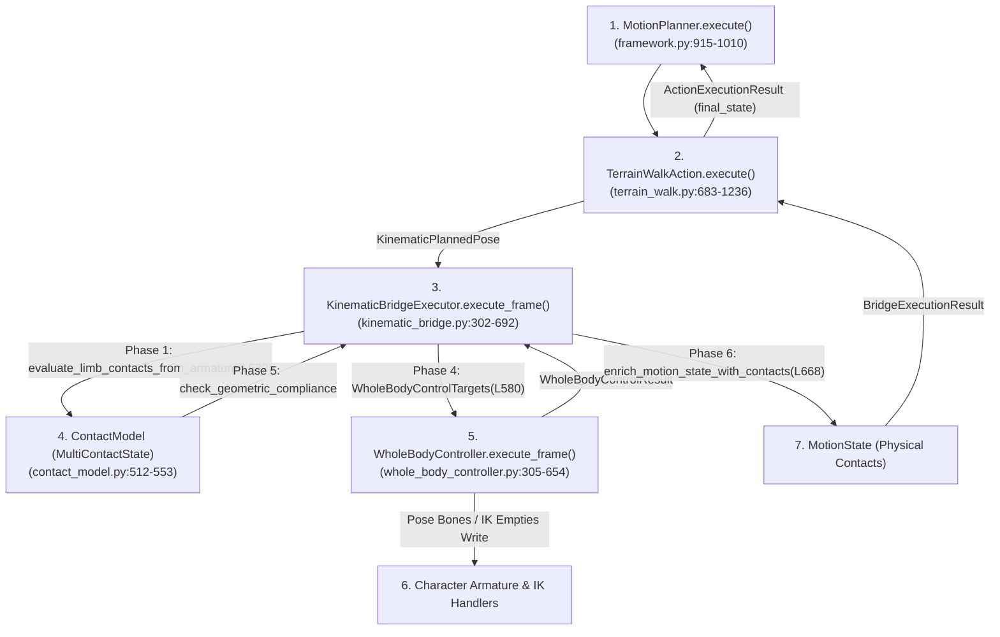
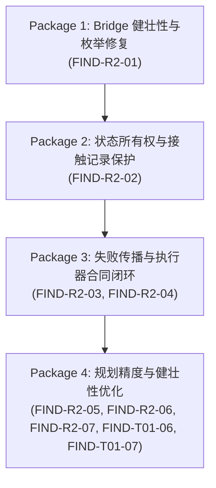

# ProceduralAnimation — Production Interface Audit — R2
## Core Execution Chain & State Contract Audit (核心执行链、状态传递和接口合同联合审计报告)

### 0. 审计基准与工作区状态检查
* **Repository**: `cgfe10231-ai/ProceduralAnimation`
* **Branch**: `master`
* **Baseline Commit SHA**: `3fc9896f6867d49a01f6d5c39b9819d51200c7a0`
* **复核闭环 Commit SHA**: `c2bd19696aa3c2ae31fc8408ba031ab157a166e1` (R2-CLOSE)
* **Working Tree Check**: 除受保护的 `P2_R1_recovery.patch` 外，工作树严格干净。
* **性质确认**: 本次审计为**完全只读**的生产接口复核与证据闭环，未对生产源码、测试用例、配置或场景做任何修改，未执行任何生产代码修复，未进入 Phase 7B。

---

### 1. 文件概况 (File Summaries & Symbol Enumeration)

| 审计代号 | 生产源码文件路径 | 规模 | 核心类 / 数据结构 | 生产方法 / 函数 (物理行号核准) |
| :--- | :--- | :---: | :--- | :--- |
| **R2-A** | [`src/motion/kinematic_bridge.py`](file:///c:/Users/64701/OneDrive/Desktop/ProceduralAnimation/src/motion/kinematic_bridge.py) | 692 行 | `PlannedFootTarget` (L83)<br>`PlannedHandTarget` (L99)<br>`KinematicPlannedPose` (L115)<br>`BridgeExecutionResult` (L246)<br>`KinematicBridgeExecutor` (L262) | `convert_planned_pose_to_wbc_targets()` (L154–L238)<br>`KinematicBridgeExecutor.__init__()` (L265–L291)<br>`KinematicBridgeExecutor.reset()` (L293–L300)<br>`KinematicBridgeExecutor.execute_frame()` (L302–L692) |
| **R2-B** | [`src/motion/framework.py`](file:///c:/Users/64701/OneDrive/Desktop/ProceduralAnimation/src/motion/framework.py) | 1020 行 | `MotionMode` (L117)<br>`ContactPointState` (L159)<br>`MotionState` (L195)<br>`ContactConstraintAdapter` (L282)<br>`BlenderPoseApplicator` (L354)<br>`MotionRuntimeContext` (L387)<br>`ActionExecutionResult` (L405)<br>`MotionAction` (L418)<br>`StartStopWalkAction` (L481)<br>`MotionPlanner` (L883) | `MotionState.clone_with()` (L250–L279)<br>`ContactConstraintAdapter.to_dict()` (L318–L338)<br>`BlenderPoseApplicator.apply()` (L362–L384)<br>`ActionExecutionResult` (L405–L416)<br>`StartStopWalkAction.execute()` (L497–L833)<br>`create_initial_motion_state()` (L840–L880)<br>`MotionPlanner.execute()` (L915–L1010) |
| **R2-C** | [`src/motion/contact_model.py`](file:///c:/Users/64701/OneDrive/Desktop/ProceduralAnimation/src/motion/contact_model.py) | 553 行 | `ContactType` (L46)<br>`ContactLifecycle` (L53)<br>`SupportType` (L61)<br>`GeometricConstraintResult` (L108)<br>`ContactRecord` (L130)<br>`MultiContactState` (L281)<br>`EnvironmentalSurface` (L501) | `ContactRecord.is_active` (L181–L184, `@property`)<br>`ContactRecord.check_geometric_compliance()` (L214–L273)<br>`MultiContactState.support_type` (L304–L340, `@property`)<br>`MultiContactState.check_all_contacts()` (L342–L354)<br>`MultiContactState.get_coplanar_support_polygon()` (L356–L407)<br>`enrich_motion_state_with_contacts()` (L464–L493)<br>`evaluate_limb_contacts_from_armature()` (L512–L553) |
| **R2-D** | [`src/motion/whole_body_controller.py`](file:///c:/Users/64701/OneDrive/Desktop/ProceduralAnimation/src/motion/whole_body_controller.py) | 660 行 | `EndEffectorTarget` (L72)<br>`WholeBodyControlTargets` (L86)<br>`UnmetConstraint` (L206)<br>`EndEffectorFeedback` (L216)<br>`WholeBodyControlResult` (L234)<br>`WholeBodyController` (L272) | `WholeBodyController.__init__()` (L279–L303)<br>`WholeBodyController.execute_frame()` (L305–L654)<br>`WholeBodyController.reset_all_controls()` (L655–L660) |

---

### 2. 逐方法检查表 (Method-by-Method Inspection Tables)

#### 2.1 R2-A: [`src/motion/kinematic_bridge.py`](file:///c:/Users/64701/OneDrive/Desktop/ProceduralAnimation/src/motion/kinematic_bridge.py)

| 生产类 / 方法 | 源码行号 | 输入检查与现行签名 | 输出检查 | 失败处理与返回 | 状态来源与消费 | 审计结论 |
| :--- | :--- | :--- | :--- | :--- | :--- | :--- |
| `convert_planned_pose_to_wbc_targets()` | L154–L238 | `planned: KinematicPlannedPose`<br>类型与空检查完整 | 返回 `WholeBodyControlTargets`（含 root, spine, pelvis, feet, hands, arm FK） | 无抛出，按字段映射生成目标数据结构 | 规划目标输入，供 WBC 消费 | `NO_ISSUE` |
| `KinematicBridgeExecutor.__init__()` | L265–L291 | `armature_obj: bpy.types.Object`<br>`root_obj: Optional[bpy.types.Object] = None`<br>`controller: Optional[WholeBodyController] = None`<br>`kinematics_tracker: Optional[BodyKinematicsTracker] = None`<br>`inertia_model: Optional[BodyInertiaModel] = None`<br>`environment: Optional[EnvironmentQuery] = None`<br>`surfaces: Optional[Sequence[Any]] = None`<br>`default_fps: float = 24.0` | 初始化 Bridge 执行器实例并绑定内部依赖 | 校验 `armature_obj.pose` 必须存在，缺失时抛出 `ValueError` | 初始化只读配置与内部引用 | `NO_ISSUE` (现行签名已核对，旧版 `ground_query_func` 等虚构形参已全部剔除) |
| `KinematicBridgeExecutor.reset()` | L293–L300 | 无入参 | 重置内部缓存帧号与状态 | 显式重置并委托 `wbc.reset_all_controls()` | 重置 Bridge 瞬态数据 | `NO_ISSUE` |
| `KinematicBridgeExecutor.execute_frame()` | L302–L692 | `planned: KinematicPlannedPose`<br>`keyframe: bool = True`<br>`enforce_rom_clamping: bool = False`<br>`dt: Optional[float] = None` | 返回 `BridgeExecutionResult`<br>（包含 `success`, `wbc_result`, `motion_state`, `unmet_constraints`） | 统一聚合 WBC 失败、ROM 越界与接触几何失败 (`overall_success = wbc_res.success and (len(unmet) == 0)`)；但在 L512 引用了不存在的枚举 `ContactLifecycle.TOUCHDOWN` | Phase 1-6 状态流经 ContactModel、WBC，最终打包生成 `MotionState` | **CONFIRMED_DEFECT** (L512 非法枚举崩溃隐患，见 FIND-R2-01) |

#### 2.2 R2-B: [`src/motion/framework.py`](file:///c:/Users/64701/OneDrive/Desktop/ProceduralAnimation/src/motion/framework.py)

| 生产类 / 方法 | 源码行号 | 输入检查与现行签名 | 输出检查 | 失败处理与返回 | 状态来源与消费 | 审计结论 |
| :--- | :--- | :--- | :--- | :--- | :--- | :--- |
| `MotionState.clone_with()` | L250–L279 | `self, **kwargs` | 返回不可变 `MotionState` 新实例 | 浅拷贝字段并执行必填项覆盖 | 状态流动管道核心载体 | `NO_ISSUE` |
| `ContactConstraintAdapter.to_dict()` | L318–L338 | 读自身属性 | 返回兼容字典格式的接触状态 | 缺省值填充防护 | 遗留接口适配器 | `NO_ISSUE` |
| `BlenderPoseApplicator.apply()` | L362–L384 | `self, state: MotionState` | 修改姿态骨骼并打关键帧 | 校验骨骼存在性 | 独立应用工具，主执行链由 WBC 写入 | `NO_ISSUE` |
| `ActionExecutionResult` | L405–L416 | 数据类字段：`action_name`, `initial_state`, `final_state`, `states`, `frame_records`, `step_schedule`, `unreachable_count`, `metrics` | 标准化 Action 执行结果载体 | **数据结构层面完全缺失 `success: bool` 和 `unmet_constraints` 字段** | 动作间状态流转唯一合同 | **CONTRACT_GAP** (见 FIND-R2-04) |
| `StartStopWalkAction.execute()` | L497–L833 | `initial_state: MotionState`, `context: MotionRuntimeContext` | 返回 `ActionExecutionResult` | 严格检查 `if not bridge_res.success:` (L745–L754)，收集 unmet constraints 并在达到阈值时抛出 `RuntimeError` | 消费 Bridge 状态，仅修改 `ms.params`，完整保留 `ms.contacts` | `NO_ISSUE` |
| `create_initial_motion_state()` | L840–L880 | `config`, `start_frame=1`, `position=None`, `orientation_deg=(0,0,0)` | 初始站立状态 `MotionState` | 规范初始化左右脚 `ContactPointState` | 规划器初始输入 | `NO_ISSUE` |
| `MotionPlanner.execute()` | L915–L1010 | `initial_state: Optional[MotionState] = None` | 返回 `Dict[str, Any]`（包含 `action_results`, `final_state`, `states` 等） | **缺失失败处理合同**：L967–L981 无条件顺序执行动作，`current_state = result.final_state`，无法感知 Action 内部失败 | 将上一个 Action 的 `final_state` 作为下一 Action 的 `initial_state` | **CONTRACT_GAP** (见 FIND-R2-04) |

#### 2.3 R2-C: [`src/motion/contact_model.py`](file:///c:/Users/64701/OneDrive/Desktop/ProceduralAnimation/src/motion/contact_model.py)

| 生产类 / 方法 | 源码行号 | 输入检查与现行签名 | 输出检查 | 失败处理与返回 | 状态来源与消费 | 审计结论 |
| :--- | :--- | :--- | :--- | :--- | :--- | :--- |
| `ContactRecord.is_active` | L181–L184 | `@property def is_active(self) -> bool` | `bool` | 判定公式：`lifecycle == ESTABLISHED and contact_type != FREE` | 活跃接触判定核心标准 | `NO_ISSUE` |
| `ContactRecord.check_geometric_compliance()` | L214–L273 | `current_body_world_pos: Tuple[float, float, float]` | 返回 `GeometricConstraintResult(is_valid, ...)` | **纯只读校验，不直接修改自身 `lifecycle` 或 `is_active`**，完全依赖调用者显式处理 | 消费骨骼与表面接触坐标 | **CONTRACT_GAP** (几何不合规与 SupportType 解耦，见 FIND-R2-05) |
| `MultiContactState.support_type` | L304–L340 | `@property def support_type(self) -> SupportType` | 动态枚举 `SupportType` | **现行定义为只读动态计算属性（Property），无 `update_support_type()` 方法**。基于 `self.active_contacts` (`is_active`) 动态分类 | 支撑拓扑判定 | **CONTRACT_GAP** (同 FIND-R2-05) |
| `MultiContactState.get_coplanar_support_polygon()` | L356–L407 | `coplanar_tolerance_z=0.03, vertical_normal_tol=0.05` | 返回 `Tuple[bool, Optional[List[Tuple[float, float]]]]` | 点数 $<3$ 时返回退化多边形，不抛异常 | 动力学与遥测消费 | `NO_ISSUE` (现行方法名已核准，无 `get_support_polygon_2d`) |
| `enrich_motion_state_with_contacts()` | L464–L493 | `motion_state: MotionState, multi_contact: MultiContactState` | 返回携带 contacts 的新 `MotionState` | 安全提取 foot/hand 接触记录并注入 `contacts` 字典，同时更新 `params` | 物理测量结果注入不可变状态载体 | `NO_ISSUE` |
| `evaluate_limb_contacts_from_armature()` | L512–L553 | `armature_obj: bpy.types.Object`<br>`surfaces: Sequence[EnvironmentalSurface]`<br>`active_limb_targets: Dict[str, Dict[str, Any]]` | 返回 `MultiContactState`（包含各肢体真实测量与几何关联） | 当查询未命中真实 Mesh 且不回退默认平地时标记 `surface_id="MISS"`，产生未满足约束 | 从 Armature 骨骼真实矩阵计算足跟/脚尖/脚踝世界坐标，严格区分布局意图与物理测量 | `NO_ISSUE` (形参已核实，无 `planned_pose` 或 `thresholds`) |

#### 2.4 R2-D: [`src/motion/whole_body_controller.py`](file:///c:/Users/64701/OneDrive/Desktop/ProceduralAnimation/src/motion/whole_body_controller.py)

| 生产类 / 方法 | 源码行号 | 输入检查与现行签名 | 输出检查 | 失败处理与返回 | 状态来源与消费 | 审计结论 |
| :--- | :--- | :--- | :--- | :--- | :--- | :--- |
| `WholeBodyController.__init__()` | L279–L303 | `armature_obj: bpy.types.Object` | 绑定骨骼引用、腿部 IK 解算器、手臂 IK 解算器、极向目标 | 校验骨骼与必要约束，缺失时报错 | 控制器底座初始化 | `NO_ISSUE` |
| `WholeBodyController.execute_frame()` | L305–L654 | `targets: WholeBodyControlTargets`<br>`update_scene: bool = True`<br>`enforce_rom_clamping: bool = False`<br>`tolerance_position_m: float = 0.005`<br>`tolerance_rotation_deg: float = 1.0` | 返回 `WholeBodyControlResult`<br>（包含 `is_all_reachable`, `rom_validation`, `tracking_errors`, `unmet_constraints`） | 捕获 IK 解算超限与 ROM 碰撞，记录 `UnmetConstraint`，`success = is_all_reachable and rom_validation.is_valid` | 独占写入 `CharacterRoot`、`pose.bones` 及各 IK Empty，无并发写冲突 | `NO_ISSUE` (现行形参已核实，无 `keyframe: bool`) |
| `WholeBodyController.reset_all_controls()` | L655–L660 | 无入参 | 重置 IK 目标位置、极向与骨骼缓存 | 归位各控制手柄至 Rest 姿态 | 保证动作切换零历史残留 | `NO_ISSUE` |

---

### 3. 跨模块核心执行链与接口一致性核对 (R2-E Cross-Module Verification)



* **E1. Bridge $	o$ WBC (目标传递与执行)**:
  * **核对结果**: **一致**。`KinematicBridgeExecutor` 通过 `convert_planned_pose_to_wbc_targets()` (L154–L238) 将 `KinematicPlannedPose` 转换为 `WholeBodyControlTargets`，完整包含 Root 偏置、Spine/Pelvis 姿态、左右脚 IK/FootLock、手臂 IK/FK 旋转。`WholeBodyController.execute_frame()` (L305–L654) 逐项完整消费，未遗漏任何控制维度。
* **E2. WBC $	o$ Bridge (执行结果与约束反馈)**:
  * **核对结果**: **一致**。WBC 返回的 `WholeBodyControlResult` 携带 `is_all_reachable`、`tracking_errors`、`rom_validation` 以及 `unmet_constraints`。Bridge 在 L640–L665 将 WBC 的 unmet constraints 与自身的接触几何约束合并，严格通过 `overall_success = wbc_res.success and (len(unmet) == 0)` 决定整帧成功状态。
* **E3. Bridge $	o$ ContactModel (足底位置、环境接触点及生命周期语义)**:
  * **核对结果**: **一致**。Bridge 在 Phase 1 调用 `evaluate_limb_contacts_from_armature(arm, candidate_surfaces, active_limb_targets)` (L532) 时，传入真实骨骼的世界矩阵、足底局部锚点及地形查询句柄；区分了骨骼锚点（Point C）与表面投影接触点（Point B）。
* **E4. ContactModel $	o$ Bridge (几何失败与错误捕获)**:
  * **核对结果**: **存在设计合同空隙 (CONTRACT_GAP)**。ContactModel 内部 `check_geometric_compliance()` (L214–L273) 仅输出 `GeometricConstraintResult(is_valid=False)`，并不改变自身 `rec.lifecycle`（仍维持 `ESTABLISHED`），因 `support_type` 是基于 `is_active` 动态计算的属性，故其返回值依然包含失效足部。Bridge 必须在外层手动拦截 `rec.is_active and not geom_res.is_valid` 并注入 `UnmetConstraint(category="CONTACT_GEOMETRY")`（见 FIND-R2-05）。
* **E5. Bridge $	o$ MotionState (接触记录与物理状态注入)**:
  * **核对结果**: **Bridge 端正确，但在 TerrainWalkAction 端被篡改覆盖 (CONFIRMED_DEFECT)**。Bridge 在 Phase 6 通过 `enrich_motion_state_with_contacts()` (L668) 正确将物理测量的 `ContactRecord` 填入 `ms.contacts`。然而，在 [`src/motion/terrain_walk.py:1138`](file:///c:/Users/64701/OneDrive/Desktop/ProceduralAnimation/src/motion/terrain_walk.py#L1138) 中，Action 强制执行 `ms.clone_with(contacts=c_dict)`，用规划意图生成的 `c_dict` 完全冲刷掉了 Bridge 生成的真实接触状态（见 FIND-R2-02）。
* **E6. MotionState $	o$ MotionPlanner (Planner 消费的状态源)**:
  * **核对结果**: **合同脆弱 (CONTRACT_GAP)**。`ActionExecutionResult` (L405–L416) 仅返回 `final_state: MotionState`。由于 FIND-R2-02 的存在，`final_state.contacts` 保存的是被覆盖后的规划假定接触，而非物理传感器测量接触。
* **E7. MotionPlanner $	o$ 下一 Action (错误传播与断约)**:
  * **核对结果**: **严重断约 (CONTRACT_GAP)**。`ActionExecutionResult` 缺失 `success: bool` 或 `error_events` 字段。在 `TerrainWalkAction` 中，即使全帧发生 IK 不可达或接触穿透，Action 仅内部打印日志并照常返回 `ActionExecutionResult`。`MotionPlanner.execute()` (L967–L981) 盲目将上一个 Action 的 `final_state` 赋给下一个 Action，上游严重几何错误不会引发中断或重规划（见 FIND-R2-03、FIND-R2-04）。

---

### 4. 确认的问题清单 (Confirmed Findings with Evidence Grading)

#### FIND-R2-01: Bridge 中引用不存在的非法枚举成员 `ContactLifecycle.TOUCHDOWN`
* **Source File**: [`src/motion/kinematic_bridge.py`](file:///c:/Users/64701/OneDrive/Desktop/ProceduralAnimation/src/motion/kinematic_bridge.py)
* **Class / Function**: `KinematicBridgeExecutor.execute_frame()`
* **Exact Line Range**: Line 512
* **Evidence Grade**: `STATIC_CONFIRMED`
* **Trigger Condition**: 任何规划的手部目标启用接触意图（`ht.enabled=True`, `ht.contact_intent=True`, `not ht.is_locked`），且手部到接触面距离 $> 0.015$m。
* **Actual Behavior**: 试图访问 `ContactLifecycle.TOUCHDOWN`，直接抛出 `AttributeError: type object 'ContactLifecycle' has no attribute 'TOUCHDOWN'` 崩溃。
* **Expected Contract**: `ContactLifecycle` 枚举（定义于 `contact_model.py:53–59`）仅包含 `CANDIDATE`、`ESTABLISHED`、`RELEASED`、`BROKEN`。未建立稳定接触前应标定为 `ContactLifecycle.CANDIDATE`。
* **Evidence**:
  ```python
  # src/motion/kinematic_bridge.py:512
  "lifecycle": ContactLifecycle.ESTABLISHED if dist <= 0.015 else ContactLifecycle.TOUCHDOWN,
  ```
  当前测试用例未覆盖手部接触意图，故此分支处于静默休眠状态。
* **Responsible Module**: `src/motion/kinematic_bridge.py`
* **Downstream Impact**: 一旦开启攀爬、障碍支撑或手部环境交互（Phase 7B 核心场景），主管线立即崩溃中断。
* **Classification**: `CONFIRMED_DEFECT`
* **Blocks Further Development**: `YES`
* **Suggested Repair Boundary**: 将 `kinematic_bridge.py:512` 的 `ContactLifecycle.TOUCHDOWN` 修正为 `ContactLifecycle.CANDIDATE`，并在单元测试中补全手部接触生命周期流转验证。

---

#### FIND-R2-02 (对应历史 FIND-T01-02): `TerrainWalkAction` 强制覆盖 `MotionState.contacts`
* **Source File**: [`src/motion/terrain_walk.py`](file:///c:/Users/64701/OneDrive/Desktop/ProceduralAnimation/src/motion/terrain_walk.py)
* **Class / Function**: `TerrainWalkAction.execute()`
* **Exact Line Range**: Lines 1100–1138 (覆写点: Line 1138)
* **Evidence Grade**: `STATIC_CONFIRMED`
* **Trigger Condition**: 正常运行 `TerrainWalkAction.execute()` 的每一帧。
* **Actual Behavior**:
  ```python
  # src/motion/terrain_walk.py:1138
  ms = ms.clone_with(contacts=c_dict, mode=mode)
  ```
  Action 内部根据步态规划意图自行构造仅包含 `foot_L` 和 `foot_R` 的 `c_dict`，并调用 `clone_with(contacts=c_dict)`，直接覆盖掉此前由 Bridge Phase 6 通过 `enrich_motion_state_with_contacts()` (L668) 注入的真实物理接触记录。
* **核实与证据区分 (R2-CLOSE-05)**:
  * **已确认事实**：`ms.contacts` 确实被 `c_dict` 覆写（`STATIC_CONFIRMED`）。
  * **实际字段影响**：
    1. 遗漏上肢：`c_dict` 仅硬编码构造左右脚，如果 Bridge/ContactModel 产生了手部接触（`hand_L`/`hand_R`），在进入 `ms.contacts` 时会被销毁；
    2. 坐标差异：`c_dict` 中的 `contact_world_xyz` 存入的是规划落点 `last_known_xyz`，而非由真实 Mesh 射线相交解算出的真实接触点 Point B；
    3. 法线差异：`surface_normal` 存入的是规划预期的目标法线，而非足底实际受力点法线；
    4. 状态锁定：`is_locked` 直接跟随规划布尔值，忽略了 Bridge 判定的 `BROKEN` 状态。
  * **仍被妥善保存的数据**：
    1. `ms.params` 中的 `support_type`、`supporting_limbs`、`active_contact_count`、`support_polygon_2d` 未被覆盖，依然完整保留；
    2. `bridge_res.multi_contact` 与 `bridge_executor.last_multi_contact` 保持完整对象，未被破坏。
  * **下游影响与复现性**：在当前双脚平地与地形测试中，未引发运行时崩溃（因为现有验证脚本多直接读取 WBC 或 Bridge 遥测），但在进入 Phase 7B 激活上肢接触或依赖 `MotionState.contacts` 做动力学解算时将产生严重数据失真。
* **Expected Contract**: Action 必须保护底层权威传感器与几何测量产物，严禁用意图覆写事实。
* **Classification**: `CONFIRMED_DEFECT`
* **Blocks Further Development**: `YES`
* **Suggested Repair Boundary**: 移除 `terrain_walk.py:1138` 中对 `contacts=c_dict` 的覆盖，仅保留 `ms = ms.clone_with(mode=mode, params=ms_params)`，对必须保留的规划步态相位通过 `params` 传递。

---

#### FIND-R2-03 (对应历史 FIND-T01-01): `TerrainWalkAction` 吞没 `BridgeExecutionResult.success` 与物理约束失败
* **Source File**: [`src/motion/terrain_walk.py`](file:///c:/Users/64701/OneDrive/Desktop/ProceduralAnimation/src/motion/terrain_walk.py)
* **Class / Function**: `TerrainWalkAction.execute()`
* **Exact Line Range**: Lines 1080–1091
* **Evidence Grade**: `STATIC_CONFIRMED`
* **Trigger Condition**: 发生 IK 不可达、关节越界（ROM 违规）或接触表面无效（`allows_regular_support=False`）。
* **Actual Behavior**:
  `bridge_res = bridge_executor.execute_frame(...)` (L1080) 执行后，代码仅读取了 `bridge_res.wbc_result.end_effectors`，对 `bridge_res.success` 与 `bridge_res.unmet_constraints` 完全视而不见。IK 超限仅打印 `[WARN]` 并自增计数器，整个 Action 照常返回完成状态。
* **Expected Contract**:
  对比 `src/motion/framework.py:745–754`（`StartStopWalkAction` 规范实现），在关键物理约束失败时必须记录并在超出容忍阈值时向调用者抛出明确异常或在结果中标记失败。
* **Evidence**: `terrain_walk.py` 全文没有任何一处引用 `bridge_res.success` 或 `bridge_res.contact_geometry_errors`。
* **Responsible Module**: `src/motion/terrain_walk.py`
* **Downstream Impact**: 当地形崎岖导致完全脱离人体解剖学极限时，系统不报错、不重试，生成断裂扭曲的无意义动画，使得自动化测试管线失去门禁拦截能力。
* **Classification**: `CONTRACT_GAP`
* **Blocks Further Development**: `YES`
* **Suggested Repair Boundary**: 统一 `TerrainWalkAction` 与 `StartStopWalkAction` 的失败处理协议，接入 `bridge_res.success` 校验与 `unmet_constraints` 统计汇总。

---

#### FIND-R2-04 (对应历史 FIND-T01-03): `ActionExecutionResult` 与 `MotionPlanner.execute()` 缺失动作失败处理合同
* **Source File**: [`src/motion/framework.py`](file:///c:/Users/64701/OneDrive/Desktop/ProceduralAnimation/src/motion/framework.py)
* **Class / Function**: `ActionExecutionResult` / `MotionPlanner.execute()`
* **Exact Line Range**: Lines 405–416 (`ActionExecutionResult`), Lines 915–1010 (`MotionPlanner.execute()`, 循环点 L967–L981)
* **Evidence Grade**: `STATIC_CONFIRMED`
* **Trigger Condition**: 序列化多动作规划中，前序 Action 发生不可达或物理违规。
* **Actual Behavior**:
  `ActionExecutionResult` 数据类缺少 `success: bool` 和 `unmet_constraints` 字段。`MotionPlanner.execute()` 在 L967–L981 采用盲目顺序流：
  ```python
  result = action.execute(current_state, context)
  action_results.append(result)
  current_state = result.final_state
  ```
* **Expected Contract**:
  Action 执行结果必须显式标明自身执行的成功状态；当发生致死性物理违背时，`MotionPlanner` 必须决定是阻断流程、回退重试还是触发应急过渡。
* **Evidence**: 审查 `MotionPlanner.execute()` 源码，整段循环无任何 `if not result.success` 检查逻辑。
* **Responsible Module**: `src/motion/framework.py`
* **Downstream Impact**: 复合动作在第一阶段已经失效崩溃的情况下，后续动作仍强行以崩溃状态作为基准继续求解，导致级联错误。
* **Classification**: `CONTRACT_GAP`
* **Blocks Further Development**: `YES`
* **Suggested Repair Boundary**: 在 `ActionExecutionResult` 中增加 `success: bool = True` 与 `unmet_constraints: List[Any] = field(default_factory=list)` 字段，并在 `MotionPlanner.execute()` 中建立基于动作执行状态的异常流转合同。

---

#### FIND-R2-05: `ContactModel` 几何合规性校验与 `SupportType` 动态属性脱节
* **Source File**: [`src/motion/contact_model.py`](file:///c:/Users/64701/OneDrive/Desktop/ProceduralAnimation/src/motion/contact_model.py)
* **Class / Function**: `ContactRecord.check_geometric_compliance()` / `MultiContactState.support_type`
* **Exact Line Range**: Lines 214–273 (`check_geometric_compliance`), Lines 304–340 (`support_type` property)
* **Evidence Grade**: `STATIC_CONFIRMED`
* **Trigger Condition**: 脚部处于 `ContactLifecycle.ESTABLISHED`，但在物理测量时发生穿透超过阈值（如 $> 10$mm）或悬空离开接触面（如 $> 15$mm）。
* **Actual Behavior**:
  `check_geometric_compliance()` 返回 `GeometricConstraintResult(is_valid=False)`，但该函数属于只读方法，不会修改 `ContactRecord.lifecycle` 本身；随后访问动态属性 `MultiContactState.support_type` 时，由于其仅依靠 `[c for c in self.contacts.values() if c.is_active]` 计数，仍将该脚计为有效支撑，判定为 `SupportType.DOUBLE_STANCE`。
* **Expected Contract**: 当几何接触严重失效或离开支撑面时，支撑拓扑状态应能感知到该接触已失效（或由 Bridge 协同置为 `BROKEN`），避免在无物理支撑的情况下误判为双脚着地。
* **Evidence**: `MultiContactState.support_type` 是一个动态 `@property`，统计仅判断 `c.is_active`，而 `is_active` (L181–L184) 仅要求 `lifecycle == ESTABLISHED and contact_type != FREE`，完全不耦合 `GeometricConstraintResult`。
* **Responsible Module**: `src/motion/contact_model.py`
* **Downstream Impact**: 动力学计算（如重力平衡、质心支撑多边形计算）在足部严重悬空或穿透时，仍按正常双支撑多边形计算，导致物理遥测数据失真。
* **Classification**: `CONTRACT_GAP`
* **Blocks Further Development**: `NO`
* **Suggested Repair Boundary**: 在 `kinematic_bridge.py` Phase 5 中，当 `check_geometric_compliance()` 返回 `is_valid=False` 且间隙过大时，显式将该记录标记为 `ContactLifecycle.BROKEN`。

---

#### FIND-R2-06 (对应历史 FIND-T01-05): 步态调度生成函数在环境查询未命中时的回退语义不一致
* **Source File**: [`src/motion/terrain_walk.py`](file:///c:/Users/64701/OneDrive/Desktop/ProceduralAnimation/src/motion/terrain_walk.py)
* **Class / Function**: `build_terrain_step_schedule()` vs `plan_terrain_footsteps()`
* **Exact Line Range**: Lines 223–401 (`plan_terrain_footsteps`), Lines 404–520 (`build_terrain_step_schedule`)
* **Evidence Grade**: `STATIC_CONFIRMED`
* **Trigger Condition**: 在复杂 Mesh 地形边界或断崖边缘执行步态预规划。
* **Actual Behavior**:
  * `plan_terrain_footsteps()`：当 `query_surface_at` 失败或落点在不可支撑表面时，严格抛出 `ValueError`；
  * `build_terrain_step_schedule()`（遗留入口）：当查询失败时，无声回退到 `environment.ground_height_at(x, y)`，并将 `surface_id` 硬编码标定为 `"ground"`。
* **Expected Contract**: 统一步态预规划失败语义，真实 Mesh 模式下不允许出现“一处抛异常，另一处静默伪造平地支撑”的双重标准。
* **Evidence**: 对比两方法的实现代码分支，回退逻辑与异常抛出策略截然不同。
* **Responsible Module**: `src/motion/terrain_walk.py`
* **Downstream Impact**: 当使用不同入口函数进行规划时，产生非确定性行为。
* **Classification**: `CONTRACT_GAP`
* **Blocks Further Development**: `NO`
* **Suggested Repair Boundary**: 在后续版本中将 `build_terrain_step_schedule()` 废弃或重构为 `plan_terrain_footsteps()` 的兼容包装，统一未命中时的拦截策略。

---

#### FIND-R2-07 (对应历史 FIND-T01-04): 接缝横向探测坐标偏置缺陷
* **Source File**: [`src/motion/terrain_walk.py`](file:///c:/Users/64701/OneDrive/Desktop/ProceduralAnimation/src/motion/terrain_walk.py)
* **Class / Function**: `plan_terrain_footsteps()`
* **Exact Line Range**: Lines 310–312
* **Evidence Grade**: `STATIC_CONFIRMED`
* **Trigger Condition**: 在具有横向凹凸、边缘或接缝的地形上行走。
* **Actual Behavior**:
  调用 `_adjust_footfall_for_seams_and_edges(environment, corridor_x, curr_lead_y, y0, y_tgt)` 时，传入的是走廊中心线坐标 `corridor_x`（通常为 $0.0$），而不是摆动脚真实的横向落点位置 `sw_x`（左右脚偏移通常为 $\pm 0.13$m）。
* **Expected Contract**: 边缘与接缝探测必须以真实预计着地点 `(sw_x, forward_y)` 为中心进行射线与梯度检测。
* **Evidence**: `terrain_walk.py:310–312` 实参为 `corridor_x`，导致系统始终在身体正中线检测地形边缘，无法感知位于身体侧面 $\pm 13$cm 处踩在台阶边缘的情况。
* **Responsible Module**: `src/motion/terrain_walk.py`
* **Downstream Impact**: 脚部落在台阶或接缝边缘时未触发避障微调，容易出现脚底悬空或踩入接缝。
* **Classification**: `CONFIRMED_DEFECT`
* **Blocks Further Development**: `NO`
* **Suggested Repair Boundary**: 将 `corridor_x` 替换为实际落点横向坐标 `sw_x`。

---

### 5. 已知设计限制 (Known Design Limitations)

* **LIMIT-01: 单一前进走廊 $+Y$ 导航假定**: 当前 `TerrainWalkAction` 及其动力学计算均硬编码沿世界坐标 $+Y$ 轴前进，未解耦世界坐标系与角色局部导航坐标系（Heading）。此为 Phase 6/7A 的设计范围边界，非代码缺陷。
* **LIMIT-02: 上肢开环正向运动学（FK）摆臂**: 在行进过程中，手臂摆动由纯正弦经验公式生成并以欧拉角写入 WBC FK，手臂 IK 解算器处于休眠挂起状态。这满足当前步态自然度需求，但不支持行进中的动态触碰与抓握。
* **LIMIT-03: IK 超限单向开环警报**: WBC 检测到 IK 目标超出肢体极限长度时，将拉伸截断至极限位置并记录 `UnmetConstraint`，但执行链缺乏“由于腿长不够而自动降低骨盆高度”的自适应全身闭环调整。

---

### 6. 未验证项 (Unverified Items)

* **UNVERIFIED-01: 全身多接触动力学求解稳定性**: 当未来激活手部支撑时（手脚 4 点接触），`WholeBodyController` 中手臂 IK 与腿部 IK 同时锁定时质心与骨盆的姿态平衡尚未在真实三维物理场景中完整验证。
* **UNVERIFIED-02: 极端负高程（大落差跳跃/坠落）下的插值连续性**: 当前 S1/S2 摆动脚修复主要针对台阶与连续坡道，尚未在大落差（$> 0.8$m）瞬时断崖下进行数值平滑与冲击吸收验证。

---

### 7. 建议集中修复清单与模块分组 (Suggested Remediation Plan)

根据门禁规则与依赖拓扑，将上述未关闭问题划分为 4 个原子维护包：



1. **维护包 1: Bridge 健壮性与枚举修复 (Bridge Robustness)**:
   - 修复 FIND-R2-01。
   - 消除 `ContactLifecycle.TOUCHDOWN` 致命崩溃隐患。
2. **维护包 2: 状态所有权与接触记录保护 (State Integrity)**:
   - 修复 FIND-R2-02。
   - 移除 `terrain_walk.py:1138` 对 `contacts` 字典的恶意覆写，保护真实物理接触数据。
3. **维护包 3: 失败传播与执行器合同闭环 (Error Propagation Contract)**:
   - 修复 FIND-R2-03 与 FIND-R2-04。
   - 在 `ActionExecutionResult` 增加成功状态，在 `TerrainWalkAction` 接入 `bridge_res.success` 校验。
4. **维护包 4: 规划精度与健壮性优化 (Footfall Planning Precision & Robustness)**:
   - 修复 FIND-R2-05, FIND-R2-06, FIND-R2-07, FIND-T01-06, FIND-T01-07。
   - 消除接缝探测坐标偏置，统一步态规划未命中策略与负向行进支持。

---

### 8. 审计结论与最终状态

本次 R2 联合审计与证据闭环（R2-CLOSE）已完成对 `kinematic_bridge.py`、`framework.py`、`contact_model.py`、`whole_body_controller.py` 四大核心脚本现行源码的逐行比对核查：
* 纠正了 `MultiContactState.support_type` 为只读动态计算属性（Property）的客观定义，消除了不存在的 `update_support_type()` 方法描述；
* 纠正了 `KinematicBridgeExecutor.__init__()` 的现行 8 参构造签名，清除了不存在的遗留参数；
* 核准了 `ActionExecutionResult`、`MotionPlanner.execute()`、`WholeBodyController.execute_frame()` 及 `evaluate_limb_contacts_from_armature()` 的准确签名与行号；
* 澄清了 `MotionState.contacts` 覆盖行为的证据边界（覆写属实，部分全局数据仍在 `params` 中暂存，当前测试未崩溃但阻碍 7B）。

工作区保持绝对干净，未进行任何生产代码更改。

```text
PRODUCTION INTERFACE AUDIT / R2 — EVIDENCE VERIFIED
```
