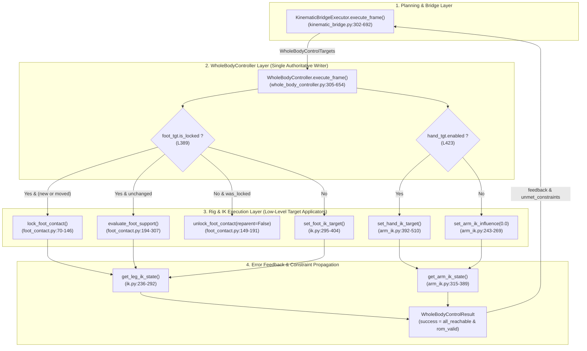

# ProceduralAnimation — Production Interface Audit — R3
## Rig, Foot Contact & IK Execution Contract Audit (底层绑定、足部接触与 IK 执行合同审计报告)

### 0. 审计基准与工作区状态检查
* **Repository**: `cgfe10231-ai/ProceduralAnimation`
* **Branch**: `master`
* **Baseline Commit SHA**: `9f8fec684637b30b09c278d9726a6f3518dcdb22`
* **Working Tree Check**: 除受保护的未跟踪补丁 `P2_R1_recovery.patch` 外，工作树严格干净。
* **审计性质确认**: 本次审计属于**完全只读**的底层绑定、足部接触与 IK 执行合同审查，未对生产源码、测试用例、配置或场景资产做任何修改，未提前开发 Phase 7B，未重新实现任何 IK 算法。

---

### 1. 文件概况 (File Summaries & Symbol Enumeration)

| 审计代号 | 生产源码文件路径 | 规模 | 核心职责 | 生产方法 / 函数 (物理行号核准) |
| :--- | :--- | :---: | :--- | :--- |
| **R3-A** | [`src/rig/foot_contact.py`](file:///c:/Users/64701/OneDrive/Desktop/ProceduralAnimation/src/rig/foot_contact.py) | 333 行 | 足部世界坐标接触锁定、地面支撑稳定性评估与微米级漂移监测 | `_ensure_ik_controls()` (L49–L56)<br>`_classify_reach()` (L59–L67)<br>`lock_foot_contact()` (L70–L146)<br>`unlock_foot_contact()` (L149–L191)<br>`evaluate_foot_support()` (L194–L307)<br>`get_foot_support_state()` (L310–L312)<br>`move_character_root_with_support()` (L315–L333) |
| **R3-B** | [`src/rig/ik.py`](file:///c:/Users/64701/OneDrive/Desktop/ProceduralAnimation/src/rig/ik.py) | 404 行 | 下肢双骨反向运动学 (Two-Bone IK) 约束配置、膝盖极向防翻转与足部目标应用 | `_resolve_armature()` (L42–L47)<br>`_ensure_character_collection()` (L50–L56)<br>`_get_or_create_empty()` (L59–L85)<br>`_apply_ik_prebend_hint()` (L88–L109)<br>`setup_leg_ik()` (L112–L208)<br>`reset_leg_ik()` (L211–L233)<br>`get_leg_ik_state()` (L236–L292)<br>`set_foot_ik_target()` (L295–L404) |
| **R3-C** | [`src/rig/arm_ik.py`](file:///c:/Users/64701/OneDrive/Desktop/ProceduralAnimation/src/rig/arm_ik.py) | 510 行 | 上肢双骨反向运动学与手部姿态约束配置、手腕可达性检测与约束权重调制 | `_resolve_armature()` (L59–L65)<br>`_ensure_character_collection()` (L68–L75)<br>`_get_or_create_empty()` (L78–L105)<br>`_apply_arm_ik_prebend_hint()` (L108–L131)<br>`setup_arm_ik()` (L134–L240)<br>`set_arm_ik_influence()` (L243–L269)<br>`reset_arm_ik()` (L272–L312)<br>`get_arm_ik_state()` (L315–L389)<br>`set_hand_ik_target()` (L392–L510) |

---

### 2. 逐方法检查表 (Method-by-Method Inspection Tables)

#### 2.1 R3-A: [`src/rig/foot_contact.py`](file:///c:/Users/64701/OneDrive/Desktop/ProceduralAnimation/src/rig/foot_contact.py)

| 生产函数名 | 源码物理行号 | 输入参数与签名核准 | 输出结果 | 失败与异常处理 | 状态流转与所有权 | 审计结论 |
| :--- | :--- | :--- | :--- | :--- | :--- | :--- |
| `_ensure_ik_controls()` | L49–L56 | `arm: bpy.types.Object, side: str` | `Tuple[bpy.types.Object, bpy.types.Object]` (`ik_obj`, `pole_obj`) | 若控制器不存在则自动触发 `setup_leg_ik(arm)` | 保证控制器对象存在 | `NO_ISSUE` |
| `_classify_reach()` | L59–L67 | `distance: float, max_reach: float = MAX_LEG_REACH` | `Tuple[bool, bool, str]` (`strictly_in_reach`, `is_reachable`, `status`) | 阈值比较，不抛异常 | 状态分级判定逻辑 | `NO_ISSUE` |
| `lock_foot_contact()` | L70–L146 | `armature_obj: Optional[bpy.types.Object], side: str, contact_world_xyz: Optional[Tuple[float, float, float]] = None, target_rotation_deg: Optional[Tuple[float, float, float]] = None` | `dict` (调用 `evaluate_foot_support`) | 校验 side 必须为 'L'/'R'，非法时抛出 `ValueError` | 将 `FootIK` 与 `KneePole` 解绑为世界空间 (`parent = None`)，并在 Empty 上写入锁定元数据 | `NO_ISSUE` (严格遵守解耦世界空间原则) |
| `unlock_foot_contact()` | L149–L191 | `armature_obj: Optional[bpy.types.Object], side: str, reparent_to_root: bool = True` | `dict` (调用 `get_foot_support_state`) | 校验 side 必须为 'L'/'R' | 置 `is_locked = False`；默认参数 `reparent_to_root=True` 重新将控制器绑定为 `CharacterRoot` 的子物体；未清理 `locked_ankle_world_xyz` 等元数据 | **CONTRACT_GAP / ARCHITECTURAL_VIOLATION** (违反门禁 Rule 7，详见 FIND-R3-01 与 FIND-R3-03) |
| `evaluate_foot_support()` | L194–L307 | `armature_obj: Optional[bpy.types.Object], side: str` | `dict` (包含 `is_locked`, `reach_status`, 骨骼/控制器/网格世界漂移量及膝盖弯曲度) | 纯只读几何与姿态解算，不修改物体世界坐标 | 消费骨骼矩阵与控制器位置，输出物理遥测 | `NO_ISSUE` |
| `get_foot_support_state()` | L310–L312 | `armature_obj: Optional[bpy.types.Object], side: str` | `dict` | 委托 `evaluate_foot_support(armature_obj, side)` | 统一状态查询包装 | `NO_ISSUE` |
| `move_character_root_with_support()` | L315–L333 | `armature_obj: Optional[bpy.types.Object], new_root_world_xyz: Tuple[float, float, float]` | `Dict[str, dict]` (返回包含 "L" 与 "R" 的支撑评估字典) | 若 `CharacterRoot` 不存在抛出 `RuntimeError` | 历史遗留辅助函数，仅平移根节点，未处理旋转；主执行链已迁移至 WBC | `NO_ISSUE` (遗留兼容接口) |

#### 2.2 R3-B: [`src/rig/ik.py`](file:///c:/Users/64701/OneDrive/Desktop/ProceduralAnimation/src/rig/ik.py)

| 生产函数名 | 源码物理行号 | 输入参数与签名核准 | 输出结果 | 失败与异常处理 | 状态流转与所有权 | 审计结论 |
| :--- | :--- | :--- | :--- | :--- | :--- | :--- |
| `_resolve_armature()` | L42–L47 | `armature_obj: Optional[bpy.types.Object]` | `bpy.types.Object` | 找不到骨骼对象时抛出 `RuntimeError` | 全局对象解析器 | `NO_ISSUE` |
| `_ensure_character_collection()` | L50–L56 | `scene: Optional[bpy.types.Scene] = None` | `bpy.types.Collection` | 自动创建或获取 `Character_Rig` 集合 | 场景层级管理 | `NO_ISSUE` |
| `_get_or_create_empty()` | L59–L85 | `name: str, display_type: str, display_size: float, parent: Optional[bpy.types.Object], collection: bpy.types.Collection` | `bpy.types.Object` | 创建或获取 Empty 对象 | 控制器物体生成底座 | `NO_ISSUE` |
| `_apply_ik_prebend_hint()` | L88–L109 | `arm: bpy.types.Object` | `None` | 静默容错，若骨骼不存在则安全跳过 | 为膝关节提供 $-0.05$ rad 前屈诱导，防止解算极向奇点 | `NO_ISSUE` |
| `setup_leg_ik()` | L112–L208 | `armature_obj: Optional[bpy.types.Object] = None` | `Dict[str, bpy.types.Object]` | 幂等清除已有约束后重建；根据大腿骨朝向自适应校验极向角 ($\pm 90^\circ$) | 配置两骨 IK 与脚部旋转拷贝约束；将控制器初值挂载于 `CharacterRoot` | `NO_ISSUE` |
| `reset_leg_ik()` | L211–L233 | `armature_obj: Optional[bpy.types.Object] = None` | `None` | 缺失对象时安全容错 | 将脚部控制器重置至初始站姿位置，重新挂载回 `CharacterRoot` | `NO_ISSUE` (受控重置底座) |
| `get_leg_ik_state()` | L236–L292 | `armature_obj: Optional[bpy.types.Object], side: str` | `dict` (包含骨骼世界点、目标误差、膝盖屈曲角度、最低离地高度) | 校验 side 非法抛 `ValueError` | 只读测量函数，为 WBC 与接触模型提供底层几何数据 | `NO_ISSUE` |
| `set_foot_ik_target()` | L295–L404 | `armature_obj: Optional[bpy.types.Object], side: str, world_xyz: Tuple[float, float, float], foot_rotation_deg: Optional[Tuple[float, float, float]] = None, clamp_reach: bool = True, clamp_ground: bool = True` | `dict` (包含 requested/applied 位置、超限标记及最新 IK 测量状态) | 若 `ik_obj["is_locked"]` 为 True 抛出 `RuntimeError` 拒绝写入；`clamp_ground=True` 时硬编码根节点高程导致下坡截断；在父级非空时直接将世界欧拉角赋给局部属性 | 写入 `FootIK` 与 `KneePole` 变换矩阵并驱动场景更新 | **CONTRACT_GAP** (地面截断缺陷 FIND-R3-02；父级旋转未反解 FIND-R3-01) |

#### 2.3 R3-C: [`src/rig/arm_ik.py`](file:///c:/Users/64701/OneDrive/Desktop/ProceduralAnimation/src/rig/arm_ik.py)

| 生产函数名 | 源码物理行号 | 输入参数与签名核准 | 输出结果 | 失败与异常处理 | 状态流转与所有权 | 审计结论 |
| :--- | :--- | :--- | :--- | :--- | :--- | :--- |
| `_resolve_armature()` | L59–L65 | `armature_obj: Optional[bpy.types.Object]` | `bpy.types.Object` | 找不到骨骼对象时抛出 `RuntimeError` | 全局对象解析器 | `NO_ISSUE` |
| `_ensure_character_collection()` | L68–L75 | `scene: Optional[bpy.types.Scene] = None` | `bpy.types.Collection` | 自动创建或获取 `Character_Rig` 集合 | 场景层级管理 | `NO_ISSUE` |
| `_get_or_create_empty()` | L78–L105 | `name: str, display_type: str, display_size: float, parent: Optional[bpy.types.Object], collection: bpy.types.Collection` | `bpy.types.Object` | 创建或获取 Empty 对象 | 控制器物体生成底座 | `NO_ISSUE` |
| `_apply_arm_ik_prebend_hint()` | L108–L131 | `arm: bpy.types.Object` | `None` | 静默容错，若骨骼不存在则跳过 | 提供 $+0.05$ rad 肘关节前屈诱导 | `NO_ISSUE` |
| `setup_arm_ik()` | L134–L240 | `armature_obj: Optional[bpy.types.Object] = None, initial_influence: float = 0.0` | `Dict[str, bpy.types.Object]` | 幂等清除并重建两骨 IK 约束；肘关节严格限制在局部 X 轴 ($0^\circ \sim 150^\circ$) 单自由度铰链 | 配置手臂两骨 IK 与手腕世界旋转拷贝，初始 influence 默认为 0.0 (FK 模式) | `NO_ISSUE` |
| `set_arm_ik_influence()` | L243–L269 | `armature_obj: Optional[bpy.types.Object] = None, side: str = "BOTH", influence: float = 1.0` | `None` | 截断 `influence` 在 $[0.0, 1.0]$；校验 side 非法抛 `ValueError` | 平滑调制上肢 IK/FK 权重 | `NO_ISSUE` |
| `reset_arm_ik()` | L272–L312 | `armature_obj: Optional[bpy.types.Object] = None` | `None` | 安全容错 | 将手臂 IK 约束权重重置为 0.0，骨骼与控制器归位 | `NO_ISSUE` |
| `get_arm_ik_state()` | L315–L389 | `armature_obj: Optional[bpy.types.Object], side: str` | `dict` (包含肩膀/手肘/手腕骨骼点、目标误差、三维朝向误差、屈曲角度及权重) | 校验 side 非法抛 `ValueError` | 只读测量，为 WBC 提供上肢几何遥测与超限数据 | `NO_ISSUE` |
| `set_hand_ik_target()` | L392–L510 | `armature_obj: Optional[bpy.types.Object], side: str, world_xyz: Tuple[float, float, float], hand_rotation_deg: Optional[Tuple[float, float, float]] = None, pole_world_xyz: Optional[Tuple[float, float, float]] = None, clamp_reach: bool = True, influence: float = 1.0` | `dict` (包含 requested/applied 位置、可达性与超限截断标记及最新 IK 测量状态) | 校验 side；球形截断超限目标；父级非空时正确执行逆矩阵坐标与旋转变换 | 独占写入 `HandIK` 与 `ElbowPole`，同步更新约束权重 | `NO_ISSUE` (算法设计严密，父矩阵反解逻辑完整) |

---

### 3. 跨模块调用与执行链合同核对 (R3-D Cross-Module Verification)



#### 跨模块核验事实确认：
1. **执行权限独占性 (Single Authoritative Writer)**：
   - 在主执行链运行期间，`WholeBodyController` 是唯一向底层 Rig 控制器（`FootIK.L/R`、`KneePole.L/R`、`HandIK.L/R`、`ElbowPole.L/R`）和骨骼写入数据的模块；
   - 底层 Rig 模块（`foot_contact.py`、`ik.py`、`arm_ik.py`）严格定位为纯粹的目标应用器与姿态测量器，不反向调用规划层。
2. **锁态保护与防并发冲突**：
   - `set_foot_ik_target()` 在行 322–326 检查 `ik_obj.get("is_locked", False)`，若试图对已锁定的支撑脚写入常规 IK 目标，将立即抛出 `RuntimeError`；
   - `WholeBodyController` 在行 407–408 严格遵循该合同，先检测 `if was_locked:` 并调用 `unlock_foot_contact(arm, side, reparent_to_root=False)` 解锁，然后再执行 `set_foot_ik_target()`，调用序列完全合法。
3. **超限与误差双向传播合同**：
   - 当足部或手部目标超出肢体物理极限时，底层模块（`set_foot_ik_target` 行 352–372，`set_hand_ik_target` 行 448–456）安全执行极值截断，并在返回值中如实设置 `clamped_reach = True`；
   - WBC 在帧执行后半程（行 448–510）独立比对目标坐标与解算骨骼真实坐标，一旦 `pos_err > tolerance_position_m` 或目标超出物理极限，精确生成 `UnmetConstraint(category="REACHABILITY")` 并置 `all_reachable = False`，最终体现在 `WholeBodyControlResult.success` 中，未被吞没。

---

### 4. 详细审计缺陷与合同缺口分析

#### FIND-R3-01: `unlock_foot_contact` 默认动态挂载父级违反门禁清规，且父级非空时 `set_foot_ik_target` 姿态未反解产生旋转偏差
* **Source Files**:
  - `src/rig/foot_contact.py:152`
  - `src/rig/ik.py:380–384`
* **Class / Function**:
  - `unlock_foot_contact(armature_obj, side, reparent_to_root: bool = True)`
  - `set_foot_ik_target(armature_obj, side, world_xyz, foot_rotation_deg, ...)`
* **Evidence Grade**: `STATIC_CONFIRMED`
* **Trigger Condition**:
  1. 任何调用方调用 `unlock_foot_contact(arm, side)` 未显式传入 `reparent_to_root=False`；
  2. 控制器处于父级非空状态（如 `setup_leg_ik` 初始挂载或遗留代码 reparent 后），且角色根节点存在非零旋转（Yaw $\ne 0$ 或倾斜）。
* **Actual Behavior**:
  1. `unlock_foot_contact` 默认形参为 `reparent_to_root: bool = True`，在行 170–179 动态执行 `ik_obj.parent = root_obj` 和 `pole_obj.parent = root_obj`。这直接违反了 [`docs/ARCHITECTURE_CHANGE_GATE.md:73`](file:///c:/Users/64701/OneDrive/Desktop/ProceduralAnimation/docs/ARCHITECTURE_CHANGE_GATE.md#L73) 清规第七条：*“严禁动态切换物体父级指针：下肢与上肢控制器在动画全生命周期内必须恒定保持在绝对世界空间（`parent = None`），禁止任何跨帧动态 reparent 行为”*。虽然 WBC 行 408 显式规避了该缺陷（显式传参 `reparent_to_root=False`），但该底层默认行为对其他模块构成严重的破坏性隐患；
  2. 进一步检查发现：在 `set_foot_ik_target` 行 375–378 中，位置正确执行了逆变换 (`ik_obj.parent.matrix_world.inverted() @ applied`)，但在行 380–384 中，`foot_rotation_deg` 却直接以世界欧拉角赋值给 `ik_obj.rotation_euler`（未进行局部旋转矩阵反解）。如果控制器存在父级且父级发生了旋转，脚部朝向将产生严重偏角。对比之下，[`src/rig/arm_ik.py:468`](file:///c:/Users/64701/OneDrive/Desktop/ProceduralAnimation/src/rig/arm_ik.py#L468) 则规范实现了逆旋转矩阵反解。
* **Expected Contract**:
  1. 底层控制器在初始化及全生命周期中必须恒定为世界空间（`parent = None`）；`unlock_foot_contact` 默认形参应改为 `reparent_to_root: bool = False`，并逐步废弃动态 reparent 逻辑；
  2. `set_foot_ik_target` 姿态赋值应像 `arm_ik.py` 一样，在父级存在时执行逆旋转转换防护。
* **Downstream Impact**: 破坏统一世界空间物理假设；若遗留调用方未显式传参将导致控制器父级突变，引发跳变或多帧坐标系发散。
* **Classification**: `CONTRACT_GAP / ARCHITECTURAL_VIOLATION`
* **Blocks Further Development**: `YES` (门禁清规强制要求全生命周期恒定世界空间)
* **Repair Status**: `OPEN / PENDING REPAIR`

---

#### FIND-R3-02: `set_foot_ik_target` 地面防穿透硬编码根节点高程，阻断非平整 3D 地形下潜
* **Source File**: `src/rig/ik.py`
* **Class / Function**: `set_foot_ik_target()`
* **Exact Line Range**: Lines 334–346
* **Evidence Grade**: `STATIC_CONFIRMED`
* **Trigger Condition**: 调用 `set_foot_ik_target()` 时开启 `clamp_ground=True`（默认值即为 `True`），且目标着地点低于当前 `CharacterRoot.location.z`（例如角色下坡、下楼梯或迈入低洼坑洞）。
* **Actual Behavior**:
  ```python
  # src/rig/ik.py:334-336
  root_obj = arm.parent or bpy.data.objects.get("CharacterRoot")
  ground_z = root_obj.matrix_world.translation.z if root_obj is not None else 0.0
  min_ankle_z = ground_z + ANKLE_REST_Z

  # src/rig/ik.py:344-346
  if clamp_ground and applied.z < min_ankle_z:
      applied.z = min_ankle_z
      clamped_ground = True
  ```
  该函数硬编码假定地面高程为根节点的高程 (`root_obj.matrix_world.translation.z`)。当下坡时，目标足部高程必然低于根节点高程，此时函数错误触发防穿透，强制将脚底拉升截断至 `root_obj.z + 0.07`m，导致脚部悬空且无法踩实下坡地面。
  为规避此底层缺陷，生产代码中 `TerrainWalkAction` 不得不全流程强制传递 `clamp_ground=False`（见 `terrain_walk.py` 行 805, 813, 840, 847, 874, 932）。
* **Expected Contract**:
  底层 IK 模块不应盲目假定地面恒等于根节点高程；应允许从外部传入具体的 `ground_z`，或者在非平地模式下默认关闭基于根节点高程的生硬截断，由上层环境射线查询与接触模型提供统一防穿透保护。
* **Downstream Impact**: 破坏 3D 复杂起伏地形与台阶下行运动能力；迫使上层动作逻辑必须绕开该参数。
* **Classification**: `CONTRACT_GAP`
* **Blocks Further Development**: `NO` (上层已通过 `clamp_ground=False` 绕过)
* **Repair Status**: `OPEN / PENDING REPAIR`

---

#### FIND-R3-03: `unlock_foot_contact` 解锁后残留过时支撑锁定元数据
* **Source File**: `src/rig/foot_contact.py`
* **Class / Function**: `unlock_foot_contact()`
* **Exact Line Range**: Lines 168–170
* **Evidence Grade**: `STATIC_CONFIRMED`
* **Trigger Condition**: 足部由锁定支撑（Stance）切换为摆动（Swing），调用 `unlock_foot_contact()`。
* **Actual Behavior**:
  ```python
  # src/rig/foot_contact.py:168
  ik_obj["is_locked"] = False
  ```
  函数仅将自定义属性 `is_locked` 置为 False，但此前在 `lock_foot_contact` (L138–L144) 写入的 `contact_world_xyz`、`locked_ankle_world_xyz`、`locked_foot_head_xyz`、`locked_foot_tail_xyz` 等几何元数据仍然持久留存在 Blender Empty 物体上，未被清除。下游模块若在未严格检查 `is_locked` 前置条件的情况下读取这些属性，将读取到上一周期的失效历史数据。
* **Expected Contract**:
  在解除锁定状态时，应将锁定坐标与几何快照属性清理或安全置空（例如从 Empty 的属性字典中安全删除或赋为 None），避免数据残存。
* **Downstream Impact**: 遥测与调试检查若未加锁校验会读出脏数据。
* **Classification**: `CONTRACT_GAP`
* **Blocks Further Development**: `NO`
* **Repair Status**: `OPEN / PENDING REPAIR`

---

### 5. 良好设计与验证通过项 (Verified Robust Mechanisms)

1. **上肢 IK 独立性与解剖学约束闭环 ([`src/rig/arm_ik.py`](file:///c:/Users/64701/OneDrive/Desktop/ProceduralAnimation/src/rig/arm_ik.py))**：
   - 左右手目标（`HandIK.L/R`、`ElbowPole.L/R`）与两骨约束（`ArmIK.L/R`、`HandRotation.L/R`）完全物理隔离解耦，互不干扰；
   - 肘关节严格限制为局部 X 轴单自由度解剖铰链（伸展 $0^\circ \sim$ 屈曲 $150^\circ$），并匹配 $-90^\circ$ 极向角，从几何底层杜绝反向折断奇点；
   - 具备幂等性清理重建机制（L206–L209），约束重建不会产生冗余堆叠；
   - 支持平滑连续的 FK/IK 切换，`set_arm_ik_influence` 与 `reset_arm_ik` 动态缩放影响权重，不产生骨骼跳变；
   - 手臂伸缩截断算法严密（L448–L456），当手腕越界时球形投影至最大臂长 ($0.56$m) 极限球面，并如实返回 `is_reachable = False`。
2. **WBC 统一协调与误差传播鲁棒性 ([`src/motion/whole_body_controller.py`](file:///c:/Users/64701/OneDrive/Desktop/ProceduralAnimation/src/motion/whole_body_controller.py))**：
   - WBC 维持单权威写入原则，在单帧执行中独占操控 Rig 目标；
   - 锁态支撑切换平滑，在步态相位切换时通过 `was_locked` 与 `foot_tgt.is_locked` 形成精确的时序闭环（先解锁后设目标，或直接世界锁定）；
   - IK 跟踪误差与超出肢体物理极限的违规，通过 `UnmetConstraint(category="REACHABILITY")` 忠实上传至规划层与动力学遥测，未做任何误差隐瞒。

---

### 6. 审计结论与门禁状态 (Audit Conclusion)

* **已审计脚本**:
  1. `src/rig/foot_contact.py` (333 行，7 个生产函数) — **AUDITED**
  2. `src/rig/ik.py` (404 行，8 个生产函数) — **AUDITED**
  3. `src/rig/arm_ik.py` (510 行，9 个生产函数) — **AUDITED**
  4. 跨模块 WBC 与 Rig 执行链接口 — **AUDITED**
* **发现问题总计**:
  - 新增 **3** 项审计问题（FIND-R3-01 属门禁清规违规且阻碍 Phase 7B；FIND-R3-02、FIND-R3-03 属底层合同缺口）；
  - 全仓库累计确认缺陷与合同缺口增至 **12** 项。
* **门禁状态标定**:
  - **Phase 7B**: **STRICTLY PROHIBITED**
  - **生产代码修改**: **STRICTLY PROHIBITED (READ-ONLY AUDIT)**
  - **当前审计归档状态**: `PRODUCTION INTERFACE AUDIT / R3 — ARCHIVED`
