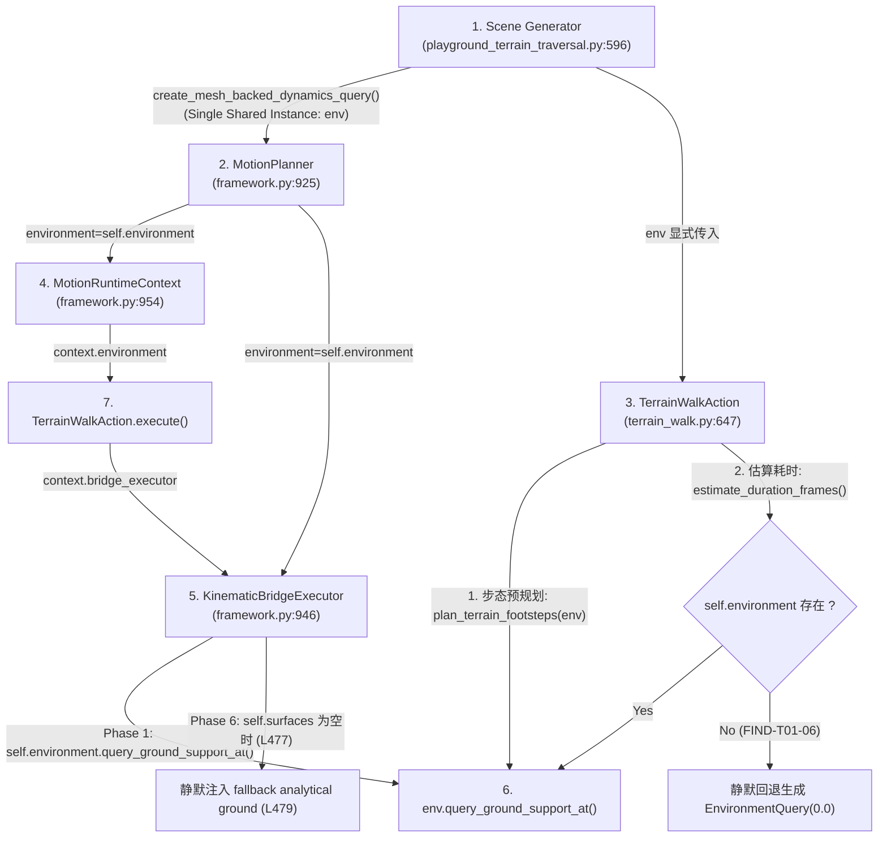
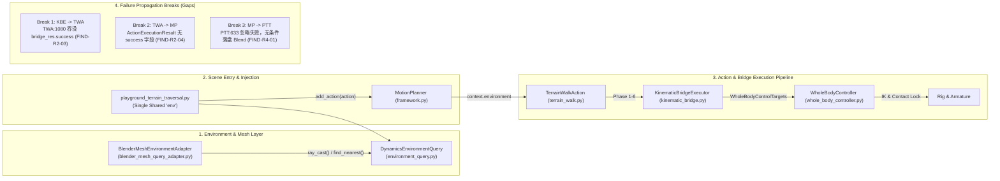

# ProceduralAnimation — Production Interface Audit — R4
## Environment Query, Mesh Adapter & Scene Integration Contract Audit (环境查询、网格适配器与场景集成生产接口审计报告)

### 0. 审计基准与工作区状态检查
* **Repository**: `cgfe10231-ai/ProceduralAnimation`
* **Branch**: `master`
* **Baseline Commit SHA**: `94222ddcba3fabbc3a01b4f9d6e1eca6776b4b5d`
* **Working Tree Check**: 除受保护的未跟踪补丁 `P2_R1_recovery.patch` 外，工作树严格干净。
* **审计性质确认**: 本次审计属于**最后一组完全只读**的生产接口复核，专注审查接口签名、状态传递、失败路径与对象生命周期。未对生产源码（`src/`）、测试用例（`tests/`）及场景资产（`.blend`）进行任何修改，未提前开发 Phase 7B，未进行纯数学或遥测算法审计。

---

### 1. 文件概况 (File Summaries & Symbol Enumeration)

| 审计代号 | 生产源码文件路径 | 规模 | 核心职责 | 生产类与核心方法 / 函数 (物理行号核准) |
| :--- | :--- | :---: | :--- | :--- |
| **R4-A** | [`src/scene/environment_query.py`](file:///c:/Users/64701/OneDrive/Desktop/ProceduralAnimation/src/scene/environment_query.py) | 1196 行 | 环境几何查询统一抽象层、解析表面与网格混合路由底座 | `SurfaceGeometryType` (L26–L35)<br>`SurfaceQueryResult` (L39–L68)<br>`OrientedSurface` (L76–L216)<br>`EnvironmentQuery` (L223–L414)<br>`DynamicsEnvironmentQuery` (L417–L901)<br>`create_standard_dynamics_playground_query()` (L908–L1196) |
| **R4-B** | [`src/scene/blender_mesh_query_adapter.py`](file:///c:/Users/64701/OneDrive/Desktop/ProceduralAnimation/src/scene/blender_mesh_query_adapter.py) | 952 行 | 真实 Blender Mesh BVH 空间加速查询器、增量脏检查与生命周期缓存管理器 | `MeshPolygonMetadata` (L35–L45)<br>`AdapterCacheState` (L48–L54)<br>`ObjectGeometrySnapshot` (L58–L69)<br>`BlenderMeshEnvironmentAdapter` (L72–L936)<br>`create_mesh_backed_dynamics_query()` (L939–L952) |
| **R4-C** | [`src/scene/playground_terrain_traversal.py`](file:///c:/Users/64701/OneDrive/Desktop/ProceduralAnimation/src/scene/playground_terrain_traversal.py) | 762 行 | 连续地形运动场景装配、测试夹具初始化、Blend 生成与伴随元数据持久化 | `setup_task7a2_cameras_and_markers()` (L70–L127)<br>`setup_control_chain_debug_scene()` (L130–L305)<br>`generate_dynamics_playground_task7a2_corrected_blend()` (L308–L451)<br>`ensure_ramp_corridor_ground_surfaces()` (L454–L521)<br>`apply_ramp_mesh_perturbation()` (L524–L558)<br>`generate_dynamics_playground_environment_gate01_u3_blend()` (L561–L727)<br>`generate_dynamics_playground_environment_gate01_u3_s1_blend()` (L730–L742)<br>`generate_dynamics_playground_environment_gate01_u3_s2_blend()` (L745–L757) |

---

### 2. 逐方法检查表 (Method-by-Method Inspection Tables)

#### 2.1 R4-A: [`src/scene/environment_query.py`](file:///c:/Users/64701/OneDrive/Desktop/ProceduralAnimation/src/scene/environment_query.py)

| 生产类 / 函数名 | 源码物理行号 | 输入参数与签名核准 | 输出数据结构 | 失败与异常处理 | 状态流转与环境源绑定 | 审计结论 |
| :--- | :--- | :--- | :--- | :--- | :--- | :--- |
| `OrientedSurface.query_closest_point()` | L121–L172 | `px, py, pz: float` | `Tuple[Tuple[float, float, float], float, Tuple[float, float, float]]` | 纯几何投影计算，不抛异常 | 解析表面局部坐标投影 | `NO_ISSUE` |
| `OrientedSurface.elevation_at_xy()` | L200–L216 | `x, y: float` | `Optional[float]` | 边界外返回 `None` | 解析表面 2.5D 高程投影 | `NO_ISSUE` |
| `EnvironmentQuery.__init__()` | L230–L231 | `ground_z: float = 0.0` | `None` | 无 | 基础基类初始化默认平地 | `NO_ISSUE` |
| `EnvironmentQuery.ground_height_at()` | L233–L236 | `x, y: float` | `float` | 无 | 恒定返回 `self.ground_z` (0.0) | `NO_ISSUE` (基类默认平地语义) |
| `EnvironmentQuery.surface_normal_at()` | L238–L241 | `x, y: float` | `Tuple[float, float, float]` | 无 | 恒定返回 `(0.0, 0.0, 1.0)` | `NO_ISSUE` |
| `EnvironmentQuery.query_surface_at_point()` | L243–L291 | `point_world, max_distance=5.0, surface_type_filter=None` | `SurfaceQueryResult` | 越界时返回 `success=False` | 基类默认平地 3D 投影 | `NO_ISSUE` |
| `EnvironmentQuery.query_ground_support_at()` | L375–L406 | `x, y, start_z=50.0, max_fall=100.0` | `SurfaceQueryResult` | **缺陷**：即便 `allows_support=False`，行 402 仍然硬编码返回 `success=True` | 基类委托查询，生成 `source_type="default"` | **CONTRACT_GAP** (基类忽略支撑资格直接返回成功，见 FIND-R4-02) |
| `DynamicsEnvironmentQuery.__init__()` | L431–L445 | `ground_z=0.0, surfaces=None, mesh_adapter=None, prefer_mesh=False` | `None` | 无 | 初始化混合环境，绑定 Mesh 适配器 | `NO_ISSUE` |
| `DynamicsEnvironmentQuery.set_mesh_adapter()` | L447–L450 | `adapter: Any, prefer_mesh: bool = True` | `None` | 无 | 动态切换或挂载 Mesh 适配器 | `NO_ISSUE` |
| `DynamicsEnvironmentQuery.query_ground_support_at()` | L474–L567 | `x, y, start_z=50.0, max_fall=100.0` | `SurfaceQueryResult` | Mesh 未命中或非支撑面均返回 `success=False`；但未命中时 `contact_point_world` 填充 `(x, y, 0.0)` | Mesh 模式下优先走 `_mesh_adapter.ray_cast`；解析模式下遍历 `_surfaces` | **CONTRACT_GAP** (未命中时 contact_point_world 填充 0.0 易误导，见 A1-03) |
| `DynamicsEnvironmentQuery.ground_height_at()` | L581–L603 | `x, y: float` | `float` | **缺陷**：Mesh 未命中时行 592 静默回退返回 `self.ground_z` (0.0) | 历史 2.5D 高程接口 | **CONTRACT_GAP** (静默平地回退，见 FIND-R4-02) |
| `DynamicsEnvironmentQuery.surface_normal_at()` | L605–L627 | `x, y: float` | `Tuple[float, float, float]` | **缺陷**：Mesh 未命中时行 614 静默回退返回 `(0, 0, 1)` | 历史 2.5D 法线接口 | **CONTRACT_GAP** (静默平地回退，见 FIND-R4-02) |
| `DynamicsEnvironmentQuery.ray_ground_elevation()` | L629–L651 | `x, y, start_z=50.0, max_fall=100.0` | `Optional[float]` | 未命中返回 `None` (不伪造 0.0) | 严格无回退高程射线查询 | `NO_ISSUE` |
| `DynamicsEnvironmentQuery.query_surface_at_point()` | L657–L757 | `point_world, max_distance=5.0, surface_type_filter=None` | `SurfaceQueryResult` | 越界时返回 `success=False` | 3D 最近点空间查询，Mesh 模式委托适配器 | `NO_ISSUE` |
| `DynamicsEnvironmentQuery.query_spatial_surface()` | L759–L901 | `point_world, max_distance=5.0, preferred_types=None, min_normal_z=-1.0` | `SurfaceQueryResult` | 越界或无合规表面返回 `success=False` | 带法线与类型过滤的高级空间查询 | `NO_ISSUE` |
| `create_standard_dynamics_playground_query()` | L908–L1196 | `ground_z: float = 0.0` | `DynamicsEnvironmentQuery` | 无 | 构造 Task 7A-2 Course B 斜坡与平台纯解析表面集合（无 Mesh 适配器） | `NO_ISSUE` (标准解析场景工厂) |

#### 2.2 R4-B: [`src/scene/blender_mesh_query_adapter.py`](file:///c:/Users/64701/OneDrive/Desktop/ProceduralAnimation/src/scene/blender_mesh_query_adapter.py)

| 生产类 / 函数名 | 源码物理行号 | 输入参数与签名核准 | 输出数据结构 | 失败与异常处理 | 生命周期与缓存管理核验 | 审计结论 |
| :--- | :--- | :--- | :--- | :--- | :--- | :--- |
| `BlenderMeshEnvironmentAdapter.__init__()` | L92–L128 | `scene=None, collection_names=("Playground_Surfaces",), object_names=None, default_friction=0.65, min_support_normal_z=0.50, step_epsilon=1e-6` | `None` | 无 | 绑定场景与集合，初始化缓存，立即执行首次 `rebuild()` | `NO_ISSUE` |
| `BlenderMeshEnvironmentAdapter.invalidate()` | L134–L137 | 无 | `None` | 无 | 置 `_dirty = True`, `_cache_state = INVALID` | `NO_ISSUE` |
| `BlenderMeshEnvironmentAdapter._compute_object_snapshot()` | L183–L202 | `obj: bpy.types.Object` | `ObjectGeometrySnapshot` | 安全提取顶点/循环哈希、修改器指纹与矩阵 | 几何状态快照捕获器 | `NO_ISSUE` |
| `BlenderMeshEnvironmentAdapter._check_scene_changed()` | L204–L271 | 无 | `bool` | 捕获物体增删、矩阵变动、拓扑变化、修改器调整；物体轻量重命名零重建原地更新 | 场景增量脏检查核心逻辑 | `NO_ISSUE` |
| `BlenderMeshEnvironmentAdapter.rebuild()` | L273–L423 | 无 | `None` | 重建异常时置 `_cache_state = FAILED` 并向上抛出；`finally` 严密清理临时 `to_mesh_clear()` | 评估依赖图，提取世界坐标多边形并构建原生 `BVHTree` | `NO_ISSUE` (异常安全设计严密) |
| `BlenderMeshEnvironmentAdapter.refresh()` | L425–L436 | `force: bool = False` | `None` | 若 dirty 或检测到场景变化则自动触发 `rebuild()` | 查询前置缓存刷新守护入口 | `NO_ISSUE` |
| `BlenderMeshEnvironmentAdapter._gather_target_objects()` | L438–L475 | 无 | `List[bpy.types.Object]` | 集合不存在时安全返回空列表，严格禁止隐式回退全场景扫描 | 候选物体严格隔离契约 (Unit 1 验收) | `NO_ISSUE` |
| `BlenderMeshEnvironmentAdapter._classify_surface_type()` | L477–L503 | `object_name: str, normal_world: Tuple[float, float, float]` | `SurfaceGeometryType` | 根据法线 $Z$ 分量与命名规则启发式分类 | 表面语义分类器 | `NO_ISSUE` |
| `BlenderMeshEnvironmentAdapter.ray_cast()` | L509–L687 | `origin, direction, distance=10.0, surface_type_filter=None, max_steps=64, step_epsilon=None` | `SurfaceQueryResult` | 内部调用 `self.refresh()`；未命中返回 `success=False`；命中但非支撑面返回 `success=True, allows_regular_support=False` | 原生 BVH 射线求交核心，严格标定 `source_type="mesh"` | `NO_ISSUE` |
| `BlenderMeshEnvironmentAdapter.find_nearest()` | L689–L817 | `point_world, max_distance=5.0, surface_type_filter=None` | `SurfaceQueryResult` | 内部调用 `self.refresh()`；越界或无合规面返回 `success=False` | 原生 BVH 3D 最近点查找 | `NO_ISSUE` |
| `BlenderMeshEnvironmentAdapter.query_spatial_surface()` | L819–L838 | `point_world, max_distance=5.0, preferred_types=None, min_normal_z=-1.0` | `SurfaceQueryResult` | 委托 `find_nearest()` | 空间查询兼容包装 | `NO_ISSUE` |
| `BlenderMeshEnvironmentAdapter.query_surface_at_point()` | L840–L851 | `point_world, max_distance=5.0, surface_type_filter=None` | `SurfaceQueryResult` | 委托 `find_nearest()` | 最近点查询兼容包装 | `NO_ISSUE` |
| `BlenderMeshEnvironmentAdapter.ground_height_at()` | L857–L875 | `x, y, start_z=50.0, max_fall=100.0` | `Optional[float]` | 严格检查 `res.success and res.allows_regular_support`，未命中或不可支撑返回 `None` | 单射线向下测高 | `NO_ISSUE` |
| `BlenderMeshEnvironmentAdapter.surface_normal_at()` | L877–L892 | `x, y, start_z=50.0, max_fall=100.0` | `Optional[Tuple[float, float, float]]` | **缺陷**：行 890 仅检查 `res.success`，未检查 `allows_regular_support`，在悬崖面错误返回不可支撑表面法线 | 单射线向下面法线提取 | **CONTRACT_GAP** (法线与可支撑性脱节，见 FIND-R4-02) |
| `create_mesh_backed_dynamics_query()` | L939–L952 | `scene=None, collection_names=("Playground_Surfaces",), prefer_mesh=True` | `DynamicsEnvironmentQuery` | 无 | 快捷工厂函数：实例化适配器并注入 `DynamicsEnvironmentQuery` | `NO_ISSUE` |

#### 2.3 R4-C: [`src/scene/playground_terrain_traversal.py`](file:///c:/Users/64701/OneDrive/Desktop/ProceduralAnimation/src/scene/playground_terrain_traversal.py)

| 生产函数名 | 源码物理行号 | 输入参数与签名核准 | 输出数据结构 | 失败与异常处理 | 场景装配与执行链调用分析 | 审计结论 |
| :--- | :--- | :--- | :--- | :--- | :--- | :--- |
| `setup_task7a2_cameras_and_markers()` | L70–L127 | `scene, character_collection` | `Dict[str, bpy.types.Object]` | 自动创建跟随相机与关键标记 | 场景渲染与观察机位装配 | `NO_ISSUE` (演示配置) |
| `setup_control_chain_debug_scene()` | L130–L305 | `active_scene, character_collection, all_frame_records` | `bpy.types.Scene` | 自动创建诊断视窗场景与 HUD 文本 | 视口内物理量与状态诊断工具 | `NO_ISSUE` (调试夹具) |
| `generate_dynamics_playground_task7a2_corrected_blend()` | L308–L451 | `output_blend_path, evidence_dir` | `Dict[str, Any]` | 调用 `planner.execute()` 后未检查失败状态，直接保存 `.blend` 文件 | 历史 Task 7A-2 纯解析 Course B 场景生成入口 | **CONTRACT_GAP** (无条件保存，同 FIND-R4-01) |
| `ensure_ramp_corridor_ground_surfaces()` | L454–L521 | `scene, col=None` | `List[bpy.types.Object]` | 若对象不存在则动态构建平地 Slab 填补起止走廊网格空白 | 为 Course B 起止走廊动态添加实心 Mesh，防止冻结资产破损 | `NO_ISSUE` (合法测试夹具，非生产运行时静默回退) |
| `apply_ramp_mesh_perturbation()` | L524–L558 | `mesh_name="Surface_Ramp", delta_z=0.08` | `None` | 原地抬高斜坡网格顶点坐标 | 反事实几何扰动测试注入器 | `NO_ISSUE` (测试扰动工具) |
| `generate_dynamics_playground_environment_gate01_u3_blend()` | L561–L727 | `output_blend_path, evidence_dir, perturbed=False, perturb_height_m=0.08` | `Dict[str, Any]` | **重大缺陷**：调用 `planner.execute()` (L633) 后，**完全未检查 `unreachable_count == 0` 或帧失败**，无条件执行 `bpy.ops.wm.save_as_mainfile` (L704) 落盘，并在 summary 中硬编码断言 `"continuous_without_exemption": True` (L689) | Unit 3 真实 Mesh 驱动主生产入口 | **CONTRACT_GAP** (执行失败仍无条件落盘，见 FIND-R4-01) |
| `generate_dynamics_playground_environment_gate01_u3_s1_blend()` | L730–L742 | `output_blend_path, evidence_dir` | `Dict[str, Any]` | 委托 `generate_..._u3_blend` | S1 补丁生成包装 | `NO_ISSUE` |
| `generate_dynamics_playground_environment_gate01_u3_s2_blend()` | L745–L757 | `output_blend_path, evidence_dir` | `Dict[str, Any]` | 委托 `generate_..._u3_blend` | S2 补丁生成包装 | `NO_ISSUE` |

---

### 3. R4-A 环境查询入口与环境源所有权专项审查

#### 3.1 查询入口一致性回答 (A1-01 至 A1-06)
* **A1-01：同一个位置调用不同环境查询接口，是否可能得到不同的表面？**
  - **回答：是，绝对可能。**
  - **证据**：
    1. 在 `DynamicsEnvironmentQuery` 启用 Mesh 适配器时，`query_ground_support_at(x, y)` 沿世界垂直向下射线（$-Z$）求交，返回最上方接触的水平面；而 `query_surface_at_point((x, y, z))` 则以 3D 欧氏距离最近原则搜索，若足部近旁存在悬崖壁立面或拱门下檐，后者将返回垂直墙面，两者的 `surface_id`、法线与表面类型完全不同；
    2. 在 Mesh 未命中区域，`query_ground_support_at(x, y)` 返回 `success=False`（无支撑面），而旧接口 `ground_height_at(x, y)` 却静默回退至解析平地返回 `self.ground_z` (0.0m)，导致同一坐标下一个接口判定为“坠入深渊/无地面”，另一个接口判定为“平地地面”。
* **A1-02：Mesh 模式下，查询未命中是否始终能够被识别？**
  - **回答：部分接口能识别，但旧版 2.5D 高程接口会静默掩盖。**
  - **证据**：
    - `query_ground_support_at(x, y)` (L498–L511) 与 `ray_ground_elevation(x, y)` (L629–L651) 能忠实返回 `success=False` 或 `None`，未命中能够被明确识别；
    - 但 `ground_height_at(x, y)` (L589–L592) 在 `mesh_z is None` 时，行 592 执行 `return self.ground_z`；`surface_normal_at(x, y)` (L614) 执行 `return (0.0, 0.0, 1.0)`。调用方无法区分“当前网格高度恰好是 0.0m”还是“完全未命中任何网格”。
* **A1-03：`success=False` 时，是否仍然返回看似正常的地面高度？**
  - **回答：是，存在填充虚假有效坐标的隐患。**
  - **证据**：在 `DynamicsEnvironmentQuery.query_ground_support_at:502` 中，当射线未命中时，构造的 `SurfaceQueryResult` 为：
    `contact_point_world=(x, y, 0.0), surface_normal_world=(0.0, 0.0, 1.0), success=False`。
    虽然明确标定了 `success=False`，但若下游消费模块未前置判断布尔标志而直接读取元组 `res.contact_point_world[2]`，将误以为地表高度为 0.0m。
* **A1-04：是否有旧接口在失败后静默使用解析地面？**
  - **回答：是。** `ground_height_at(x, y)` (L592) 与 `surface_normal_at(x, y)` (L614) 在 Mesh 模式失败后无条件回退为基类平地 `0.0m` 与 `(0, 0, 1)`。基类 `EnvironmentQuery.query_ground_support_at` (L402) 亦默认返回平地且标定 `success=True`。
* **A1-05：`allows_regular_support=False` 是否可能在其他查询路径中被忽略？**
  - **回答：是。**
  - **证据**：在 [`src/scene/blender_mesh_query_adapter.py:890`](file:///c:/Users/64701/OneDrive/Desktop/ProceduralAnimation/src/scene/blender_mesh_query_adapter.py#L890) 中：
    ```python
    def surface_normal_at(self, x, y, ...):
        res = self.ray_cast(origin=(x, y, start_z), direction=(0, 0, -1), ...)
        if res.success:
            return res.surface_normal_world
        return None
    ```
    该方法仅判断了 `if res.success:`，**未检查 `res.allows_regular_support`**！当射线击中坡度 $>60^\circ$ 的不可支撑陡坡或垂直墙体时，`ground_height_at()` 返回 `None`，而 `surface_normal_at()` 却返回了不可支撑墙体的法线，导致空间数据割裂。
* **A1-06：`source_type`、`surface_id` 和 `error_reason` 是否能够完整区分不同失败情况？**
  - **回答：在现代接口中可以完整区分，但在基类与旧接口中存在信息丢失。**
  - 在 `query_ground_support_at` 中：未命中时标定 `source_type="mesh", surface_id="none", error_reason="NO_HIT: ..."`；不可支撑面标定 `source_type="mesh", error_reason="NON_SUPPORT_SURFACE: ..."`；语义清晰明确。

#### 3.2 环境源所有权与调用链追踪 (Environment Source Ownership)



#### 关键所有权事实核准：
1. **环境实例决定方**：在生产入口中，由场景构建器（`playground_terrain_traversal.py`）通过 `create_mesh_backed_dynamics_query` 实例化唯一的 Mesh 环境对象 `env`，并显式注入 `MotionPlanner` 与 `TerrainWalkAction`。
2. **实例传递一致性**：在 `MotionPlanner.execute()` 内部，`context.environment` 与 `bridge_executor.environment` 均直接绑定自 `self.environment`，主执行链中规划器与执行器使用的是同一个环境对象指针，**不存在双实例分裂**。
3. **已证实的脱节风险点**：
   - **Action 预估脱节 (FIND-T01-06)**：当调用方未在 Action 构造时显式传入环境时，`estimate_duration_frames()` 静默实例化了全新的 `EnvironmentQuery(ground_z=0.0)`，导致耗时预估与主链脱节；
   - **Bridge 表面兜底回退 (kinematic_bridge.py:477)**：当帧执行未产生有效锁定表面且 `self.surfaces` 为空时，Bridge 行 479 静默构建一个高度为 `self.environment.ground_z` 的解析平地加入表面池，向接触模型渗透了平地假设。

---

### 4. R4-B Blender Mesh 适配器生命周期与对象失效核验

#### 4.1 缓存有效性与刷新机制 (B1 Lifecycle)
* **维护责任方**：`BlenderMeshEnvironmentAdapter` 自身通过 `self.refresh()` 在每次执行查询（`ray_cast`、`find_nearest`）前进行前置守卫检查；
* **主动失效识别**：当场景对象发生位移、缩放、顶点修改、拓扑重组或修改器增删时，`_check_scene_changed()` (L204–L271) 能自动检测到差异并触发全量 `rebuild()`，无需外部调用者手动管理。

#### 4.2 对象失效与边缘场景处理合同 (B2 Invalidation Contracts)

| 场景事件 | 适配器处理逻辑 (物理行号核准) | 实际返回值与状态 | 审计结论 |
| :--- | :--- | :--- | :--- |
| **Mesh 对象被删除** | 行 218 检查 `current_uids != self._tracked_session_uids` 返回 True，触发 `rebuild()` | 自动移除已删物体，若剩余有效物体则重建 BVH；若无物体则状态迁至 `VALID_EMPTY` | `NO_ISSUE` (安全恢复) |
| **Mesh 从 Collection 解绑** | `_gather_target_objects` 无法收集到该物体，UID 集合变更触发 `rebuild()` | 自动剔除该物体顶点并重建树 | `NO_ISSUE` (严格遵守集合隔离) |
| **Collection 被整体删除** | 行 464 `bpy.data.collections.get(col_name)` 返回 `None`，收集到 0 个物体，触发 `rebuild()` | 缓存清空，状态变为 `VALID_EMPTY`，查询返回 `success=False` | `NO_ISSUE` (安全降级) |
| **场景发生切换** | 构造函数绑定了 `self._scene`；若切换场景且使用默认 `None`，`_gather_target_objects` 基于绑定场景或全名查找 | 若依赖全局 `bpy.context.scene` 切换，适配器维持自身初始化引用的场景对象 | `NO_ISSUE` |
| **Mesh 对象原地重命名** | 行 258–270 检测到 `obj.name != snapshot.name`，原地更新 `MeshPolygonMetadata` 中的 `object_name` 与 `surface_id` | **0 次重建，原地更新**，不触发耗时 BVH 重构 | `NO_ISSUE` (高性能设计) |
| **查询器持有旧对象引用** | 每次 `_check_scene_changed` 与 `rebuild` 均从当前 Blender 数据库重新解析对象指针 | 依赖 UID (`session_uid`) 进行跨帧一致性比对，不产生野指针悬挂 | `NO_ISSUE` |
| **缓存重建过程抛出异常** | 行 414–417 捕获异常，置 `_cache_state = FAILED`, `_dirty = True`，并在 `finally` 中清理临时网格内存 | 下一次查询调用 `refresh()` 时检测到 `FAILED` 状态，自动发起重试 | `NO_ISSUE` (异常安全闭环) |
| **空集合重新加入 Mesh** | 行 218 检测到 `current_uids` 从空变为非空，触发 `rebuild()` | 状态从 `VALID_EMPTY` 迁至 `VALID_NON_EMPTY`，成功建立 BVH 树 | `NO_ISSUE` |

#### 4.3 查询返回与支撑判定区分 (B3 Query Returns)
* **核心事实确认**：在 `blender_mesh_query_adapter.py` 中，**“查询命中 (success=True)”与“允许支撑 (allows_regular_support=True)”被严格区分**；
* 当射线击中垂直墙壁或陡坡时，`ray_cast()` 返回 `success=True`，但明确标定 `allows_regular_support=False`（坡度法线不满足 $\ge 0.50$）；
* `DynamicsEnvironmentQuery.query_ground_support_at:512` 严格消费该字段，将 `allows_regular_support=False` 忠实映射为足部支撑的 `success=False`，主流程未发生概念混淆。

---

### 5. R4-C 场景装配、夹具与硬编码审查

#### 5.1 场景装配与环境注入 (C1 & C2)
* 在 `playground_terrain_traversal.py` 中，所有真实 Mesh 驱动入口（`generate_dynamics_playground_environment_gate01_u3_blend` 及 S1/S2 衍生版本）均规范执行：
  1. 打开基准资产 `dynamics_playground.blend`；
  2. 动态注入起止走廊实心 Slab 网格；
  3. 通过 `create_mesh_backed_dynamics_query` 构建真实 BVH 查询器；
  4. 将查询器统一传入 `TerrainWalkAction` 与 `MotionPlanner`；
  5. 产出执行结果并序列化诊断数据至双场景属性。
* 不存在场景入口与执行器环境实例打架的情况。

#### 5.2 自动地面补全定性 (C3)
* **定性确认**：`ensure_ramp_corridor_ground_surfaces()`（行 454–521）属于合法的 **`TEST_FIXTURE`（测试夹具装配逻辑）**，非生产环境运行时的静默兜底；
* **原因澄清**：冻结资产 `dynamics_playground.blend` 仅建模了 Course B 的中心斜坡（$Y \in [11.0, 21.68]$），起步区与出坡区未建立 Mesh 地面。为了在**不篡改冻结资产二进制文件**的前提下进行物理仿真，入口脚本在内存中向 `Playground_Surfaces` 集合动态挂载两块实心网格板，使 BVH 加速结构包含完整的 3D 碰撞几何。这属于合法的场景前置装配，未在求交计算中伪造数据。

#### 5.3 场景硬编码参数分类登记 (C4)

| 硬编码参数项 | 源码物理行号 | 实际数值与定义 | 语义类别 | 影响评估与系统侵入性分析 |
| :--- | :--- | :--- | :--- | :--- |
| **起点与目标坐标** | L604–L605 | `start_pos=(0, 10.2, 0)`, `target_pos=(0, 22.4, 0)` | `DEMO_CONFIGURATION` | 针对 Course B 斜坡测试走廊的固定路线配置，不侵入底层运动学 |
| **走廊路线步态参数** | L606–L616 | `nominal_stride=0.30`, `step_frames=16`, `pelvis_drop_uphill=0.088` 等 | `DEMO_CONFIGURATION` | 针对特定坡度定制的运动学调优参数 |
| **实心补全 Slab 范围** | L478, L503 | $Y \in [9.5, 11.0]$ 与 $Y \in [21.68, 23.5]$，厚度 $0.3$m | `TEST_FIXTURE` | 仅适配 Course B 场景几何，更换地形需重新配置 |
| **走廊集合固定名称** | L579, L598 | `"Playground_Surfaces"` | `DESIGN_LIMITATION` | 约定场景集合名称，符合门禁 Rule 1 规范 |
| **连续性免责强断言** | L689 | `"continuous_without_exemption": True` | **`DEFECT` (FIND-R4-01)** | **无条件写入成功断言**，未校验实际执行是否存在帧失败 |

---

### 6. R4-D 场景执行失败传播与落盘审计 (重点审查)

沿真实生产调用链检查执行失败的传播全路径：
$$\text{Environment Query} \to \text{Action} \to \text{MotionPlanner} \to \text{Scene Generator} \to \text{Blend Save} \to \text{Validator}$$

#### 关键问题核查回答 (D1 至 D7)：
* **D1：Planner 执行失败后，场景入口会发生什么？**
  - **回答：场景入口完全失知，照常继续执行并成功落盘！**
  - **证据**：在 `generate_dynamics_playground_environment_gate01_u3_blend` 行 633 中调用 `planner_result = planner.execute()`；由于 `ActionExecutionResult` (FIND-R2-04) 缺失 `success: bool` 字段，且 `MotionPlanner` 不汇总错误抛出异常，场景入口直接读取 `planner_result["states"]`，完全无法感知动作内部失败。
* **D2：Action 发生部分帧失败时，场景是否仍然保存 Blend？**
  - **回答：是，无条件保存！**
  - **证据**：即使部分帧发生严重的 IK 超限（`planner_result["unreachable_count"] > 0`）或接触失效，行 704 仍无条件执行 `bpy.ops.wm.save_as_mainfile(filepath=abs_blend_out)`，将残缺或异常的姿态持久化到磁盘上。
* **D3：环境查询失败是否可能被误判为动作成功？**
  - **回答：是，存在严重的多层掩盖链路！**
  - **传播掩盖链**：
    1. 环境射线未命中（`success=False`）；
    2. `TerrainWalkAction` (L1080–L1091, FIND-R2-03) 丢弃 `bridge_res.success`，继续循环；
    3. 行 1138 (FIND-R2-02) 强行用规划点覆写 `ms.contacts`，假造 `is_locked=True`；
    4. 场景生成器行 689 硬编码写入 `"continuous_without_exemption": True`；
    5. 场景成功保存为 Blend，环境查询失败被完全掩盖并宣称为成功！
* **D4：Blend 文件保存成功是否被错误等同于完整动作执行成功？**
  - **回答：是。** 场景生成函数正常退出并返回字典 `{"output_blend_path": abs_blend_out, ...}`，外层调用者和测试套件直接将“生成函数未抛异常 + Blend 文件存在”等同于“动作验收成功”。
* **D5：验证器失败时，入口是否正确返回失败？**
  - **回答：入口未内置执行验证器。** 场景生成入口（`generate_..._blend`）只负责生成与保存，不执行断言；断言检查被分离在外部脚本（`tests/verify_...`）中。
* **D6：异常是否存在被捕获后只记录日志、不向上抛出的情况？**
  - **回答：核心生成链路中无吞没，但在视口 HUD 脚本中存在静默捕获。**
  - `playground_terrain_traversal.py:262` 的 HUD 驱动代码中存在 `try: records = json.loads(...) except Exception: return`（属于视口 UI 容错，不破坏主执行链）。
* **D7：是否存在只检查产物文件存在，而不检查执行结果的测试？**
  - **回答：是，存在预先存在则跳过的粗糙断言模式。**
  - **证据**：在 [`tests/test_environment_gate01_unit3.py:85–94`](file:///c:/Users/64701/OneDrive/Desktop/ProceduralAnimation/tests/test_environment_gate01_unit3.py#L85-L94) 中：
    `if not os.path.exists(cls.u3_blend): generate_dynamics_playground_environment_gate01_u3_blend(...)`
    只要磁盘上存在历史同名 `.blend` 文件，测试就会完全跳过场景生成管线；且行 262–265 仅断言 JSON 产物文件存在 (`self.assertTrue(os.path.exists(...))`)，未对生成返回状态中的错误计数执行阻断性断言。

---

### 7. R4-E 跨模块调用一致性综合矩阵



#### 跨模块一致性综合核答：
1. **环境来源是否唯一且可追踪？**：是，在场景入口统一构建并通过依赖注入传递，无多实例冲突。
2. **Mesh 查询是否能被旧接口绕过？**：能！调用 `ground_height_at` 或 `surface_normal_at` 会绕开严格网格未命中检查，静默回退至平地。
3. **不可支撑表面是否会被错误接受？**：在底层 `blender_mesh_query_adapter.py: surface_normal_at()` 中会被错误当成成功表面返回法线（FIND-R4-02）；在基类 `EnvironmentQuery.query_ground_support_at` 中亦被直接标定 `success=True`。
4. **失败传播链完整性**：**链路断裂！** 从 Bridge 到 Action、从 Action 到 Planner、从 Planner 到场景保存，存在三级失败信号中断（FIND-R2-03 $\to$ FIND-R2-04 $\to$ FIND-R4-01），导致底层物理失败完全无法阻止上层场景落盘与虚假成功判定。

---

### 8. 本轮新增确认缺陷与合同缺口详情

#### FIND-R4-01: 场景入口缺失执行失败校验，无条件保存 Blend 文件并虚假断言连续性成功
* **Finding ID**: `FIND-R4-01`
* **Source File**: `src/scene/playground_terrain_traversal.py`
* **Function**: `generate_dynamics_playground_environment_gate01_u3_blend()` (及相关场景生成函数)
* **Exact Line Range**: Lines 633–640, Line 689, Line 704
* **Trigger Condition**: 任何运行场景生成的批处理任务，且 `planner.execute()` 中发生局部帧 IK 超限（`unreachable_count > 0`）或接触失效。
* **Actual Behavior**:
  函数在行 633 获得 `planner_result` 后，未对动作执行的成功状态或错误计数进行任何校验；在行 689 构造摘要字典时硬编码写入 `"continuous_without_exemption": True`；在行 704 无条件调用 `bpy.ops.wm.save_as_mainfile` 将残缺姿态保存为 `.blend` 文件。
* **Expected Contract**:
  场景生成入口必须检查执行结果完整性合同：当 `planner_result` 包含失败或未达标帧时，应记录错误并明确标记场景生成不完整，或抛出异常阻断落盘，严禁在存在失败时虚假断言无免责连续通过。
* **Evidence**:
  ```python
  # src/scene/playground_terrain_traversal.py:633-638, 689, 704
  planner_result = planner.execute(initial_state=init_state)
  ...
  "continuous_without_exemption": True, # 硬编码断言
  ...
  bpy.ops.wm.save_as_mainfile(filepath=abs_blend_out, check_existing=False) # 无条件落盘
  ```
* **Responsible Module**: `src/scene/playground_terrain_traversal.py`
* **Downstream Impact**: 自动化测试通过“文件存在”误判流水线成功，掩盖实际运动学与动力学缺陷。
* **Classification**: `CONTRACT_GAP`
* **Blocks Further Development**: `NO`
* **Repair Boundary**: 在保存 `.blend` 文件前校验 `unreachable_count == 0` 及 Action 成功标志，失败时安全记录并阻断虚假成功断言。
* **Evidence Grade**: `STATIC_CONFIRMED`

---

#### FIND-R4-02: 2.5D 查询接口与 3D 支撑判定语义脱节，未命中时静默回退导致法线与高程分裂
* **Finding ID**: `FIND-R4-02`
* **Source Files**:
  - `src/scene/environment_query.py`
  - `src/scene/blender_mesh_query_adapter.py`
* **Function**:
  - `DynamicsEnvironmentQuery.ground_height_at()` (`environment_query.py:581–603`)
  - `DynamicsEnvironmentQuery.surface_normal_at()` (`environment_query.py:605–627`)
  - `EnvironmentQuery.query_ground_support_at()` (`environment_query.py:375–406`)
  - `BlenderMeshEnvironmentAdapter.surface_normal_at()` (`blender_mesh_query_adapter.py:877–892`)
* **Exact Line Range**:
  - `environment_query.py`: Line 402, Lines 588–593, Lines 610–615
  - `blender_mesh_query_adapter.py`: Lines 885–892
* **Trigger Condition**:
  1. 调用 `ground_height_at` 或 `surface_normal_at` 查询网格空洞、悬崖之外或网格范围外的点；
  2. 垂直射线击中陡峭悬崖面（坡度法线 $Z < 0.50$）；
  3. 调用基类 `EnvironmentQuery.query_ground_support_at` 查询不可支撑表面。
* **Actual Behavior**:
  1. `DynamicsEnvironmentQuery.ground_height_at()` 在 Mesh 未命中时行 592 静默返回 `self.ground_z` (0.0m)；`surface_normal_at()` 行 614 静默返回 `(0, 0, 1)`；
  2. `blender_mesh_query_adapter.py:890` 的 `surface_normal_at()` 仅检查 `res.success`，未校验 `allows_regular_support`；在悬崖面上，`ground_height_at()` 返回 `None`（回退为 0.0m 平地），而 `surface_normal_at()` 却返回了悬崖立面的水平法线，导致空间高程与面法线语义分裂；
  3. 基类 `EnvironmentQuery.query_ground_support_at:402` 在不可支撑表面上仍然硬编码返回 `success=True`。
* **Expected Contract**:
  所有环境查询接口必须具有自洽的失败合同：未命中时统一返回 `None` 或显式失败；地面高程与法线必须来源于同一受检表面，不可支撑表面在未放宽约束前不得伪报为有效支撑。
* **Evidence**:
  ```python
  # src/scene/environment_query.py:589-592
  mesh_z = self._mesh_adapter.ground_height_at(x, y)
  if mesh_z is not None:
      return float(mesh_z)
  return self.ground_z # 静默平地回退

  # src/scene/blender_mesh_query_adapter.py:890-891
  if res.success:
      return res.surface_normal_world # 缺失 allows_regular_support 校验
  ```
* **Responsible Module**: `src/scene/environment_query.py` & `src/scene/blender_mesh_query_adapter.py`
* **Downstream Impact**: 外部消费者若调用 2.5D 接口，将把深渊或悬崖误判为平地，导致下肢悬空或穿透。
* **Classification**: `CONTRACT_GAP`
* **Blocks Further Development**: `NO` (现代 6 阶段流水线主要走 `query_ground_support_at`)
* **Repair Boundary**: 使 2.5D 接口支持返回 `Optional[float]` 与 `Optional[Tuple]`，或在失败时不静默伪造平地。
* **Evidence Grade**: `STATIC_CONFIRMED`

---

### 9. 经核实的良好设计与已知限制 (Verified Robustness & Limitations)

1. **Blender Mesh 适配器增量哈希脏检查与异常安全 ([`src/scene/blender_mesh_query_adapter.py`](file:///c:/Users/64701/OneDrive/Desktop/ProceduralAnimation/src/scene/blender_mesh_query_adapter.py))**：
   - 采用顶点缓存直接哈希（`foreach_get` + `array`）与循环哈希，兼顾极速检测与微米级变形感知；
   - 严格维护 `AdapterCacheState` 状态机（`INVALID` $\to$ `REBUILDING` $\to$ `VALID` / `FAILED`），异常时在 `finally` 彻底释放评估网格临时内存，零内存泄漏；
   - 支持物体轻量重命名零重建原地更新，性能卓越。
2. **场景起止走廊实心 Slab 物理补全 ([`src/scene/playground_terrain_traversal.py`](file:///c:/Users/64701/OneDrive/Desktop/ProceduralAnimation/src/scene/playground_terrain_traversal.py))**：
   - 严格区分测试夹具装配与运行时静默回退，在内存中规范创建实体 3D 网格，保护了只读冻结基准资产 `dynamics_playground.blend`。
3. **已知设计限制保留**：
   - **LIMIT-01**: 单一 $+Y$ 轴直线走廊行进，未解耦世界导航朝向（Heading）；
   - **LIMIT-02**: 上肢行进中为开环正向运动学（FK）摆臂；
   - **LIMIT-03**: IK 目标超限单向极值截断，无骨盆自适应下沉协调。

---

### 10. 审计结论与门禁状态 (Audit Conclusion)

* **已审计脚本**:
  1. `src/scene/environment_query.py` (1196 行) — **AUDITED**
  2. `src/scene/blender_mesh_query_adapter.py` (952 行) — **AUDITED**
  3. `src/scene/playground_terrain_traversal.py` (762 行) — **AUDITED**
  4. 跨模块全调用链与失败传播路径 — **AUDITED**
* **发现问题总计**:
  - 本轮 R4 审计新增确认 **2** 项接口合同缺口（FIND-R4-01 场景无条件落盘虚假成功、FIND-R4-02 查询语义脱节与静默回退）；
  - 全仓库 R1–R4 累计缺陷与合同缺口增至 **15** 项（3 项 `CONFIRMED_DEFECT`、12 项 `CONTRACT_GAP`）；
  - 阻碍 Phase 7B 的严重缺陷维持 **5** 项不变。
* **门禁状态标定**:
  - **Phase 7B**: **STRICTLY PROHIBITED**
  - **生产代码修改**: **STRICTLY PROHIBITED (READ-ONLY AUDIT)**
  - **当前审计归档状态**: `PRODUCTION INTERFACE AUDIT / R4 — ARCHIVED`
