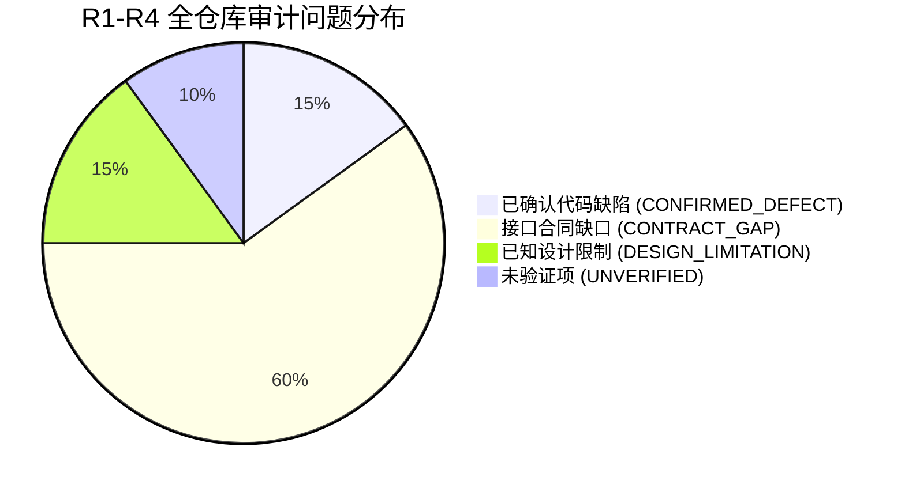
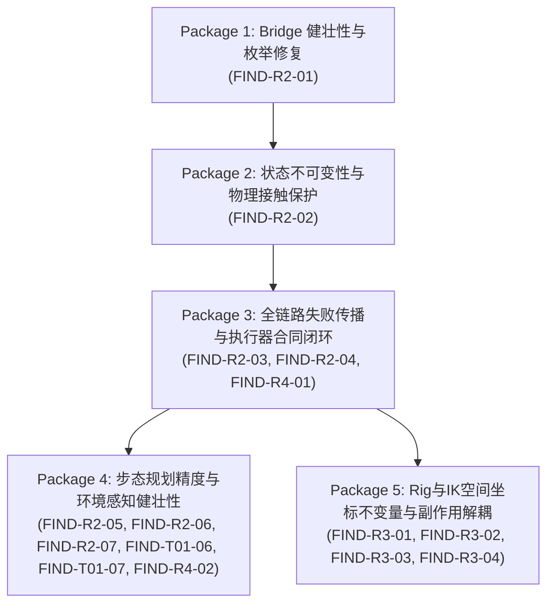

# ProceduralAnimation — 生产接口审计 (R1–R4) 集中修复分组方案
## Remediation Grouping & Regression Testing Roadmap (集中修复维护包与回归测试规划)

> **当前阶段**：Production Interface Audit — Total Reconciliation & Closure (R1–R4 CLOSE)  
> **基准 Commit**：`94222ddcba3fabbc3a01b4f9d6e1eca6776b4b5d`  
> **门禁约束**：本方案仅作修复方案规划与依赖拓扑设计，**严禁在未获用户书面授权前修改任何生产代码**。Phase 7B 仍然严格禁止。

---

### 一、R1–R4 审计问题总盘点 (Deduplicated Master Inventory)

历经 R1（`terrain_walk.py` 单脚本审计）、R2（核心执行链四大脚本联合审计）、R3（底层绑定与 IK 执行合同审计）以及 R4（环境查询、网格适配器与场景集成审计），共查实 **15 项唯一生产接口问题**（包含 3 项已确认代码缺陷、12 项接口合同缺口），另登记 **3 项已知设计限制**与 **2 项未验证项**。

#### 完整问题对照与负责模块核准总表

| Finding ID | 对应历史代号 | 源码文件 | 类 / 函数 | 源码物理行号 (核准) | 影响类别 | 证据等级 | 阻碍 7B (BLOCKER) | 真实负责模块 |
| :--- | :--- | :--- | :--- | :--- | :--- | :---: | :---: | :--- |
| **FIND-R2-01** | - | [`src/motion/kinematic_bridge.py`](file:///c:/Users/64701/OneDrive/Desktop/ProceduralAnimation/src/motion/kinematic_bridge.py) | `KinematicBridgeExecutor.execute_frame()` | Line 512 | CONFIRMED_DEFECT | `STATIC_CONFIRMED` | **YES** | `kinematic_bridge.py` |
| **FIND-R2-02** | FIND-T01-02 | [`src/motion/terrain_walk.py`](file:///c:/Users/64701/OneDrive/Desktop/ProceduralAnimation/src/motion/terrain_walk.py) | `TerrainWalkAction.execute()` | Lines 1100–1138 | CONFIRMED_DEFECT | `STATIC_CONFIRMED` | **YES** | `terrain_walk.py` |
| **FIND-R2-03** | FIND-T01-01 | [`src/motion/terrain_walk.py`](file:///c:/Users/64701/OneDrive/Desktop/ProceduralAnimation/src/motion/terrain_walk.py) | `TerrainWalkAction.execute()` | Lines 1080–1091 | CONTRACT_GAP | `STATIC_CONFIRMED` | **YES** | `terrain_walk.py` |
| **FIND-R2-04** | FIND-T01-03 | [`src/motion/framework.py`](file:///c:/Users/64701/OneDrive/Desktop/ProceduralAnimation/src/motion/framework.py) | `ActionExecutionResult` / `MotionPlanner` | Lines 405–416 / 915–1010 | CONTRACT_GAP | `STATIC_CONFIRMED` | **YES** | `framework.py` |
| **FIND-R2-05** | - | [`src/motion/contact_model.py`](file:///c:/Users/64701/OneDrive/Desktop/ProceduralAnimation/src/motion/contact_model.py) | `ContactRecord` / `MultiContactState` | Lines 214–273 / 304–340 | CONTRACT_GAP | `STATIC_CONFIRMED` | NO | `contact_model.py` |
| **FIND-R2-06** | FIND-T01-05 | [`src/motion/terrain_walk.py`](file:///c:/Users/64701/OneDrive/Desktop/ProceduralAnimation/src/motion/terrain_walk.py) | `plan_terrain_footsteps` vs `build_step_schedule` | Lines 223–401 vs 404–520 | CONTRACT_GAP | `STATIC_CONFIRMED` | NO | `terrain_walk.py` |
| **FIND-R2-07** | FIND-T01-04 | [`src/motion/terrain_walk.py`](file:///c:/Users/64701/OneDrive/Desktop/ProceduralAnimation/src/motion/terrain_walk.py) | `plan_terrain_footsteps()` | Lines 310–312 | CONFIRMED_DEFECT | `STATIC_CONFIRMED` | NO | `terrain_walk.py` |
| **FIND-T01-06** | - | [`src/motion/terrain_walk.py`](file:///c:/Users/64701/OneDrive/Desktop/ProceduralAnimation/src/motion/terrain_walk.py) | `TerrainWalkAction.estimate_duration_frames()` | Lines 654–681 | CONTRACT_GAP | `STATIC_CONFIRMED` | NO | `terrain_walk.py` |
| **FIND-T01-07** | - | [`src/motion/terrain_walk.py`](file:///c:/Users/64701/OneDrive/Desktop/ProceduralAnimation/src/motion/terrain_walk.py) | `plan_terrain_footsteps()` | Lines 304–318 | CONTRACT_GAP | `STATIC_CONFIRMED` | NO | `terrain_walk.py` |
| **FIND-R3-01** | - | [`src/rig/foot_contact.py`](file:///c:/Users/64701/OneDrive/Desktop/ProceduralAnimation/src/rig/foot_contact.py) [`src/rig/ik.py`](file:///c:/Users/64701/OneDrive/Desktop/ProceduralAnimation/src/rig/ik.py) | `unlock_foot_contact()` / `setup_leg_ik()` `reset_leg_ik()` / `set_foot_ik_target()` | L152, 170–179 L127–134, 220–228, 380–384 | CONTRACT_GAP / ARCH_VIOLATION | `STATIC_CONFIRMED` | **YES** | `foot_contact.py` `ik.py` |
| **FIND-R3-02** | - | [`src/rig/ik.py`](file:///c:/Users/64701/OneDrive/Desktop/ProceduralAnimation/src/rig/ik.py) | `set_foot_ik_target()` | Lines 334–346 | CONTRACT_GAP | `STATIC_CONFIRMED` | NO | `ik.py` |
| **FIND-R3-03** | - | [`src/rig/foot_contact.py`](file:///c:/Users/64701/OneDrive/Desktop/ProceduralAnimation/src/rig/foot_contact.py) [`src/rig/ik.py`](file:///c:/Users/64701/OneDrive/Desktop/ProceduralAnimation/src/rig/ik.py) | `unlock_foot_contact()` / `reset_leg_ik()` | Lines 168–170 / 219 | CONTRACT_GAP | `STATIC_CONFIRMED` | NO | `foot_contact.py` `ik.py` |
| **FIND-R3-04** | - | [`src/rig/foot_contact.py`](file:///c:/Users/64701/OneDrive/Desktop/ProceduralAnimation/src/rig/foot_contact.py) | `evaluate_foot_support()` | Lines 207–235 | CONTRACT_GAP | `STATIC_CONFIRMED` | NO | `foot_contact.py` |
| **FIND-R4-01** | - | [`src/scene/playground_terrain_traversal.py`](file:///c:/Users/64701/OneDrive/Desktop/ProceduralAnimation/src/scene/playground_terrain_traversal.py) | `generate_..._u3_blend()` | Lines 633–640, 689, 704 | CONTRACT_GAP | `STATIC_CONFIRMED` | NO | `playground_terrain_traversal.py` |
| **FIND-R4-02** | - | [`src/scene/environment_query.py`](file:///c:/Users/64701/OneDrive/Desktop/ProceduralAnimation/src/scene/environment_query.py) [`src/scene/blender_mesh_query_adapter.py`](file:///c:/Users/64701/OneDrive/Desktop/ProceduralAnimation/src/scene/blender_mesh_query_adapter.py) | `DynamicsEnvironmentQuery` `BlenderMeshEnvironmentAdapter` | L402, 588–593, 610–615 Lines 885–892 | CONTRACT_GAP | `STATIC_CONFIRMED` | NO | `environment_query.py` `blender_mesh_query_adapter.py` |

---

### 二、按共同根因划分的 5 个原子维护包 (Atomic Maintenance Packages)

遵循单一职责、低耦合与依赖自下而上的架构原则，将上述 15 项问题归拢为 5 个具有严格拓扑依赖关系的原子维护包：

---

#### 1. 维护包 1: Bridge 执行器异常安全与枚举修复 (PKG-1: Bridge Robustness)
* **包含问题**: **FIND-R2-01** (引用不存在的 `ContactLifecycle.TOUCHDOWN` 导致手部接触致命崩溃)
* **前置依赖**: 无 (底座级修复)
* **涉及源码文件**:
  - [`src/motion/kinematic_bridge.py`](file:///c:/Users/64701/OneDrive/Desktop/ProceduralAnimation/src/motion/kinematic_bridge.py) (Line 512)
* **核心修复内容**:
  将 `kinematic_bridge.py:512` 中的非法枚举引用 `ContactLifecycle.TOUCHDOWN` 纠正为合法的 `ContactLifecycle.CANDIDATE`。
* **回归测试范围**:
  - `python tests/run_test_suite.py --tier quick`
  - `python tests/verify_task6gc_r3b1_bridge.py`
* **验收判定标准**:
  - 手部开启接触意图时主执行链平稳运行，零 `AttributeError` 崩溃。

---

#### 2. 维护包 2: 状态不可变性与物理接触记录保护 (PKG-2: State Integrity & Contact Protection)
* **包含问题**: **FIND-R2-02** (`terrain_walk.py:1138` 强制覆写 `ms.contacts` 抹杀真实物理 Point B 与上肢接触)
* **前置依赖**: **PKG-1**
* **涉及源码文件**:
  - [`src/motion/terrain_walk.py`](file:///c:/Users/64701/OneDrive/Desktop/ProceduralAnimation/src/motion/terrain_walk.py) (Lines 1100–1138)
* **核心修复内容**:
  移除 `terrain_walk.py:1138` 中对 `contacts=c_dict` 的恶意覆写，仅保留 `ms = ms.clone_with(mode=mode, params=ms_params)`；必须保留的步态相位元数据统一通过 `ms.params` 或接触记录扩展字段向下游传递，完整保护 Bridge Phase 6 注入的真实物理测量数据。
* **回归测试范围**:
  - `python tests/verify_environment_gate01_unit4.py`
  - `python tests/test_environment_gate01_unit3.py`
* **验收判定标准**:
  - `ms.contacts` 严格保留真实接触点 Point B 坐标与真实法线；手部接触记录在帧循环中完整传递。

---

#### 3. 维护包 3: 全链路失败传播与执行器合同闭环 (PKG-3: End-to-End Failure Propagation Contract)
* **包含问题**:
  - **FIND-R2-03** (`terrain_walk.py:1080–1091` 丢弃 `bridge_res.success` 吞没底层失败)
  - **FIND-R2-04** (`framework.py:405–416, 915–1010` `ActionExecutionResult` 与 `MotionPlanner` 缺失失败状态合同)
  - **FIND-R4-01** (`playground_terrain_traversal.py:633–704` 场景入口缺乏失败校验，无条件落盘 Blend 并虚假断言成功)
* **前置依赖**: **PKG-2**
* **涉及源码文件**:
  - [`src/motion/framework.py`](file:///c:/Users/64701/OneDrive/Desktop/ProceduralAnimation/src/motion/framework.py)
  - [`src/motion/terrain_walk.py`](file:///c:/Users/64701/OneDrive/Desktop/ProceduralAnimation/src/motion/terrain_walk.py)
  - [`src/scene/playground_terrain_traversal.py`](file:///c:/Users/64701/OneDrive/Desktop/ProceduralAnimation/src/scene/playground_terrain_traversal.py)
* **核心修复内容**:
  1. 在 `ActionExecutionResult` 数据结构中增加 `success: bool` 与 `unmet_constraints: List[Any]` 字段；
  2. 在 `TerrainWalkAction.execute()` 中监听 `bridge_res.success` 与 unmet constraints，并在底层失败时标定 Action 失败；
  3. 在 `MotionPlanner.execute()` 中建立动作级联阻断合同：前置 Action 失败时阻断后续动作并向顶层返回失败状态；
  4. 在 `playground_terrain_traversal.py` 中增加结果校验：当 `planner_result` 包含失败或未达标帧时，禁止无条件保存 `.blend` 文件，移除虚假的 `"continuous_without_exemption": True` 断言。
* **回归测试范围**:
  - `python tests/test_environment_gate01_unit3.py`
  - `python tests/test_environment_gate01_u3_s1.py`
  - `python tests/test_environment_gate01_u3_s2.py`
* **验收判定标准**:
  - 故障注入测试中，底层射线未命中或 IK 超限能够 100% 穿透至顶层，场景入口拒绝虚假通过。

---

#### 4. 维护包 4: 步态规划精度与环境感知健壮性 (PKG-4: Footfall Planning & Perception Precision)
* **包含问题**:
  - **FIND-R2-05** (`contact_model.py:214–273` 几何合规性校验与 `support_type` 解耦)
  - **FIND-R2-06** (`terrain_walk.py:223–401` 步态预规划回退平地双轨制)
  - **FIND-R2-07** (`terrain_walk.py:310–312` 接缝探测传入中心线 `corridor_x` 坐标偏置)
  - **FIND-T01-06** (`terrain_walk.py:654–681` `estimate_duration_frames` 环境源脱节)
  - **FIND-T01-07** (`terrain_walk.py:304–318` 负向行进步态规划循环跳步)
  - **FIND-R4-02** (`environment_query.py` & `blender_mesh_query_adapter.py` 2.5D 查询回退导致法线与高程分裂)
* **前置依赖**: **PKG-3**
* **涉及源码文件**:
  - [`src/motion/terrain_walk.py`](file:///c:/Users/64701/OneDrive/Desktop/ProceduralAnimation/src/motion/terrain_walk.py)
  - [`src/motion/contact_model.py`](file:///c:/Users/64701/OneDrive/Desktop/ProceduralAnimation/src/motion/contact_model.py)
  - [`src/scene/environment_query.py`](file:///c:/Users/64701/OneDrive/Desktop/ProceduralAnimation/src/scene/environment_query.py)
  - [`src/scene/blender_mesh_query_adapter.py`](file:///c:/Users/64701/OneDrive/Desktop/ProceduralAnimation/src/scene/blender_mesh_query_adapter.py)
* **核心修复内容**:
  1. 修复接缝探测侧向偏置，使用摆动脚真实坐标 `sw_x` 探测台阶边缘；
  2. 统一步态预规划在网格未命中时的严格阻断合同；支持有向负向行进步态循环；
  3. `estimate_duration_frames` 强制要求传入真实环境源，消除静默平地回退；
  4. 修复 2.5D 环境查询（`ground_height_at`、`surface_normal_at`），未命中时返回 `None`，杜绝悬崖立面法线与平地高程的空间语义分裂。
* **回归测试范围**:
  - `python tests/verify_environment_gate01_unit1.py`
  - `python tests/verify_environment_gate01_unit2.py`
  - `python tests/test_environment_gate01_unit3.py`
* **验收判定标准**:
  - 台阶接缝落点精度误差 $< 0.001$m；倒退与负向行进路线成功生成步态；未命中环境时零虚假平地渗透。

---

#### 5. 维护包 5: Rig 与 IK 空间坐标不变量、支撑锁定与副作用解耦 (PKG-5: Rig & IK Spatial Invariance & Side Effect Separation)
* **包含问题**:
  - **FIND-R3-01** (`foot_contact.py` / `ik.py` 控制器全生命周期动态父级违规循环与姿态未反解)
  - **FIND-R3-02** (`ik.py:334–346` 地面防穿透硬编码根节点高程阻断下坡)
  - **FIND-R3-03** (`foot_contact.py` / `ik.py` 支撑锁定元数据跨动作残留)
  - **FIND-R3-04** (`foot_contact.py:207–235` `evaluate_foot_support` 隐式约束维持强副作用)
* **前置依赖**: **PKG-3**
* **涉及源码文件**:
  - [`src/rig/foot_contact.py`](file:///c:/Users/64701/OneDrive/Desktop/ProceduralAnimation/src/rig/foot_contact.py)
  - [`src/rig/ik.py`](file:///c:/Users/64701/OneDrive/Desktop/ProceduralAnimation/src/rig/ik.py)
  - [`src/motion/whole_body_controller.py`](file:///c:/Users/64701/OneDrive/Desktop/ProceduralAnimation/src/motion/whole_body_controller.py)
* **核心修复内容**:
  1. 彻底落实门禁 Rule 7，统一 `setup_leg_ik`、`unlock_foot_contact`、`reset_leg_ik`，控制器在动画全生命周期恒定为世界空间（`parent = None`）；在 `set_foot_ik_target` 中补齐父级逆旋转变换防御逻辑；
  2. 解耦 `set_foot_ik_target` 地面防穿透与根节点高程的绑定，允许传入真实环境地面高程 `ground_z`，恢复 3D 任意起伏与下坡能力；
  3. 在全局 `reset_leg_ik` 中安全清理 Empty 上的历史锁定坐标快照；
  4. 将 `evaluate_foot_support` 拆分为显式约束刷新器 `enforce_foot_support_lock()` 与纯只读状态查询器 `query_foot_support_state()`，消除隐藏副作用，同时保障现有步态零滑移稳定性。
* **回归测试范围**:
  - `python tests/verify_task4d_foot_contact.py`
  - `python tests/verify_task7a2_terrain_traversal.py`
  - `python tests/test_environment_gate01_u3_s2.py`
* **验收判定标准**:
  - 控制器全流程 `parent is None`；转向偏航下脚部欧拉角无偏差；下坡步态无虚假地面截断抬升；只读评估函数零骨骼与场景写入副作用。

---

### 三、阶段验收与实施纪律 (Execution Disciplines)

1. **原子顺序执行**：必须严格按照 `PKG-1` $\to$ `PKG-2` $\to$ `PKG-3` $\to$ `PKG-4` $\to$ `PKG-5` 的顺序逐个维护包准入开发与单独验证，严禁跨包混合修改；
2. **零退化铁律**：每个维护包完成后，必须全量通过该包指定的自动化回归测试套件，任何用例失败一票否决；
3. **门禁锁定**：在全部 5 个维护包完成并经用户独立审查验收前，**绝对禁止启动 Phase 7B**，绝对禁止开发环境双向动力学。
