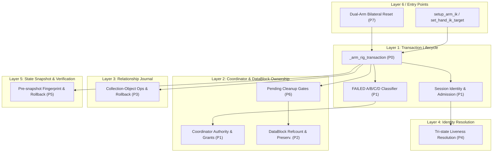

# TASK 10-B-13: P0–P7 Global Joint Architecture Audit Matrix

**Audit Round**: Round 4/5  
**Baseline Git Commit**: `ddaa9b8d796180076eaa3f5d79cde492df4ebb0a`  
**Repository Branch**: `audit/task-10-b-9`  
**Target Architecture**: `ARCHITECTURE_SYNC.md` Section 10 (Six-Layer Transaction & Resource Architecture)

---

## 1. Executive Summary & Audit Scope

This joint audit maps the entire production transaction system (`src/rig/arm_ik.py`) across eight functional categories (**P0 through P7**). It verifies architectural contract adherence, inspects multi-layer call chains, tracks data structures across boundaries, and maps test coverage across all existing test suites.



---

## 2. P0–P7 Joint Audit Matrix

| Category | Description | Primary Layer | Architectural Contracts | Core Functions | Callers / Callees | Existing Test Coverage | Audit Finding Reference |
|---|---|---|---|---|---|---|---|
| **P0** | **Transaction Atomicity & Rollback-Only Propagation** | Layer 1 | ARCH-TX-01 (9-State Lifecycle)<br>ARCH-TX-02 (Atomic Rollback)<br>ARCH-TX-03 (Rollback-Only Flag) | `_arm_rig_transaction`<br>`mark_rollback_only`<br>`_rollback_arm_rig_state` | **Callers**: `setup_arm_ik`, `reset_arm_ik`, `set_hand_ik_target`<br>**Callees**: Snapshot, Liveness, Rollback, Cleanup | `TEST-01`–`TEST-24`<br>`TEST-59`<br>`TEST-118`–`TEST-123` | F-04 (Dual-exception chaining coverage gap) |
| **P1** | **Session Identity, FAILED Classification & De-Isolation Lifecycle** | Layer 1<br>Layer 2<br>Layer 5 | ARCH-TX-04 (4-Way FAILED A/B/C/D)<br>ARCH-TX-05 (Session Identity Isolation)<br>ARCH-TX-06 (Coordinator De-isolation & Tombstone Retirement) | `ensure_armature_session_identity`<br>`_check_original_object_liveness`<br>`_verify_armature_session_identity_record`<br>`_record_armature_failure_isolation_by_coordinator`<br>`_issue_coordinator_authorization_grant`<br>`verify_armature_deisolation_evidence`<br>`request_armature_deisolation`<br>`_verify_dead_armature_tombstone_retirement_evidence`<br>`retire_dead_armature_tombstone` | **Callers**: Entry points, `_arm_rig_transaction`<br>**Callees**: Layer 4 lookup, Coordinator records, Evidence verifiers | `TEST-124`–`TEST-173` | **F-01** (TEST-151 short-circuit defect)<br>**F-02** (UNKNOWN escalated to FAILED-D defect)<br>**F-03** (Coordinator grant fallback ambiguity) |
| **P2** | **DataBlock Lifecycle & Cross-Armature Sharing Protection** | Layer 2<br>Layer 6 | ARCH-RES-01 (DataBlock User Count >= 1)<br>ARCH-RES-02 (Shared Datablock Deletion Prevention) | `retry_cleanup`<br>`_register_pending_arm_rig_cleanup`<br>`retry_pending_arm_rig_cleanup` | **Callers**: `_arm_rig_transaction` error handler, external retry<br>**Callees**: `bpy.data.*.remove` with `do_unlink=True` | `TEST-77`–`TEST-83`<br>`TEST-113`–`TEST-117` | F-05 (Non-mesh shared datablock assertion gap) |
| **P3** | **Collection-Object Relationship Authorization & Restoration** | Layer 3 | ARCH-REL-01 (7-State Relationship Journal)<br>ARCH-REL-02 (Atomic Relationship Rollback) | `_authorized_link_object_to_collection`<br>`_authorized_unlink_object_from_collection`<br>`_authorized_revert_relationship_record`<br>`_authorized_restore_collection_object_relationships` | **Callers**: `setup_arm_ik`, `_rollback_arm_rig_state`<br>**Callees**: `_find_live_collection_by_identity`, `_find_live_object_by_identity` | `TEST-25`–`TEST-58`<br>`TEST-84`–`TEST-94` | Compliant |
| **P4** | **Identity Resolution & Tri-State Liveness Resolution** | Layer 4 | ARCH-LOOKUP-01 (Tri-state Liveness: LIVE / ABSENT / UNKNOWN)<br>ARCH-LOOKUP-02 (Safe RNA Reference Handling) | `_find_live_collection_by_identity`<br>`_find_live_object_by_identity`<br>`_is_object_linked_to_collection_by_identity`<br>`_check_original_object_liveness` | **Callers**: Layer 1, Layer 2, Layer 3<br>**Callees**: `bpy.data.objects`, `bpy.data.collections` | `TEST-95`–`TEST-108`<br>`TEST-138`–`TEST-143` | Interacts with F-02 (UNKNOWN contract handling) |
| **P5** | **Arm Rig State Snapshotting, Pre-write Verification & Rollback** | Layer 5 | ARCH-SNAP-01 (Immutable Frozen Fingerprints)<br>ARCH-SNAP-02 (Zero-mutation Pre-write Proof)<br>ARCH-SNAP-03 (Exact Post-rollback Restoration) | `_freeze_fingerprint_property_value`<br>`_has_nan_or_inf`<br>`_capture_pre_snapshot_structural_fingerprint`<br>`_verify_pre_write_zero_mutation_and_integrity`<br>`_rollback_arm_rig_state`<br>`_verify_arm_rig_state_restored` | **Callers**: `_arm_rig_transaction`<br>**Callees**: Bone RNA attributes, Mathutils structures | `TEST-60`–`TEST-76`<br>`TEST-165`–`TEST-173` | Compliant (Hardened in Round 3) |
| **P6** | **Pending Cleanup Gates & Bounded Idempotent Retry** | Layer 2<br>Layer 6 | ARCH-GATE-01 (Write Transaction Admission Barrier)<br>ARCH-GATE-02 (Bounded Idempotent Cleanup) | `_assert_arm_rig_cleanup_gate`<br>`retry_pending_arm_rig_cleanup`<br>`retry_cleanup` | **Callers**: Entry point pre-flight<br>**Callees**: Registry state, datablock cleaner | `TEST-113`–`TEST-117` | Compliant |
| **P7** | **Dual-Arm Bilateral Transaction Coordination & Reset Invariants** | Layer 1<br>Layer 5 | ARCH-DUAL-01 (Bilateral Transaction Atomicity)<br>ARCH-DUAL-02 (World Transform Parent Invariant) | `reset_arm_ik`<br>`_preflight_arm_ik_parent_transforms`<br>`setup_arm_ik`<br>`set_hand_ik_target` | **Callers**: Public Animation Engine APIs<br>**Callees**: Left/Right `_arm_rig_transaction` | `TEST-109`–`TEST-112`<br>`test_arm_ik_lifecycle_world_transform_contract.py` | F-06 (Dual-arm independent reset under cleanup gate) |

---

## 3. Detailed Architectural Cross-Layer Call Chain Analysis

### 3.1 P0 Call Chain: Transaction Execution & Propagation
```text
Public API (setup_arm_ik / reset_arm_ik / set_hand_ik_target)
  │
  ├──> _preflight_arm_ik_parent_transforms [Parent Transform Invariant]
  │
  └──> _arm_rig_transaction(armature, ...)
         │
         ├──> Phase 1: Entry & Admission Check
         │      ├── ensure_armature_session_identity
         │      ├── _assert_arm_rig_cleanup_gate
         │      └── check if session is in _ISOLATED_FAILED_ARMATURES or _DEAD_ARMATURE_TOMBSTONES
         │
         ├──> Phase 2: Active Stack & Nested Context Sharing
         │      ├── if context already exists for armature:
         │      │     return existing active context (yield)
         │      └── else:
         │            create new root context, push to _ACTIVE_ARMATURE_TRANSACTIONS
         │
         ├──> Phase 3: SNAPSHOTTING & Pre-write Fingerprint
         │      ├── _capture_pre_snapshot_structural_fingerprint
         │      └── _snapshot_arm_rig_state
         │
         ├──> Phase 4: ACTIVE Body Execution (Caller performs rig setup / mutations)
         │      └── on inner exception:
         │            mark_rollback_only(context) -> context.rollback_only = True
         │
         ├──> Phase 5: COMMITTING / Verification
         │      ├── if context.rollback_only is True:
         │      │     raise ArmRigTransactionAbortedError("Transaction marked rollback-only")
         │      └── commit state -> COMMITTED
         │
         └──> Phase 6: ROLLING_BACK / Exception Handling
                ├── L1 Liveness check
                ├── _verify_pre_write_zero_mutation_and_integrity
                │     └── If zero mutation verified -> FAILED_A
                ├── _rollback_arm_rig_state & _authorized_restore_collection_object_relationships
                ├── _verify_arm_rig_state_restored
                │     ├── If restored successfully -> ROLLED_BACK (FAILED_B)
                │     └── If restoration failed -> FAILED_C (ISOLATED_FAILED_C)
                └── If armature dead/absent -> FAILED_D (TOMBSTONE)
```

### 3.2 P1 Call Chain: De-isolation & Tombstone Retirement
```text
External Recovery Workflow
  │
  ├──> Step 1: verify_armature_deisolation_evidence(session_id, evidence)
  │      ├── Case 1: Active Isolated Armature (FAILED-A, FAILED-B, FAILED-C)
  │      │     ├── Check 1: session_id in _ISOLATED_FAILED_ARMATURES
  │      │     ├── Check 2: original_object_name matches
  │      │     ├── Check 3: object liveness == "LIVE"
  │      │     ├── Check 4: RNA pointer intact
  │      │     ├── Check 5: Snapshot reference present & trusted
  │      │     ├── Check 6: recovery_state != "RECOVERY_UNCERTAIN"  <-- [F-01 GAP: short-circuit]
  │      │     ├── Check 7: current fingerprint strictly matches pre-failure snapshot
  │      │     └── Returns: VerificationEvidence(verdict="VERIFIED", ...)
  │      │
  │      └── Case 2: Insufficient / Forged Evidence -> Returns "REJECTED"
  │
  ├──> Step 2: _issue_coordinator_authorization_grant(verification_evidence)
  │      ├── Validates verification_evidence is genuine instance with verdict="VERIFIED"
  │      ├── Generates cryptographically secure grant_id
  │      └── Stores in _COORDINATOR_AUTHORIZATION_GRANTS
  │
  └──> Step 3: request_armature_deisolation(session_id, verification_evidence, authorization_grant)
         ├── Validates grant exists and is not consumed
         ├── Verifies grant session_id matches target session_id
         ├── Marks grant as consumed: grant["consumed"] = True
         └── Removes session_id from _ISOLATED_FAILED_ARMATURES
```

---

## 4. Cross-Layer Invariant Verifications

1. **Pure Python Dynamics Decoupling**: Core mathematical physics kernels (`forward_dynamics`, `contact_force_solver`, `body_kinematics`) remain completely decoupled from Blender `bpy`.
2. **Single Scene SSOT**: All kinematic operations execute on `output/dynamics_playground.blend` without spawning auxiliary test files.
3. **Fail-Safe Rollback Invariant**: Any failure during IK setup, bone parenting, or constraint addition guarantees restoration of initial state or complete isolation in `_ISOLATED_FAILED_ARMATURES`.
