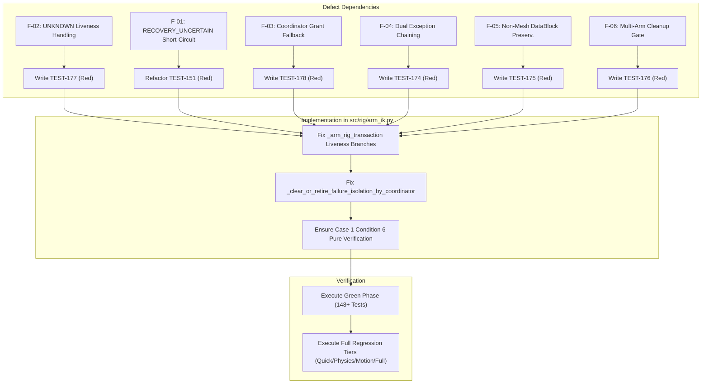

# TASK 10-B-13: Round 5/5 Unified Repair Manifest

**Manifest Status**: FROZEN  
**Target Execution Round**: Round 5/5 (Final Repair Round)  
**Baseline Git Commit**: `ddaa9b8d796180076eaa3f5d79cde492df4ebb0a`  
**Governing Documents**: `ARCHITECTURE_SYNC.md` Section 10, `docs/ARCHITECTURE_CHANGE_GATE.md`

---

## 1. Scope and File Boundaries

The following files and only the following files are authorized for modification in Round 5/5:

1. `src/rig/arm_ik.py` (Production Transaction Kernel)
2. `tests/test_task10b_transaction_atomicity.py` (Atomicity & Lifecycle Test Suite)

All other files (including `ARCHITECTURE.md`, `ARCHITECTURE_SYNC.md`, `DECISIONS.md`, `PROJECT_STATE.md`, `AI_SYNC.md`, `HANDOFF.md`, and all legacy tests) remain **STRICTLY PROTECTED**.

---

## 2. Defect Dependency Graph & Execution Order

---

## 3. Detailed Specifications for Target Functions

### 3.1 `src/rig/arm_ik.py`: `_arm_rig_transaction` (Addressing F-02)
- **Target Lines**: ~4350–4364, ~4420–4440, ~4454–4465, ~4487–4497.
- **Specification**:
  Inspect `id_check = _check_original_object_liveness(armature, session_id)`.
  - When `not id_check["is_valid"]`:
    - If `id_check.get("status") == "ABSENT"`:
      Classify failure strictly as `_FailedTransactionClass.FAILED_D` (record tombstone in `_DEAD_ARMATURE_TOMBSTONES`).
    - If `id_check.get("status") == "UNKNOWN"`:
      Do **NOT** escalate to `FAILED_D`. Do **NOT** install a tombstone.
      Classify failure as `_FailedTransactionClass.FAILED_C` (register in `_ISOLATED_FAILED_ARMATURES`) or raise `ArmRigTransactionError("ARMATURE_LIVENESS_UNKNOWN")`.

### 3.2 `src/rig/arm_ik.py`: `_clear_or_retire_failure_isolation_by_coordinator` (Addressing F-03)
- **Target Lines**: ~955–980.
- **Specification**:
  - Remove fallback `grant_candidate = authorization_grant if authorization_grant is not None else verification_evidence`.
  - Enforce that `authorization_grant` must be passed as an explicit dictionary. If `authorization_grant is None`, raise `ValueError("authorization_grant is required for isolation clearance")`.
  - Validate that `authorization_grant["grant_id"]` exists in `_COORDINATOR_AUTHORIZATION_GRANTS`.
  - Check grant timestamp against TTL (e.g., 300.0 seconds). If expired, mark rejected.

### 3.3 `src/rig/arm_ik.py`: `verify_armature_deisolation_evidence` (Addressing F-01)
- **Target Lines**: ~3955–3965.
- **Specification**:
  - Confirm Case 1 Condition 6 evaluates `record.get("recovery_state") == "RECOVERY_UNCERTAIN"`.
  - Return `VerificationEvidence(verdict="REJECTED", reason="RECOVERY_UNCERTAIN_REJECTED", ...)`.
  - Ensure this branch is reached when `snapshot_trusted` is `True` and snapshot is valid.

---

## 4. Test Suite Augmentation Plan (`tests/test_task10b_transaction_atomicity.py`)

| Test ID | Method Name | Target Finding | Purpose / Assertions |
|---|---|---|---|
| **TEST-151** | `test_151_failed_c_recovery_uncertain_forged_verified_rejected` | F-01 | Provide valid trusted snapshot; assert verdict is `REJECTED` and reason is strictly `RECOVERY_UNCERTAIN_REJECTED`. |
| **TEST-174** | `test_174_nested_transaction_dual_exception_chaining_preserved` | F-04 | Inner marks `rollback_only` and raises `ValueError`; outer rollback raises `RuntimeError`. Assert both are present in chained `__cause__`/`__context__`. |
| **TEST-175** | `test_175_cleanup_preserves_shared_curves_and_armatures` | F-05 | Create curve and armature datablocks with multiple users; run `retry_cleanup`. Assert datablocks are not deleted while `user_count > 0`. |
| **TEST-176** | `test_176_multi_armature_selective_cleanup_gate` | F-06 | Register cleanup gate on Armature A; assert Armature B can reset cleanly without interference. |
| **TEST-177** | `test_177_unknown_liveness_does_not_create_failed_d_tombstone` | F-02 | Mock liveness returning `status="UNKNOWN"`; run transaction. Assert failure is recorded in `_ISOLATED_FAILED_ARMATURES`, and `_DEAD_ARMATURE_TOMBSTONES` remains empty. |
| **TEST-178** | `test_178_coordinator_grant_fallback_rejected` | F-03 | Attempt to clear isolation with `authorization_grant=None` and verification evidence only. Assert immediate rejection. |

---

## 5. Step-by-Step Execution Protocol for Round 5

1. **Step 1: Baseline Check**: Verify branch `audit/task-10-b-9`, HEAD equals expected SHA, no unknown changes.
2. **Step 2: Red Phase**: Add/refactor tests `TEST-151`, `TEST-174`–`TEST-178` in `tests/test_task10b_transaction_atomicity.py`. Run tests and observe expected red test failures.
3. **Step 3: Green Phase Implementation**: Implement changes in `src/rig/arm_ik.py` for F-01, F-02, F-03. Run atomicity suite and verify 148+ tests pass.
4. **Step 4: Cross-Layer Regression Verification**:
   - `python tests/run_test_suite.py --tier quick` (19/19)
   - `python tests/run_test_suite.py --tier physics` (27/27)
   - `python tests/run_test_suite.py --tier motion` (12/12)
   - `python tests/run_test_suite.py --tier full` (42/42)
5. **Step 5: Evidence Capture**: Save test reports and `verification.json` in `docs/evidence/task10b13/round05/`.
6. **Step 6: Git Commit & Remote Synchronization**: Commit with standard message `fix(task-10-b-13): round 5 unified implementation and defect closure`, push to remote, and verify SHA.
