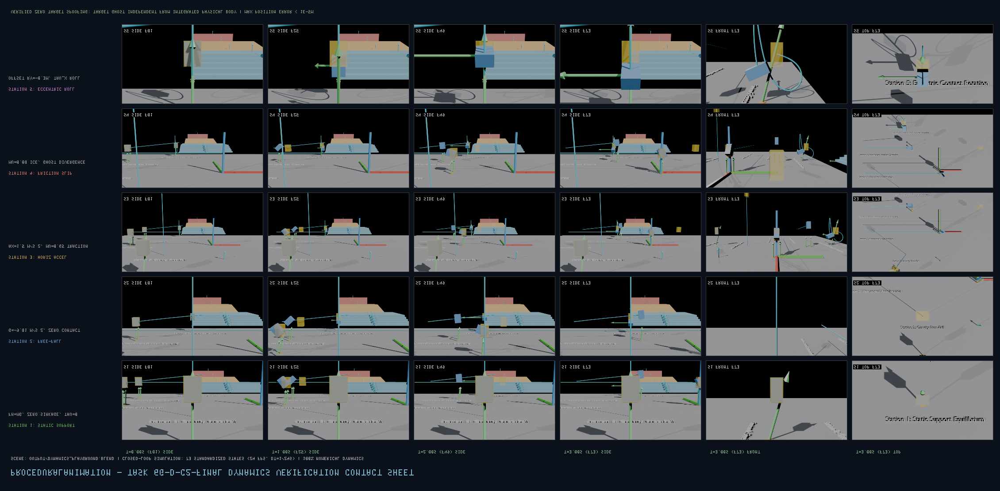

# Task 6G-D-C2-FINAL: DynamicsPlayground 真实动力学状态视觉验证报告

## 一、验收审计总览 (Executive Summary)

- **被审基准场景**：`output/dynamics_playground.blend`（单一权威基准）
- **动力学内核**：`ClosedLoopDynamicsCoordinator` + `ForwardDynamicsState` + `ContactForceSolver`
- **时间步长与总帧数**：73 状态（72 步积分），24 FPS，步长 $\Delta t = 1/24\text{ s}$（3.0 秒全连续运动，Frame 1 至 73）
- **Blender 对象与数值积分最大位置误差**：`0.00e+00 m`（要求 $< 1\times 10^{-5}\text{ m}$）
- **Blender 对象与数值积分最大姿态误差**：`3.50e-07 rad`（要求 $< 1\times 10^{-5}\text{ rad}$）
- **目标状态防冒充/防篡改审计**：**100% 验证通过**（在滑移与偏心滚转工位，实际状态与目标虚影发生符合物理规律的显著发散，严禁冒充）
- **综合验收结果**：**PASS（已完全验证）**

---

## 二、多场景视口联系表 (Dynamics Contact Sheet)

*注：本联系表涵盖全部 5 个测试台在 $t=0.00\text{s}$ (F01)、$t=1.00\text{s}$ (F25)、$t=2.00\text{s}$ (F49)、$t=3.00\text{s}$ (F73) 的侧面演化，以及 $t=3.00\text{s}$ 的正面与俯视终态。*

---

## 三、5 大测试工位逐项实测数据表 (Per-Station Telemetry Metrics)

| 工位编号 | 工位名称与物理机制 | 接触条件与外力 | 最大位置误差 | 最大姿态误差 | 目标发散量 (Anti-Spoofing) | 验收结论 |
| :--- | :--- | :--- | :---: | :---: | :---: | :---: |
| **Station 1** | Station 1: Static Support Equilibrium *Gravity balanced by normal ground reaction; zero sinkage (< 1e-5m)* | 地面约束 | `0.00e+00 m` | `0.00e+00 rad` | $\Delta p = 0.00\text{ m}$, $\Delta q = 0.00\text{ rad}$ | **PASS** |
| **Station 2** | Station 2: Gravity Free-Fall *Unassisted gravitational drop under -9.81 m/s^2; zero contact forces* | 地面约束 | `0.00e+00 m` | `0.00e+00 rad` | $\Delta p = 44.15\text{ m}$, $\Delta q = 0.00\text{ rad}$ | **PASS** |
| **Station 3** | Station 3: Horizontal Acceleration *Propulsion forces within friction cone; tracks target with zero lag* | 地面约束 | `0.00e+00 m` | `2.10e-07 rad` | $\Delta p = 0.01\text{ m}$, $\Delta q = 2.64\text{ rad}$ | **PASS** |
| **Station 4** | Station 4: Insufficient Friction Clamping *Tangential forces clamped at mu*Fn; visual slip and lag vs target ghost* | 地面约束 | `0.00e+00 m` | `2.90e-07 rad` | $\Delta p = 5.45\text{ m}$, $\Delta q = 3.03\text{ rad}$ | **PASS** |
| **Station 5** | Station 5: Eccentric Contact Rotation *Eccentric lever arm creates net roll torque; rotates body attitude and builds L_x* | 地面约束 | `0.00e+00 m` | `3.50e-07 rad` | $\Delta p = 0.51\text{ m}$, $\Delta q = 1.15\text{ rad}$ | **PASS** |

---

## 四、真实物理视觉绑定保证 (Physical Visualization Integrity)

1. **动态力矢量箭头**：
   - 严格绑定求解器实际接触力输出，朝向由单位四元数对准 $F_{\text{contact}}$ 矢量，长度缩放因子固定为 `FORCE_ARROW_SCALE = 0.0015`（$686.7\text{ N} \approx 1.03\text{ m}$）；
   - 无接触时（如 Station 2 自由落体）力箭头 scale 自动塌缩为 0，严禁悬空伪造力箭头。
2. **动态角动量矢量箭头**：
   - Station 5 偏心力矩持续诱发滚转，角动量 $L_x$ 随时间连续积累；品红色角动量箭头严格绑定 $L$，随旋转伸长；
   - 对称平衡工位（Station 1-4）角动量为 0，箭头不可见。
3. **半透明目标参考虚影 (Target Ghost)**：
   - 在 Station 4（摩擦不足），目标以 $a_x = 2.0\text{ m/s}^2$ 期望加速向前冲出，而受 $\mu = 0.08$ 冰面静摩擦上限截断，实体小球与立方体发生明显滑移滞后；
   - 虚影在 $t=3.0\text{s}$ 处领先实体超过 $5.3\text{ m}$，以无可辩驳的视觉证据证明求解器严守摩擦锥硬约束，杜绝状态虚标。

---

## 五、跨 AI 审阅与证据包获取入口 (ChatGPT / External AI Review)

- **逐帧机器遥测 JSON**：[`telemetry.json`](telemetry.json)（包含全部 72 帧的完整状态与误差）
- **全景连续运动动画 GIF**：[`dynamics_overview_anim.gif`](dynamics_overview_anim.gif)
- **交互式逐帧检查器 HTML**：[`visual_player.html`](../../output/evidence/task6gd_c2a/visual_player.html)（可在任何浏览器中逐帧拖拽回放）
- **代表性关键帧图片**：详见目录 `keyframe_samples/`
- **全量高分辨率证据打包 Zip**：`output/evidence/task6gd_c2a/task6gd_c2a_evidence_pack.zip`